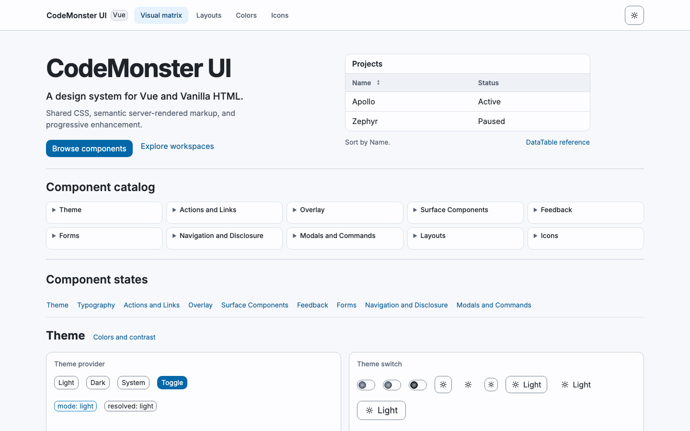

# CodeMonster UI

[](https://github.com/codemonster-ru/ui/actions/workflows/ci.yml)

CodeMonster UI is a design system for teams building forms, navigation, and application layouts
with Vue 3 or server-rendered HTML. Both integrations share design tokens, styles, semantic
markup, and interaction rules. Vanilla pages can use CSS on its own and load the browser
controllers when they need interactive behavior.

## Get started

Install the stable 1.1 Vue release from npm.

```bash
npm install vue@^3.5.0 @codemonster-ru/ui-tokens@^1.0.1 \
  @codemonster-ru/ui-css@^1.1.0 @codemonster-ru/ui-vue@^1.1.0
```

Follow the [1.1 release notes](./docs/codemonster-ui-1.1-release-notes.md) for the stable
package cohort. This checkout builds the unpublished `2.0.0` candidate. To try its Vue or
Vanilla examples in an application, follow the
[local installation and quick starts](./docs/getting-started.md).

## Preview locally



The Vue and Vanilla showcases open on the **Visual matrix**. Use **Layouts** for complete
forms, navigation, tables and dialogs in sample interfaces.

From the repository root, run `npm ci` with the Node.js version in [`.nvmrc`](./.nvmrc).

| Task | Vue showcase | Vanilla showcase |
| --- | --- | --- |
| Develop with browser updates | `npm run dev` · [5177](http://127.0.0.1:5177) | `npm run dev:vanilla` · [5178](http://127.0.0.1:5178) |
| Build the local showcase | `npm run build:showcase` | `npm run build:vanilla` |
| Open the existing build | `npm run preview` · [4173](http://127.0.0.1:4173) | `npm run preview:vanilla` · [4174](http://127.0.0.1:4174) |

Build once before previewing an adapter. The [showcase guide](./examples/ui-showcase/README.md)
describes component routes, layout examples and static hosting.

## Packages

The [2.0 checkout](./docs/codemonster-ui-2.0-release-notes.md) builds seven npm packages.

| Package | Use |
| --- | --- |
| [`@codemonster-ru/ui-tokens`](./packages/tokens/README.md) | Themes, design tokens, and breakpoints |
| [`@codemonster-ru/ui-css`](./packages/css/README.md) | Shared styles, fonts, and component CSS |
| [`@codemonster-ru/ui-runtime`](./packages/runtime/README.md) | Vanilla controllers and shared behavior |
| [`@codemonster-ru/ui-icons`](./packages/icons/README.md) | Framework-independent icon geometry |
| [`@codemonster-ru/ui-vue`](./packages/vue/README.md) | Vue components |
| [`@codemonster-ru/ui-layouts`](./packages/layouts/README.md) | Vue page layouts, shells, and regions |
| [`@codemonster-ru/ui-utilities`](./packages/utilities/README.md) | Optional design-token-based utility CSS |

## Documentation and architecture

- [Documentation index](./docs/index.md) and [component reference](./docs/components/index.md).
- [Vanilla integration](./docs/vanilla.md) and [server rendering and hydration](./docs/integration.md#server-rendering-and-hydration).
- [Architecture](./ARCHITECTURE.md) and [component contracts](./contracts/README.md).
- [VueForge migration](./docs/migrate-from-vueforge.md) from the
  [VueForge repository](https://github.com/codemonster-ru/vueforge).

## Development checks

Run `npm run check` for documentation and package checks, and `npm test` for package and UI
contract tests. The [contribution guide](./CONTRIBUTING.md) explains how to choose focused
checks and include browser evidence. Use the [release checklist](./docs/release-checklist.md)
for release verification.

## Support and contributing

Use [GitHub Issues](https://github.com/codemonster-ru/ui/issues) for usage questions and
reproducible bugs. Follow the [contribution guide](./CONTRIBUTING.md) for changes or the
[security policy](./SECURITY.md) to report a vulnerability privately.

CodeMonster UI packages are available under the [MIT License](./LICENSE).
