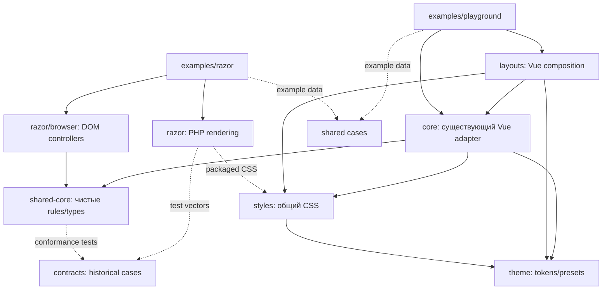

# VueForge: план второй мультиплатформенной миграции

Статус: **план одобрен; выполнены M00–M14 (включая corrective M07.1 и M10.1)**. Дата анализа: 2026-09-08. Результаты M00/M01 — в приложении В, M02 — в приложении Г, M03/M04 — в приложении Д, M05 — в приложении Е, M06 — в приложении Ж, M07 — в приложении З, M07.1 — в приложении И, M08 — в приложении К, M09 — в приложении Л, M10 — в приложении М, M10.1 — в приложении Н, M11 — в приложении О, M12 — в приложении П, M13 — в приложении Р, M14 — в приложении С; остальные milestones не начаты.

Единственная спецификация существующего продукта — коммит `fd793696f50d3be0fcd3788f0f8f751c63869963` (далее **reference**). Первая миграция исследована как исторический материал, преимущественно до локального `main` на `921ea7a7969b4510bfc356350eafb72a7a99466d`. Отдельно рассмотрена диагностическая ветка `feat/vueforge-reference-oracle` на `b55b69d96510e3ef68738ef2200ef1c6abd1eac8`; её изменения не следует считать содержимым `main`.

## 1. Executive summary

Нужно сохранить VueForge и последовательно выделить из него общие части. Начинать новую линейку компонентов с заново написанных контрактов нельзя: это повторяет основной механизм расхождения первой попытки. Правило работы — **NO REWRITE UNLESS EXTRACTION IS IMPOSSIBLE**. Исторические Vue API, CSS, DOM hooks, поведение, темы и showcase остаются обязательным условием каждого шага.

Предлагается сохранить существующие npm-пакеты, имена `Vf*`, классы `.vf-*`, переменные `--vf-*` и пути импорта. `packages/core` уже означает Vue-библиотеку `@codemonster-ru/vueforge-core`; превращать этот каталог в нейтральный core при сохранении прежнего package name было бы неоднозначно. Для извлекаемых чистых функций достаточно нового `packages/shared-core`, для существующего общего CSS — `packages/styles`. Существующий `packages/theme` уже не зависит от Vue и остаётся владельцем theme serialization и общих token definitions. Vue-компоненты остаются в своих текущих пакетах.

Razor — PHP-шаблонизатор Annabel. Он получает собственные PHP-компоненты, шаблоны и небольшие browser controllers. Vue использует свои templates/lifecycle и чистые функции shared core; Razor browser controllers используют те же функции. PHP не исполняет TypeScript: для необходимых SSR-вычислений допустимы небольшие PHP-эквиваленты с общими входными/выходными тестовыми данными.

Исторический `examples/playground` сохраняется целиком. Рядом добавляется самостоятельный Razor showcase, использующий тот же каталог проверочных примеров и данные. Сопоставление строится по `caseId`, теме и viewport, через одинаковые URL-параметры и автоматические captures. Универсальный renderer и общий runtime для двух adapters не нужны.

Первый полноценный срез — `VfInput`. Он достаточно содержателен для проверки extraction: native attributes, conditional wrapper, adornments, clear/password actions, сохранение выделения текста, field integration, размеры и floating label. Полный `VfField` или `VfIconButton` не требуется мигрировать одновременно: их существующие Vue-реализации сохраняются; переносится CSS dependency closure и создаются небольшие внутренние Razor helpers для действий и SVG.

Успех среза требует одновременно трёх сравнений: **reference Vue → новый Vue**, **reference Vue → Razor**, **новый Vue → Razor**. Совпадение новых adapters между собой не доказывает сохранение VueForge.

## 2. Состояние Git, границы и доказательства анализа

При начале работы HEAD уже был detached на reference. Отслеживаемых изменений не было. Git показывал неотслеживаемые каталоги `examples/razor/` и `packages/razor/`; они сохранены. Поскольку target commit совпадал с HEAD, создание ветки не требовало замены файлов рабочего дерева. Создана и выбрана `refactor/multiplatform-v2` непосредственно от reference. Предыдущие ветки, коммиты и второй worktree `ui-vueforge` не изменены.

В этом этапе единственное добавление в проект — данный документ. Нет implementation commits, обновления зависимостей, изменений source/CSS/config, переноса компонентов или удаления файлов. Названия каталогов ниже, которых нет на reference, обозначают предложение, а не выполненную работу.

Исследованы дерево reference, manifests, export barrels, исходники компонентов и их тесты, CSS и theme generation, showcase, `git log`, `git show`, структурные и адресные `git diff`, история отдельных путей. Диапазон `reference..main` содержит 733 коммита; существенные этапы сгруппированы ниже. Это архитектурный анализ исходников и истории, а не повторный запуск всех исторических CI-проверок или построчный аудит каждого из 733 patches.

Ссылки вида `commit:path` — воспроизводимые адреса объектов Git: `git show <commit>:<path>`. Для доступных текущих файлов даны пути от корня. Коммиты зафиксированы локально; обновление remote refs не выполнялось. Утверждения о поведении кода отделены от результатов старых запусков. Новые скриншоты, сборки reference/current и browser interaction runs в этом этапе не выполнялись; визуальный PASS здесь не объявляется.

## 3. Historical architecture на reference

### 3.1. Реальная структура и зависимости

Root — private npm workspace `vueforge`, `packages/*` и `examples/*`, `packageManager: npm@11.9.0`, root Node policy `>=24.15.0`. Опубликованные пакеты имеют собственные версии и часть manifests ещё допускает Node `>=18`; это существующая разница требований, которую нельзя молча «исправить» при extraction. Источники: `package.json`, `ARCHITECTURE.md`, manifests соответствующих пакетов.

| Каталог | Публичный пакет и версия reference | Фактическая ответственность |
| --- | --- | --- |
| `packages/core` | `@codemonster-ru/vueforge-core` 2.4.0 | Vue controls, providers, composables, presets, foundation, component CSS; Vue peer, theme/icons/floater dependencies |
| `packages/layouts` | `@codemonster-ru/vueforge-layouts` 2.1.2 | 17 Vue primitives/shells/regions, responsive APIs, собственные presets и CSS; core/Vue peers, theme dependency |
| `packages/theme` | `@codemonster-ru/vueforge-theme` 2.0.1 | Types, motion/breakpoints/color contracts, preset resolution, CSS serialization и явные DOM apply functions; без Vue dependency |
| `packages/icons` | `@codemonster-ru/vueforge-icons` 3.2.0 | VueIconify, именованные glyph modules и registry/metadata, собственный CSS; glyph modules не являются отдельными публичными named exports |
| `packages/codeblock` | `@codemonster-ru/vueforge-codeblock` 4.0.1 | Vue code presentation, copy/highlight/runtime loading; Vue peer и icons dependency |
| `packages/playground-core` | `@codemonster-ru/vueforge-playground-core` 2.1.0 | Sessions/events, TypeScript worker и browser execution; без Vue peer, но со своей предметной областью |
| `packages/playground` | `@codemonster-ru/vueforge-playground` 3.0.1 | Vue playground UI; зависимости на playground-core/codeblock/core |
| `packages/playground-vite-plugin` | `@codemonster-ru/vueforge-playground-vite-plugin` 1.0.0 | Vite integration; не слой UI-компонентов |

Название `playground-core` не делает его кандидатом в общий UI core: execution sessions и workers относятся к playground. Аналогично `core/src/foundation` смешивает чистые breakpoint definitions и Vue composables; переносить эту папку целиком нельзя.

### 3.2. Публичный Vue-контракт шире component props

`packages/core/src/index.ts` экспортирует 47 компонентов: 46 из component barrel и дополнительно `VfThemeProvider`, а также plugin API (`VueForgeCore`, `createVueForgeCore`, default), composables, foundation/theme/async functions и типы. `packages/layouts/src/index.ts` экспортирует 17 компонентов, plugins, theme APIs, responsive functions и публичные slot/exposed types для AdminLayout. Полный компонентный каталог приведён в приложении.

Нужно сохранить root exports, существующие component subpaths, `.css` subpaths, `/foundation`, `/theme`, `/async`, ESM/CJS/SSR поведение, Vue peer range и CSS side effects. `core/package.json` различает browser auto-CSS entry и Node entry: простой перенос SFC в новый пакет не сохраняет этот контракт автоматически. `layouts/src/index.ts` сам импортирует `styles.css`; это тоже observable packaging behavior.

У CodeBlock публичный component entry — `/view`, у Playground — `/ui` с `VfPlayground` и `VfPlaygroundAsync`; package-root import у этих двух пакетов отсутствует. `/highlight` и `/runtime` имеют собственную ответственность. Наличие `src/index.ts` не доказывает опубликованный root export: проверять нужно `package.json#exports`.

В `core/src/types/components.ts` уже есть необходимые union/types: `VfControlSize`, `VfButtonVariant`, `VfSelectOption`, `VfTabItem`, таблицы, navigation, labels. Например, variants Button включают `success`, `info`, `warn`, `help`, `contrast`, а не только primary/secondary/danger/ghost. `VfTabItem` допускает внешние `tabId`/`panelId`. DataTable labels содержат функции; превращение их в JSON-only API было бы breaking change.

### 3.3. Где действительно находятся стили и tokens

CSS core уже внешний: `core/src/styles/entries/*.css`, `components/*.css`, import manifests, foundation. В просмотренных core/layout SFC нет `<style>` blocks. Layout CSS отдельно в `layouts/src/style-entries`, `style-parts`, `styles.css`. Первая задача — переместить владение существующим CSS и сохранить его результирующую сборку, а не извлекать новый дизайн из templates.

Theme engine уже отделён, но defaults распределены: `core/src/theme/default-preset-source.ts`, `color-token-schema.ts`, `layouts/src/theme/default-preset.ts`, другие package presets. В core defaults есть прямые build-time imports из `../../../theme/src/*`; это существующая утечка границы, которую позже следует заменить публичным package entry. Сам `packages/theme/src/runtime.ts` содержит и чистые serializers, и `applyThemeConfig(s)` с `Document`; framework-independent не означает DOM-free.

`core/vite.config.ts` и `core/build/*` генерируют CSS artifacts, разворачивают breakpoint aliases, собирают standalone component CSS, сохраняют auto-CSS JS entries. Уже есть проверки CSS contracts/parity/form geometry и packed-consumer smoke tests. Эту работающую инфраструктуру нужно расширять адресно.

## 4. Historical showcase architecture

Reference showcase — `examples/playground`, а не пустая demo-оболочка. В `src` 20 файлов, в том числе 9 SFC. `main.ts`, `App.vue`, `PlaygroundShowcase.vue`, route helpers и section components собирают работающий Vue/Vite продукт. Основные разделы: Core, Layouts, Icons, CodeBlock, Playground, Colors. Навигация, responsive shell, активный раздел, обработка URL, theme controls и loading behavior входят в baseline.

`App.vue` лениво загружает шесть routes: `/core`, `/colors`, `/layouts`, `/icons`, `/codeblock`, `/playground`. Навигация использует native History API/`popstate`; неизвестный path открывает Core. Shell — `VfThemeProvider → VfAppShell`, navigation — `VfMenuBar`, theme control — `VfThemeSwitch`. `main.ts` устанавливает `VueForgeLayouts` с `defaultTheme: 'system'` и `themeStorageKey: 'codemonster-showcase-theme'`. Icon contexts проверяют light/dark × normal/compact; Colors — primitive scales, semantic swatches, scoped theme panels и состояния controls. Эти композиции должны остаться в каталоге и baseline.

`CoreShowcase.vue` содержит 2870 строк и использует 50 различных `Vf*` tags, включая композиции с layouts. `LayoutsShowcase.vue` — 1286 строк и 13 именованных demo sections. Это не количество публичных core-компонентов: число tags и число exports измеряют разные вещи. Примеры показывают variants/sizes, adorned и floating fields, menu/navigation, controlled state, overlays, таблицы с sorting/pagination/selection/resizing/reordering, async loading, responsive shells и scoped slots.

Источники: `examples/playground/src/sections/core/CoreShowcase.vue`, `core-showcase.css`, `sections/layouts/LayoutsShowcase.vue`, `layouts-showcase.css`, `sections/icons/*`, `sections/codeblock/*`, `sections/colors/*`, `PlaygroundShowcase.vue`, `components/ViteLikeDemoPreview.vue`, `vite.config.ts`.

Данные и Vue state живут рядом с примерами: `ref`, `computed`, callbacks, arrays, labels и local actions. Импорт компонентов и токенов проходит через существующие package entries/dev aliases. VitePress demo integration и interactive playground имеют собственную стоимость сборки; их нельзя превращать в обязательную зависимость Razor.

Текущий DX добавления примера — правка соответствующей section SFC, локальных данных, при необходимости CSS и документации. Крупные section files можно позже делить по компонентам, но только отдельными behavior-preserving изменениями после появления historical route/screenshot gates. Сейчас деление не является prerequisite для migration и не оправдывает удаление примеров.

## 5. Первая миграция: существенные этапы истории

| Этап / проверенные коммиты | Что произошло | Значение для второй попытки |
| --- | --- | --- |
| `2d0083b9` → `7eaf35c2` | Новый продукт CodeMonster UI, `Cm`/`cm-`, package boundaries, independently authored canonical HTML и новые API conventions | Подход был рассчитан на новый публичный продукт. По текущему заданию исходный VueForge имеет приоритет над новой canonical спецификацией |
| `af0b3f38` → `395bc7ac` | Новые tokens/CSS/utilities и инфраструктура contracts | Разделение CSS и framework code полезно; повторное определение token graph вместо точного переноса создало отдельную точку истины |
| `76b84095`, `592a3b63`, `edb54820`, `e54bbe9b`, `20259ed1`, `dabde134` | Отдельные Vue `Cm*` реализации, cohorts форм/navigation/advanced inputs/tables | Это создание adapters нового контракта, а не последовательное уменьшение старых SFC. Совместимость нельзя вывести из сходства названий |
| `bb053445` → `38ef9db2`, последующие PHP cohorts | PHP Razor components/slots/escaping/registry, CSS distribution и tests | Значительная полезная инфраструктура; движок остаётся внешним generic templater, конкретные UI components принадлежат adapter |
| `4e830431`, merge `10daa310` | Showcase переключён на новую линейку; patch удалил 5687 строк и добавил 604 | Демонстрации сократились раньше доказательства полноты. `03afa3fb`, `8a4d633f` затем возвращали каталог и frozen matrix |
| `4a10bf24` → `b5f04ae8` | Coverage inventories, maturity backlog, mappings/codemod, consumer/release checks; `Tag` superseded, shell wrappers/сложные части заменялись recipes | Диспозиция replaced/composed/manual/dropped полезна для отчёта, но не является доказательством API/visual parity |
| `ac41d79a`, `aa9b62a4`, `f7387f20`, `523d2578`, `b7bf169f` | Historical screenshots, exact comparison, cross-platform и interaction matrices | Верный вид проверок появился после масштабной замены. Во второй попытке он должен предшествовать extraction |
| `db0e0423` | Исправлен refresh workflow, копировавший current-adapter captures поверх reviewed reference baseline; уточнены неоднозначные Accordion selectors | Provenance должен проверять реальный источник captures; current output не обновляет historical baseline |
| `a20fbe7c`, `ff3c987b`, многочисленные input/group-box/table/showcase repairs | Исправлен порядок visual work; возвращены token aliases, geometry, icons, layout composition | Локальные поправки showcase маскировали необходимость вернуть общие CSS/tokens и реальные component semantics |
| `9144a9be`, `9ac0d5c0`, `6af7189b` | Demo переименовано в Vue, добавлено Dockerized Razor example, CI ускорено внутри существующих checks | Docker и isolated consumer checks можно использовать. Переименование исторического showcase не нужно для самого extraction |
| `0a6c19b6`, `81019258`, `3f6537e9`, `ca72a277` | Native Select/DatePicker первой попытки вновь заменены authored controls | Native control не обеспечил historical UX. Во второй попытке исходные custom Vue controls уже есть — их не нужно сначала удалять |
| `fffcb50e`, `5b9b65a4`, `73006d84`, `81640a0e` | Объявлено завершение M12, добавлены bundled fonts, уточнены visual measurements и reduced-motion literal | Старый PASS относится к конкретным cases/environment. Он не заменяет проверку всех нынешних API и маршрутов |
| `d304ed1e`, `195a8eb8`, `df23f7c2`, `dae64be9`, `c145773e` | Вынесены чистые rules, исправлено конкурирующее управление DOM из Vue и runtime | Чистые функции пригодны для повторного анализа; runtime hydration ownership требуется спроектировать до подключения Razor controllers |
| `574344aa`, `5aa6df14`, `895bee59` | Согласованы DOM comparators, раскрыты CI-only checks, добавлены guards на frozen showcase/controller coverage | Проверки должны доказывать реальное выполнение gate, а не наличие скрипта в package.json |
| `593a60f3` → `65137616`, `c20e5136`, `1771462a` | Layouts возвращены отдельной линейкой, theme стал подсистемой, icons перенесены как данные | Разделение данных icons полезно. Новые theme/scoped-slot решения являются API redesign и не должны переноситься как defaults |
| `19748e6c`, `eb0fdf83`, `921ea7a7` | Исторические пакеты/showcase/migration checks удалены из main; затем обогащены шесть demo и восстановлены части пяти layouts; последний commit прямо признаёт оставшиеся потери SetupLayout brand/toolbar/aside permutations | Reference нельзя объявить ненужным после достижения узкой matrix. В новой ветке он остаётся живым oracle |
| `fb2e4501`, `b55b69d9` в отдельной ветке | Возвращён reference renderer для новых cases, diagnostic report/ratchet workflow | Использовать идею сравнения с историческим кодом; устранить ограничения fonts, report-only и неполной matrix до принятия как gate |

## 6. Подтверждённые regressions и их причины

| Наблюдение по исходникам / истории | Почему возникло | Как предотвратить |
| --- | --- | --- |
| `Vf*`/`vueforge-*`/`.vf-*` заменены `Cm*`/`ui-*`/`.cm-*` | Rebranding и новый contract стали частью migration | Сохранить единственную существующую публичную систему имён; никаких rename codemods для этой задачи |
| `main:packages/vue/src/components/input/CmInput.vue` больше не имеет `leadingIcon`/`trailingIcon`; `type` ограничен шестью text-like values, тогда как reference передаёт native `type` через attrs | Компонент заново реализован по сокращённому contract | Compile/runtime cases для прежних props и native attrs до extraction; не нормализовать `number`, `date` и другие исторически допустимые attrs в `text` |
| Input меняет target consumer `class`/`style`: при adornments reference ставит их на wrapper; main — на input. Удалены field injection и `data-vf-filled`; clear меняет emission и структуру empty-state; password restore потерял direction и дополнительный animation frame | Универсальные root-attribute rules и новая реализация не описывали исключения reference | Сохранить per-component forwarding, event traces, conditional DOM и selection behavior; testing отдельно plain/adorned/empty/floating |
| `main:packages/vue/src/components/tabs/CmTabs.vue` требует id, вводит новый value format, `valueChange` вместо `change`, именованные по value slots вместо `tab`/`panel`, удаляет external panel IDs, меняет lifecycle panels | Независимый canonical HTML и удобство сериализуемых fixtures стали ограничениями Vue API | Извлечь rules из существующего VfTabs, оставить slots/id/lifecycle в Vue, описать отдельный PHP способ предоставить content |
| ThemeSwitch стал трёхпозиционным subsystem control с иным persistence; AppShell scoped slots заменены DOM attributes; пять region wrappers исключены | Ограничения нового Razor API перенесены на Vue; продуктовая переработка смешана с миграцией | PHP composition может отличаться, Vue API остаётся прежним; subsystem redesign — отдельное предложение |
| `4e830431` сократил showcase; `19748e6c` удалил историческую app | Coverage/«migration complete» подменили проверку реальной полноты | Route/example inventories и historical reference остаются gate до и после rollout |
| `ff3c987b` возвращает `textLabel`/`textBody` token indirections; `81640a0e` возвращает `0.01ms` вместо `0ms` | При переносе сохранены похожие числовые значения, но изменены связи/семантика tokens | Сравнивать token graph, resolved values, overrides, theme selectors, media rules и timing |
| `c145773e` фиксирует одновременное изменение aria/hidden/tabindex Vue и runtime controller | Canonical DOM требовал controller hooks даже у Vue; runtime мог менять controlled state вопреки parent | С самого начала Razor-only mount roots; Vue вообще не получает auto-activation marker |
| `main:examples/razor/public/index.php` подключает CSS, но не browser JS; пример содержит закрытый Accordion с button triggers | Наличие controller source/SSR tests не обеспечило его реальную доставку в app | Проверять installed/browser example: открыть страницу, нажать trigger, увидеть изменение; scripts/assets должны входить в delivery contract |
| `1f2dee35` поздно добавляет CSS peer в Vue manifest; несколько commits синхронизируют Razor CSS | Dependency/distribution contract был слабее source contract | Packed consumer + CSS dependency checks; единственная generated asset source и проверка hash/version |

Источники различий ThemeSwitch/AppShell также прямо перечислены в `main:docs/codemonster-ui-2.0-release-notes.md`. Этот документ одновременно продолжает ссылаться на уже удалённый `examples/vue`; это пример устаревшего описания, поэтому статус roadmap/release notes нельзя считать более сильным доказательством, чем дерево соответствующего коммита.

Не подтверждено, что первая попытка имела единый универсальный production renderer или Vue imports внутри её чистого behavior core. В поздней реализации rendering действительно раздельный, а `runtime/src/core` — полезное направление. Проблема прежде всего в происхождении контракта, изменённых Vue APIs, ownership и неполных acceptance gates. Все заявленные визуальные эффекты, не доказанные новым capture, остаются рисками для проверки, а не измеренными сейчас pixel regressions.

## 7. Что сохранить из первой попытки

Переиспользование означает перенос минимальной подходящей части после проверки против reference; не wholesale cherry-pick feature ветки.

| Часть | Решение и условие |
| --- | --- |
| Shared CSS/token ownership | Сохранить принцип; исходные значения, selectors и dependency graph брать из reference |
| `runtime/src/core` rules и unit tests | Перечитать как кандидатов: Tabs/Input/disclosure/calendar/table helpers полезны, если не навязывают новое default/validation поведение |
| PHP provider/templates/attribute escaping/slots | Использовать integration pattern и security tests; рендерить reference-derived markup/API mapping |
| Significant DOM comparator | Сохранить normalization boolean attrs, class ordering, ID relationships, comments; ослабления только адресные и обоснованные |
| Shared PHP/JS conformance cases | Использовать для небольшой двойной SSR/browser реализации правил; тесты должны содержать неудобные historical values, а не только happy path |
| Visual capture и frozen reference provenance | Перенести минимальный воспроизводимый harness с проверкой environment/fonts и двумя real adapters |
| Browser accessibility/interaction tests | Сохранить подход; заменить ожидания нового API историческими expectations и проверить реальные bootstrap paths |
| Packed npm/Composer consumers, SSR/auto-CSS/tree-shaking tests | Дополнить existing baseline tools; не переносить запрет `Vf*`/VueForge imports |
| Dockerized PHP workflow | Сохранить воспроизводимый PHP/Composer запуск в изолированной fixture |
| Icon data extraction (`1771462a`) | Сохранить идею одного набора SVG data без второго renderer; проверить glyph/viewBox/stroke/size и прежний Vue API |
| CI coverage/ownership guards | Проверять факт запуска, required matrix и отсутствие адаптерных циклов; не создавать job для гипотетических adapters |

## 8. Что отбросить или заменить

Отбросить новую canonical спецификацию как источник истины для существующего VueForge; она может быть справочным материалом, но не основанием изменить baseline. Не переносить `Cm` rename, новые mandatory IDs, value regex, сокращённые variants, slot/event renames, arbitrary normalization или новый theme persistence в прежний Vue API.

Не переносить native Select/DatePicker как упрощённую замену, blanket policy «все behavior rules ровно один раз на TypeScript» для PHP SSR, controller markers на Vue roots, schema-driven universal renderers, generic component state machines и contract DSL. Не нужны заранее зарезервированные React/Angular/Web Components packages, utilities package ради нового utility CSS или общая orchestration app для двух frameworks.

Не переносить migration codemods/removal gates, которые измеряют исчезновение VueForge imports: в новой задаче эти импорты должны сохраниться. Не принимать замену компонента recipe, `dropped` или решение «остаётся в старом продукте» как эквивалентность API. Прежний компонент может оставаться Vue-only во время rollout, но должен оставаться доступным и проверяемым.

Убрать из нового подхода локальные compensating offsets showcase и тестовые DOM fixtures, которые рисуют более удачную реализацию, чем реальный adapter. CSS artifacts для Composer могут быть copies при публикации; независимые редактируемые копии CSS не допускаются.

## 9. Proposed target architecture и package responsibilities

Сохранение существующих каталогов уменьшает diff и риск consumer regressions. Ни `apps/`, ни `packages/vue` не являются обязательными для правильного направления зависимостей.

```text
packages/
  theme/                 существующий theme engine + извлечённые neutral defaults
  shared-core/           новые pure rules и действительно общие TS contracts
  styles/                существующий CSS, transferred без redesign
  core/                  существующий Vue adapter, прежний vueforge-core API
  layouts/               существующие Vue layouts, прежний API
  icons/                 существующий Vue icons API
  codeblock/             существующий Vue codeblock API
  playground-core/       существующий execution/session package
  playground/            существующий Vue playground API
  playground-vite-plugin/
  razor/                 PHP rendering + собственный browser enhancement
contracts/               обычные case data и описания historical semantics
examples/
  playground/            исходный Vue showcase
  razor/                 отдельный PHP showcase
  shared/                данные/examples index, без renderer/framework imports
```

`shared-core` имеет узкий scope: types/value rules, используемые реальными Vue и Razor browser implementations. Он не содержит DOM, Vue, PHP, rendering, configuration registry, plugin lifecycle или автоматическую регистрацию всех компонентов. Статическому Card core module не нужен. Public surface состоит из используемых функций; внутренний helper без второго потребителя остаётся рядом с компонентом.

`theme` остаётся владельцем serializers, token definitions и preset resolution; чистые функции и browser apply effects разделены по modules/entries, сохраняя прежние exports. Перенос package-specific presets выполняется только при появлении shared CSS потребителя, без Vue type imports в neutral definitions. Storage/matchMedia/reactivity интеграции Vue остаются в Vue.

`styles` владеет foundation, existing component/region CSS и его import graph. Оно получает tokens от theme, не зависит от adapters и не знает о Vue lifecycle. `core` и `layouts` сохраняют свои CSS exports, собирая их из единственного shared source. Это продолжение существующего distribution API, не вторая implementation или compatibility renderer.

`razor` — один Composer package с PHP source/templates и собственным browser entry. Небольшая JS build configuration внутри него оправдана первым interactive component; отдельный generic runtime npm package до появления внешнего потребителя не нужен. Если browser entry позже необходимо публиковать независимо, выделение рассматривается отдельно по реальной delivery потребности.

`icons` пока остаётся Vue package. Для Razor нужны neutral SVG data без Vue dependency; их можно выделить в узкий data module/package при реализации icon support. Нельзя импортировать Vue icons renderer в shared core. `codeblock` и `playground` сохраняются работающими Vue-пакетами и в showcase; перенос их execution infrastructure не входит в первый UI срез.

Рабочие имена новых npm packages: `@codemonster-ru/vueforge-shared-core`, `@codemonster-ru/vueforge-styles`; Composer adapter — `codemonster-ru/vueforge-razor`. Это предложение имён, без проверки registry availability и без публикации. Существующие имена и версии не меняются в рамках установления boundaries.

## 10. Package dependency graph

В диаграмме стрелка означает **«зависит от»**. Пунктир — build/test/data artifact dependency, а не PHP import JavaScript.



Ни styles, ни theme, ни shared-core не импортируют Vue adapter или Razor. Razor не зависит от `core`/`layouts`/Vue runtime. Vue не зависит от Razor bootstrap. `layouts → core` допустим: оба относятся к существующему Vue adapter. В source/build scripts также проверяются escape imports вида `../core/src`; корректный runtime graph не оправдывает обратную build dependency.

Composer не устанавливает npm dependencies автоматически. CSS/JS/data artifacts готовятся при сборке release из pinned shared packages; host PHP page получает готовые assets без Node server. Для development build нужны локальные workspace packages; для published consumer — semver dependencies, проверенный архив и manifest. Порядок будущей сборки: theme/shared-core → styles → Vue и Razor browser/assets → layouts/остальные зависимые пакеты → examples/consumers.

Тестовые vectors принадлежат `contracts`, а не опубликованному behavior runtime. Если PHP понадобится generated constant data из shared-core/theme, это отдельный build artifact dependency с source hash; PHP не импортирует TS module. Shared cases showcase используют эти contract cases или ссылаются на них, не создавая вторую семантическую спецификацию.

## 11. Component contract model

Контракт сначала извлекается из reference source, exports, tests, showcase и observable behavior. Он не проектируется независимо, чтобы затем переделать под него Vue. Если baseline имеет accessibility defect или противоречие в docs, записать его отдельно; не исправлять молча вместе с extraction. Улучшение возможно отдельным reviewed change после доказательства совместимости.

| Часть контракта | Представление | Что проверяется |
| --- | --- | --- |
| Props, enums, sizes, defaults | Existing TS types и небольшой обычный object для shared facts | Optionality, absent/null/empty semantics, native attrs, invalid input behavior reference |
| Events | Vue signatures + описание semantic outcome и PHP/browser mapping | Payload, order, count, controlled/uncontrolled behavior; одинаковое имя во всех frameworks не требуется |
| Slots/content | Vue slot names/scopes сохраняются; PHP named/default content описывается отдельно | Placement, fallback, escaping, смысл content; callbacks/refs не сериализуются |
| States/interactions | Prose + обычные executable test functions | Transition, disabled/readonly/loading, focus, keyboard, selection, close reasons |
| CSS/DOM | Перечень contractual hooks, selectors и небольшие focused fixtures | Root/attrs target, relationships, classes, wrapper conditions, theme inheritance |
| Accessibility | Accessible name, roles, label/description IDs, keyboard/focus | Browser output и реальный user flow, а не только HTML strings |
| Shared rules | Pure functions + simple JSON input/output vectors | Одинаковые результаты JS/PHP там, где SSR обязан вычислять те же значения |
| Example data | Plain serializable objects/JSON | Stable caseId, fixture inputs, expected capability; без templates/functions внутри JSON |

Минимальный illustrative contract fragment, не новый DSL и не код реализации:

```ts
export type VfControlSize = 'sm' | 'md' | 'lg';

export const inputContract = {
  reference: 'fd793696f50d3be0fcd3788f0f8f751c63869963',
  sizes: ['sm', 'md', 'lg'],
  defaults: {
    modelValue: '', size: 'md', invalid: false,
    clearable: false, passwordReveal: false,
  },
  slots: ['leading', 'trailing'],
  vueEvents: ['update:modelValue'],
} as const;
```

Этот object не заменяет контракт attrs, icon props, field injection или selection behavior. Не нужно описывать TypeScript type system заново в JSON Schema. PHP потребляет JSON test vectors и явные render inputs; небольшая build-time выгрузка данных допустима лишь при реальном потребителе. Она не генерирует component templates или component classes.

Validation переносится только вместе с существующей семантикой: отсутствие исторической runtime validation не разрешает ввести новые throwing checks, required ids или regex на values. Browser native validation и server application validation остаются разными слоями. Labels/formatting callbacks Vue остаются функциями; PHP может получить строки или собственные callbacks, не вынуждая Vue перейти на меньший API.

## 12. CSS architecture

Сначала зафиксировать reference token graph и flattened CSS, включая order/specificity/media/selector dependencies. Затем перемещать существующие файлы с минимальными import edits; не переименовывать классы, custom properties, semantic tokens, theme attributes или presets. Tailwind не используется.

Сохранить одновременно полный stylesheet и standalone component CSS, foundations/reset, reduced-motion/forced-colors, auto-CSS subpaths и Node SSR entries. Общий CSS может быть одним из главных shared implementation layers именно потому, что baseline уже построен на global `.vf-*` selectors. Изменять DOM, пока selectors требуют прежних siblings/ancestors, нельзя.

Для Input dependency closure начинается с `input.css → field.css + icon-button.css` и их собственных imports/tokens. Floating selectors зависят от положения label относительно input/wrapper и `.vf-field--floating-in`/других modes; извлечение только `.vf-input` rules потеряет поведение. CSS supporting components можно вынести без миграции их Vue source/API.

Theme comparison проверяет не только итоговый цвет: primitive → semantic → component aliases, dimensions, typography, line-height, borders, shadows, motion, breakpoint expansion, root font scaling, scoped presets и custom overrides. `var(--vf-text-label-font-size)` не заменять числовым эквивалентом: иначе consumer override перестанет распространяться. Сохранить `data-vf-theme`, storage semantics и существующие provider APIs.

Adapter-specific CSS допустим для доказуемого framework lifecycle hook, например уже существующих Vue transition classes. Он остаётся малым и colocated; базовые размеры/отступы/палитра/иконки не должны различаться между adapters. Первому Input срезу не нужна вторая Razor skin. Стили рамки showcase принадлежат showcase; любые поправки, компенсирующие component mismatch, исправляются в общих styles/contract.

Для Composer выпускать generated CSS artifacts с version/hash/source provenance. Сравнивать их с output shared styles; запрещать ручные правки копий. Проверить CSS-only PHP consumer без Vue JS и Vue packed consumer с прежними import paths. Fonts фиксировать как часть capture environment; добавление нового bundled font в продукт — отдельное изменение, если reference фактически использовал другую face.

## 13. Vue adapter architecture

Существующий SFC остаётся implementation. Последовательность для компонента: historical characterization → unchanged CSS ownership transfer → извлечение реально общих pure calculations → types/contracts из существующего API → Razor implementation. Компонент становится меньше только там, где это получилось без изменения результата.

В Vue остаются `ref/computed/watch`, `inject/provide`, slot functions/scopes, `useAttrs`, `useSlots`, `useId`, component refs, `nextTick`, transitions/Teleport, focus scheduling, observers и cleanup. Shared core возвращает данные, Vue сам применяет их declaratively. В Vue не монтируется Razor browser controller.

При Input extraction сохранить строковый `modelValue`, local currentValue/watch, точную проверку boolean attrs, forwarding исключений, clear emission, ref focus, password selection direction и animation-frame restore, `vfFieldContextKey` и cleanup. Pure calculations получают plain values: clear eligibility, derived adornment state и password action metadata. Вынос Vue context или универсального «field state service» не нужен.

Сохранить plugin registration, public types/composables, all export conditions и CSS side effects. Типы можно re-export из shared module под прежними именами; нельзя превращать root package в dual `Vf`/`Cm` API или менять import paths. Consumer fixture использует неизменённый код reference, а не автоматически переписанный codemod результат.

## 14. Razor adapter architecture

Доступен настоящий PHP source: `/Users/kolesnikov_k_a/Projects/Codemonster/PHP/annabel/packages/razor`; рассмотрен checkout Annabel `f037701378fc92ec311f29f30f7130711f3471a7`. В первой UI миграции adapter использует `codemonster-ru/razor ^2.1`, `codemonster-ru/view ^2.0`, PHP `>=8.2`. Это локально проверенная integration capability, не предположение об ASP.NET.

Generic Razor engine владеет parsing/compilation, registry/provider/resolver, prop и slot mechanics, render context, escaping/trusted markup и diagnostics. UI adapter владеет конкретными `vf-*` tags, defaults/attribute mappings, template markup, component content и browser assets. В UI repo не копируется compiler и не добавляется собственная template language.

Каждый PHP component render получает props и native content, формирует безопасные template parameters и рендерит обычный HTML через engine. Default/named slots остаются idiomatic Razor content. Vue scoped slots с callback не нужно буквально воспроизводить: PHP предоставляет данные своему template/render call или заранее готовый content соответствующего смысла. Это различие синтаксиса и lifecycle, не повод удалить scoped slot в Vue.

Attributes требуют component-specific mapping: например, `clear-label` ↔ `clearLabel` был отдельно исправлен в `59ad9f59`. В Razor template допустима lowercase/kebab запись; camelCase может быть ключом programmatic PHP render call, если adapter поддерживает такой alias. Проверить mapping, collisions и precedence, не обещая camelCase syntax в шаблоне. Quoted literals остаются строками, `:prop="$expression"` вычисляет PHP expression, bare boolean attribute означает true. Не путать HTML boolean attribute presence с PHP truthiness строки `"false"`. Простые строки экранируются; `RenderedHtml::fromTrustedString` обозначает уже доверенный HTML и не является sanitizer. Проверить attribute injection, unsafe URLs, nested slots, repeated IDs и ошибочные props существующими безопасными patterns.

Shared TS behavior напрямую используется только Razor browser entry. PHP SSR может повторить минимальное вычисление initial state; например, первая попытка уже имела `CmAccordion.php::openItems` и `resolveAccordionOpenItems` в TS. Для двух языков общими становятся спецификация и vectors, а не runtime. Не нужны PHP→Node bridge, transpiler TS→PHP, JSON interpreter или серверный Vue renderer.

Browser controller получает explicit Razor root, attaches только необходимые listeners, вызывает shared pure rules и владеет DOM своего subtree. Lifecycle — `mount`/`destroy` при реальной замене subtree; идемпотентность и cleanup проверяются. Vue roots не имеют Razor activation marker. Mixed page допускается: bootstrapping ограничен Razor containers, без MutationObserver auto-discovery всего документа. Поздняя оптимизация возможна при конкретном host requirement.

SSR Input остаётся нативным `<input>` с name/value/type/required/disabled/readonly и label relationships. Без JS доступен ввод и submit; enhancement actions появляются/становятся доступны после bootstrap, без ложного обещания работающих clear/reveal controls. Полный no-JS эквивалент сложного combobox/dialog не обещается: для каждого будущего компонента фиксируется честный fallback. Его отсутствие нельзя использовать как повод обеднить исходный Vue control.

Floating label требует отдельной no-JS стратегии: historical CSS удерживает label через `:focus-within` или `.vf-field__control--filled`, который обновляет Vue. У статического PHP field после ввода и blur filled state сам не изменится. Поэтому до enhancement использовать обычную nonfloating label composition, затем включать точный floating state через packaged bridge. No-JS suite проверяет `type → blur`, label/value overlap и submit, а не только первый SSR frame.

Поставка — Composer PHP/templates + versioned built CSS и browser assets; явный documented asset entry. Dev showcase может собирать browser JS локально, production PHP не требует Node. Проверка должна открыть реальную PHP-страницу и воспользоваться interactive control: PHPUnit render assertions отдельно не закрывают browser functionality.

## 15. Showcase: рассмотренные варианты и выбор

| Вариант | Польза | Стоимость/риск | Вывод |
| --- | --- | --- | --- |
| Одна Vue app переключает renderer | Общая navigation chrome | PHP требует отдельный server/iframe/fetch HTML, bootstrap и teardown; смешение DOM/CSS ownership | Не выбирать для первого среза |
| Две полностью независимые apps/examples | Нативный lifecycle | Дублирование данных, потеря сопоставимости, разъезд coverage | Недостаточно без общего case index |
| Две native apps + plain shared example data/specifications | Сохраняет historical app, простой PHP, одинаковые inputs, независимые lifecycle | Два небольших mapping/render слоя, что неизбежно для разных platforms | **Выбрать** |
| Универсальный schema renderer | Автоматическая demo matrix | Новый framework/DSL, неполный Vue slot API, проверка synthetic implementation | Отклонить |
| Пара страниц в iframe | Быстрое visual сопоставление без смешения DOM | Нужны два servers, одинаковый viewport и отдельный standalone run overlays | Только необязательное средство ручного сравнения после среза |

Исторический Vue showcase не заменяется минимальным новым каталогом. Его routes, navigation, shell, examples, данные и interactive demos остаются baseline. Shared index добавляет адресуемые cases поверх него. Исторические большие demonstrations сохраняются как product-level coverage; маленькие isolated cases дополняют их для точного поиска причины расхождения.

`examples/shared` содержит case IDs, описания, serializable data, viewport/theme metadata и ожидаемую поддержку. Vue examples продолжают писать обычными Vue templates; PHP — обычными Razor templates. Не переносить callback/slot/render expressions в JSON. Для сложного scoped example общий contract задаёт пользовательский сценарий и данные, а каждая app реализует его native способом.

В каталогах видны все baseline components. Пока Razor implementation отсутствует, отображается статус «Vue; Razor ещё не реализован» и reference example; компонент не исчезает из navigation и не считается parity-supported. Новые компоненты без reference могут иметь отдельную секцию, не уменьшая frozen catalog.

DX нового case: добавить stable ID и общие данные, добавить native render example Vue и Razor при заявленной поддержке, зарегистрировать checks. На первом Input достаточно explicit map из нескольких case IDs; generic component factory не нужен. Разделение больших historical SFC — позже, отдельным проверяемым шагом без изменения screenshot output.

## 16. Демонстрация parity в showcase

Обе apps получают одинаковые `component`, `case`, `theme`, `viewport` параметры или эквивалентные стабильные routes. Из Vue case доступна ссылка на тот же Razor case и обратно. Переключение платформы выполняет навигацию между приложениями; оно не встраивает PHP renderer в Vue lifecycle.

Первый Input каталог показывает plain/adorned/clear/password/floating варианты, все размеры, initial/filled/empty/invalid/disabled/readonly, keyboard focus и восстановление cursor. Данные, labels, locale и ширина контейнера совпадают. В отдельном reference server тот же case рендерит исходный `VfInput` без совместного импорта нового CSS.

Для ручной проверки достаточно двух URL и generated contact sheet/overlay из тех же captures. Если later side-by-side view полезен, он открывает isolated frames фиксированного внутреннего viewport; это отдельная tooling page, не новая showcase architecture. Overlays/Teleport и responsive layouts обязательно проверяются также в standalone document.

Не принимать parity из screenshot одного default Button. Проверяется реальная Vue app и реальная PHP app с теми scripts/styles, которые получит consumer. Historical full-page frames проверяют качество layout/navigation/showcase, isolated frames — component rendering, interaction frames — состояния после действий.

## 17. Cross-platform parity strategy

Матрица имеет три независимых направления и явные capability markers:

| Сравнение | Что оно доказывает | Что не доказывает |
| --- | --- | --- |
| Reference Vue → extracted Vue | Сохранение Vue API/поведения/внешнего вида | Работоспособность Razor |
| Reference Vue → Razor | Эквивалентный UI результат заданного shared scenario | Буквальную реализацию Vue lifecycle в PHP |
| Extracted Vue → Razor | Отсутствие adapter divergence на поддержанных cases | Сохранение baseline, если оба adapters ошибаются одинаково |

Разделить equivalent user behavior (ввод/выбор/открытие/keyboard/focus/submit/accessibility) и native framework mechanics (Vue emits/refs/watch/slots/SSR hydration против PHP render calls/browser events). У Vue event names/signatures сохраняются; Razor может использовать DOM `input`/`change` и документированный semantic event, если результат эквивалентен. Нельзя требовать одинакового event transport ценой изменения Vue event order/count.

DOM сравнивается строго там, где он контракт CSS, consumer selectors, forms или accessibility. Нормализовать можно ordering attributes/classes, эквивалентные boolean attrs, framework comments/scoping metadata и автоматически созданные ID values при сохранении связей. Нельзя скрыть разницу root attributes, text, conditional wrappers, roles, name/value, focus order или panel lifecycle широкой normalization rule.

Для reference/extracted Vue production output цель — **0 changed, 0 missing, 0 unexpected** в одинаковом capture environment. Для Razor требовать тот же видимый результат на shared cases; framework-only differences описывать по компонентам и проверять отдельно. Не увеличивать допустимое pixel отклонение для всего компонента, чтобы пропустить geometry или glyph mismatch.

Трёхстороннее interactive/visual comparison выполняется после успешного bootstrap в одинаковом состоянии. SSR/no-JS — отдельная suite с честными capability/fallback expectations. Например, отсутствие ещё неработающей clear action до Razor bootstrap не сравнивается с уже interactive Vue как один и тот же state; после bootstrap её вид, поведение и доступность обязаны совпасть.

## 18. Testing strategy и качество доказательств

### 18.1. Минимальный набор gates

| Gate | Проверка | Регрессия, которую он должен поймать |
| --- | --- | --- |
| Historical API | Неизменённые consumer source fixtures: imports/types/props/events/slots/plugins; compile и runtime | Rename, новые required props, удалённый slot/type/subpath, changed attrs |
| Characterization | Reference/extracted event traces и state transitions | Clear emission, controlled state, defaultValue, focus return, selection direction |
| Significant DOM/CSS | Focused snapshots + selector/relationship assertions | Изменение wrapper/label adjacency, class target, hidden/aria/IDs |
| Tokens/styles | Dependency graph + computed values/overrides + full/standalone CSS | Потеря aliases, font metrics, specificity, breakpoints, reduced motion |
| Visual component | Reference/extracted/Razor screenshots, одинаковые inputs | Визуальное расхождение обоих новых adapters с reference |
| Visual product | Полные historical routes, desktop/mobile, обе темы | Урезанный showcase, missing sections, shell geometry, responsive behavior |
| Interaction browser | Реальный Vue/Razor bootstrap, pointer/keyboard/form submit | Controller не доставлен, двойной handler, stale controlled DOM |
| Accessibility | Axe как автоматическая часть + keyboard/focus/labels/forced colors/manual cases | Ошибка semantics/focus, которую screenshot не показывает |
| SSR/no-JS/hydration | Vue server render/hydrate и PHP page без JS/с JS | DOM ownership race, id collision, broken native submit, inaccessible dead controls |
| Package consumers | Existing npm exports/auto-CSS/CJS/SSR/tree-shaking + Composer archives/assets | Локальная workspace сборка работает, published consumer — нет |
| Gate coverage | CI явно запускает всё required и проверяет количество cases | «verify passed», хотя visual/PHP/browser suites пропущены |

Для platform-independent helpers tests используют plain data без DOM/framework. Для adapters проверять перевод inputs/outputs и реальную интеграцию; не дублировать весь helper algorithm в ожиданиях. PHP SSR equivalents имеют те же edge-case vectors. Security tests PHP не заменяют browser tests.

### 18.2. Reference harness и воспроизводимость

Reference собирается из immutable `git archive`/отдельного checkout на точном commit в изолированном рабочем каталоге. Shared working tree не переключается между capture шагами. Test wrapper может создавать общий fixture вокруг настоящего historical component; он не изменяет component source/style. Никакой новый adapter CSS не должен попадать на historical page.

До первого изменения зафиксировать lockfile/toolchain, browser revision, OS/container image, viewport/DPR, locale/timezone, color scheme, reduced motion, font files/face weights и source hashes, fixture frame, scrollbar, screenshot timing. Ждать реальной загрузки шрифтов, route readiness и stable layout; произвольный sleep не заменяет readiness. Async data и clocks должны быть deterministic на обеих сторонах. Mask только реально недетерминированные области с объяснением; не маскировать компонент или required state.

Baseline записывается из reference и сопровождается manifest с `referenceCommit`, case inventory, viewport/theme и environment/assets hashes. Current captures не могут автоматически обновлять reference images. Изменение baseline — отдельный review diff. New missing/unexpected case — failure, а не автоматическое уменьшение denominator.

### 18.3. Ограничения старых visual доказательств

На `19748e6c^` историческая infrastructure содержала 264 full-showcase frames по пяти routes — Core, Layouts, Icons, CodeBlock, Playground, без Colors — и 44 state frames (11 cases), а также 48 cross-platform frames. После sunset в main осталось 48 cross-platform frames: 12 cases × 2 темы × 2 viewport. В этой matrix нет layout visual fixtures. Поэтому зелёный cross-platform CI не исключает потерю layouts или historical showcase. Новая M00 matrix должна включать все шесть routes, в том числе `/colors`, а не унаследовать старый пробел.

`main:scripts/visual/cross-platform-fixture/main.ts` монтирует настоящий Vue component, но Razor HTML вставляет через `innerHTML` без запуска controllers. Такие captures проверяют initial SSR appearance; interactive Razor parity из этих 48 кадров не следует. Новый harness должен иметь отдельные SSR/no-JS cases и cases с реальным adapter bootstrap.

На `feat/vueforge-reference-oracle` есть полезная попытка снова сравнивать настоящую reference implementation. Но `b55b69d9` использует manual workflow с `--report-only=true`, не является required CI gate; ratchet не заменяет zero-diff, а разрешение dimension mismatch нуждается в отдельном строгом контроле. Font injection также требует исправления: historical capture включает fonts только при `--font=inject`, workflow этот флаг не передаёт, тогда как current fixture импортирует `ui-css/fonts.css`. Один browser runner не гарантирует одну фактически загруженную font face.

Число `44/48 differing`, сообщённое в истории oracle, нельзя здесь приписать только component regressions: необходимо повторить capture с согласованными fonts и проверить loaded faces. Полезны старые scripts, а не безусловное доверие их старому verdict. Новая migration начинается с подтверждённого reference-vs-reference control run и только затем reference-vs-extracted comparison.

## 19. Пошаговая migration sequence

Все milestones ниже **не начаты** и выполняются только после отдельного подтверждения этого плана. Каждый имеет узкий diff, проверку и самостоятельный rollback. Rollback будущих committed changes — обычный `git revert` соответствующих focused commits; история первой попытки не переписывается.

| ID / phase | Изменение | Exit evidence | Граница commit / rollback |
| --- | --- | --- | --- |
| M00 / Phase 0 | Зафиксировать machine-checkable exports/components/routes/cases inventory reference; минимальный immutable capture harness всех шести routes, включая Colors | Полный каталог приложения и public APIs; reference-vs-reference без отличий в pinned environment | Только baseline tooling/data; revert не затрагивает product |
| M01 / Phase 0 | Characterization Input и unchanged consumer fixture; full historical showcase frame set | Tests проходят на reference; deliberate negative fixture подтверждает обнаружение props/class/case loss | Tests/fixtures отдельно от extraction |
| M02 / Phase 1 | Минимальные shared-core/styles boundaries и dependency check без перевода компонентов | Нет Vue/Razor/DOM в pure core; consumer output и entrypoints прежние | Scaffolding/build rules только в объёме первого consumer; не десятки пустых packages |
| M03 / Phase 2 | Перенести необходимые neutral token defaults/type definitions с точным graph; прежние APIs re-export | Token graph/resolved values/overrides и theme outputs совпадают; Node import safe | Theme move отдельно; revert возвращает ownership без смены API |
| M04 / Phase 2 | Перенести неизменённый Input CSS dependency closure; прежние core CSS entries собираются из shared source | Full + standalone CSS, all Input states и whole showcase unchanged | CSS/build patch отдельно от Vue logic |
| M05 / Phase 3 | Извлечь только чистые Input calculations/contracts; сохранить существующий SFC structure/lifecycle | API/types/events/attrs/selection/field integration + reference visual gates | Один небольшой компонентный extraction; undo возвращает helpers внутрь SFC |
| M06 / Phase 4 | Минимальный Razor provider/Input template, neutral icon-name/glyph data prerequisite, internal actions и packaged field-state bridge, browser controller/assets | PHP escaping/SSR/form tests; JS rules vectors; реальный clear/reveal/focus и no-JS input | PHP rendering и browser delivery могут быть отдельными focused commits |
| M07 / Phase 5 | Добавить Razor в общие Input cases; три направления comparisons | Все required Input cases по themes/sizes/states; DOM/a11y/interaction/visual | Adapter harness/tests отдельно; нет изменения reference expectations |
| M08 / Phase 6 | Добавить Input Razor showcase и matching links/data index, сохранив Vue showcase | Ручной обзор реальных страниц, full-route baseline, отсутствие synthetic mock renderer | Только examples и их case registry; library remains independently usable |
| M09 / Phase 7 | Review полученного vertical slice и packed npm/Composer proof | Input DoD полностью закрыт; dependency graph, CSS delivery и one-owner policy подтверждены | Отчёт/корректировка плана. Не начинать bulk migration при незакрытом gate |
| M10 / Phase 8a | Следом Field/IconButton/Button и простые text/display controls, по одному | Каждый повторяет M03–M08 применительно к своему scope | Component-level commits; supporting API migrations не склеивать в cohort rewrite |
| M11 / Phase 8b | Tabs как второй behavior proof, затем Accordion/Switch/Checkbox/Radio | Controlled state, panel lifecycle, keyboard и PHP initial state подтверждены | Один behavioral component на milestone |
| M12 / Phase 8c | Navigation/overlays, потом Select/DatePicker, затем DataTable | Focus/portal/scroll/async/locale и сложные table scenarios равны reference | Разбивать по компонентам; не переписывать сложные controls ради native approximation |
| M13 / Phase 8d | Layout primitives, regions, shells, theme integration и оставшиеся публичные компоненты | Сохранены scoped slots/exposed APIs, responsive routes, observer/scroll behavior | По одному layout/component; существующий Vue layout не переводить в recipe |
| M14 / completion | Остальной каталог, документация, реальные consumers, release rehearsal | Whole-migration DoD; все baseline Vue APIs остаются; Razor coverage честно заявлена | Packaging/docs отдельно; release/version/publish требуют собственного этапа |

Не переносить все tokens/component CSS «на всякий случай» до пилота. Если Input closure затрагивает общую foundation, переместить необходимую общую часть целиком и сохранить неперенесённые entries через существующие imports; не раздваивать token source. Migration sequence допускает уточнение после M09 по конкретному finding, но не ослабление historical gate.

## 20. Первый компонент: VfInput и ограничение его scope

Button слишком прост для доказательства state/lifecycle boundaries; Tabs полезен, но первым проверит меньшую часть forms/attrs/CSS dependency graph. Select, DatePicker и DataTable слишком сложны для начального proof. Input выявит именно ошибки первой попытки при небольшом размере source.

В scope входят прежние props/defaults (`modelValue`, `size`, `invalid`, `leadingIcon`, `trailingIcon`, `clearable`, `passwordReveal`), `leading`/`trailing` slots, inherited native attrs/events, plain/adorned DOM, readonly/disabled/invalid, all sizes, clear/reveal, focus/caret и existing field integration. Neutral icon-name/glyph resolution — явная prerequisite M06: поддержка всех имён в default Input icon mode и unknown-name fallback не заменяется тремя жёстко прописанными иконками. Eye/eyeSlash/xmark — обязательные internal glyphs; полный публичный Icons adapter в этот срез не входит.

Существующие `VfField`, `VfIconButton` и VueIconify остаются без refactoring. VfIconButton напрямую рендерит button и icon, не требует публичной миграции VfButton. Переносятся exact CSS imports/tokens, а Razor Input использует внутренний action markup с тем же результатом. Native Razor label/help/error fixture воспроизводит required field surroundings, не выдавая себя за законченный публичный Field adapter.

Проверить empty→filled→clear, external model changes, native `name`/`autocomplete`/`placeholder`/`min`/`max`/`step` attrs, number/date type pass-through, custom class/style placement, invalid/required/readonly/disabled, multiple instances, slotted icons, all adornment combinations, password selection и direction. Для floating variants обязательно сравнить существующий Vue `VfField` с эквивалентным Razor fixture DOM/state. Full Field API и IconButton API будут самостоятельными следующими milestones; вспомогательные fixtures не закрывают их DoD.

Razor label/help/error fixture — статическая native composition. Dynamic filled/floating state, включая `.vf-field__control--filled` и `data-vf-filled`, принадлежит небольшому packaged Input/Field bridge с явно переданным composition root. Showcase не содержит своего JS-алгоритма для этой логики. При последующем добавлении публичного Field bridge используется им или передаёт ему владение в одном focused change; второй controller тех же узлов не появляется.

Input pilot может потребовать небольшие private effect helpers внутри Razor controller. Это не основание создать общий DOM runtime или state machine для всех будущих компонентов. При неожиданном runtime divergence возвращаться к source reference и characterization, не переписывать Vue по PHP удобству.

## 21. Risks и anti-patterns

| Риск | Ранний индикатор | Действие |
| --- | --- | --- |
| Contract снова становится redesign | Новые required props/renames до extraction | Block milestone, добавить historical consumer case |
| Больше package scaffolding, чем переносимого поведения | Пустые modules/registry/state abstractions | Удалить ненужную схему из proposal; публиковать только использованные entries |
| Перемещение CSS меняет cascade | Новые imports/order, duplicated foundation, floating mismatch | Сравнить flattened closure + real frames; не добавлять showcase offsets |
| Tokens выглядят одинаково, но теряют overrides | Aliases заменены literals | Проверить graph и custom preset propagation |
| PHP/TS SSR diverge | Разные selected/open/default values | Shared vectors с null/empty/disabled/duplicate edges, без runtime bridge |
| Framework lifecycle теряется | Watch/inject/slots moved into neutral core | Вернуть lifecycle Vue; делить только plain calculations |
| Два владельца DOM | Controller markers на Vue, события приходят дважды | Explicit Razor bootstrap и mixed-page ownership test |
| Icons/fonts не совпадают | Похожие glyphs или разная loaded face | Exact source data/fonts/environment; отдельно review продуктовых font changes |
| Условные SSR improvements меняют Vue defaults | Новая cookie/theme policy/ID requirement | Сохранить Vue API; явно описать PHP lifecycle отдельно |
| Showcase зелёный после удаления сложных cases | Уменьшился denominator, missing cases accepted | Frozen inventory, missing/unexpected fail |
| Старые артефакты смешаны с чистой веткой | Untracked vendor/generated assets выглядят как implementation | Читать историческую попытку через Git, проверять чистую isolated consumer fixture |
| Изолированный component pass скрывает product regression | Нет full routes/layouts/callback examples | Сохранять original showcase и реальные consumer compilation/integration |

## 22. Что явно не следует абстрагировать

- Vue refs/computed/watchers, provide/inject, plugin installation и composable signatures.
- Slots/scoped slots, VNodes, framework event wiring, Vue Router `to` semantics, native component composition.
- PHP compiler/registry/render context/escaping mechanics — они уже принадлежат Razor engine.
- DOM rendering, lifecycle, hydration, Teleport/Transition, focus scheduling и ownership.
- Универсальную state machine, plugin container, event bus, renderer DSL, template generator или schema interpreter.
- Application data fetching, business validation, routing policy и callbacks table labels/formatters.
- Общую «таблицу возможностей React/Angular» и заранее созданные adapters без потребителей.
- Playground workers/execution sessions и CodeBlock runtimes как базу всех UI controls.
- Новую utility CSS систему, тему с новым persistence или переименование public API ради нейтрального бренда.
- Все похожие helper functions автоматически: перенос оправдан совпадающими реальными правилами двух adapters.

## 23. Definition of Done отдельного migrated component

- Historical source/export/test/showcase contract записан, включая props/events/slots/defaults/types/imports/attrs и meaningful DOM.
- Существующий Vue SFC уменьшен extraction, либо невозможность extraction доказана конкретным ограничением и вынесена на отдельное решение; rewrite не принят молча.
- Неизменённые historical consumer examples компилируются и работают; нет slot/event/attribute/API drift.
- Shared CSS/token graph имеет единственный source; full и standalone artifacts, themes/overrides/forced-colors/reduced-motion проверены.
- Pure rules действительно DOM/framework-free; PHP equivalents, если нужны, проходят общие vectors.
- Razor native template/slots/escaping и documented SSR/no-JS behavior проверены; browser assets реально доставлены и interactions работают.
- В each subtree один DOM owner; controlled Vue state, SSR hydration, repeated IDs и cleanup не нарушены.
- API, DOM/class, interaction, accessibility и три visual comparisons проходят все required cases; missing/unexpected равны нулю.
- Компонент доступен в полном Vue showcase и matching Razor cases; variants/sizes/states и данные не сокращены для PASS.
- Packed npm/Composer consumers получают нужные code/CSS/assets по documented imports; не требуется соседний source checkout.
- Reviewed evidence содержит точные commits/cases/environment и необработанные comparison artifacts; оставшиеся ограничения описаны как ограничения, не PASS.
- Изменение помещается в focused commits и откатывается без разрушения остальных компонентов.

## 24. Definition of Done всей migration

Все публичные baseline Vue компоненты, plugins, composables, types, import/CSS paths, themes, behavior и showcase сохранены и проходят historical gates. Ни один компонент не исчезает из продукта из-за того, что для Razor его неудобно реализовать. Полный Vue каталог измеряется от reference exports, а не от mapping первой попытки.

Для каждого компонента явно указан Razor статус. Все заявленные Vue/Razor components проходят component DoD; baseline-derived ordinary UI controls/layouts должны получить эквивалентные Razor implementations. Specialized Vue-only execution features вроде Playground требуют отдельного решения о native PHP delivery до заявления полной мультиплатформенной поддержки всего каталога. Если они остаются Vue-only, можно объявить завершённым согласованный UI scope, но нельзя объявить весь baseline каталог мультиплатформенным. Сам Vue API/feature/showcase при этом всё равно сохраняется.

Shared dependency graph ацикличен; нейтральные packages не импортируют adapters; Vue и Razor имеют независимые rendering/lifecycle и пользуются общими styles/tokens и практически оправданными rules. No universal renderer, no speculative React/Angular architecture. Package consumer tests проходят без workspace leakage; Composer поставляет согласованные CSS/browser assets.

Historical full-showcase routes, component states и cross-platform cases остаются required gates с сохранённым denominator и immutable reference. Complete означает проверенный observable result и работающие examples/consumers, а не «у каждого компонента есть disposition» или «оба adapters совпали между собой».

Release/version/publication и возможное изменение branding — отдельные задачи. Удаление historical oracle не является шагом завершения migration. После создания этого документа работа останавливается до явного подтверждения плана.

## Приложение A. Покомпонентный каталог reference

Аудит основан на исходниках commit `fd793696f50d3be0fcd3788f0f8f751c63869963`, public entrypoints, package manifests и существующих тестах. Это статическая инвентаризация для плана; динамический PASS, pixel parity и полное покрытие всех комбинаций не заявляются. Все перечисленные свойства, события, slots, CSS-классы, условия присутствия узлов и native-attribute forwarding сохраняются до отдельного одобренного изменения API.

Подсчёт: **46** имён в `core/src/components/index.ts` + **VfThemeProvider** отдельно = **47** core exports; **17** layouts; **VfCodeBlock**; **VfPlayground** + **VfPlaygroundAsync**; **VueIconify** (коллективная группа icon assets). Итого **68 публичных имён компонентов/обёрток**, а не 68 независимых поведений. Theme package не экспортирует Vue-компоненты. Внутренние `VfHorizontalScroller`, `VfMenuBarItemNode`, `VfNavMenuItemNode` не публичные компоненты, но входят в dependency closure соответствующих контрактов.

В сигнатурах `?` означает optional prop. Defaults ниже взяты из `withDefaults` исходного SFC, включая явный `undefined` для controlled/uncontrolled и tri-state props. Отсутствующие optional boolean props без override подчиняются Vue Boolean casting; это не повод считать `open`, `collapsed` или `stickyHeader` равными false. Callback factories в defaults создают новое значение для instance. Локальный `*Props` type в SFC не считается package export: опубликованные типы перечислены отдельно. Запись scope сохраняет bindings шаблона; потребитель Vue использует соответствующие camelCase slot props.

### A.1. Core: 46 компонентов

Import: `@codemonster-ru/vueforge-core` и существующий `/<kebab-family>`; `VfMenuItem` входит в `/menu`, `VfFieldset` имеет `/fieldset`. CSS `/<family>.css` и агрегаты `/base.css`, `/tokens.css`, `/theme.css`, `/foundation.css`, `/styles.css`. Public per-component ESM import имеет раздельные browser auto-CSS и node условия; package root также CJS. Классы и custom properties остаются `vf-` / `--vf-`.


#### VfAccordion

Props: `open?: boolean; defaultOpen?: boolean; title?: string; disabled?: boolean;`

Defaults: `open: undefined, defaultOpen: false, title: undefined, disabled: false`

Объявленные события: `'update:open': [value: boolean]; openChange: [value: boolean];`

Slots: `trigger(open=isOpen)`; `default(open=isOpen)`

`vf-accordion` → button trigger + region; controlled/uncontrolled open; Enter/Space; aria-expanded/controls/labelledby; measured height transition; disabled blocks toggle.

Источник: [SFC](../packages/core/src/components/accordion/VfAccordion.vue#L7)


#### VfAlert

Props: `tone?: VfFeedbackTone; title?: string; icon?: IconName | string; hideIcon?: boolean;`

Defaults: `tone: 'primary', title: undefined, icon: undefined, hideIcon: false`

Объявленные события: —

Slots: `icon`; `title`; `default`

`vf-alert`, tone modifiers; role=alert; title/icon/content regions; tone selects fallback icon; decorative icon hidden.

Источник: [SFC](../packages/core/src/components/alert/VfAlert.vue#L12)


#### VfAvatar

Props: `image?: string; imageAlt?: string; label?: string; icon?: IconName | string; size?: VfControlSize; shape?: VfAvatarShape;`

Defaults: `image: undefined, imageAlt: '', label: undefined, icon: undefined, size: 'md', shape: 'square'`

Объявленные события: —

Slots: `default`

`vf-avatar`, size/circle modifiers; span; priority image → label → icon → default; imageAlt passes to img; decorative icon hidden.

Источник: [SFC](../packages/core/src/components/avatar/VfAvatar.vue#L11)


#### VfBadge

Props: `tone?: VfBadgeTone;`

Defaults: `tone: 'neutral'`

Объявленные события: —

Slots: `default`

`vf-badge`, tone modifiers; span with default slot; attrs/class forwarding.

Источник: [SFC](../packages/core/src/components/badge/VfBadge.vue#L10)


#### VfBreadcrumbs

Props: `items: VfBreadcrumbItem[]; ariaLabel?: string; component?: string | Component;`

Defaults: `ariaLabel: 'Breadcrumb', component: undefined`

Объявленные события: —

Slots: `separator(item=item, index=index)`

`vf-breadcrumbs` → nav/ol/li; current/disabled items differ from links; aria-current=page; RouterLink/custom component and external rel handling; separator slot item/index.

Источник: [SFC](../packages/core/src/components/breadcrumbs/VfBreadcrumbs.vue#L12)


#### VfButton

Props: `variant?: VfButtonVariant; size?: VfControlSize; block?: boolean; loading?: boolean; type?: 'button' | 'submit' | 'reset';`

Defaults: `variant: 'primary', size: 'md', block: false, loading: false, type: 'button'`

Объявленные события: —

Slots: `default`

`vf-button` + variant, non-md size, block/loading modifiers; native button; loading disables and adds spinner/aria-busy; native attrs/listeners forward.

Источник: [SFC](../packages/core/src/components/button/VfButton.vue#L11)


#### VfCard

Props: `title?: string; compact?: boolean;`

Defaults: `title: undefined, compact: false`

Объявленные события: —

Slots: `header`; `default`; `footer`

`vf-card` → section/header/body/footer; compact modifier; optional header/title/footer presence changes DOM.

Источник: [SFC](../packages/core/src/components/card/VfCard.vue#L9)


#### VfCheckbox

Props: `modelValue?: boolean; size?: VfControlSize; invalid?: boolean; disabled?: boolean; indeterminate?: boolean; label?: string;`

Defaults: `modelValue: false, size: 'md', invalid: false, disabled: false, indeterminate: false, label: undefined`

Объявленные события: `'update:modelValue': [value: boolean]; change: [value: boolean];`

Slots: `default`

`vf-checkbox` label → native checkbox + decorative control + content; checked/indeterminate/invalid/disabled; class/style на label, остальные attrs на native input; name/value/id/aria и mixed state.

Источник: [SFC](../packages/core/src/components/checkbox/VfCheckbox.vue#L10)


#### VfCommandPalette

Props: `open?: boolean; defaultOpen?: boolean; title?: string; placeholder?: string; modelValue?: string; defaultValue?: string; items?: unknown[]; loading?: boolean; idleText?: string; emptyText?: string; highlightMatches?: boolean; dividers?: boolean; closeOnSelect?: boolean; closeOnOverlayClick?: boolean; closeOnEscape?: boolean; maxHeight?: string | number; teleportTo?: string | HTMLElement | null | false; disableTeleport?: boolean; showDefaultFooterHints?: boolean;`

Defaults: `open: undefined, defaultOpen: false, title: 'Search', placeholder: 'Search...', modelValue: undefined, defaultValue: '', items: () => [], loading: false, idleText: 'Start typing to search', emptyText: 'Nothing found', highlightMatches: true, dividers: true, closeOnSelect: true, closeOnOverlayClick: true, closeOnEscape: true, maxHeight: undefined, teleportTo: undefined, disableTeleport: false, showDefaultFooterHints: true`

Объявленные события: `'update:open': [value: boolean]; openChange: [value: boolean]; 'update:modelValue': [value: string]; queryChange: [value: string]; select: [item: unknown]; submit: [query: string]; close: []; open: [];`

Slots: `actions(close=close, query=query)`; `default(items=props.items, query=query, loading=loading, active-index=activeIndex, select=handleSelect, close=close)`; `item(item=item, index=index, active=index === activeIndex, query=query, select=() => handleSelect(item))`; `empty(query=query)`; `footer(close=close, query=query, items=props.items)`

`vf-command-palette`; teleported modal dialog, combobox/listbox/options/status; query + open state; arrow navigation, Enter select/submit, Escape; active descendant, focus trap, scroll lock; loading/empty/idle/highlight regions.

Источник: [SFC](../packages/core/src/components/command-palette/VfCommandPalette.vue#L15)


#### VfConfirmDialog

Props: `open?: boolean; title?: string; description?: string; confirmLabel?: string; cancelLabel?: string; confirmVariant?: VfButtonVariant; size?: VfDialogSize; dividers?: boolean; teleportTo?: string | HTMLElement | null | false; disableTeleport?: boolean; initialFocus?: VfConfirmDialogInitialFocus; loading?: boolean; disabled?: boolean; closeOnConfirm?: boolean;`

Defaults: `open: false, title: 'Confirm action', description: undefined, confirmLabel: 'Confirm', cancelLabel: 'Cancel', confirmVariant: 'danger', size: 'sm', dividers: true, teleportTo: undefined, disableTeleport: false, initialFocus: 'cancel', loading: false, disabled: false, closeOnConfirm: true`

Объявленные события: `'update:open': [value: boolean]; confirm: []; cancel: [];`

Slots: `default`; `footer(cancel=cancel, confirm=confirm, loading=props.loading)`

Composition over VfDialog + buttons; initialFocus cancel/confirm/dialog; loading blocks duplicate actions; confirm/cancel ordering and closeOnConfirm; description id and footer action scope.

Источник: [SFC](../packages/core/src/components/confirm-dialog/VfConfirmDialog.vue#L7)


#### VfDataTable

Props: `columns: VfDataTableColumn[]; rows?: VfDataTableRow[]; rowKey?: string | ((row: VfDataTableRow, index: number) => VfDataTableRowKey); selectable?: boolean; rowSelectable?: (row: VfDataTableRow, rowIndex: number) => boolean; selectedRowKeys?: VfDataTableRowKey[]; defaultSelectedRowKeys?: VfDataTableRowKey[]; expandedRowKeys?: VfDataTableRowKey[]; defaultExpandedRowKeys?: VfDataTableRowKey[]; caption?: string; density?: VfDataTableDensity; striped?: boolean; columnDividers?: boolean; stickyHeader?: boolean; visibleColumnKeys?: string[]; columnOrder?: VfDataTableColumnOrder; defaultColumnOrder?: VfDataTableColumnOrder; reorderableColumns?: boolean; columnWidths?: VfDataTableColumnWidths; defaultColumnWidths?: VfDataTableColumnWidths; resizableColumns?: boolean; loading?: boolean; loadingVariant?: VfDataTableLoadingVariant; loadingRows?: number; pagination?: boolean; paginationMode?: VfDataTablePaginationMode; page?: number; defaultPage?: number; pageSize?: number; defaultPageSize?: number; pageSizeOptions?: number[]; totalRows?: number; sort?: VfDataTableSort[]; defaultSort?: VfDataTableSort[]; sortingMode?: VfDataTableSortingMode; multiSort?: boolean; labels?: Partial<VfDataTableLabels>; error?: boolean; emptyText?: string; loadingText?: string;`

Defaults: `rows: () => [], rowKey: undefined, selectable: false, rowSelectable: undefined, selectedRowKeys: undefined, defaultSelectedRowKeys: () => [], expandedRowKeys: undefined, defaultExpandedRowKeys: () => [], caption: undefined, density: 'default', striped: false, columnDividers: false, stickyHeader: false, visibleColumnKeys: undefined, columnOrder: undefined, defaultColumnOrder: () => [], reorderableColumns: false, columnWidths: undefined, defaultColumnWidths: () => ({}), resizableColumns: false, loading: false, loadingVariant: 'mask', loadingRows: 3, pagination: false, paginationMode: 'client', page: undefined, defaultPage: 1, pageSize: undefined, defaultPageSize: 10, pageSizeOptions: () => [10, 25, 50], totalRows: undefined, sort: undefined, defaultSort: () => [], sortingMode: 'client', multiSort: false, labels: () => ({}), error: false, emptyText: undefined, loadingText: undefined`

Объявленные события: `'update:selectedRowKeys': [selectedRowKeys: VfDataTableRowKey[]]; 'update:expandedRowKeys': [expandedRowKeys: VfDataTableRowKey[]]; 'update:page': [page: number]; 'update:pageSize': [pageSize: number]; 'update:columnOrder': [columnOrder: VfDataTableColumnOrder]; 'update:columnWidths': [columnWidths: VfDataTableColumnWidths]; 'update:sort': [sort: VfDataTableSort[]]; 'column-reorder-end': [columnOrder: VfDataTableColumnOrder]; 'column-resize-end': [columnWidths: VfDataTableColumnWidths];`

Slots: `caption`; `header-${column.key}(column=column)`; `error`; `cell-${column.key}(row=row, column=column, value=cellValue(row, column.key), row-index=rowIndex)`; `expanded-row(row=row, row-key=expandedRowId(row, rowIndex), row-index=rowIndex)`; `empty`; `footer`; `loading`

`vf-data-table` + existing `vf-table` shell; native table/caption/head/body/foot, loading/error/empty; selection, expansion, client/manual sort/page; pinning, widths, keyboard/pointer resize and reorder; aria-sort, separators, live announcements and focus.

Источник: [SFC](../packages/core/src/components/data-table/VfDataTable.vue#L29)


#### VfDataTableColumnChooser

Props: `columns: VfDataTableColumn[]; modelValue?: string[]; requiredColumnKeys?: string[]; disabled?: boolean; triggerLabel?: string; allLabel?: string;`

Defaults: `modelValue: undefined, requiredColumnKeys: () => [], disabled: false, triggerLabel: 'Configure columns', allLabel: 'All columns'`

Объявленные события: `'update:modelValue': [value: string[]];`

Slots: `trigger(visible-column-keys=visibleKeys, disabled=props.disabled)`

`vf-data-table-column-chooser`; VfDropdown + VfCheckbox; unknown/required keys normalized; required columns stay selected; all checkbox mixed state; scoped trigger.

Источник: [SFC](../packages/core/src/components/data-table-column-chooser/VfDataTableColumnChooser.vue#L9)


#### VfDatePicker

Props: `modelValue?: string | string[]; min?: string; max?: string; multiple?: boolean; range?: boolean; monthPicker?: boolean; yearPicker?: boolean; showTime?: boolean; minuteStep?: number; locale?: string | string[]; displayFormat?: string; firstDayOfWeek?: 0 | 1 | 2 | 3 | 4 | 5 | 6; size?: VfControlSize; invalid?: boolean; disabled?: boolean; readonly?: boolean; clearable?: boolean; placeholder?: string; placement?: VfDropdownPlacement; teleportTo?: string | HTMLElement | null | false; disableTeleport?: boolean; labels?: Partial<VfDatePickerLabels>;`

Defaults: `modelValue: '', min: undefined, max: undefined, multiple: false, range: false, monthPicker: false, yearPicker: false, showTime: false, minuteStep: 1, locale: undefined, displayFormat: undefined, firstDayOfWeek: 1, size: 'md', invalid: false, disabled: false, readonly: false, clearable: false, placeholder: undefined, placement: 'bottom-start', teleportTo: undefined, disableTeleport: false, labels: () => ({})`

Объявленные события: `'update:modelValue': [value: string | string[]];`

Slots: —

`vf-date-picker`; button trigger + conditional hidden form inputs + teleported dialog/grid; single/multiple/range/date/month/year/time modes, locale formatting/min/max; roving calendar focus, keyboard period navigation, clear/Escape/outside close; hidden inputs создаются при string name, по одному на formValues; видимого текстового input нет.

Источник: [SFC](../packages/core/src/components/date-picker/VfDatePicker.vue#L19)


#### VfDialog

Props: `open?: boolean; defaultOpen?: boolean; title?: string; description?: string; size?: VfDialogSize; dividers?: boolean; teleportTo?: string | HTMLElement | null | false; disableTeleport?: boolean; closeOnOverlayClick?: boolean; closeOnEscape?: boolean; closable?: boolean; ariaLabel?: string; ariaLabelledby?: string; ariaDescribedby?: string;`

Defaults: `open: undefined, defaultOpen: false, title: undefined, description: undefined, size: 'md', dividers: false, teleportTo: undefined, disableTeleport: false, closeOnOverlayClick: true, closeOnEscape: true, closable: true, ariaLabel: undefined, ariaLabelledby: undefined, ariaDescribedby: undefined`

Объявленные события: `'update:open': [value: boolean]; openChange: [value: boolean];`

Slots: `header(title-id=titleId)`; `description(description-id=descriptionId)`; `actions(close=close)`; `default(close=close)`; `footer(close=close)`

`vf-dialog` overlay/content/header/body/footer; role=dialog/aria-modal/title/description ids; Teleport/Transition; controlled/uncontrolled open; focus trap + restore, Escape, overlay click, scroll lock; nested focus scope.

Источник: [SFC](../packages/core/src/components/dialog/VfDialog.vue#L11)


#### VfDivider

Props: `orientation?: VfDividerOrientation;`

Defaults: `orientation: 'horizontal'`

Объявленные события: —

Slots: —

`vf-divider`; div в обоих orientations; aria-orientation в обоих случаях, role=separator только для vertical; orientation modifier.

Источник: [SFC](../packages/core/src/components/divider/VfDivider.vue#L10)


#### VfDrawer

Props: `open?: boolean; defaultOpen?: boolean; title?: string; size?: VfDrawerSize; placement?: VfDrawerPlacement; dividers?: boolean; rounded?: boolean; offsetTop?: string | number; bodyPadding?: string | number; teleportTo?: string | HTMLElement | null | false; disableTeleport?: boolean; scrollLockTarget?: HTMLElement | null | false; closeOnOverlayClick?: boolean; closeOnEscape?: boolean; closable?: boolean; ariaLabel?: string; ariaLabelledby?: string; ariaDescribedby?: string;`

Defaults: `open: undefined, defaultOpen: false, title: undefined, size: 'md', placement: 'right', dividers: false, rounded: false, offsetTop: undefined, bodyPadding: undefined, teleportTo: undefined, disableTeleport: false, scrollLockTarget: undefined, closeOnOverlayClick: true, closeOnEscape: true, closable: true, ariaLabel: undefined, ariaLabelledby: undefined, ariaDescribedby: undefined`

Объявленные события: `'update:open': [value: boolean]; openChange: [value: boolean];`

Slots: `header(title-id=titleId)`; `actions(close=close)`; `default(close=close)`; `footer(close=close)`

`vf-drawer` overlay + content; placement/size/dividers/rounded/offset geometry; modal semantics; focus trap/restore/Escape/overlay; custom scrollLockTarget; Teleport/Transition.

Источник: [SFC](../packages/core/src/components/drawer/VfDrawer.vue#L26)


#### VfDropdown

Props: `open?: boolean; defaultOpen?: boolean; placement?: VfDropdownPlacement; teleportTo?: string | HTMLElement | null | false; disableTeleport?: boolean; closeOnSelect?: boolean; variant?: 'default' | 'pills'; disabled?: boolean;`

Defaults: `open: undefined, defaultOpen: false, placement: 'bottom-start', teleportTo: undefined, disableTeleport: false, closeOnSelect: true, variant: 'default', disabled: false`

Объявленные события: `'update:open': [value: boolean]; openChange: [value: boolean];`

Slots: `trigger(open=isOpen, toggle=toggleMenu, disabled=props.disabled)`; `default(close=closeMenu, open=isOpen)`

`vf-dropdown` trigger wrapper + teleported role=menu; trigger tabindex/expanded/haspopup/controls; Arrow/Enter/Space/Home/End/Escape; getItems() не фильтрует disabled items; это baseline limitation, closeOnSelect, focus return; floating flip/shift/arrow and focus-scope branch.

Источник: [SFC](../packages/core/src/components/dropdown/VfDropdown.vue#L9)


#### VfField

Props: `label?: string; description?: string; error?: string; invalid?: boolean; required?: boolean; labelPlacement?: VfFieldLabelPlacement; floatingVariant?: VfFieldFloatingVariant;`

Defaults: `label: undefined, description: undefined, error: undefined, invalid: false, required: false, labelPlacement: 'top', floatingVariant: 'in'`

Объявленные события: —

Slots: `label`; `default(control-id=controlId, described-by=describedBy, invalid=isInvalid, required=props.required)`; `description`; `error`

`vf-field` label/control/description/error; scoped default provides controlId/describedBy/invalid/required (caller binds them); error implies invalid; Vue injection tracks floating support/filled state; top/in/on/over label placement changes exact sibling structure.

Источник: [SFC](../packages/core/src/components/field/VfField.vue#L7)


#### VfFieldset

Props: `label?: string; description?: string; error?: string; invalid?: boolean;`

Defaults: `label: undefined, description: undefined, error: undefined, invalid: false`

Объявленные события: —

Slots: `label`; `default(described-by=describedBy, invalid=isInvalid)`; `description`; `error`

`vf-fieldset` fieldset/legend/control/description/error; default scope describedBy/invalid; semantic group + disabled-compatible native attrs.

Источник: [SFC](../packages/core/src/components/field/VfFieldset.vue#L6)


#### VfFormLayout

Props: `mode?: VfFormLayoutMode; labelWidth?: string;`

Defaults: `mode: 'stacked', labelWidth: 'minmax(10rem, 25%)'`

Объявленные события: —

Slots: `default`

`vf-form-layout`, stacked/horizontal/responsive modifiers; div + default; labelWidth CSS variable.

Источник: [SFC](../packages/core/src/components/form-layout/VfFormLayout.vue#L8)


#### VfGroupBox

Props: `title?: string; collapsible?: boolean; collapsed?: boolean; defaultCollapsed?: boolean; disabled?: boolean;`

Defaults: `title: undefined, collapsible: false, collapsed: undefined, defaultCollapsed: false, disabled: false`

Объявленные события: `'update:collapsed': [value: boolean]; collapsedChange: [value: boolean];`

Slots: `toggle-icon(collapsed=isCollapsed)`; `title(collapsed=isCollapsed)`; `title(collapsed=false)`; `default(collapsed=isCollapsed)`

`vf-group-box` fieldset/legend/content; optional collapse button и region; collapsed content удаляется через v-if; controlled/uncontrolled collapsed; disabled; title/toggle-icon/default receive collapsed.

Источник: [SFC](../packages/core/src/components/group-box/VfGroupBox.vue#L12)


#### VfIconButton

Props: `icon: IconName | string; variant?: VfButtonVariant; size?: VfControlSize; type?: 'button' | 'submit' | 'reset';`

Defaults: `variant: 'ghost', size: 'md', type: 'button'`

Объявленные события: —

Slots: —

`vf-icon-button` native button + VueIconify; ghost default; native attrs/listeners; caller supplies accessible name; internal icon aria-hidden. It does not depend on VfButton.

Источник: [SFC](../packages/core/src/components/icon-button/VfIconButton.vue#L11)


#### VfInput

Props: `modelValue?: string; size?: VfControlSize; invalid?: boolean; leadingIcon?: IconName | string; trailingIcon?: IconName | string; clearable?: boolean; passwordReveal?: boolean;`

Defaults: `modelValue: '', size: 'md', invalid: false, leadingIcon: undefined, trailingIcon: undefined, clearable: false, passwordReveal: false`

Объявленные события: `'update:modelValue': [value: string];`

Slots: `leading`; `trailing`

`vf-input` bare input or conditional `vf-input-wrap`; string local/model value, native attr forwarding; adorned class/style belong to wrapper; leading/trailing slots override icon props; clear only nonempty + enabled + writable; password reveal preserves selection/direction/focus across nextTick + RAF; Field injection + data-vf-filled.

Источник: [SFC](../packages/core/src/components/input/VfInput.vue#L13)


#### VfLink

Props: `href?: string; to?: string | Record<string, unknown>; target?: string; rel?: string; underline?: VfLinkUnderline; tone?: VfLinkTone; component?: string | Component;`

Defaults: `href: undefined, to: undefined, target: undefined, rel: undefined, underline: 'none', tone: 'default', component: undefined`

Объявленные события: —

Slots: `default`

`vf-link` anchor or RouterLink/custom component; to chooses router path; target=_blank defaults rel=noopener noreferrer; underline/tone modifiers; attrs/listeners forwarded.

Источник: [SFC](../packages/core/src/components/link/VfLink.vue#L11)


#### VfMenu

Props: —

Объявленные события: —

Slots: `default`

`vf-menu` div role=menu; default slot; no declared props/emits; keyboard ownership belongs to containing Dropdown/MenuBar.

Источник: [SFC](../packages/core/src/components/menu/VfMenu.vue#L1)


#### VfMenuItem

Props: `label: string; icon?: IconName | string; disabled?: boolean; active?: boolean; tone?: 'default' | 'danger'; href?: string; target?: string; rel?: string;`

Defaults: `icon: undefined, disabled: false, active: false, tone: 'default', href: undefined, target: undefined, rel: undefined`

Объявленные события: `select: [];`

Slots: —

`vf-menu__item` button or anchor role=menuitem; icon/label, active/danger/disabled; disabled prevents select/navigation; target/rel behavior; native click and declared select distinct.

Источник: [SFC](../packages/core/src/components/menu/VfMenuItem.vue#L9)


#### VfMenuBar

Props: `items: VfNavMenuItem[]; modelValue?: string; defaultValue?: string; ariaLabel?: string; variant?: 'default' | 'pills';`

Defaults: `modelValue: undefined, defaultValue: undefined, ariaLabel: 'Menu bar', variant: 'default'`

Объявленные события: `'update:modelValue': [value: string]; change: [value: string]; select: [item: VfNavMenuItem];`

Slots: —

`vf-menu-bar` + menubar/list/node menus + horizontal scroller; controlled/uncontrolled selection and nested open path; arrows/Home/End/Escape/typeahead/hover timers/outside close; RTL and disabled branches; item route links/icons.

Источник: [SFC](../packages/core/src/components/menu-bar/VfMenuBar.vue#L9)


#### VfNavMenu

Props: `items: VfNavMenuItem[]; modelValue?: string; defaultValue?: string; ariaLabel?: string; expandMode?: 'multiple' | 'single'; variant?: 'default' | 'pills' | 'sidebar'; compact?: boolean;`

Defaults: `modelValue: undefined, defaultValue: undefined, ariaLabel: 'Navigation', expandMode: 'multiple', variant: 'default', compact: undefined`

Объявленные события: `'update:modelValue': [value: string]; change: [value: string]; select: [item: VfNavMenuItem];`

Slots: —

`vf-nav-menu` nav/lists/recursive nodes; item/group + links; single/multiple expanded branches; active ancestors; default/pills/sidebar and compact breakpoint probe; model/change/select; tree content is data-driven, no custom slots.

Источник: [SFC](../packages/core/src/components/nav-menu/VfNavMenu.vue#L6)


#### VfPageHeader

Props: `title?: string; description?: string; breadcrumbs?: VfBreadcrumbItem[]; headingLevel?: VfPageHeaderHeadingLevel;`

Defaults: `title: undefined, description: undefined, breadcrumbs: () => [], headingLevel: 1`

Объявленные события: —

Slots: `breadcrumbs`; `title`; `description`; `actions`

`vf-page-header` header + breadcrumbs/title/description/actions; h1..h6 from headingLevel; slot override precedence and omission of empty regions.

Источник: [SFC](../packages/core/src/components/page-header/VfPageHeader.vue#L6)


#### VfPanel

Props: `title?: string; subtle?: boolean;`

Defaults: `title: undefined, subtle: false`

Объявленные события: —

Slots: `header`; `default`

`vf-panel` section + optional header + непосредственный default slot, без body wrapper; subtle modifier; title fallback in header.

Источник: [SFC](../packages/core/src/components/panel/VfPanel.vue#L9)


#### VfPopover

Props: `open?: boolean; defaultOpen?: boolean; placement?: VfDropdownPlacement; teleportTo?: string | HTMLElement | null | false; disableTeleport?: boolean; closeOnOutsideClick?: boolean; closeOnEscape?: boolean;`

Defaults: `open: undefined, defaultOpen: false, placement: 'bottom-start', teleportTo: undefined, disableTeleport: false, closeOnOutsideClick: true, closeOnEscape: true`

Объявленные события: `'update:open': [value: boolean]; openChange: [value: boolean];`

Slots: `trigger(open=isOpen, toggle=togglePopover)`; `default(open=isOpen, close=closePopover)`

`vf-popover` focusable trigger wrapper + teleported role=dialog; nonmodal; Enter/Space/Down open, autofocus/data-autofocus, Escape/outside close and trigger focus; focus-scope branch; float arrow/flip/shift.

Источник: [SFC](../packages/core/src/components/popover/VfPopover.vue#L9)


#### VfProgressBar

Props: `value?: number; max?: number; indeterminate?: boolean; label?: string; height?: string | number; showValue?: boolean; tone?: VfFeedbackTone; striped?: boolean; animated?: boolean;`

Defaults: `value: 0, max: 100, indeterminate: false, label: 'Progress', height: undefined, showValue: false, tone: 'primary', striped: false, animated: false`

Объявленные события: —

Slots: —

`vf-progress-bar` role=progressbar + value/label; clamps value against max; determinate aria-valuenow/min/max, indeterminate omission; custom height/tone/striped/animated and optional visible value.

Источник: [SFC](../packages/core/src/components/progress-bar/VfProgressBar.vue#L10)


#### VfProgressSpinner

Props: `label?: string; size?: string | number; strokeWidth?: number; tone?: VfFeedbackTone;`

Defaults: `label: 'Loading', size: undefined, strokeWidth: 4, tone: 'primary'`

Объявленные события: —

Slots: —

`vf-progress-spinner` role=progressbar + SVG track/value; accessible label, custom CSS size/strokeWidth, tone and motion.

Источник: [SFC](../packages/core/src/components/progress-spinner/VfProgressSpinner.vue#L10)


#### VfRadio

Props: `modelValue?: VfRadioValue; value: VfRadioValue; size?: VfControlSize; invalid?: boolean; disabled?: boolean; label?: string;`

Defaults: `modelValue: undefined, size: 'md', invalid: false, disabled: false, label: undefined`

Объявленные события: `'update:modelValue': [value: VfRadioValue]; change: [value: VfRadioValue];`

Slots: `default`

`vf-radio` label → native radio/control/dot/content; required value string/number/boolean; strict selection; name group native behavior; checked/disabled/invalid modifiers; class/style на label, остальные attrs на native input.

Источник: [SFC](../packages/core/src/components/radio/VfRadio.vue#L12)


#### VfSelect

Props: `modelValue?: string; options: VfSelectOption[]; size?: VfControlSize; invalid?: boolean; leadingIcon?: IconName | string; trailingIcon?: IconName | string; clearable?: boolean; placeholder?: string; disabled?: boolean; placement?: VfDropdownPlacement; teleportTo?: string | HTMLElement | null | false; disableTeleport?: boolean;`

Defaults: `modelValue: '', size: 'md', invalid: false, leadingIcon: undefined, trailingIcon: undefined, clearable: false, placeholder: undefined, disabled: false, placement: 'bottom-start', teleportTo: undefined, disableTeleport: false`

Объявленные события: `'update:modelValue': [value: string];`

Slots: `leading`; `trailing`

`vf-select-wrap` + optional hidden name input + button trigger/listbox/options (not native select); string value; icons/clear/floating labels; descriptive attrs to trigger, class/style wrapper; keyboard disabled skip/Escape/Home/End; Teleport/floating/focus return.

Источник: [SFC](../packages/core/src/components/select/VfSelect.vue#L17)


#### VfSkeleton

Props: `minHeight?: string | number; radius?: string; animated?: boolean;`

Defaults: `minHeight: undefined, radius: 'var(--vf-radius-surface)', animated: true`

Объявленные события: —

Slots: —

`vf-skeleton`; aria-hidden placeholder; CSS minHeight/radius + animated modifier.

Источник: [SFC](../packages/core/src/components/skeleton/VfSkeleton.vue#L10)


#### VfSkeletonGate

Props: `ready?: boolean; minHeight?: string | number; reserveHeight?: string | number; preserveLastHeight?: boolean; normalizeContentSpacing?: boolean; radius?: string; fadeDuration?: number;`

Defaults: `ready: false, minHeight: undefined, reserveHeight: undefined, preserveLastHeight: false, normalizeContentSpacing: false, radius: undefined, fadeDuration: 220`

Объявленные события: —

Slots: `default`; `skeleton`

`vf-skeleton-gate` content + skeleton overlay; aria-busy/content visibility; measured/reserved/last height and ResizeObserver; readiness fade and normalized content spacing; skeleton slot.

Источник: [SFC](../packages/core/src/components/skeleton-gate/VfSkeletonGate.vue#L32)


#### VfStepper

Props: `items: VfStepperItem[]; modelValue?: string; defaultValue?: string; orientation?: VfStepperOrientation; contentPosition?: VfStepperContentPosition; ariaLabel?: string;`

Defaults: `modelValue: undefined, defaultValue: undefined, orientation: 'horizontal', contentPosition: undefined, ariaLabel: 'Progress'`

Объявленные события: `'update:modelValue': [value: string]; change: [value: string];`

Slots: —

`vf-stepper` nav/list/buttons; controlled/uncontrolled current item; horizontal/vertical, content-position fallback, progress geometry; orientation-dependent arrows/Home/End, disabled skip; RTL reversal отсутствует and aria-current=step.

Источник: [SFC](../packages/core/src/components/stepper/VfStepper.vue#L10)


#### VfSwitch

Props: `modelValue?: boolean; size?: VfControlSize; static?: boolean; thumbContrast?: VfSwitchThumbContrast; invalid?: boolean; disabled?: boolean; label?: string;`

Defaults: `modelValue: false, size: 'md', static: false, thumbContrast: 'auto', invalid: false, disabled: false, label: undefined`

Объявленные события: `'update:modelValue': [value: boolean]; change: [value: boolean];`

Slots: `thumb(checked=props.modelValue)`; `default`

`vf-switch` label → native checkbox role=switch + track/thumb/content; model/change boolean; static track and inverse thumb contrast; thumb slot checked; class/style на label, остальные attrs на native input; disabled/invalid.

Источник: [SFC](../packages/core/src/components/switch/VfSwitch.vue#L10)


#### VfTable

Props: `caption?: string; columnDividers?: boolean; compact?: boolean; striped?: boolean; stickyHeader?: boolean;`

Defaults: `caption: undefined, columnDividers: false, compact: false, striped: false, stickyHeader: false`

Объявленные события: —

Slots: `caption`; `header`; `default`; `footer`

`vf-table-wrap`/scroll/table; caption/thead/tbody/tfoot placement; compact/striped/column-dividers/sticky-header modifiers; consumer owns cell markup.

Источник: [SFC](../packages/core/src/components/table/VfTable.vue#L9)


#### VfTableOfContents

Props: `items: VfTableOfContentsItem[]; activeId?: string; ariaLabel?: string; smooth?: boolean; scrollOffset?: number; variant?: 'default' | 'pills';`

Defaults: `activeId: undefined, ariaLabel: 'Table of contents', smooth: false, scrollOffset: 0, variant: 'default'`

Объявленные события: —

Slots: —

`vf-table-of-contents` nav/ol/li/links; activeId/level styling and aria-current; optional smooth scroll/offset; default/pills; anchor destination behavior.

Источник: [SFC](../packages/core/src/components/table-of-contents/VfTableOfContents.vue#L10)


#### VfTabs

Props: `items: VfTabItem[]; modelValue?: string; defaultValue?: string;`

Defaults: `modelValue: undefined, defaultValue: undefined`

Объявленные события: `'update:modelValue': [value: string]; change: [value: string];`

Slots: `tab(v-bind={ item, isActive: activeValue === item.value, index })`; `panel(v-bind={ activeValue: activeItem.value })`

`vf-tabs` + horizontal scroller/tablist/tabs/baseline/indicator; controlled/uncontrolled, first enabled fallback; arrows/Home/End/RTL + focus; shared tab slot item/isActive/index; one active panel only with panel slot (activeValue); external tabId/panelId permitted; reduced-motion + resize/overflow handling.

Источник: [SFC](../packages/core/src/components/tabs/VfTabs.vue#L7)


#### VfTag

Props: `tone?: VfFeedbackTone;`

Defaults: `tone: 'neutral'`

Объявленные события: —

Slots: `default`

`vf-tag`, tone modifiers; span + default content and attrs.

Источник: [SFC](../packages/core/src/components/tag/VfTag.vue#L10)


#### VfTextarea

Props: `modelValue?: string; size?: VfControlSize; invalid?: boolean;`

Defaults: `modelValue: '', size: 'md', invalid: false`

Объявленные события: `'update:modelValue': [value: string];`

Slots: —

`vf-textarea` native textarea; string update model; size/invalid/floating modifiers, native attrs, Field filled/support lifecycle.

Источник: [SFC](../packages/core/src/components/textarea/VfTextarea.vue#L11)


#### VfThemeSwitch

Props: `size?: VfControlSize; disabled?: boolean; label?: string; static?: boolean; thumbContrast?: VfSwitchThumbContrast; variant?: VfThemeSwitchVariant; buttonVariant?: VfThemeSwitchButtonVariant;`

Defaults: `size: 'md', disabled: false, label: undefined, static: false, thumbContrast: 'auto', variant: 'switch', buttonVariant: 'secondary'`

Объявленные события: —

Slots: `default`; `thumb(checked=thumbChecked)`

`vf-theme-switch`; existing VfSwitch, VfButton с content или VfIconButton без content; injected useTheme toggles explicit light/dark from resolved system mode; dynamic accessible name; switch label/default/thumb slots.

Источник: [SFC](../packages/core/src/components/theme-switch/VfThemeSwitch.vue#L17)


#### VfTooltip

Props: `text?: string; placement?: VfTooltipPlacement; openDelay?: number; teleportTo?: string | HTMLElement | null | false; disableTeleport?: boolean;`

Defaults: `text: undefined, placement: 'top', openDelay: 80, teleportTo: undefined, disableTeleport: false`

Объявленные события: —

Slots: `default`; `content`

`vf-tooltip` wrapper/trigger + teleported tooltip span/arrow; hover/focus delay, blur/leave close, timer/floating cleanup; aria-describedby on trigger wrapper; top/bottom flip. No public controlled open or emits.

Источник: [SFC](../packages/core/src/components/tooltip/VfTooltip.vue#L8)


### A.2. Layouts: 17 компонентов

Import: `@codemonster-ru/vueforge-layouts` и существующие `/<kebab-name>`; CSS `/<kebab-name>.css`, `/base.css`, `/breakpoints.css`, `/tokens.css`, `/theme.css`, `/styles.css`. Polymorphic `as` — существующий string API; native attrs и default slots сохраняются. Slots перечислены с реальным scope из шаблона, а не только с именем.


#### VfContainer

Props: `as?: string; size?: VfContainerSize; fluid?: boolean;`

Defaults: `as: 'div', size: undefined, fluid: false`

Объявленные события: —

Slots: `default`

`vf-container` polymorphic root; bounded sizes md/lg/xl/2xl and fluid modifier; default content + attrs.

Источник: [SFC](../packages/layouts/src/primitives/VfContainer.vue#L10)


#### VfGrid

Props: `as?: string`

Defaults: `as: 'div'`

Объявленные события: —

Slots: `default`

`vf-grid` polymorphic root; CSS-driven grid geometry, default content + attrs.

Источник: [SFC](../packages/layouts/src/primitives/VfGrid.vue#L8)


#### VfInline

Props: `as?: string; wrap?: boolean;`

Defaults: `as: 'div', wrap: true`

Объявленные события: —

Slots: `default`

`vf-inline` polymorphic flex row; wrap=true default, nowrap modifier.

Источник: [SFC](../packages/layouts/src/primitives/VfInline.vue#L9)


#### VfSection

Props: `as?: string; surface?: boolean;`

Defaults: `as: 'section', surface: false`

Объявленные события: —

Slots: `default`

`vf-section` polymorphic section; optional surface modifier.

Источник: [SFC](../packages/layouts/src/primitives/VfSection.vue#L9)


#### VfStack

Props: `as?: string`

Defaults: `as: 'div'`

Объявленные события: —

Slots: `default`

`vf-stack` polymorphic root; CSS vertical stack.

Источник: [SFC](../packages/layouts/src/primitives/VfStack.vue#L8)


#### VfAdminLayout

Props: `as?: string; fillViewport?: boolean; sidebarCollapsed?: boolean; defaultSidebarCollapsed?: boolean; mobileSidebarOpen?: boolean; defaultMobileSidebarOpen?: boolean; mobileSidebarOpenLabel?: string; mobileSidebarCloseLabel?: string;`

Defaults: `as: 'div', fillViewport: true, sidebarCollapsed: undefined, defaultSidebarCollapsed: false, mobileSidebarOpen: undefined, defaultMobileSidebarOpen: false, mobileSidebarOpenLabel: 'Open navigation', mobileSidebarCloseLabel: 'Close navigation'`

Объявленные события: `'update:sidebarCollapsed': [value: boolean]; 'update:mobileSidebarOpen': [value: boolean];`

Slots: `brand(is-sidebar-collapsed=isSidebarCollapsed, is-sidebar-compact=isSidebarCompact, is-mobile-sidebar-open=isMobileSidebarOpen, collapse-sidebar=collapseSidebar, expand-sidebar=expandSidebar, toggle-sidebar-collapsed=toggleSidebarCollapsed, close-mobile-sidebar=closeMobileSidebar, open-mobile-sidebar=openMobileSidebar, toggle-mobile-sidebar=toggleMobileSidebar)`; `aside(is-sidebar-collapsed=isSidebarCollapsed, is-sidebar-compact=isSidebarCompact, is-mobile-sidebar-open=isMobileSidebarOpen, collapse-sidebar=collapseSidebar, expand-sidebar=expandSidebar, toggle-sidebar-collapsed=toggleSidebarCollapsed, close-mobile-sidebar=closeMobileSidebar, open-mobile-sidebar=openMobileSidebar, toggle-mobile-sidebar=toggleMobileSidebar)`; `mobile-toggle(is-mobile-sidebar-open=isMobileSidebarOpen, mobile-toggle-attrs=mobileToggleAttrs, close-mobile-sidebar=closeMobileSidebar, open-mobile-sidebar=openMobileSidebar, toggle-mobile-sidebar=toggleMobileSidebar)`; `mobile-brand`; `header(is-sidebar-collapsed=isSidebarCollapsed, is-sidebar-compact=isSidebarCompact, is-mobile-sidebar-open=isMobileSidebarOpen, collapse-sidebar=collapseSidebar, expand-sidebar=expandSidebar, toggle-sidebar-collapsed=toggleSidebarCollapsed, close-mobile-sidebar=closeMobileSidebar, open-mobile-sidebar=openMobileSidebar, toggle-mobile-sidebar=toggleMobileSidebar)`; `default(is-sidebar-collapsed=isSidebarCollapsed, is-sidebar-compact=isSidebarCompact, is-mobile-sidebar-open=isMobileSidebarOpen, collapse-sidebar=collapseSidebar, expand-sidebar=expandSidebar, toggle-sidebar-collapsed=toggleSidebarCollapsed, close-mobile-sidebar=closeMobileSidebar, open-mobile-sidebar=openMobileSidebar, toggle-mobile-sidebar=toggleMobileSidebar)`; `footer`

`vf-admin-layout`; desktop collapsed/sidebar compact-hover state + mobile drawer/open state; controlled/uncontrolled props; scoped slots + six exposed open/close/toggle methods; mobile ARIA controls/expanded/labels, root Escape и backdrop close; CSS responsiveness, hover/focus preview. Собственного focus trap/restore, scroll lock или JS viewport/header measurement нет.

Источник: [SFC](../packages/layouts/src/shell/VfAdminLayout.vue#L15)


#### VfAdminShell

Props: `as?: string; fillViewport?: boolean;`

Defaults: `as: 'div', fillViewport: true`

Объявленные события: —

Slots: `brand`; `header`; `header-actions`; `sidebar`; `default`; `footer`

`vf-admin-shell`; topbar above sidebar/main/workspace; brand/header/actions/sidebar/footer slots, fill viewport.

Источник: [SFC](../packages/layouts/src/shell/VfAdminShell.vue#L9)


#### VfAppShell

Props: `as?: string; layout?: 'content' | 'sidebar-content' | 'sidebar-content-aside'; fillViewport?: boolean; showSubheader?: boolean; showContentSubheader?: boolean; stickyHeader?: boolean; stickySidebar?: boolean; stickyAside?: boolean; sidebarAppearance?: 'default' | 'plain'; asideAppearance?: 'default' | 'plain'; contentAppearance?: 'default' | 'plain'; contentPadded?: boolean; sidebarCollapsed?: boolean; defaultSidebarCollapsed?: boolean;`

Defaults: `as: 'div', layout: 'sidebar-content-aside', fillViewport: false, showSubheader: true, showContentSubheader: true, stickyHeader: undefined, stickySidebar: false, stickyAside: false, sidebarCollapsed: undefined, sidebarAppearance: 'default', asideAppearance: 'default', contentAppearance: 'default', contentPadded: true, defaultSidebarCollapsed: false`

Объявленные события: `'update:sidebarCollapsed': [value: boolean];`

Slots: `header`; `subheader`; `sidebar(is-sidebar-collapsed=isSidebarCollapsed, collapse-sidebar=collapseSidebar, expand-sidebar=expandSidebar, toggle-sidebar-collapsed=toggleSidebarCollapsed)`; `content-subheader`; `default(is-sidebar-collapsed=isSidebarCollapsed, collapse-sidebar=collapseSidebar, expand-sidebar=expandSidebar, toggle-sidebar-collapsed=toggleSidebarCollapsed)`; `aside`; `footer`

`vf-app-shell`; structured slots; даже только default content сохраняет container/grid/main wrappers; optional left/right/subheader/content-subheader; controlled/uncontrolled sidebar collapse; exposed controls + scope; sticky measured offsets, appearance/padding/fill flags.

Источник: [SFC](../packages/layouts/src/shell/VfAppShell.vue#L22)


#### VfAsideArea

Props: `as?: string; appearance?: 'default' | 'plain';`

Defaults: `as: 'aside', appearance: 'default'`

Объявленные события: —

Slots: `default`

`vf-aside-area` aside by default; plain/default appearance.

Источник: [SFC](../packages/layouts/src/shell/VfAsideArea.vue#L9)


#### VfAuthLayout

Props: `as?: string; title?: string | null; description?: string | null; fillViewport?: boolean; centered?: boolean; surface?: boolean;`

Defaults: `as: 'main', title: null, description: null, fillViewport: true, centered: true, surface: true`

Объявленные события: —

Slots: `brand`; `title`; `description`; `default`; `footer`

`vf-auth-layout` main/panel + brand/title/description/content/footer; slot override precedence, surface/centered/fill flags.

Источник: [SFC](../packages/layouts/src/shell/VfAuthLayout.vue#L10)


#### VfContentArea

Props: `as?: string; padded?: boolean;`

Defaults: `as: 'main', padded: true`

Объявленные события: —

Slots: `default`

`vf-content-area` main by default; padded modifier.

Источник: [SFC](../packages/layouts/src/shell/VfContentArea.vue#L9)


#### VfDocumentLayout

Props: `as?: string; layout?: 'content' | 'sidebar-content' | 'sidebar-content-aside'; fillViewport?: boolean; edgeNotches?: boolean; showSubheader?: boolean; showContentSubheader?: boolean; stickyHeader?: boolean; stickySidebar?: boolean; stickyAside?: boolean;`

Defaults: `as: 'div', layout: 'content', fillViewport: false, edgeNotches: false, showSubheader: true, showContentSubheader: true, stickyHeader: undefined, stickySidebar: false, stickyAside: false`

Объявленные события: —

Slots: `header`; `subheader`; `sidebar`; `content-subheader`; `default`; `aside`; `footer`

`vf-document-layout` shared container boundary + AppShell-style regions; content/sidebar/aside modes; sticky offsets, optional edge notches and conditional slot presence.

Источник: [SFC](../packages/layouts/src/shell/VfDocumentLayout.vue#L11)


#### VfErrorLayout

Props: `as?: string; code?: string | number | null; title?: string | null; description?: string | null; fillViewport?: boolean; centered?: boolean; surface?: boolean;`

Defaults: `as: 'section', code: null, title: null, description: null, fillViewport: true, centered: true, surface: true`

Объявленные события: —

Slots: `code`; `title`; `description`; `actions`

`vf-error-layout` section + code/title/description/actions; number/string code; null text defaults; slot precedence, centered/surface/fill flags.

Источник: [SFC](../packages/layouts/src/shell/VfErrorLayout.vue#L10)


#### VfFooterArea

Props: `as?: string`

Defaults: `as: 'footer'`

Объявленные события: —

Slots: `default`

`vf-footer-area` footer by default; native attrs/default slot.

Источник: [SFC](../packages/layouts/src/shell/VfFooterArea.vue#L8)


#### VfHeaderArea

Props: `as?: string; sticky?: boolean;`

Defaults: `as: 'header', sticky: true`

Объявленные события: —

Slots: `default`

`vf-header-area` header by default, sticky=true; native attrs и sticky CSS modifier; измерения высоты внутри этого компонента нет.

Источник: [SFC](../packages/layouts/src/shell/VfHeaderArea.vue#L9)


#### VfSetupLayout

Props: `as?: string; title?: string | null; description?: string | null; fillViewport?: boolean; surface?: boolean; asidePosition?: 'left' | 'right'; keyboardNavigation?: boolean;`

Defaults: `as: 'main', title: null, description: null, fillViewport: true, surface: true, asidePosition: 'left', keyboardNavigation: true`

Объявленные события: `next: [event: KeyboardEvent]; back: [event: KeyboardEvent];`

Slots: `brand`; `toolbar`; `aside`; `title`; `description`; `default`; `actions`; `footer`

`vf-setup-layout` main/panel/aside/toolbar/actions/footer; conditional empty-aside detection; next/back KeyboardEvent, keyboardNavigation toggle; conflicting editable targets excluded.

Источник: [SFC](../packages/layouts/src/shell/VfSetupLayout.vue#L20)


#### VfSidebarArea

Props: `as?: string; appearance?: 'default' | 'plain';`

Defaults: `as: 'aside', appearance: 'default'`

Объявленные события: —

Slots: `default`

`vf-sidebar-area` aside by default; plain/default appearance.

Источник: [SFC](../packages/layouts/src/shell/VfSidebarArea.vue#L9)


### A.3. Theme provider, CodeBlock, Playground, Icons


#### VfThemeProvider

`VfThemeProvider` из `vueforge-core`

Props/defaults: `defaultTheme?`, `storageKey?`, `attribute?`; fallback plugin config → system / existing storage+attribute constants

Events/slots/API: default slot; no emits; `useTheme`: mode/resolvedTheme refs + setTheme/toggleTheme

Renderless provider; SSR: system initially resolves light, explicit light/dark сохраняются; mounted storage/root attribute/system preference precedence; localStorage, matchMedia, rootSelector, theme transition cleanup. [source](../packages/core/src/providers/VfThemeProvider.vue#L8), [types](../packages/core/src/types/theme.ts#L738)


#### VfCodeBlock

`VfCodeBlock` из `@codemonster-ru/vueforge-codeblock/view`

Props/defaults: `code=""`, `language=plaintext`, `filename=""`, showHeader=true, showLineNumbers=false, copyable=true, copyLabel=Copy, copiedLabel=Copied, copiedDuration=1200, languageLabel=Language, disabled=false, wrap=false, highlight=true, containerMinHeight/minHeight/maxHeight="", ariaLabel=Code block, theme=inherit, allowedLanguages?, languageFallback=plaintext

Events/slots/API: `copy({text})`, `ready()`; slot actions; `/view` also exports default plugin + setCodeBlockThemeVars and CodeBlock* public types; `/highlight` exports highlighter/preloader/plain-code helpers

`vf-codeblock` header/meta/actions/code-shell/pre/lines; raw-text clipboard; line numbers/decorative hidden text; Shiki async language/cache; highlighted SSR/hydration and nearest theme boundary; headerless copy remains available. [props](../packages/codeblock/src/types.ts#L73), [view](../packages/codeblock/src/view.ts#L1), [tests](../packages/codeblock/src/components/__tests__/VfCodeBlock.test.ts#L289). Package root is not exported.


#### VfPlayground

`VfPlayground` из `@codemonster-ru/vueforge-playground/ui`

Props/defaults: Shared height?/minHeight?/heightMode=fixed, theme=inherit, initialTab?, tabsRenderer?/actionsRenderer?/filesRenderer?; sandbox mode default: files+entry required at public type level, framework=vanilla, autorun=true, showCode=true, resolveImport?, bootstrapScript?; component mode: mode=component + component required, componentSource="", componentSourceLanguage=vue, componentFiles?/componentEntry?/componentPadding?/componentMinHeight?

Events/slots/API: run(), error(PlaygroundError), ready(), preview-ready(); layout scoped slot; plugin componentName=VfPlayground; public union of VfPlaygroundSandboxProps / ComponentProps

`vf-playground`; sandbox iframe vs direct Vue demo; code/preview/console tabs + multi-file external tabpanels; import resolver, runtime bridge, bounded console, nearest inherited theme/host vars; event ordering/SSR client-only hint; runtime stays lazy. [props](../packages/playground/src/props.ts#L8), [SFC](../packages/playground/src/VfPlayground.vue), [tests](../packages/playground/src/VfPlayground.spec.ts#L483). Package root is not exported.


#### VfPlaygroundAsync

`VfPlaygroundAsync` from `/ui`

Props/defaults: Existing createAsyncWithSkeleton wrapper around same component; delay=0; radius=`var(--vf-playground-radius-lg, var(--vf-radius-overlay))`; defaultMinHeight=`var(--vf-playground-height, var(--vf-breakpoint-xs))`

Events/slots/API: Preserve loading wrapper + attrs/slots/event forwarding supplied by createAsyncWithSkeleton

Separate public export, not separate visual design. [ui.ts](../packages/playground/src/ui.ts#L10), [async helper](../packages/core/src/async.ts)


#### VueIconify

`VueIconify` from `@codemonster-ru/vueforge-icons`

Props/defaults: icon=moon; spin=false; size=`var(--vf-icon-current-size, var(--vf-icon-size-md))`; inset=0; variant?; family=classic; secondaryColor=`var(--vf-icon-secondary-color, currentColor)`; secondaryOpacity=`var(--vf-icon-secondary-opacity, 0.4)`

Events/slots/API: No emits/slots; public iconGroups/iconNames/icons/iconCatalog/coreIconNames/showcaseIconEntries, iconFamilies/iconVariants/outlineIconVariants and corresponding types

`vf-icon-wrapper` span → actual SVG component; variant/family optical offsets/inset; moon fallback неизвестного имени + camel/kebab name normalization; unsupported variant/family выбрасывают ошибку, brand family ограничен classic; exact path/viewBox/stroke metadata; native attrs forwarding. 117 SFC files include renderer + 116 glyph modules; glyph modules are not individual named public exports. [renderer](../packages/icons/src/lib/components/icon.vue#L1), [public exports](../packages/icons/src/lib/index.ts#L1), [metadata](../packages/icons/src/lib/iconMeta.ts#L1). Icons are one data/renderer group in this inventory. Scoped SCSS находится в renderer SFC и требует отдельного переноса для Razor; утверждение об уже внешнем CSS core/layouts не распространяется на Icons.


`@codemonster-ru/vueforge-theme` — уже framework-neutral пакет, не Vue adapter: motion/breakpoint/token name registries; mode resolver; create/resolve presets/configs; CSS variable/text serializers; explicit DOM apply functions. Сохраняются `VfThemeMode`, resolved/preset/config/token types и имена exported functions. Vue refs, provider, injection и plugin ownership остаются в core adapter. [public entrypoint](../packages/theme/src/index.ts#L1).

### A.4. Public types и границы API

Core root [index.ts](../packages/core/src/index.ts#L81) явно экспортирует: `VfBadgeTone`, `VfAvatarShape`, `VfBreadcrumbItem`, `VfButtonVariant`, `VfConfirmDialogInitialFocus`, `VfControlSize`, `VfDataTableCellAlign`, `VfDataTableCellVerticalAlign`, `VfDataTableColumn`, `VfDataTableColumnPin`, `VfDataTableColumnOrder`, `VfDataTableColumnWidths`, `VfDataTableDensity`, `VfDataTableLabels`, `VfDataTableLoadingVariant`, `VfDataTablePaginationMode`, `VfDataTableRow`, `VfDataTableSort`, `VfDataTableSortDirection`, `VfDataTableSortingMode`, `VfDatePickerLabels`, `VfDialogSize`, `VfDrawerSize`, `VfDrawerPlacement`, `VfDividerOrientation`, `VfDropdownPlacement`, `VfFeedbackTone`, `VfFormLayoutMode`, `VfLinkUnderline`, `VfLinkTone`, `VfPageHeaderHeadingLevel`, `VfNavMenuItem`, `VfNavMenuProps`, `VfSelectOption`, `VfStepperContentPosition`, `VfStepperItem`, `VfStepperOrientation`, `VfSwitchThumbContrast`, `VfTabItem`, `VfTableOfContentsItem`, `VfTooltipPlacement`. Их поля/union literals — [components.ts](../packages/core/src/types/components.ts#L1). Отдельно сохраняются theme types, composable option types, breakpoint types и `CreateAsyncWithSkeletonOptions` из того же public entrypoint.

Особые type contracts: `VfTabItem` — value/label/disabled/tabId/panelId; `VfSelectOption` — string value/label/disabled; `VfNavMenuItem` — recursive children, kind=item/group, leadingIcon, href/to/target/rel/disabled; `VfDataTableColumn` — key/header/sortable/width/minWidth/maxWidth/nowrap/resizable/reorderable/pinned/align/verticalAlign/scope. Нельзя свести эти типы к общему `{ id, label }`. `VfDataTableRowKey`, локальные `VfRadioValue`, `VfFieldLabelPlacement`, `VfThemeSwitchVariant` нельзя объявлять существующими root exports только потому, что они встречаются в source: точный root/subpath экспорт фиксируется отдельно.

Layouts root экспортирует `VfAdminLayoutProps`, `VfAdminLayoutExposed`, `VfAdminLayoutScope`, `VfAdminLayoutMobileSidebarScope`, `VfAdminLayoutMobileToggleAttrs`: шесть методов collapseSidebar/expandSidebar/toggleSidebarCollapsed/closeMobileSidebar/openMobileSidebar/toggleMobileSidebar, desktop/mobile state и mobileToggleAttrs. Также exported preset/theme/options/token/resolved layout types, theme serializers/apply/resolve helpers, `useCssVarBreakpoints`, переэкспорт foundation breakpoints/composables. [index](../packages/layouts/src/index.ts#L11), [admin types](../packages/layouts/src/shell/admin-layout.types.ts#L1).

### A.5. Найденные проверки и ограничения аудита

- Core общие component tests содержат Input/icon/clear/password/uncontrolled value/selection/disabled/readOnly в [components.spec.ts:1546](../packages/core/src/components/components.spec.ts#L1546), Field/required/floating варианты — далее с 1756, Select keyboard/native form submission — с 1991; DataTable sort/page/selection/reorder/resize/expansion — в том же файле. Это полезная исходная матрица, а не доказательство сегодняшнего запуска.
- Tabs отдельный [VfTabs.spec.ts](../packages/core/src/components/tabs/VfTabs.spec.ts#L13): controlled/uncontrolled, disabled skip, RTL, shared slots, no implicit panel, external IDs, moving indicator, overflow controls, reduced motion. Overlay/date/menu/group/stepper/form/page-header families имеют соседние `.spec.ts`; native controls и простые primitives также проверяются общим suite.
- Layouts [layouts.spec.ts](../packages/layouts/__tests__/layouts.spec.ts#L100): CSS exports/runtime-token serialization/scoped modes, responsive/controlled admin shells, conditional slots, setup keyboard exclusions и core theme-provider forwarding.
- CodeBlock tests покрывают real highlighting, SSR/hydration, nearest theme boundary, scoped vars, raw clipboard payload, hidden-header copy и lazy cache. Playground tests покрывают component/sandbox modes, external tabpanel IDs, theme bridge, reparenting, SSR hint hydration и ready/preview-ready sequencing.
- Не запускались browser interactions или новые conformance/visual tests. A11y здесь означает сохранение существующих semantics/handlers из source, а не новый WCAG PASS; существующие возможные defects не маскируются как migration cleanup.

## Приложение B. Проверка этого этапа

- Ветка `refactor/multiplatform-v2` создана на точном reference SHA; HEAD не содержит новых коммитов. Отслеживаемое дерево совпадает с reference.
- Каталог сверён с фактическими export barrels и дополнительными component entries: 68 ожидаемых имён, 68 разделов, без пропусков и дубликатов. Defaults core/layouts дополнительно извлечены из AST существующих `withDefaults`, включая явные `undefined` и factories.
- Локальные ссылки на исходники и указанные номера строк существуют. Исторические выводы привязаны к Git commits; материал первой попытки не перенесён в source новой ветки.
- Markdownlint проверил непосредственно этот файл с настройками репозитория: ошибок нет. Проверка whitespace документа также не выявила ошибок.
- Build, component tests и screenshot suites не запускались: source не изменён, а воспроизводимый comparative baseline является будущей Phase 0. Никаких новых доказательств visual PASS этот документ не заявляет.

Следующее действие после одобрения — M00, затем M01. Оба выполнены; см. приложение В.

## Приложение В. Результаты M00 и M01 и уточнения плана

M00 и M01 выполнены на ветке `refactor/multiplatform-v2`. Production source, CSS, версии пакетов и import paths не изменялись. Harness и его документация — `scripts/baseline/`, замороженные данные — `baseline/`.

### В.1. Что подтвердилось

- Immutable reference через `git archive` в изолированный каталог работает: relative workspace symlinks внутри скопированного `node_modules` переуказывают на изолированные `packages/*`, и harness проверяет это до сборки. Shared working tree между captures не переключается.
- Reference-vs-reference control run по двум независимым checkouts даёт 0 отличий на всех 24 captures (6 routes x 2 viewports x 2 темы), включая `/colors`. Повторный запуск совпадает с записанным baseline: 24 captures, 256 cases.
- Каталог из приложения A машинно подтверждён: 46 core + 17 layouts + `VfThemeProvider`, `VfCodeBlock`, `VfPlayground`, `VfPlaygroundAsync`, `VueIconify` = 68 публичных имён. Число проверяется, а не описывается.
- Negative проверки работают: inventory gate ловит удалённый export, route, CSS entry и export subpath; сравнение captures ловит missing/unexpected case, потерю компонента, dimension mismatch и font drift; 12 мутаций `VfInput` обнаруживаются characterization suite.

### В.2. Уточнения к плану, выявленные при выполнении

1. **Reference build зависит от gitignored generated artifacts.** `packages/core/src/styles/components.css` и `packages/layouts/src/styles.css` импортируют `.generated/theme/*.css`, которые создаются при загрузке `vite.config.ts` соответствующих пакетов. Кроме того, showcase резолвит `@codemonster-ru/vueforge-icons` и `@codemonster-ru/vueforge-core/async` через `dist`, а не через source aliases. Поэтому изолированный reference обязан выполнить полный `npm run build` рабочего пространства перед сборкой showcase; копировать артефакты из рабочего дерева нельзя. Раздел 18.2 следует читать с этим уточнением.
2. **Showcase содержит три реальных источника недетерминизма.** `CoreShowcase.vue` крутит progress demo через `setInterval` + `Math.random`; `LayoutsShowcase.vue` рендерит `new Date().getFullYear()`; `VfDatePicker` подсвечивает «сегодня». Без контроля часов baseline ломается в другой день. Harness управляет окружением (закреплённый `Date`, seeded `Math.random`, замороженный interval scheduler) до выполнения любого page script, а не маскирует компоненты — это соответствует требованию 18.2 «clocks должны быть deterministic», но требует явной записи в плане.
3. **Font provenance хуже, чем предполагалось.** Reference объявляет `Inter, ui-sans-serif, system-ui, …` и **не поставляет ни одного `@font-face`**. На машине записи baseline `Inter` не установлен: измеренная ширина стека `Inter` равна принудительному serif fallback (`227.18`), а фактический body измеряется как `257.38`, то есть как `system-ui`/`BlinkMacSystemFont`. Screenshot hashes действительны только для записанного окружения. Отсюда следует, что упомянутое в 18.3 расхождение `44/48 differing` первой попытки нельзя приписывать только component regressions без проверки загруженной face — и что добавление bundled font (`5b9b65a4`) было продуктовым изменением, а не migration-neutral шагом.
4. **`/icons` не рендерит SaaS contexts.** `packages/icons/src/App.vue` на reference не содержит ни одного `<slot>`, поэтому контент `#saas-contexts`, который передаёт `examples/playground/src/sections/icons/IconsShowcase.vue`, не отображается. Baseline фиксирует фактически отрендеренный DOM. Это historical behaviour; исправление — отдельное продуктовое решение, не часть migration.
5. **Раздел 6 о consumer `class`/`style` требует дополнения.** Помимо того что при adornments reference ставит их на wrapper, у reference есть отдельный дефект: на plain (неадорнированном) input consumer `style` **теряется полностью** — `inheritAttrs: false`, `style` исключён из forwarded attrs, а bare-ветка шаблона биндит только `:class`. При extraction это нельзя «починить» молча и назвать parity.
6. **Существующий core test setup скрывает icon contract.** `packages/core/src/__tests__/setup.ts` мокает реестр иконок только `chevronDown`, поэтому `icons.eye`, `icons.eyeSlash` и `icons.xmark` неразличимы (`undefined`). Это прямо касается prerequisite M06 «eye/eyeSlash/xmark — обязательные internal glyphs»: до M01 их подмена не была бы обнаружена ни одним тестом. Characterization suite ставит собственный реестр; общий setup не изменялся.

### В.3. Зафиксированные historical defects `VfInput` (не исправлять на этом этапе)

- Consumer `style` теряется на plain input (см. В.2.5).
- Clear, если clear-контрол был единственным adornment, схлопывает conditional wrapper и пересоздаёт `<input>`; синхронный `focus()` в `handleClear` теряется, focus уходит на `<body>`. При наличии другого adornment элемент сохраняется и focus остаётся.
- `disabled="disabled"` не подавляет clear: проверка boolean attr принимает только `true`, `""` и `"true"`.
- Consumer `aria-invalid` перекрывает вычисленный, потому что forwarded attrs биндятся после него.

### В.4. Ограничения, не закрытые на M00/M01

- Visual gate объявлен PASS **только** для записанного окружения (Chrome 152 headless, darwin-arm64, DPR 1, `en-US`, UTC, reduced motion, без установленного `Inter`). Перенос на другой host требует пере-записи baseline под review с сохранением provenance.
- Baseline хранит hash-и скриншотов, а не сами PNG; для просмотра pixel diff нужны артефакты обоих сравниваемых запусков.
- Matrix — только full-page по 6 routes x 2 viewports x 2 темы. Interaction, accessibility, SSR/no-JS и package-consumer gates из 18.1 на этом этапе не строились.
- В рабочем дереве остаются неотслеживаемые каталоги первой попытки `packages/razor/` и `examples/razor/` (включая `vendor/`). Они не входят в Git, но ломают корневые `npm run lint:data` и `npm run lint:md` локально. Каталоги сохранены и не удалялись.

## Приложение Г. Результаты M02

M02 выполнен на ветке `refactor/multiplatform-v2` тремя focused commits. Product behavior не изменялось: `VfInput.vue`, Vue-компоненты, CSS output и его distribution, showcase, public exports, import paths и версии существующих пакетов остались прежними. Изменены только root `package.json` (scripts), `package-lock.json` (две workspace-ссылки) и harness M00.

### Г.1. Созданные boundaries

- `packages/shared-core` — `@codemonster-ru/vueforge-shared-core`, `0.0.0`, `private: true`. Будущий дом platform-neutral pure rules и contracts. `src/index.ts` — пустой модуль: на M02 граница и есть результат, а наполнение пакета до появления реального второго потребителя — это ровно тот anti-pattern «больше scaffolding, чем переносимого поведения» из раздела 21. Есть `tsconfig.json` и `check`/`typecheck` scripts, пакет включён в root `check`.
- `packages/styles` — `@codemonster-ru/vueforge-styles`, `0.0.0`, `private: true`. Будущий единственный владелец общего CSS. Намеренно не содержит ни одного stylesheet, поэтому CSS output, ordering, specificity и distribution побайтово не изменились. Первый dependency closure (`input.css` + `field.css` + `icon-button.css` и их tokens) переносит M04.

Оба пакета `private`, а `scripts/ci/prepare-release-from-tag.mjs` отказывается публиковать private package, поэтому случайная публикация невозможна. `packages/core` сохраняет identity `@codemonster-ru/vueforge-core` и neutral-пакетом не становится.

### Г.2. Dependency guard

`scripts/ci/boundaries.mjs` описывает правила и анализирует граф по манифестам и тексту исходников; отдельный dependency-analysis framework не вводился. Запрещённые направления:

- `shared-core`, `styles`, `theme` → `vue`, любой Vue adapter (`core`, `layouts`, `icons`, `codeblock`, `playground`, `playground-vite-plugin`), `playground-core`, `razor`, showcase;
- `shared-core` дополнительно → browser globals (`document.`, `window.`, `localStorage`, `matchMedia`, `HTML*Element`, …). Для `theme` DOM разрешён намеренно: `applyThemeConfig` принимает `Document`, и framework-independent не означает DOM-free (раздел 3.3);
- `razor` → `vue`, `core`, `layouts`;
- `core`, `layouts` → `razor`.

Проверяются и source imports (static, dynamic, `require`, CSS `@import`, в `.ts/.js/.vue/.css`), и `dependencies`/`peerDependencies` манифестов. Дополнительно проверяется, что boundary-пакеты существуют под именами из раздела 9 и остаются `private`.

Guard читает `git ls-files`, поэтому неотслеживаемые leftovers `packages/razor/` и `examples/razor/` не сканируются; правила для `razor` объявлены и включатся, когда появится tracked razor package. Escape imports разрешённого направления выводятся как notes, а не failures: десять существующих build-time связей `core`/`layouts` → `theme` остаются видимыми, но не заставляют менять product source в milestone, которому это запрещено.

Negative fixture — `scripts/ci/boundaries.test.mjs`: 18 кейсов строят одноразовые репозитории во временном каталоге и требуют обнаружения каждого запрещённого ребра. Deliberate violation в production tree не остаётся. Дополнительно проверен сам CLI: временно подложенный `import { computed } from 'vue'` в `shared-core` дал exit 1, после удаления — exit 0.

Команды: `npm run check:boundaries` и `npm run test:boundaries`, обе включены в root `check`, который CI выполняет через `npm run verify`.

### Г.3. Findings M02

1. **Isolated reference получал dangling symlinks.** Harness M00 копирует `node_modules` рабочего дерева в `git archive` reference-коммита. Workspace-ссылки на пакеты, которых на reference ещё нет (`shared-core`, `styles`), приезжали как битые symlinks. Сейчас `linkDependencies` их удаляет, поэтому изолированное дерево остаётся точным снимком reference workspace и пакет из будущего milestone не может частично разрезолвиться внутри исторического capture. Captures при этом не менялись: 24 captures, 256 cases до и после.
2. **Guard требовал git repository.** Первая версия падала в дереве, экспортированном без `.git`, обрывая весь `npm run check`. Добавлен fallback на обход рабочего дерева с явным указанием источника; экспортированное дерево по построению содержит только tracked-контент, поэтому гарантия «только tracked» сохраняется.
3. **Неотслеживаемые razor leftovers ломают ещё и `check:docs`.** Приложение В.4 фиксировало только `lint:data` и `lint:md`. `scripts/ci/check-documentation-contracts.mjs` тоже сканирует все Markdown-файлы и падает на `packages/razor/vendor/**`. Не связанных с leftovers находок ноль, и в чистом дереве команда проходит. Это состояние локального рабочего дерева, а не регрессия M02.
4. **Подтверждено В.2.1.** `npm run check` требует предварительного `npm run build`: `check:css-parity` читает gitignored `.generated/theme/tokens.css`. CI это уже соблюдает (`verify` = … `build` → `check` …).

### Г.4. Уточнения к плану

1. Раздел 9 описывает `shared-core` и `styles` как будущие npm-пакеты с рабочими именами. Уточнение: на M02 оба создаются как `private: true`, версия `0.0.0`, без сборки и без публикации. Снятие `private` — отдельное решение вместе с появлением реального потребителя и release train.
2. Каталоги `contracts/` и `examples/shared` из схемы раздела 9 на M02 намеренно не создавались: их потребители появляются на M07/M08, а пустые каталоги-заглушки противоречат границе milestone «не десятки пустых packages».
3. Раздел 10 требует проверять escape imports вида `../core/src`. Уточнение: guard различает направление. Escape import разрешённого направления — note, запрещённого — failure. Замена десяти существующих `core`/`layouts` → `theme` связей на публичный package entry остаётся отдельной задачей и не входит ни в M02, ни в исправление дефектов reference.

### Г.5. Что НЕ делалось

Token ownership, theme defaults, serialization, aliases, presets, `data-vf-theme`, provider и storage semantics не трогались (M03). `input.css`, `field.css`, `icon-button.css`, CSS imports, build CSS graph, standalone artifacts и auto-CSS entries не трогались (M04). `VfInput.vue` не изменялся, pure functions из него не извлекались (M05). Razor adapter не реализовывался.

## Приложение Д. Результаты M03 и M04

Оба milestone выполнены на ветке `refactor/multiplatform-v2` отдельными commits. `VfInput.vue` побайтово совпадает с reference; ни один Vue SFC, public export, import path, CSS public path, `.vf-*`, `--vf-*`, token value, версия пакета и showcase не изменялись.

### Д.1. M03 — перенос colour token ownership

Было: `packages/core/src/theme/color-token-schema.ts` — primitive palette (66), semantic light/dark (85), counts, allowlist внешних переменных и чистые валидаторы графа — жил в Vue-пакете и тянулся в `theme` через escape imports `../../../theme/src/*`.

Стало: canonical source — `packages/theme/src/color-token-schema.ts`, рядом с контрактом имён, который эти данные реализуют. Изменились только три строки import; тело файла побайтово идентично, поэтому ни одно имя, значение, alias или отношение не поехало вместе с переносом. Второго источника нет: core не хранит копию, а импортирует перенесённый модуль.

Модуль намеренно **не** добавлен в публичный `index.ts` пакета `theme`. Пакет опубликован как 2.0.1, его export surface заморожен M00-инвентарём, а у нейтральных данных пока нет внешнего потребителя; расширять published API без потребителя — это surface без consumer. Core продолжает потреблять модуль тем же способом, каким уже потреблял breakpoints, motion и colour contract.

Проверка эквивалентности generation: `.generated/theme/{tokens,theme,generated-breakpoints}.css` и три layout-артефакта — все шесть хэшей побайтово совпали до и после переноса.

### Д.2. Почему component token defaults остались в core

`default-preset-source.ts` (886 строк component token defaults) перенести в `theme` на M03 нельзя:

- он типизирован `VfThemeTokens` из `packages/core/src/types/theme.ts`, поэтому перенос создал бы ребро `theme → core`, запрещённое boundary guard;
- альтернатива — расширить published `VfThemeTokens` пакета `theme` примерно на 690 required-полей. Это breaking change для любого внешнего потребителя, который конструирует preset, потому что `VfThemePreset.tokens` требует их все.

Эти defaults описывают компоненты именно core-пакета, а раздел 9 откладывает перенос package-specific presets до появления shared CSS потребителя. M04 такого потребителя не создаёт: CSS custom properties связываются поздно, `packages/styles` ссылается на `var(--vf-*)` и не нуждается в значениях на этапе сборки. Поэтому «извлечённые neutral defaults» из схемы раздела 9 выполнены для colour-слоя; перенос component defaults остаётся отдельной задачей и потребует сначала вынести neutral часть `VfThemeTokens` отдельным типом, не расширяя published интерфейс.

### Д.3. M04 — перенос Input CSS closure

Фактический declared closure: `input.css → field.css + icon-button.css`, и дальше — ничего. Перенесены ровно эти три файла в `packages/styles/src/components/`, verbatim. Floating label зависит от положения label относительно input внутри `.vf-field`, а clear/reveal — icon buttons, поэтому извлечение одних `.vf-input` правил разорвало бы связный closure. Foundation, tokens и accessibility preferences остались в core: от них зависит каждый компонент, их перенос потянул бы весь cascade вместо одного closure.

`packages/core/src/styles/entries/{input,field,icon-button}.css` стали однострочными forwards. Ни один существующий путь не редактировался: `components.css` по-прежнему импортирует `./entries/*.css`, девять других core-entries по-прежнему импортируют `./field.css` и `./icon-button.css`, `src/entries/*.ts` по-прежнему импортируют `../styles/entries/*.css`, vite-писатель standalone CSS по-прежнему читает каталог entries, subpath `./input.css` и browser auto-CSS entries не тронуты.

**Finding:** forwarding-файл не должен содержать комментария. `inlineCssImports` заменяет только строку `@import`, а остальной текст сохраняет, поэтому пояснительный комментарий протёк в каждый собранный stylesheet и сломал побайтовую эквивалентность. Forwards содержат ровно одну строку; пояснение живёт в README и в тексте ошибки ownership-guard.

Существующие CSS contract/parity/geometry checks и три style-спеки читают собственный текст entry, поэтому теперь разрешают forward до canonical source через общий helper `packages/core/build/style-entry-sources.mjs`. Forward выводится, а не перечисляется: entry, чьё тело — один `@import`, и есть forward. Проверки читают побайтово тот же контент, что и до переноса; ни одно утверждение не ослаблено.

### Д.4. Новые gates

- `npm run baseline:showcase:current` — reference → current drift: собирает и обслуживает рабочее дерево в том же окружении, в котором записан baseline, и сравнивает с ним. Писать baseline не может, как и `--origin`.
- `npm run baseline:css` — собирает `packages/core` в immutable checkout reference-коммита и в рабочем дереве и сравнивает все emitted stylesheets. Source-level равенства для ownership move недостаточно: одни и те же правила, собранные из другого пакета, могут разъехаться из-за import order.
- `check:boundaries` дополнен правилом CSS ownership: adapter-entry не может держать копию stylesheet, которым владеет `packages/styles`, или форвардить не туда. Пять fixture-кейсов и одна проверка на реальном дереве.

### Д.5. Доказательства

- Все 52 собранных stylesheet побайтово совпадают с reference.
- Reference → current showcase: 0 отличий, 24 captures, 256 cases, окружение M00 (Chrome 152 headless, darwin-arm64, DPR 1, `en-US`, UTC, reduced motion, без установленного `Inter`).
- 74 characterization-теста `VfInput` и все 12 mutation detections проходят.
- Negative verification: мутации Input padding, Input border width, `transform` во `field.css` и `border-radius` в `icon-button.css` каждая роняли `baseline:css` и распространялись ровно на зависимые артефакты; возврат forward в копию ронял `check:boundaries`.
- Покрытие Input-состояний существующим `/core`: 57 `.vf-input`, 36 `.vf-input-wrap`, 24 clear-контрола, 6 password-toggle, 21 leading / 12 trailing adornment, 50 filled / 7 empty, 3 disabled, 3 readonly, invalid, все размеры и все три floating-варианта.

### Д.6. Ограничение

Focus-состояние не снимается пиксельно: showcase captures не форсируют focus. Оно покрыто на уровне CSS — `baseline:css` доказывает побайтовую идентичность `input.css`, включая 7 правил `:focus-visible` и 4 `:focus`, а также `:hover`, `:active`, `:disabled` и `:read-only`. Отдельный targeted Input visual matrix не строился: он потребовал бы внедрять fixture-страницу в immutable reference checkout, что противоречит запрету подмешивать новый CSS в историческую страницу, и при побайтово идентичных CSS и DOM дал бы мало дополнительной информации.

## Приложение Е. Результаты M05

M05 выполнен двумя focused commits. Public Vue API, import paths, CSS, tokens, showcase и версии пакетов не изменялись. Template `VfInput.vue` побайтово совпадает с reference, как и `defineOptions`, `VfInputProps`, `withDefaults` и `defineEmits`.

### Е.1. Классификация логики до extraction

| Категория | Содержимое |
| --- | --- |
| PURE | filled state; доступность password reveal; effective `type`; clear eligibility; композиция adornment state |
| VUE REACTIVITY | `ref`, `computed`, `watch`, `inject`, `useAttrs`, `useSlots`, `onBeforeUnmount`, `nextTick`, `withDefaults`, `defineEmits` |
| DOM/BROWSER | `inputRef`, `saveInputSelection`, `restoreInputSelection`, `waitForSelectionFrame` (rAF), `focus()`, `setSelectionRange`, `selectionDirection`, `handleInput` через `event.target` |
| RENDER/TEMPLATE | весь template, `inputClasses`, `wrapperClasses`, `cx`, `VueIconify`, `VfIconButton`, label и glyph reveal-кнопки |
| FIELD INTEGRATION | `inject(vfFieldContextKey)`, `setFloatingSupported`, `setFilled`, `isFloatingLabel`, cleanup при unmount |
| ATTRS/EVENTS | `isTruthyBooleanAttr`, `isDisabled`, `isReadonly`, `inputType`, `externalClass`, `externalStyle`, `forwardedInputAttrs`, `emit` |

Перенесена только строка PURE.

### Е.2. Что переехало в shared-core

`packages/shared-core/src/input/state.ts`:

- `isInputFilled(value)` — из `String(currentValue.value ?? '').length > 0`;
- `isPasswordRevealAvailable({ passwordReveal, type })` — из `Boolean(props.passwordReveal) && inputType.value === 'password'`;
- `resolveInputType({ type, passwordRevealAvailable, passwordRevealed })` — из тернарника `resolvedInputType`;
- `isClearActionAvailable({ clearable, filled, disabled, readonly })` — из условия `hasClearControl`;
- `resolveInputAdornmentState(flags)` — из цепочки `hasTrailingActionControl` → `hasTrailingControl` → `hasAdornments`.

Все принимают и возвращают plain values. Ни одна не читает DOM node, Vue ref, attrs или slot; controller, runtime и state machine не создавались. Текущий потребитель — Vue `VfInput`. Будущая релевантность для Razor: browser controller, переключающий clear/reveal, обязан пересчитывать ровно эти правила, чтобы wrapper и его классы оставались корректными.

### Е.3. Что намеренно осталось в Vue

Интерпретация boolean attrs (`true`, `""`, `"true"`) — это attrs-семантика, поэтому clear-правило получает уже решённые booleans. Композиция class names, label reveal-кнопки и выбор glyph тоже остались в adapter: раздел 20 делает neutral icon-name resolution prerequisite M06, а PHP-renderer формирует начальный markup сам и не импортирует TypeScript. Две геометрические предпосылки wrapper-классов (`--with-trailing-and-clear`, `--with-trailing-password-and-clear`) — тривиальные `&&` уже выведенного состояния, используются только для class names и остались в SFC.

### Е.4. Resolution plumbing

`@codemonster-ru/vueforge-shared-core` алиасится на source в `tsconfig`, `vitest.config` и `vite.config` пакета core, безусловно для обеих сборок. Специфер намеренно отсутствует в `rollupOptions.external` и в `dependencies` core: пакет private и не опубликован, поэтому правила инлайнятся в dist. Проверено: ни один артефакт `dist` и ни один `.d.ts` не упоминает имя пакета, а packed-consumer smokes (`smoke:css-export`, `smoke:consumer-css`, `smoke:theme-types`, `smoke:cjs-ssr`) проходят.

### Е.5. Findings M05

1. **Три mutation-строки M01 устарели ровно там, где логика переехала** (`drop-leading-icon`, `drop-trailing-icon`, `clear-ignores-readonly`). Harness сообщил об этом явно, а не молча пропустил проверку. Они перенаправлены на новые эквивалентные места; добавлены четыре мутации, ломающие сами shared-правила, чтобы доказать, что нарушение shared-семантики по-прежнему валит Vue characterization, а не прячется за границей пакета. Всего 16 мутаций, все обнаруживаются.
2. **Integrity check M01 давал false positive.** Он объявлял утечку мутации, если `git diff` по `VfInput.vue` не пуст, то есть при любой незакоммиченной работе над файлом. Теперь утечка — это файл, изменившийся на диске за время прогона (сравнение хэшей до/после по всем файлам, которые может переписать мутация, включая shared-правила), а расхождение с HEAD печатается как work in progress.
3. **SFC вырос в строках, уменьшившись по смыслу.** Script-секция 188 → 214 строк: блок импорта плюс более многословные call-site с named options. Компонент больше не решает, что означают filled, clear eligibility, reveal availability, effective type и adornment layout, — он только передаёт значения. Позиционные аргументы сократили бы код, но для сигнатур из трёх-четырёх boolean это ухудшило бы читаемость и повысило риск перепутать параметры.

### Е.6. Доказательства

- 74 characterization-теста и все 431 core-теста проходят; исторические дефекты (потеря `style` на plain input, пересоздание input и потеря focus при clear-only, `disabled="disabled"`, override `aria-invalid`, direction выделения) по-прежнему утверждаются и проходят.
- 37 unit-тестов shared-правил проходят.
- 16/16 мутаций обнаруживаются, включая четыре, ломающие shared-правила.
- Reference → current showcase: 0 отличий, 24 captures, 256 cases.
- 52 собранных stylesheet и шесть generated theme artifacts побайтово не изменились.
- Boundary guard видит первое ребро `core → shared-core` и пропускает его; `shared-core` не импортирует Vue, adapters, Razor и browser globals.
- Полная цепочка `npm run check` проходит в чистом exported tree.

## Приложение Ж. Результаты M06

M06 выполнен четырьмя focused commits. Vue-сторона не изменялась: `VfInput.vue`, public API, import paths, CSS output, tokens, showcase и версии существующих пакетов остались прежними.

### Ж.1. Untracked leftovers: что это оказалось

`packages/razor/` и `examples/razor/` содержали **только** `vendor/` и кэши инструментов (`.npm-cache`, `.phpstan.cache`, `.phpunit.cache`); ни `composer.json`, ни `src/`, ни одного PHP-файла первой попытки. То есть исходники давно удалены, остались артефакты. Конфликта с созданием tracked-пакета не было. Каталоги не удалялись и не изменялись; `**/vendor` и PHP-кэши добавлены в `.gitignore`. Из вендора использована только реально установленная зависимость `codemonster-ru/razor` v2.1.0 — сам движок, а не код первой миграции (`codemonster-ru/ui-razor` в `examples/razor/vendor` не использовался).

### Ж.2. Реальный Annabel Razor

Использованы фактические API движка, а не Vue-семантика: `ComponentProviderInterface` (`prefix()` + `components()`), `ComponentInterface::render(ComponentRenderContext): RenderedHtml`, `ComponentRenderContext` (`props()`, `prop()`, `hasSlot()`, `slot()`), именованные слоты `<razor-slot name="leading">`, `RenderedHtml::fromTrustedString`. Грамматика props движка — kebab-case (`/^:?[a-z][a-z0-9]*(-[a-z0-9]+)*$/`), bare-атрибут компилируется в `true`, `:prop="$expr"` — PHP-выражение. Поэтому Vue `modelValue` в Razor называется `value`, `passwordReveal` — `password-reveal`. Синтаксическая идентичность Vue не воспроизводится; совпадает observable output.

### Ж.3. Осознанные расхождения с Vue-адаптером

1. **Wrapper всегда рендерится, если запрошено действие.** Контроллер поэтому никогда не перестраивает DOM. Как следствие Razor **не воспроизводит** историческое поведение Vue, при котором очистка единственного adornment пересоздаёт `<input>` и теряет focus: это артефакт Vue-рендеринга, а не platform contract. Зафиксировано как framework-specific historical behavior, не как parity failure.
2. **Действия рендерятся инертными до bootstrap** (`hidden`, `disabled`, inline `display:none`), и производные от них modifier-классы не выставляются. Без JS нет ни видимой кнопки, которая ничего не делает, ни зарезервированного под неё места.
3. Vue-дефект «потеря consumer `style` на plain input» не переносится: это артефакт `inheritAttrs`, у PHP нет причины его иметь. Placement `class`/`style` (wrapper при adorned, input при bare) сохранён.

### Ж.4. Findings M06

1. **`hidden` недостаточно, чтобы скрыть действие.** Канонический `.vf-icon-button` задаёт `display`, а class-селектор старше UA-правила `[hidden]`. Кнопки оставались видимыми, при этом property-ассерт `button.hidden === true` проходил. Поймано скриншотом, а не тестом. Исправлено inline `display:none`, который снимает контроллер; ассерты переведены на computed visibility. Откат исправления роняет gate.
2. **CSS иконок Vue-scoped.** `.vf-icon-wrapper` / `.vf-icon` объявлены в `<style scoped>` внутри `packages/icons/src/lib/components/icon.vue` и собираются с `[data-v-…]`, поэтому не входят в canonical shared CSS. Для Input-замыкания это не сказывается: родители (`.vf-input-wrap__icon` и `.vf-icon-button`) уже центрируют содержимое, измеренные боксы иконок совпадают (16×16 в обоих адаптерах). Но при миграции icon-системы эти правила должны переехать в `packages/styles`.
3. **Токены CSS всё ещё производит сборка Vue-пакета.** `packages/core/.generated/theme/*.css` — единственный источник `--vf-*` для страницы, поэтому asset-сборка Razor копирует их оттуда. Копирование built-артефактов разрешено разделом 41, но нейтрального владельца token CSS пока нет; это кандидат на отдельный milestone.
4. **Fixture с Vue не может жить внутри `packages/razor`.** Первая версия mixed-ownership фикстуры импортировала Vue и `core` из пакета Razor — guard это поймал. Исправлено архитектурно: фикстура переехала в `scripts/ci/fixtures`, правило не ослаблялось.
5. **`DOMDocument::loadHTML` требует явного charset**, иначе UTF-8 значения ломаются. Компонент отдаёт корректный UTF-8; правка потребовалась только тестовой обвязке.

### Ж.5. Что НЕ делалось

Публичный Razor `VfField` не объявлялся: для floating-сценария используется test-only field shell в фикстуре. Razor showcase, shared case catalog и трёхсторонние сравнения (M07/M08) не строились. Icon-система не мигрировала — извлечены ровно три глифа. Ни один пакет не публиковался.

### Ж.6. Доказательства

- 76 PHP-тестов / 386 ассертов: SSR DOM, native attrs и типы, adornments, слоты, действия, placement class/style, ownership-маркеры, escaping (кавычки, угловые скобки, амперсанд, attribute/tag injection, Unicode, переводы строк), no-JS контракт.
- 52 browser-ассерта на трёх реальных страницах: enhanced-взаимодействия, no-JS, mixed Vue/Razor ownership. Razor-контроллер не помечает ни один Vue-узел, не добавляет к нему контролов и оставляет его DOM без изменений; Vue-контрол сохраняет собственное поведение clear.
- Cross-language vectors: один JSON гоняют и shared-core (TypeScript), и `InputStateVectorsTest` (PHP).
- Packaged consumer: установка через Composer path repository, рендер VfInput из установленной копии, резолв обоих ассетов.
- Negative verification: generic-селектор контроллера, снятый ownership-маркер, изменённое PHP-правило filled, удалённый browser-ассет и откат fix'а `display:none` — каждый роняет соответствующий gate.
- Vue-сторона без регрессий: `baseline:inventory`, `baseline:css` (52 stylesheet побайтово), `baseline:input` (16/16 мутаций), `baseline:showcase`, `baseline:showcase:current` (24 captures, 256 cases, 0 отличий), core 431 тест.
- Визуально: у Razor- и Vue-инпутов совпадают computed-геометрия (420×36), фон, цвет рамки, radius, font-size, padding и боксы иконок.

### Ж.7. Ограничение

Это **operational and reference-informed** реализация, а не доказанная полная parity. Трёхстороннее сравнение reference Vue → extracted Vue → Razor принадлежит M07; сейчас сопоставлены отдельные представительные состояния и computed-стили, а не полный case-каталог.

## Приложение З. Результаты M07

M07 выполнен тремя focused commits. Vue-сторона не изменялась: `VfInput.vue`, public API, CSS output, tokens, showcase и версии пакетов остались прежними.

### З.1. Shared case catalog

`contracts/input/cases.json` — 45 case как plain data: базовые, все размеры, invalid/disabled/readonly/required, native-типы с passthrough-атрибутами, adornments и действия во всех комбинациях, field и floating-композиция, accessibility-связи, девять interaction-сценариев. Словарь — исторический Vue-контракт reference-коммита; каталог не вводит нового поведения. Case ID стабильные и иерархические (`input/clearable-filled`), пригодны для будущих showcase-ссылок M08.

`contracts/` защищён правилом boundary guard: только `.json` и `.md`. Спецификация, импортирующая один adapter, перестаёт описывать продукт.

### З.2. Модель parity

Три классификации, применяемые к 21 dimension:

- **exact** — структура, канонические классы, native-атрибуты, текст, aria, product-data, наличие и работоспособность действий, computed-геометрия и цвет, скриншоты, значение/тип/выделение/фокус после сценария, accessible name/role/states;
- **semantic** — конкретные значения сгенерированных id, порядок атрибутов, маркеры рендерера, транспорт событий;
- **framework-specific** — историческое поведение одного адаптера, которое второй не обязан повторять.

### З.3. Классификация исторических quirks

| Quirk | Классификация | Razor отличается |
| --- | --- | --- |
| Потеря consumer `style` на plain input | framework-specific | да |
| Clear-only: схлопывание wrapper, пересоздание input, потеря focus | framework-specific | да |
| `disabled="disabled"` не подавляет clear | framework-specific | да |
| Consumer `aria-invalid` перекрывает вычисленный | **exact** | нет |
| Password reveal переписывает каретку и направление | **exact** | нет |
| `data-vf-filled` в обеих ветках и связь с field | **exact** | нет |

### З.4. Результат

45 cases x 2 темы x 3 направления = **270 case-сравнений**, **216 сравнений скриншотов**, **0 failures**, **0 visual differences**. Направление reference Vue → current Vue чисто по всем dimension — именно оно не даёт последнему направлению пройти при том, что обе новые реализации ошибаются одинаково.

Одобренных расхождений — 224 вхождения из **трёх** причин, каждая узкая и адресная:

1. маркеры владения Razor (`data-vf-razor*`), без которых контроллер не смог бы ограничить себя своими поддеревьями;
2. wrapper, который Razor рендерит заранее при запрошенном действии, и остающийся инертный элемент действия;
3. inline-layout иконок, который Vue берёт из `<style scoped>`, недоступного другому рендереру.

### З.5. Findings M07

1. **Два реальных дефекта Razor, найденных гейтом.** Глиф действия отдавался assistive technology вместо того, чтобы прятаться за accessible name кнопки; consumer `aria-invalid` проигрывал вычисленному вместо того, чтобы выигрывать, как в Vue. Оба исправлены. Контроллер также перестал оставлять пустой атрибут `style`.
2. **Vue-scoped CSS иконок блокировал parity.** Adornment Razor измерялся в 18px против 16px у Vue, и все adorned-скриншоты отличались. Решено без правки Vue и без копирования правил: генератор нейтральных icon data читает эти декларации из собранного `packages/icons/dist/index.css` и переносит их в данные как inline style. Геометрия и visual остались строгими; зарегистрировано только расхождение атрибута `style` на элементах иконки. Перенос правил в общий stylesheet принадлежит milestone миграции icon-системы.
3. **Слишком широкий `pathPattern` — тоже риск.** Первая версия одобрения по подстроке `vf-icon` захватывала и `vf-icon-button`, пряча реальный дефект с пустым `style`. Одобрения сужены до `span.vf-icon-wrapper` и `svg.vf-icon`. Registry, который проще написать широко, — главная опасность parity-харнесса.
4. **Каретка после reveal никогда не сфокусированного контрола** различается: Vue ставит её в конец, Razor — в начало. Контракт — сохранение существующей каретки, и он соблюдается: case с явным `setSelection` проходит точно. Кейсы reveal/hide получили явную установку каретки, чтобы измерять контракт, а не побочное размещение фокуса.

### З.6. Negative verification

Каждая мутация вносилась временно и восстанавливалась:

| Класс | Мутация | Что упало |
| --- | --- | --- |
| DOM | убран модификатор класса adornment | `dom.canonicalClasses` |
| Semantic | native `type` нормализован в `text` | `dom.nativeAttributes` |
| Visual/CSS | изменён `padding` в каноническом `input.css` | `style.geometry` в направлении reference→current |
| Interaction | сломано обнуление значения в clear | `interaction.value`, `interaction.state` |
| A11y | изменён accessible name действия clear | `dom.aria`, `a11y.name` |
| Allowed divergence | удалено одобрение из policy | `dom.structure` |

### З.7. Ограничения

Матрица — desktop, две темы. Input не имеет собственного responsive-поведения, а ширина контейнера фиксирована харнессом, поэтому mobile-прогон добавил бы кадры без новой информации. Скриншоты обрезаны по корню case, а не по странице, поэтому сравнение адресное. Reference-цель собирается компилятором текущего дерева при источниках из immutable checkout: версии vite и plugin-vue идентичны по клонированному lockfile, поэтому различие в выводе может прийти только из источников.

## Приложение И. Результаты M07.1

M07.1 исправляет только correctness и reliability parity-инфраструктуры. M08 не начат, showcase Razor не создавался, другие компоненты не мигрировали. Production source Vue и Razor, публичные API, общий CSS, tokens и public package versions не изменены. Единственное изменение package manifest вне test tooling — форматирование уже существующего `packages/razor/composer.json`, чтобы tracked checkout проходил обязательный Prettier gate; значения не изменились. Финальный clean-clone verify обнаружил новый high advisory в dev-only цепочке `stylelint → table → ajv → fast-uri`; lockfile обновляет только транзитивный `fast-uri` с 3.1.5 до исправленного 3.1.7, иначе существующий `audit:release` останавливал CI до reference gates.

### И.1. Воспроизведение C1 до исправления

На отдельном checkout точного HEAD M07 `d900294f78bacc305cc6b891e2a51f5bf9546834` в реальный Razor DOM шести cases были внесены `name="CORRUPTED-NAME"`, `autocomplete="cc-number"`, `maxlength="3"` и `data-vf-audit="wrong"`.

Список оказался ровно таким, как в независимом аудите: `input/disabled`, `input/readonly`, `input/clearable-empty`, `input/interaction-disabled`, `input/interaction-readonly`, `input/interaction-wrapper-transition`. Старый gate ошибочно завершился успешно: 270 case comparisons, 216 visual comparisons, 0 failures, 0 visual differences, 224 approved divergences. Причина — wildcard-approval всего `dom.structure` для Razor, декоративный `scope` и немедленный `return` после несовпадения root tags.

### И.2. Comparator и divergence registry

`dom.structure` теперь вообще нельзя разрешить. Известная разница описана отдельными `dom.wrapperPresence` и `dom.inertAction`. Alignment знает только узкий VfInput-shape: bare `input.vf-input` против `div.vf-input-wrap`, у которого control обязан быть первым непосредственным ребёнком. Control сравнивается полностью через wrapper; attributes/classes/text самого wrapper, его дополнительные children и полное inert-action subtree тоже проверяются.

После неизвестного tag mismatch компаратор сообщает `dom.structure`, затем продолжает сравнивать attributes, classes, text и children. Прежний скрытый skip `wrapperClasses` заменён видимым `interaction.wrapperPresence` с policy entry. Поле `scope` удалено. `pathPattern` заменён exact `path`/`pathSelector`; selector сопоставляется только с целевым segment, а не подстрокой всего пути.

Каждое approval требует unique `id`, target Razor, finite directions, explicit distinct case IDs, exact detail, exact path или pathSelector, exact left/right values, reason, classification и positive expected occurrence count. Unknown fields, wildcard, approval для reference→current, `dom.structure`, неизвестные/dead cases и malformed entries запрещены. Dead `dom.frameworkMarkers` rule удалён: renderer markers отфильтровывает extractor и они честно записаны в `notCompared`.

Семь живых rules дали ровно 256 occurrences:

| Rule                                           | Dimension                     | Cases | Occurrences |
| ---------------------------------------------- | ----------------------------- | ----: | ----------: |
| `razor-wrapper-rendered-for-inert-action`      | `dom.wrapperPresence`         |     6 |          24 |
| `razor-wrapper-measured-role`                  | `dom.wrapperPresence`         |     6 |          24 |
| `razor-inert-clear-action`                     | `dom.inertAction`             |     7 |          28 |
| `razor-icon-wrapper-inline-layout`             | `dom.nativeAttributes/style`  |    15 |          84 |
| `razor-icon-svg-inline-layout`                 | `dom.nativeAttributes/style`  |    15 |          84 |
| `razor-keeps-focus-through-wrapper-transition` | `interaction.focus`           |     1 |           4 |
| `razor-wrapper-present-after-scenario`         | `interaction.wrapperPresence` |     2 |           8 |

Report сохраняет для каждого rule occurrence count, case IDs, dimensions, paths и directions. Zero-use и любое отклонение от expected count валят gate.

### И.3. Interaction visual backstop

Все десять interaction scenarios снимаются после выполнения в обеих темах и трёх targets: Reference Vue, Current Vue и Razor. Это 60 строгих post-interaction comparisons. Для wrapper-transition отдельно записывается natural reference→current frame, а трёхсторонний visual comparison выполняется после blur: historical focus ownership остаётся измеренным отдельной dimension, но blanket pixel waiver отсутствует.

Добавлен отдельный focus scenario. Clear выполняется реальной pointer sequence через CDP; report хранит trusted pointer/mouse/click trace и `mousedown.defaultPrevented`. Остальные сценарии сохраняют узкий M07 transport; полный переход на real keyboard/pointer остаётся M8 debt.

### И.4. Mutation regression harness

`parity:input:mutations` сначала требует clean PASS, затем проверяет 8 атак на policy, 15 in-memory capture mutations и 13 реальных browser mutations на свежих страницах. Mutation должна подтвердить применение; stale selector, отсутствующий target, browser error или падение build/test не считается detection. Для каждого defect требуется ожидаемая dimension во всех заявленных cases, themes и directions.

Реальные mutations покрывают audit corruption, неправильную вложенность wrapper/control, missing action, modifier class, aria-label и label relationship, сломанные clear/reveal, `visibility:hidden` и `display:none` glyph, padding/border, style на дочернем SVG path и current-only CSS isolation. Точная audit mutation после исправления даёт 96 failures: 72 `dom.nativeAttributes` и 24 `dom.productData`, по всем шести cases, двум темам и двум направлениям к Razor. Обе невидимые glyph mutations дают по 28 `visual.postInteraction` failures.

Существующий `baseline:input` теперь принимает detection только при explicit applied marker и завершённых failing Vitest assertions. Stale needle даёт `MUTATION_COULD_NOT_BE_APPLIED:STALE` и exit 1; отдельный self-test проходит через реальный driver и проверяет, что load/runtime/process failure не классифицируется как detection.

### И.5. CI и чистый результат

Оба checkout в CI используют `fetch-depth: 0`. Ранний preflight проверяет `git cat-file` и тот же `git archive`, который используют harnesses. Локальная CI-style проверка доказала fail в depth-1 clone и PASS после `--unshallow`.

Required `validate` job теперь реально достигает `baseline:inventory`, `baseline:test`, `baseline:input:self-test`, `baseline:input`, `baseline:css`, `parity:input` и `parity:input:mutations`; прежние boundary, icon, core/shared и Razor gates сохранены. Отдельный required showcase job сравнивает свежие reference/current captures на одном runner и публикует evidence, не переписывая recorded baseline другого окружения.

Чистый parity result: 51 cases, 306 case comparisons, 246 initial visual comparisons, 60 post-interaction visual comparisons, 2 дополнительных natural-focus comparisons, 0 failures, 0 visual differences, 256 approved divergences. Reference→Current остаётся zero-drift. Reference showcase и Current showcase: по 24 captures и 256 cases, 0 differences; CI same-runner showcase также 0 differences. Все 52 CSS artifacts побайтово совпадают с reference.

### И.6. Отложенные findings

H2 (Composer consumer использует локально собранный gitignored `dist`) и H3 (Razor assets читают generated theme/base CSS Vue package) не исправлялись: это distribution/token ownership, а не parity correctness. M4 (hand-written field fixture), M6, M8 (полный real pointer/keyboard rewrite) и M9/M10 (icon ownership/migration) также остаются отдельным debt. M07.1 не меняет их статус и не выдаёт field/icon fixtures за завершённую миграцию.

## Приложение К. Результаты M08

M08 добавляет реальный Razor showcase для `VfInput` и общий case/index, сохраняя Vue showcase. Другие компоненты не мигрировали, `VfField` не мигрировал, публикация не решалась. Production source Vue и Razor, публичные API, общий CSS, tokens и версии пакетов не изменены.

### К.1. Архитектура

Выбран вариант раздела 15 — **две native apps + plain shared example data**. Vue-примеры остаются обычными Vue-шаблонами, Razor-примеры — обычными Razor-шаблонами; ни один callback, slot или render-выражение не сериализован в JSON.

| Артефакт | Что это |
| --- | --- |
| `examples/shared/showcase-index.json` | Общий index: замороженный публичный каталог reference-коммита, per-platform support, URL-контракт (`component`, `case`, `theme`). Case data не копируется — только `caseSource` на `contracts/input/cases.json`. |
| `examples/playground` route `/input` | Vue showcase на реальных `@codemonster-ru/vueforge-core` компонентах, реальном stylesheet и theme provider. |
| `examples/razor-showcase` | Реальное PHP-приложение: Composer-установка адаптера, реальный `RazorEngine`, реальные `.razor.php` шаблоны, ассеты из `VueForgeRazorProvider::assetPath()`. |

`examples/shared` защищён тем же правилом boundary guard, что и `contracts/`: только `.json` и `.md`.

Vue-страница — **отдельный документ, а не седьмая секция shell**. Пункт навигации в `App.vue` изменил бы header на всех шести исторических routes, а они и есть замороженный showcase baseline. `baseline:showcase:current` по-прежнему даёт 24 captures, 256 cases, 0 отличий.

### К.2. Razor rendering path

Шаблон `views/partials/input-case.razor.php` называет каждый prop явно: у движка нет prop spread, а план требует explicit map для первого компонента вместо generic factory. Prop, связанный с `null`, ведёт себя ровно как опущенный, поэтому один список props покрывает весь каталог.

Тег `vf-input` повторён по одному разу на каждую комбинацию слотов. Движок собирает named slots **при компиляции шаблона**, поэтому slot внутри `@if` всё равно объявлен, и компонент отрендерил бы adornment, которого у case нет. Это контракт движка, а не дефект адаптера. `showcase:routes` требует, чтобы все четыре списка props оставались посимвольно одинаковыми.

`views/partials/field-shell.razor.php` — локальная композиция label/description/error, необходимая, чтобы field-cases вообще отображались. Это **не** мигрированный публичный Razor `VfField`; каталог на странице сообщает `VfField` как not implemented, миграция остаётся отдельным milestone.

### К.3. Coverage

51 shared case из `contracts/input/cases.json` на обеих платформах: plain, adorned, clearable, password reveal/hide, field/floating, все размеры, empty/filled, invalid, disabled, readonly, native-типы и attrs, Unicode/escaping, а также десять interaction-сценариев M07/M07.1 (typing, clear, reveal, hide, selection, focus, disabled, readonly, wrapper transition), которые в showcase можно выполнить руками. Обе темы, обе платформы.

Каталог показывает все 68 публичных компонентов. Razor implemented — только `VfInput`; остальные 67 остаются видимыми со статусом «Razor not implemented yet» и не считаются parity-supported. Фейковых реализаций нет.

### К.4. Full-route verification

`npm run showcase:routes` поднимает оба приложения так, как их запускает разработчик (`vite preview` над реальной сборкой, `php -S` над реальным front controller) и водит их в том же headless Chrome. Ни один capture не переиспользуется из parity-прогона.

55 assertions на 51 case × 2 темы × 2 платформы:

- обе платформы рендерят весь каталог в порядке каталога, каждый case — с реальным контролом; у Razor на каждый case есть ownership-маркер и его enhanced packaged controller;
- index совпадает с замороженным каталогом `baseline/reference-inventory.json`, implemented в Razor — только `VfInput`;
- каждая per-case ссылка ведёт на тот же case другой платформы; три из них реально открываются в обе стороны;
- адрес, которого нет в каталоге, даёт явный unknown-case на обеих платформах, а не молча выбранный default;
- Vue-страница не грузит ни одного Razor-ассета, Razor-страница — ни одного Vue build-ассета;
- четыре тега `vf-input` связывают одинаковые списки props.

### К.5. Adversarial проверки

| Атака | Ожидаемый детектор | Результат |
| --- | --- | --- |
| Компонент переименован в index | сверка с замороженным каталогом | FAIL |
| `VfField` помечен Razor-implemented | «only components with a real Razor adapter» + оба каталога | FAIL, 3 assertions |
| Razor не рендерит один shared case | набор/порядок cases, ownership-маркеры, ссылки | FAIL, 12 assertions |
| Vue-ссылка указывает на другой case | сверка ссылок + реальный переход по ссылке | FAIL, включая «selects it on Razor: input/plain-empty» |
| Списки props в ветках шаблона разъехались | статическая сверка тегов | FAIL |

### К.6. Что M08 не доказывает

Composer path repository установлен с `symlink: true`, поэтому showcase работает против рабочего дерева и локально собранного `packages/razor/dist`. Это dev-приложение, а **не** доказательство дистрибутивности: H2 (gitignored `dist` отсутствует в архиве пакета) и H3 (Razor-ассеты читают generated theme/base CSS Vue-пакета) не исправлялись и не скрыты — они описаны в README showcase. Публикация принадлежит M09.

M4 (рукописная field-фикстура), M6, M8 (частично синтетический interaction transport), M9/M10 (icon ownership) остаются прежним debt. N2/N3 (`blur-after-recording` и отсутствие пиксельного покрытия focus) не расширялись: full-route проверка не использует нормализацию focus вообще. N4 (стоимость точных approvals) не трогался — policy остаётся узкой.

## Приложение Л. Результаты M09

M09 закрывает H2 (дистрибутивность Composer-пакета) и H3 (зависимость Razor asset build от внутренностей Vue-пакета). Следующий компонент не мигрировал, `VfField` не реализован, публикации не было, версии пакетов не менялись.

### Л.1. H2 до исправления

Артефакт собран так, как его получил бы реальный потребитель — `git archive HEAD packages/razor`, то есть только tracked-файлы:

- 16 файлов, каталога `dist/` нет;
- реальная установка через Composer: `assetPath()` → `…/vendor/codemonster-ru/vueforge-razor/dist`, `dir exists: NO`, `css exists: NO`, `js exists: NO`.

Прежний `razor:consumer` этого не видел, потому что ставил рабочее дерево через path repository и находил gitignored `packages/razor/dist`, собранный локально минуту назад.

### Л.2. H2 — решение

Выбрана **модель B**: `dist` не коммитится, его создаёт release stage. `scripts/release/build-razor-package.mjs`:

1. берёт пакет из `git archive`, поэтому ничто untracked или устаревшее не может попасть внутрь;
2. собирает ассеты **прямо в staging** через новый `--out-dir`, поэтому старый локальный `dist` не может оказаться тем, что уедет потребителю;
3. выбрасывает `tests`, `phpunit.xml.dist`, `build-assets.mjs` и `browser`;
4. пишет provenance: commit, источник, четыре канонических источника стилей, версия esbuild, хэши артефактов — без единого абсолютного пути.

Результат: 12 файлов. Публикация обязана использовать этот артефакт: установка напрямую из VCS ассетов не несёт, и `check:razor-package` не даёт этому пройти незамеченным.

### Л.3. H3 до исправления

`packages/razor/build-assets.mjs` читал:

| Путь | Владелец |
| --- | --- |
| `packages/core/.generated/theme/tokens.css` | Vue adapter (артефакт сборки) |
| `packages/core/.generated/theme/theme.css` | Vue adapter (артефакт сборки) |
| `packages/core/src/styles/components/base.css` | Vue adapter (исходник) |
| `packages/styles/src/components/input.css` | нейтральный |

Ни одна из этих связей не была видна dependency guard: это строки, отданные файловой системе, а не import-специфиеры.

### Л.4. H3 — решение

**Foundation CSS.** `base.css`, `theme-transition-guard.css` и `accessibility-preferences.css` не содержат ничего Vue-специфичного. Перенесены дословно в `packages/styles/src/foundation/`; в core остались однострочные forwards, паттерн M04. Публичный экспорт `./base.css`, `components.css`, `foundation.css` и standalone dist-артефакт не изменились.

**Token CSS.** Единственным Vue-входом были значения preset. Это продуктовые токены, нужные каждому адаптеру, поэтому `default-preset-source.ts` и генератор переехали в `packages/theme`, который уже владел сериализатором и colour-schema. Файл сохранил внутрипакетный путь `src/theme/default-preset-source.ts`, поэтому provenance-комментарий, который генератор пишет в `tokens.css` и `theme.css`, остался буквально верным, а артефакты — побайтово прежними.

Публичный API theme не расширен: preset внутренний и не реэкспортируется из index — так же, как M03 поступил с colour-schema. Проверка полноты против `VfThemeTokens` осталась в core (`default-preset-contract.ts`), в пакете, который этот интерфейс публикует: пропущенный токен по-прежнему ошибка компиляции.

`npm run razor:assets` теперь сам генерирует токены и читает только `packages/theme`, `packages/styles`, `packages/shared-core`. Доказано сборкой ассетов при физически отсутствующих `packages/core` и `packages/layouts`: exit 0, четыре канонических источника, все нейтральные.

### Л.5. Boundary hardening

`scripts/ci/check-asset-boundary.mjs` смотрит **строковые литералы**, а не import-специфиеры, — там, где и живёт эта связанность. Он отличает путь, который файл читает, от комментария, объясняющего путь, который файл читал раньше, и от `$comment`-provenance в сгенерированном JSON. Дополнительно отвергает Composer-зависимость на Vue-адаптер, path repository в дистрибутивном манифесте и PHP `require`, выходящий за пределы пакета. 13 негативных тестов плюс живая проверка: возврат старого core-пути в `build-assets.mjs` роняет gate.

### Л.6. Adversarial проверки

| Атака | Детектор | Результат |
| --- | --- | --- |
| `packages/core` в Razor build | asset boundary | FAIL |
| Удалён packaged CSS | package content | FAIL |
| Удалён packaged JS | package content | FAIL |
| `assetPath` выходит за пределы пакета | packaged consumer | FAIL, 4 assertions |
| Пакет симлинкнут на рабочее дерево | packaged consumer isolation | FAIL |
| Испорчен устаревший локальный `dist` | staged artifact | не затронут |
| tests/build-script оставлены в артефакте | package content | FAIL, 12 problems |
| Мутация общего CSS текущего дерева | reference isolation | reference не изменился, current и parity падают |

### Л.7. Что M09 не меняет

Vue public API, Razor public API, product CSS, tokens, версии пакетов и `contracts/` — без изменений. Reference-коммит не тронут. M4 (рукописная field-композиция), M8 (частично синтетический interaction transport), M9/M10 (icon ownership) и N2/N3/N4 остаются прежним debt.

## Приложение М. Результаты M10

Второй мигрированный компонент — `VfIconButton` — и общее решение icon ownership. Публичный Vue API компонента не изменён; изменена только внутренняя деривация классов, вынесенная в shared-core.

### М.1. Характеризация до адаптера

28 тестов фиксируют исторический контракт: нативный `button`, порядок классов `vf-icon-button` → variant → size, отсутствие модификатора при `md`, размер глифа через токен, `aria-hidden` на глифе, прокидывание attrs, слияние consumer class, `type` по умолчанию `button`, недоступность при `disabled`.

Первый прогон мутационной матрицы дал **MISSED** на `icon-button-exposes-glyph-to-assistive-tech`: заглушка иконки сама печатала `aria-hidden="true"`, поэтому утверждение проходило независимо от компонента. Тест, который ничего не доказывал, нашла матрица, а не ревью. После исправления заглушки все 22 мутации (16 VfInput + 6 VfIconButton) детектируются.

### М.2. Icon ownership

Дефектов было два сразу. Геометрия поставлялась адаптеру трёхглифовым blob, извлечённым генератором с именем компонента: миграция второго компонента означала бы ручное извлечение новых глифов. Layout существовал дважды — как `<style scoped>` в Vue-компоненте иконки и как inline-`style`, который PHP-рендерер впечатывал в разметку, потому что scoped-селектор не может совпасть с DOM Razor.

**Layout.** `packages/styles/src/components/icon.css` — единственный рукописный владелец; `icon.vue` форвардит на него через `<style scoped src>` (паттерн M04), таблица Razor перечисляет тот же файл. Рендерер больше не пишет ни одной декларации layout в разметку.

**Геометрия.** `generate-icon-registry.mjs` рендерит **все 116** опубликованных глифов в `icon-registry.json` — две побайтово идентичные копии, каноническая и дистрибутивная. Следующему компоненту иконки уже доступны.

**Vue по существу не изменился.** Правила собранного CSS побайтово прежние; изменился только content-derived scope id `6afb6507 → 21ef3ee2`, потому что изменился текст SFC. Vue переписывает вместе и `@keyframes vf-icon-spin-<hash>`, и указывающий на него `animation-name`, так что каждая сторона самосогласована; вне сгенерированного файла хэш не называет никто. 24 showcase-захвата по 256 кейсам совпадают с reference.

**Gate, который этого не проверял.** `baseline:css` собирал только `packages/core` — то есть центральное изменение milestone было вне артефактного контроля. Теперь он собирает каждый покрытый пакет (53 таблицы, 2 пакета) и отдельно печатает scope-id переименования, вместо того чтобы их прятать. Нормализуются только те id, которые файл действительно объявляет: общее правило `-[0-9a-f]{8}` переписывало бы и класс, случайно оканчивающийся на восемь hex-символов.

### М.3. Общие правила вместо второй деривации

У `VfIconButton` нет состояния, поэтому извлекать нечего — кроме двух дериваций, которые иначе PHP восстанавливал бы по тем же пропсам. `resolveIconButtonClasses` и `resolveIconButtonIconSize` живут в shared-core; PHP-зеркало `IconButtonState` прогоняет тот же вектор-файл. Сетка variant × size перечислена полностью (27 строк плюс недокументированные значения): выборочная сетка — это способ, которым выживает один неверный модификатор.

Три мутации классов и размера теперь инжектируются в общее правило, а не в SFC: дефект там обязан быть пойман через любой адаптер, который его потребляет.

### М.4. Razor

`vf-icon-button` зарегистрирован в реальном провайдере; сборка разметки — в `Support/IconButton`, потому что вызывающих двое. Второй — сам `VfInput`: его `actionButton()` собирал собственную разметку, лишь повторявшую те же имена классов, поэтому изменение icon button доходило до тега и не доходило до действий. Теперь оба зовут один рендерер, и three-way parity VfInput проходит без изменений — это и есть доказательство, что подстановка не изменила ни одного байта, видимого браузеру.

113 PHP-тестов. Из шести инжектированных дефектов пять пойманы; шестой — снятие `Html::escape` — нет, и `IconRendererTest` говорит об этом в заголовке: все экранируемые значения генерируются в реестр, а единственный вход от потребителя (имя глифа) отвергается, если не именует запись реестра. Поэтому инвариант утверждается напрямую: ни одно значение реестра не требует экранирования, все 116 глифов рендерятся одной корректной иконкой без inline-layout, нераспознанный размер сворачивается в фиксированный токен.

### М.5. Parity: один компаратор, второй компонент

Harness параметризован профилем, который едет на каталоге. Экстрактор, компаратор, движок политики и мутационный драйвер — в одном экземпляре. Прогон VfInput побайтово прежний: 51 кейс, 306 сравнений, пять approvals.

`VfIconButton` — **29 кейсов, 174 сравнения кейсов, 174 скриншота, 30 post-interaction скриншотов, ноль approved divergences** по трём направлениям. Enter и Space дают настоящий `click` на всех трёх целях; disabled-кнопка инертна на всех трёх.

Сборка второго компонента на этом harness нашла три дефекта, каждый из которых делал зелёный gate менее значимым, чем он выглядел:

| Дефект | Что он скрывал |
| --- | --- |
| `compareInteraction` сравнивал фиксированный список полей VfInput | `activations`, `pressed`, `accessibleName` попадали в отчёт и не сравнивались: Razor-кнопка, не срабатывающая на Enter, прошла бы gate с доказательством в артефакте |
| `readAccessibility` жёстко знал селекторы VfInput | для любого другого компонента ни один узел не совпадал, a11y-измерения сравнивали пустоту и рапортовали успех |
| `settle` ждал `requestAnimationFrame` | нажатие Enter на уже сфокусированной кнопке ничего не перерисовывает, кадра нет, callback не вызывается — прогон висел до таймаута DevTools |

Сравнение полей snapshot теперь исчерпывающее, а поле, которое не сравнивается и не объявлено игнорируемым, роняет прогон.

Негативная фикстура icon button — 27 мутаций: 18 по захвату, 5 реальных DOM/CSS в браузере, 4 попытки протащить approval в политику, где approvals нет. Две мутации при написании были неверны (снимала variant, которого у кейса нет; использовала `parity-`-класс, отбрасываемый экстрактором) — harness отказался засчитать их как детекции.

### М.6. Showcase и дистрибуция

Vue-маршрут `/icon-button`; Razor — тот же front controller с параметром `component` из общего URL-контракта, список компонентов выводится из shared index, неизвестный компонент даёт 404. 103 assertions. Отдельный gate закрывает ловушку, на которую я наступил: `composer install` поверх path-репозитория сохраняет уже лежащую в `vendor/` копию, поэтому showcase молча отдавал прежний адаптер.

Артефакт везёт компонент, его хелпер и PHP-зеркало; изолированный consumer рендерит оба компонента и берёт глиф, который не нужен ни одному кейсу VfInput. Проверка provenance перестала считать источники таблиц и начала сверять список с тем, что объявляет сборщик.

### М.7. Adversarial проверки

| Атака | Детектор | Результат |
| --- | --- | --- |
| Заглушка иконки сама печатает `aria-hidden` | characterization mutations | **MISSED** → тест исправлен |
| `place-items` изменён в каноническом icon.css | baseline:css (расширен) | FAIL |
| 6 дефектов в Razor icon button | PHPUnit | 5 FAIL, 1 недостижим → инвариант утверждён напрямую |
| 5 регрессий icon ownership | icon-ownership test | все FAIL |
| `packages/icons` в списке таблиц Razor | asset boundary | **MISSED** → сканер исправлен → FAIL |
| То же через PHP-файл | asset boundary | FAIL |
| Геометрия глифа изменена без регенерации | check:icon-data | FAIL на обеих копиях |
| Компонент убран из провайдера | PHPUnit | 29 failures |
| Каталог кейсов урезан (4 кейса и 1 кейс) | **ничто** → добавлен case-coverage | FAIL после добавления |
| Общее TS-правило сломано | parity | 76 различий; `reference-vs-razor` = 0, потому что Razor читает PHP-зеркало |
| Оба зеркала сломаны одинаково | shared vectors | TS 20 + PHP 2 failures |
| 27 parity-мутаций icon button | parity mutations | все пойманы |
| 36 parity-мутаций VfInput | parity mutations | все пойманы |

### М.8. Дефект в самом boundary guard

Две атаки прошли, и обе — из-за того, **как** gate читает исходники, а не из-за того, что он проверяет.

`extractRepositoryPaths` определял строковый литерал спариванием кавычек. Один апостроф в прозе — `the artifact's provenance` — спаривается с открывающей кавычкой следующего настоящего литерала, и всё после него попадает в промежутки между фиктивными «литералами». Это было живым: `packages/razor/style-sources.mjs` начинается именно с такого комментария, и запрещённый путь `packages/icons`, вставленный пятью строками ниже, был отрапортован как чистый проход. Комментарий с апострофом есть в восьми из девятнадцати охраняемых файлов; при добавлении этого файла gate тихо просел с шести нейтральных рёбер до трёх и оба раза печатал OK.

Исходник теперь обходится один раз с отслеживанием комментариев и строк. Из этого вышли ещё две формы: регулярное выражение с кавычками (в сборщике ассетов — матчер `@import`) открывало строку, которая никогда не закрывалась; в PHP `#` начинает комментарий — кроме `#[`, атрибута, литералы которого важны. Три вещи делают его fail-closed: незакрытая строка — отрапортованное нарушение, а не результат; запрещённый пакет, названный в коде вне литерала, тоже нарушение; семь тестов фиксируют формы, включая то, что проза о пути, который пакет читал раньше, зависимостью по-прежнему не считается.

### М.9. Эрозия покрытия

Любое утверждение о parity здесь — «три цели совпадают на каждом общем кейсе», и оно ничего не значит, если кейсы можно удалить. Удаление четырёх кейсов оставляет оба showcase рендерящими один и тот же укороченный список, parity сравнивает меньше и проходит, все остальные gates зелёные. У VfInput было случайное частичное прикрытие — реестр расхождений называет шесть case id; у `VfIconButton` approvals нет вовсе, поэтому самый сильный результат в репозитории был и наименее защищённым.

Добавлен guard: полная сетка variant/size включая незаданный default, контракт прокидываемых атрибутов, реальная активация указателем, Enter и Space, реально управляемая disabled-кнопка, глифы вне тройки VfInput. Счётчики кейсов — нижние границы, поэтому добавление кейсов бесплатно, а удаление требует правки рядом с утверждением о покрытии, которое оно ломает.

### М.10. Что M10 не меняет

Исторический Vue API `VfIconButton`, публичный API `packages/icons`, product CSS, токены, версии пакетов и reference-коммит — без изменений. `VfField`, `VfButton` и остальной каталог не мигрированы. Долг M9/M10 (icon ownership) из приложения Л закрыт; M4, M8 и N2/N3/N4 остаются.

## Приложение Н. Результаты M10.1

Corrective milestone: три слепые зоны инфраструктуры, найденные независимым re-audit M10, до начала `VfField`. Ни один компонент не мигрирован; под `packages/` не изменён ни один файл.

### Н.1. H1 — покрытие enabled Enter не было зафиксировано

Guard из M10 утверждал, что *какой-то* кейс нажимает Enter:

```js
assert.ok(keys.has('Enter'), 'no shared case activates the button with Enter');
```

`icon-button/interaction-disabled-keyboard` нажимает Enter — и доказывает при этом ровно обратное: disabled-кнопка **не** срабатывает. Поэтому удаление `icon-button/interaction-enter` оставляло утверждение зелёным: каталог по-прежнему содержал нажатие Enter, он лишь больше не содержал самого утверждения.

Воспроизведено до исправления. Удаление enabled-Enter кейса ловил **только** счётчик кейсов (29 → 28), а три тривиальных padding-кейса возвращали счётчик выше границы:

| Атака | Semantic detector | Count floor | Итог |
| --- | --- | --- | --- |
| Удалить enabled Enter | PASS (не сработал) | FAIL (28 < 29) | поймано не тем детектором |
| Удалить enabled Enter + 3 padding | PASS (не сработал) | PASS (31 ≥ 29) | **тихий проход, все 7 тестов зелёные** |

### Н.2. H1 — семантическая модель покрытия

Покрытие читается как три вещи вместе: **операбелен ли контрол, что было отработано, какой исход заявлен**. Исход — новое поле `expect.activates` на пяти interaction-кейсах icon button.

Поле не принимается на веру. `run.mjs` сверяет его со счётчиком активаций, который `driveInteraction` пишет по настоящим pointer/key событиям, на всех трёх целях и в обеих темах. Заявленные исходы подтверждены измерением: enter/space/pointer-click — по 1 активации в каждом из 6 захватов, disabled-keyboard и focus — по 0.

Проверка гейтится на немутированные захваты: `browser-icon-button-not-clickable` ломает активацию намеренно, и ловить это обязан компаратор, а не assertion внутри capture.

Правила вынесены в `scripts/ci/case-coverage.mjs` и возвращают список нарушений, а не ассертят: тест может прогнать их по намеренно испорченному каталогу и проверить, **какое именно** правило сработало. Счётчик кейсов остаётся, но как вторичная защита — ни одна из атак ниже не утверждает на нём.

### Н.3. H1 — adversarial проверки

| Атака | Ожидание | Результат | Сработавшее правило |
| --- | --- | --- | --- |
| A. Удалить enabled Enter | FAIL | FAIL | `no shared case proves that Enter activates an enabled button` |
| B. Удалить enabled Enter + 3 padding (счётчик выше границы) | FAIL | FAIL | то же — **не** счётчик |
| C. Заменить enabled Enter на disabled Enter | FAIL | FAIL | то же |
| D. Снять/инвертировать заявленный исход | FAIL | FAIL | `declares no expected activation outcome` + отсутствие Enter-покрытия |
| E. Удалить disabled-keyboard негатив | FAIL | FAIL | `no shared case proves that a disabled button refuses keyboard activation` |
| F. Удалить enabled Space | FAIL | FAIL | `no shared case proves that Space activates an enabled button` |
| G. Чистый каталог | PASS | PASS | — |
| Padding заявляет исход, ничего не отрабатывая | FAIL | FAIL | `claims it activates but drives no activating input` |
| Disabled-кейс объявляет себя активирующим | FAIL | FAIL | `is disabled but claims it activates` |
| Каталог лжёт об исходе (enabled Enter: `activates: false`) | FAIL | FAIL | parity: `expects no activation, but the button recorded 1` |

Повтор атаки B на живом guard после исправления: semantic-тест **FAIL**, count floor **PASS**. Это и требовалось — детектор сработал по смыслу, а не по числу.

### Н.4. M1 — незакрытый блочный комментарий

`scanSource` обходил блочный комментарий циклом, который останавливался на конце ввода и затем продолжал так, будто нашёл закрывающий разделитель:

```js
while (index < source.length && !(source[index] === '*' && source[index + 1] === '/')) index += 1;
index += 2;
```

Незакрытый `/*` съедал остаток файла и всё равно возвращал `unterminated: false`. Всё ниже переставало быть и литералом, и кодом, поэтому запрещённый путь там не рапортовал никто — включая проверку «запрещённый пакет вне литерала», добавленную в M10. Это та же fail-open форма, которую M10 чинил для апострофов, и она её отменяла: комментарий одновременно незакрытый и с апострофом сканировался чисто.

До исправления: `unterminated: false`, `literals: []`, `paths: []`, и полный анализатор на `packages/razor/build-assets.mjs` с `packages/icons/dist/x.css` внутри — **0 нарушений**.

После: потеря синхронизации рапортуется так же, как незакрытая строка или regex; сообщение называет все три формы.

**Живая проверка.** Запрещённый путь `packages/icons`, вставленный после незакрытого комментария в реальный `packages/razor/build-assets.mjs`: gate завершается кодом 1 с `could not be scanned`. До исправления тот же файл давал OK. Источник восстановлен.

### Н.5. M1 — adversarial проверки

| Атака | Ожидание | Результат |
| --- | --- | --- |
| A. Незакрытый комментарий перед запрещённым литералом | fail closed | FAIL |
| B. Незакрытый комментарий с апострофом | fail closed | FAIL |
| C. Закрытый комментарий с запрещённой прозой | нет false positive | PASS |
| D. Закрытый комментарий, затем реальный запрещённый литерал | поймать литерал | FAIL по `packages/icons` |
| E. Комментарий с апострофами, кавычками и слэшем | сканер синхронен | PASS, литерал извлечён |
| F. Незакрытые строка/шаблон/regex | без изменений | 23 прежних теста зелёные |

Качество мутации: при откате исправления падают ровно два новых теста (A и B), остальные три проходят и до, и после — они фиксируют неизменённое поведение.

### Н.6. L2 — обнаружение геометрии по содержимому

Guard сопоставлял `/icon.*data.*\.json/i` вне `packages/icons`, то есть реально запрещал **называть** файл `icon-data.json`. Рукописный blob `field-glyphs.json` с path-геометрией, положенный в `packages/razor/resources/icons/`, проходил чисто — это и есть удалённый в M10 per-component blob под другим именем.

Теперь владение решается тем, **что** файл содержит и **где** он лежит. JSON с SVG-геометрией — элементы отрисовки в сериализованном body либо path-данные под `d`/`body`/`path` — принадлежит либо `packages/icons`, либо одному из двух генерируемых реестров; approved-назначение обязано дополнительно называть `generate-icon-registry.mjs` своим генератором, поэтому рукописный blob под именем и в каталоге реестра тоже не проходит. Provenance переиспользован, а не изобретён: генератор уже штампует `$comment`, а содержимое копий держат побайтовое сравнение и `check:icon-data`.

Детектор намеренно ограничен структурированными данными. Inline SVG в компоненте, который рисует собственную графику (`VfProgressSpinner`, `VfAdminLayout`), — не реестр иконок, и его отлов сделал бы guard неприменимым.

Ложных срабатываний нет ни на одном из 111 tracked JSON. В частности, `contracts/input/parity-policy.json` несёт `viewBox` в DOM-снимке approved divergence, но не несёт геометрии, — поэтому он не требует записи в allowlist.

### Н.7. L2 — adversarial проверки

| Атака | Ожидание | Результат |
| --- | --- | --- |
| A. `razor/resources/icons/field-glyphs.json` с рукописным SVG body | FAIL | FAIL, `carries icon geometry (svg-body)` |
| B. `input-actions.json`, имя без `icon-data` | FAIL | FAIL, то же |
| C. Сгенерированные реестры в approved-назначениях | PASS | PASS |
| D. Метаданные: только имена иконок, без геометрии | PASS | PASS |
| E. Манифест визуальных снимков без геометрии | PASS | PASS |
| F. `"path"` в смысле пути файловой системы | PASS | PASS |
| Сырые path-данные без SVG-разметки | FAIL | FAIL, `path-data` |
| Approved-путь без provenance генератора | FAIL | FAIL |

Повтор исходного payload после исправления: тот же файл в том же месте отвергнут с указанием, что делать.

### Н.8. I4 — глиф в дереве доступности

Профиль доступности icon button запрашивал только `.vf-icon-button`. Утечка глифа ловилась через `dom.aria` и `interaction.state`, но ни одно `a11y.*` измерение её не мерило: незаписанная роль не запрашивается вовсе.

Глиф добавлен как измеряемая роль. Он `aria-hidden`, то есть ignored-узел и отсутствует в дереве на всех целях; запись — это то, что превращает «icon button не выставляет свой глиф» из непроверяемого заявления в сравнение, которое отрапортует утечку как exposed on one side only.

Новая мутация `icon-button-exposes-its-decorative-glyph` детектируется по `a11y.role` (4 failures) и предварительно утверждает, что глиф отсутствовал, — иначе она возмущала бы пустоту. Parity держится с нулём approved divergences.

### Н.9. Что M10.1 не меняет

Под `packages/` не изменён **ни один файл**: Vue и Razor API `VfIconButton`, поведение `VfInput`, product CSS, токены, геометрия иконок, showcase и версии пакетов — без изменений. В `package.json` изменена одна строка scripts. Reference-коммит не тронут. `VfField` и `VfButton` не мигрированы.

Остаётся прежний долг: M4, M8, N2/N3/N4, focus-only кейс L3, старый inline hamburger I1 и L1 — намеренное уклонение конкатенацией литералов (`'packages/ic' + 'ons/...'`). L1 сознательно не закрывается: M10.1 требует fail-closed поведения при потере синхронизации сканером, а не полного парсера JS/PHP. Вне области детектора L2 остаются не-JSON носители геометрии (`.ts`, `.vue`); их отлов дал бы ложные срабатывания на компонентах, рисующих собственную графику.

## Приложение О. Результаты M11

Третий мигрированный компонент — `VfField` — и закрытие долга M4. Публичный Vue API не изменён; изменена только внутренняя деривация, вынесенная в shared-core. Под `packages/theme` не изменено ничего, версии пакетов не тронуты.

### О.1. Характеризация: два открытия, решающие всё остальное

34 теста фиксируют исторический контракт до того, как под него написан адаптер. Два факта определяют, что серверу вообще разрешено выводить, и порт, который бы их угадывал, ошибся бы в обоих.

**Поле не ставит `aria-describedby` ни на что.** Оно вычисляет значение из description/error и отдаёт его в default slot; дойдёт ли оно до контрола — решение потребителя. Потребитель, который его проигнорирует, получит описание, которое никому не объявляется. Это и есть reference-поведение.

**Плавающий label не решается пропом `labelPlacement`.** Контрол внутри слота обязан согласиться через field context. Поле, обернувшее что-то инертное, рендерит обычный верхний label, как бы его ни настроили. Согласие происходит в setup контрола, когда поле **уже рендерится**, поэтому классы floating и filled отсутствуют в первом кадре и полностью отсутствуют в SSR — Vue исправляет их только на клиенте:

```html
SSR: <div class="vf-field"><label for="vf-field-control-v-0" class="vf-field__label">…
```

Из этого следует правило для Razor: parity сравнивает наблюдаемый в браузере DOM, то есть уже исправленное состояние. Поэтому Razor обязан выводить floating/filled на сервере — и это делает его no-JS вывод строго лучше, чем SSR Vue, а не просто равным.

11 мутаций расширяют существующий gate характеризации, а не добавляют раннер. Регрессия отношения невидима в снимке — разметка выглядит правильной, label просто перестаёт доходить до контрола, — поэтому каждая ломает конкретное ребро: `label.for`, id из slot scope, описываемый узел, уникальность id между полями. Все 33 (22 прежних + 11) детектируются, файлы на диске не изменены.

### О.2. Shared-core: что переехало и что осталось

Переехали пять чистых деривации: floating, invalid, классы корня и контрола, значение describedBy. У них PHP-зеркало и общий вектор-файл, который прогоняют обе стороны.

Не переехало намеренно всё каркасное: provide/inject, refs, реактивность. Razor узнаёт те же сигналы, отрендерив контрол первым и прочитав, что тот сообщил. **Вынести канал вместо правила — это и есть начало универсальной абстракции**, которую milestone запрещает.

Мутации, целившие в inline-деривации, теперь целят в общее правило — это же и доказательство, что Vue его действительно потребляет: поломка `state.ts` роняет Vue-сьют.

### О.3. Razor VfField

Настоящий компонент через провайдер. Контрол рендерится первым, обёртка собирается вокруг него — только этот порядок позволяет полю узнать filled и floating, не заставляя вызывающего повторять их.

Одно осознанное отличие формы API, записанное, а не спрятанное: у Razor-слота нет scope, поэтому `vf-input` забирает id и describedBy из field context. Явные `id`/`aria-describedby` на контроле по-прежнему побеждают — финальное слово потребителя, которое даёт Vue API, сохранено. Рендерящийся DOM тот же.

29 тестов компонента зеркалят Vue-характеризацию случай в случай. Воспроизведены и квирки: поле без согласившегося контрола не плавает, required-маркер существует только внутри label, error сам по себе делает поле invalid, а `vf-input` берёт floating-модификатор из placement, не проверяя, поплыло ли поле.

### О.4. Владение DOM: по одному владельцу на наблюдаемое

| Наблюдаемое | Vue | Razor |
| --- | --- | --- |
| `vf-field--floating`, `vf-field__control--floating` | VfField (computed) | сервер, статически |
| `vf-field__control--filled` | VfField (ref через context) | field-контроллер |
| `vf-input--floating`, `vf-input-wrap--floating` | VfInput (computed) | сервер, статически |
| Внутренности `vf-input`/`vf-input-wrap` | VfInput | input-контроллер |
| id, `for`, `aria-describedby` | VfField, применяет потребитель | vf-field, применяет vf-input |

До M11 input-контроллер тянулся за пределы своего поддерева и писал классы поля — форма ровно той проблемы двойной мутации DOM, на которой провалилась первая миграция. Теперь field bridge удалён полностью, а floating во время выполнения не пишет никто: placement и наличие label не меняются без нового рендера с сервера.

### О.5. Закрытие M4

| Рукописная аппроксимация | Судьба |
| --- | --- |
| `scripts/parity/fixtures/render-razor-cases.php` — field shell | Заменён на реальный `vf-field` вокруг реального `vf-input` |
| `packages/razor/tests/fixtures/render-page.php` — `$fieldShell` | Заменён на реальный компонент |
| `examples/razor-showcase/views/partials/field-shell.razor.php` | Переписан на `<vf-field>` |
| `examples/razor-showcase/public/index.php` — вычисление классов/id/describedBy | Удалено; остался только control id ради переносимости адреса кейса |

**M4 CLOSED: YES.** Ни одна product-relevant рукописная аппроксимация поля не осталась. Parity сравнивает Reference Vue VfField ↔ Current Vue VfField ↔ **реальный Razor VfField**.

Подстановка не изменила VfInput: те же 51 кейс, те же пять approved divergences, **те же occurrence counts на каждом** (24/24, 24/24, 28/28, 4/4, 8/8). Ничего не ослаблено ради реального компонента, и ни один approval не стал лишним — это и есть доказательство, что рукописная оболочка честно воспроизводила вывод компонента; она просто не была компонентом.

### О.6. Three-way parity

**33 кейса × 2 темы × 3 направления = 198 сравнений, 198 скриншотов, 36 post-interaction скриншотов, ноль approved divergences.** Каталог собран по семантическим измерениям, а не решёткой; включены оба квирка, которые выглядят дефектами.

Отношения потребовали отдельной работы. Поле, у которого label перестал доходить до контрола, рендерится идентично, поэтому interaction-снимок записывает **рёбра** — доходит ли label до этого контрола и во что резолвится каждый токен `aria-describedby` (description / error / чужой узел / никуда) — как собственное измерение. Клик по label — настоящий pointer-клик, поэтому ребро `for/id` доказывается так, как его переживает пользователь, а не чтением атрибута.

Id канонизируются **по кейсу**, что не видит двух кейсов, претендующих на один id. Поэтому уникальность на уровне документа проверяется при извлечении и роняет захват. Доказано принудительным сведением всех Razor-полей к одному control id — gate называет столкнувшиеся кейсы.

Заявленные исходы взаимодействий сверяются с тем, что цели реально сделали: M10.1-якорь активации обобщён на любое поле снимка. Доказано инверсией одного.

25 мутаций, все пойманы: 20 по захвату, 5 настоящих браузерных (label в никуда, label на чужой контрол, дублирующийся id, поле, переставшее отслеживать filled, реальный CSS-сдвиг). Три протащенных approval отвергнуты, включая wildcard, который waived бы весь id-граф.

### О.7. Adversarial проверки

| Атака | Детектор | Результат |
| --- | --- | --- |
| Сломать связь label → контрол | parity relationships + browser | FAIL |
| Дублирующиеся сгенерированные id | duplicate-id gate + browser | FAIL |
| Перекрестить два поля | browser mutation | FAIL |
| Убрать aria-describedby | parity relationships | FAIL |
| Указать describedby на чужой узел | parity relationships | FAIL |
| Сломать floating | parity classes + характеризация | FAIL |
| Сломать filled после ввода | browser mutation | FAIL |
| Сломать переход filled → empty | parity interaction | FAIL |
| Клик по label фокусирует не то | 2 browser mutations | FAIL |
| Неверные AX name / экспонированный маркер | a11y.name, a11y.role | FAIL |
| Визуальный сдвиг поля | style.geometry + пиксели | FAIL |
| Удалить семантический кейс + padding | field coverage | FAIL (семантически, не по счётчику) |
| Razor зависит от Vue-реализации поля | asset boundary | FAIL |
| Per-component glyph blob поля | icon ownership | FAIL |
| Current-only мутация исходника | parity | reference захвачен чисто, current упал |

### О.8. Доступность и no-JS

Контрол, description, error и required-маркер запрашиваются в дереве доступности. Маркер `aria-hidden`, поэтому он ignored-узел и отсутствует — перечисление его в профиле и есть то, что превращает это в измерение; отдельная мутация доказывает, что при утечке двигается `a11y.role`.

No-JS честный и стал лучше. До M11 плавающий label деградировал в обычный, пока контроллер не соберёт композицию. Теперь класс, label внутри контрола, связь и filled предзаполненного контрола рендерятся сервером, а раскладка дальше — чистый CSS. Четыре no-JS-ассерта это фиксируют, включая то, что **ни один контроллер не выполнялся**. Браузер добавляет ровно одно: поддерживает filled актуальным по мере ввода.

### О.9. Масштабируемость на третьем компоненте

| Метрика | VfInput | VfIconButton | VfField |
| --- | --- | --- | --- |
| Кейсы | 51 | 29 | 33 |
| Фикстура мутаций, строк | 682 | 477 | 449 |
| Policy, строк | 314 | 123 | 159 |
| Approved divergences | 5 | 0 | 0 |

Общая инфраструктура parity: **+179 строк нетто**, при бюджете ~300. Из них большая часть — снимок поля и извлечение id-графа. Ни второго компаратора, ни второго экстрактора, ни нового фреймворка. Единственное изменение, тронувшее чужие фикстуры, — `mutateElements` переехал в `mutations.mjs`: он уже был продублирован байт в байт в двух файлах, так что это удаление копии, а не добавление третьей.

Готовый reusable id-comparator уже существовал с M07 — ids канонизируются в позиции документа, ссылки резолвятся через ту же карту, висячая даёт `#unresolved`. M11 не пришлось его строить.

### О.10. Что M11 не меняет

Публичный Vue API `VfField`, поведение `VfInput`, product CSS, токены, геометрия иконок, версии пакетов и reference-коммит — без изменений. Собранный CSS побайтово совпадает с reference (единственное переименование scope id — прежнее, из M10, в пакете icons). `VfButton`, Select/DatePicker/Textarea не мигрированы.

Остаётся прежний долг: M8, N2/N3/N4, L1, L3, I1. M4 закрыт. Новое наблюдение: `isBooleanAttributePresent` в `packages/razor/browser/input.ts` — мёртвый код, существовавший до M11 (в HEAD^ он тоже вызывался только собой); workspace-lint его не покрывает, root-eslint помечает. Не трогался, чтобы не расширять scope.

## Приложение П. Результаты M12

Четвёртый мигрированный компонент — `VfButton` — и проверка того, масштабируется ли архитектура на простой компонент без нового каркаса. Публичный Vue API не изменён; изменена только внутренняя деривация, вынесенная в shared-core. Токены и версии пакетов не тронуты.

### П.1. Характеризация: loading — это не оформление

32 теста фиксируют исторический контракт. Ключевой факт, определяющий порт: **loading применяет нативный `disabled`**. Загружающаяся кнопка по-настоящему инертна и для указателя, и для клавиатуры, и loading побеждает явный `disabled: false`. Спиннер при этом **не декоративный**: он сохраняет `role="progressbar"` и собственное имя, скрыта только графика внутри. Загружающаяся кнопка объявляет и свою метку, и «Loading».

Два квирка зафиксированы как есть:

- недокументированный variant/size всё равно попадает в имя класса — reference интерполирует проп без проверки против собственного union;
- `disabled="true"` строкой **не** отключает кнопку: компонент сравнивает только с `true` и `''`, а его собственный `:disabled` применяется после attrs-fallthrough, поэтому строка кнопку включает обратно.

12 мутаций расширяют существующий gate. Одна была **MISSED** на первом прогоне, и исправлено было утверждение, а не мутация: тест порядка спиннера сравнивал element-детей, а слот — текст, поэтому спиннер оставался «первым» и после перемещения. Теперь сравниваются childNodes.

### П.2. CSS

`button.css` и импортируемый им `progress-spinner.css` переехали в `packages/styles` по паттерну M04; core-entries стали однострочными форвардами. Спиннер едет вместе с кнопкой, а не становится отдельным мигрированным компонентом: это loading-аффорданс, который кнопка компонует. Razor-артефакт перечисляет `button.css` источником, поэтому копии нет. Собранный Vue CSS не изменился: 53 таблицы по-прежнему побайтово совпадают с reference.

### П.3. Shared-core

Переехали три деривации: список классов, «loading применяет нативный disabled» и значение `aria-busy`. Осталось в Vue то, **как** читается атрибут: `attrs.disabled === true || attrs.disabled === ''` — факт про Vue-fallthrough и источник строкового квирка; PHP получает проп, а не attrs. Общее правило принимает **ответ**, а не сырой атрибут.

### П.4. Razor VfButton

Настоящий компонент через провайдер, **без браузерного контроллера вообще**. Нативная кнопка уже умеет указатель, Enter, Space, фокус и disabled; «улучшать» это значило бы переписывать то, что даёт платформа. Маркера владения нет намеренно — он заявлял бы, что есть что улучшать.

Спиннер рендерит `Support/ProgressSpinner`, а не зарегистрированный тег: у `VfProgressSpinner` есть публичный Vue API, который никто не характеризовал, и регистрация тега заявляла бы миграцию, которой M12 не делал.

Иконок у компонента нет вовсе — они пишутся в default slot вызывающим, — поэтому никакой обработки глифов и никаких данных иконок в компоненте не нужно.

### П.5. Three-way parity

**34 кейса × 2 темы × 3 направления = 204 сравнения, 204 скриншота, 42 post-interaction скриншота, ноль approved divergences.**

Interaction-снимок теперь общий с `VfIconButton`, а не скопирован: у компонентов одинаковая форма post-scenario состояния, поэтому выражение принимает селектор параметром, а счётчик активаций берёт его из профиля.

Три мутации были **MISSED** на первом прогоне, и каждая оказалась настоящим дефектом, а не мутацией на выброс:

| MISSED | Что это было на самом деле |
| --- | --- |
| `button-drops-aria-busy` | `aria-busy` отсутствовал в списке сравниваемых атрибутов — **ни один компонент** никогда его не сравнивал. Добавлен. |
| `button-renders-a-different-accessible-name` | Мутация правки DOM-захвата ожидала сдвига `a11y.*`, но дерево доступности захватывается отдельно. Теперь ожидает `dom.aria`; AX-уровень имеет собственную мутацию. |
| `button-renders-the-spinner-after-its-label` | Порядок «спиннер против текста» не представим в захвате: экстрактор пишет текст на узле, а не ребёнком. Стала браузерной мутацией, ожидающей пиксели. |

Итого 34 мутации детектируются: 25 по захвату, 6 браузерных, 3 протащенных approval отвергнуты, включая wildcard.

### П.6. Adversarial проверки

| Атака | Детектор | Результат |
| --- | --- | --- |
| Неверный default type | characterization + parity | FAIL |
| Неверный variant / size | parity canonical classes | FAIL |
| Потерян native/data атрибут | parity native attributes | FAIL |
| Снят disabled | parity native attributes | FAIL |
| Enabled Enter / Space сломаны | parity interaction | FAIL |
| Disabled активируется | parity interaction | FAIL |
| Loading активируется | parity interaction + browser | FAIL |
| Неверная иконка | parity structure/glyph | FAIL |
| Декоративный глиф утёк в AX | dom.aria + a11y.role | FAIL |
| Визуальный сдвиг padding | style.geometry + пиксели | FAIL |
| Удалить семантический кейс + padding | button coverage | FAIL семантически, count floor прошёл |
| Razor зависит от Vue-реализации | asset boundary | FAIL |
| Per-component glyph blob | icon ownership | FAIL |
| Current-only мутация | parity | reference-vs-razor = **0 различий** |

### П.7. Масштабируемость на четвёртом компоненте

| Метрика | VfInput | VfIconButton | VfField | VfButton |
| --- | --- | --- | --- | --- |
| Кейсы | 51 | 29 | 33 | 34 |
| Characterization-тесты | 52 | 14 | 34 | 32 |
| Фикстура мутаций, строк | 682 | 477 | 449 | 517 |
| Policy, строк | 314 | 123 | 159 | 147 |
| Profile, строк | 34 | 27 | 32 | 30 |
| Approved divergences | 5 | 0 | 0 | 0 |

Общая parity-инфраструктура: **+47 строк нетто**, из них 31 — сам блок профиля, то есть component-shaped данные. Собственно инфраструктурного кода — около 16 строк: параметризация селектора в снимке и `aria-busy` в списке сравниваемых атрибутов. Новых абстракций нет: ни второго компаратора, ни второго экстрактора, ни нового раннера. Новых gate-скриптов три, и все три — component-shaped данные (каталог покрытия, его тест, фикстура мутаций).

**Миграция простого компонента стала рутиной: YES.**

### П.8. Шаблон миграции простого компонента

Последовательность, проверенная на четырёх компонентах. Это чек-лист, а не фреймворк: кода он не порождает.

1. **Характеризовать reference.** Читать исходник на reference-коммите, писать тесты до любых production-правок. Квирки утверждать как есть. Ожидать 15–35 тестов.
2. **Доказать характеризацию мутациями.** Расширить существующий gate, не писать раннер. Одна мутация на наблюдаемое, которое может тихо исчезнуть. MISSED — это либо слабое утверждение, либо настоящая дыра; чинить причину, а не удалять мутацию.
3. **Собрать семантический каталог кейсов.** Полностью перечислять документированные оси (variant/size), по одному кейсу на состояние, interaction-кейсы объявляют `expect`. Никакой декартовой решётки.
4. **Написать coverage guard.** Правила возвращают нарушения, а не ассертят. Обязательно атака: удалить семантический кейс + padding выше floor → падение по смыслу, не по счётчику.
5. **Проверить владение CSS.** Уже нейтрально — переиспользовать. Нет — перенести ровно `@import`-замыкание по паттерну M04, entries сделать форвардами, добавить в `style-sources.mjs`, прогнать `baseline:css`.
6. **Вынести только чистые правила.** Ноль — допустимый ответ. Framework-shaped половину (чтение attrs, provide/inject, слоты) оставлять на платформе. Вектор-файл + PHP-зеркало. Перенацелить мутации на общее правило — это и доказательство, что Vue его потребляет.
7. **Реализовать нативный Razor-компонент.** Идиоматичный PHP, экранирование через `Html`, регистрация в провайдере. Если хватает нативного элемента — контроллера не писать и маркер владения не ставить.
8. **Добавить профиль parity.** Каталог, policy, `measuredRoles`, `accessibilityRoles`. Переиспользовать существующий снимок, если форма совпадает; параметризовать, а не копировать. **Перечислить семантические атрибуты компонента и проверить, что каждый действительно достижим сравнением** — не «есть ли для него измерение», а «сообщит ли что-нибудь о различии в нём». M12 нашёл так `aria-busy`, M13 — `rows`, `minlength`, `spellcheck`, `wrap` и само значение textarea; оба раза пробел находился лишь как побочный эффект недетектируемой мутации. Пункт добавлен в шаблон по итогам M13 (`scripts/ci/attribute-coverage.test.mjs`).
9. **Добавить фокусные мутации.** По одной на измерение, плюс браузерные для того, что видно только на реальной странице. Каждая утверждает предусловие.
10. **Добавить showcase.** Vue-роут + Razor-страница из общего каталога, отметить implemented в общем индексе, обновить ожидания gate.
11. **Упаковать.** Добавить файлы в `requiredEntries`, расширить изолированного потребителя, проверять относящееся к компоненту (для кнопки — что переживает loading-аффорданс).
12. **Прогнать регрессии и отчитаться о стоимости.** Все четыре компонента, все gate-ы, метрики против предыдущих слайсов. Рост общей инфраструктуры — архитектурный сигнал.

### П.9. Что M12 не меняет

Публичный Vue API `VfButton`, экспорты, импорт-пути, токены, версии пакетов, шесть замороженных исторических showcase-маршрутов и reference-коммит — без изменений. Под `packages/core/src/components` изменены только `VfButton.vue` (проводка к общим правилам) и его новый characterization-спек. Другие компоненты не мигрированы.

Остаётся прежний долг: M8, N2/N3/N4, L1, L3, I1. Новых архитектурных долгов нет. Environment-дрейф: `baseline:showcase:current` сообщает расхождение `environment.browser` (Chrome 152.0.7977.82 → .83) — обновился локальный браузер; ни один продуктовый артефакт не отличается, замороженный baseline намеренно не обновлялся.

## Приложение Р. Результаты M13

Пятый мигрированный компонент — `VfTextarea` — и первый milestone, выполнявшийся строго по шаблону миграции из M12, чтобы проверить, работает ли шаблон как заранее заданная процедура, а не как описание задним числом.

### Р.1. Характеризация: значение путешествует двумя разными способами

31 тест фиксирует исторический контракт. Определяющий факт: **значение никогда не передаётся одинаково**. На клиенте Vue пишет атрибут `value` — которого HTML для `textarea` не определяет вовсе — и параллельно ставит свойство, поэтому текст элемента остаётся пустым. При server-render тот же компонент пишет значение как текст элемента: это нативная форма и единственная, что выживает без клиента.

```html
клиент: <textarea class="vf-textarea" value="first line…"></textarea>
SSR:    <textarea class="vf-textarea">first line…</textarea>
```

PHP-адаптеру доступна только нативная форма. Значит, две реализации описывают одно и то же значение по-разному, показывая пользователю одно и то же.

Два квирка зафиксированы как есть: `v-bind="attrs"` стоит **после** собственных биндингов компонента, поэтому потребительский атрибут побеждает их (у `VfButton` — наоборот); и пробелы считаются заполнением, потому что проверяется длина строки, а не содержимое.

13 мутаций расширяют существующий раннер. Все 58 по пяти компонентам детектируются.

### Р.2. Каталог и покрытие

37 кейсов — треть каталога VfInput, потому что у компонента три пропа. Зато 17 кейсов оборачивают контрол в настоящий `VfField`, а 8 управляют им в браузере.

Обе обязательные padding-атаки проведены на живом guard: удаление всех доказательств «пусто → заполнено» + 6 padding-кейсов, и удаление **всех** field-кейсов + 24 padding-кейса. В обоих случаях семантическое правило падает, а count floor проходит.

Три из первых написанных атак **не сработали** — и по правильной причине: каталог доказывает эти правила несколькими кейсами, поэтому удаление одного носителя покрытие не разрушает. Атаки переписаны так, чтобы удалять всех носителей. Это точность guard, а не его мягкость.

### Р.3. CSS и общие правила

`textarea.css` переехал в `packages/styles`; его единственная объявленная зависимость `field.css` уже была нейтральной. Собранный Vue CSS не изменился.

Добавлено **одно** общее правило — список классов. Предикат заполненности **не** добавлен: тест VfTextarea байт в байт совпадает с `isInputFilled`, поэтому «textarea-копия» была бы той же функцией под вторым именем, и у квирка появилось бы два места для расхождения. Оба адаптера вызывают правило VfInput.

### Р.4. Razor VfTextarea и владение DOM

Значение идёт в текст элемента. Экранирование здесь важнее, чем где-либо ещё в адаптере: значение — это содержимое, а не атрибут. Значение с закрывающим тегом `</textarea>` и `img onerror` остаётся текстом и возвращается байт в байт.

| Наблюдаемое | Vue | Razor |
| --- | --- | --- |
| значение контрола | реактивный ref + свойство | текст элемента (сервер) + браузер |
| фокус | нативный | нативный |
| `data-vf-filled` на контроле | реактивность VfTextarea | textarea-контроллер |
| `vf-field__control--filled` | VfField | field-контроллер |
| floating-классы | computed VfTextarea/VfField | сервер, статически |
| id, `aria-describedby`, invalid | slot scope + потребитель | field context (сервер) |

Ни один контроллер не пишет атрибуты другого. Потребовалась одна правка field-контроллера: он выбирал только `input`, что было верно, пока VfInput был единственным мигрированным контролом, и молча неверно в тот момент, когда поле обернуло textarea.

### Р.5. Проверка атрибутов — материализация риска M12

M12 закончился остаточным риском: плоский список сравниваемых атрибутов, где `aria-busy` отсутствовал. M13 нашёл ещё **четыре**: `rows`, `minlength`, `spellcheck`, `wrap` не назывались ни одним сравнением. `rows` — важнейший: он определяет высоту контрола.

Хуже того, само **значение** не сравнивалось: `liveValue` записывался только для `HTMLInputElement`, а значение textarea не лежит в сравниваемом атрибуте ни на одном адаптере. Теперь записывается и сравнивается.

Это позволило закрыть единственное настоящее расхождение без approval. Ни атрибут `value`, ни текст элемента не являются контрактом `textarea`, поэтому экстрактор отбрасывает оба для этого типа элемента и сравнивает живое значение — задокументировано в `notCompared` с причиной, а не waived как divergence. Что это не дыра, доказано: подмена отрендеренного значения по-прежнему роняет сравнение — на живом значении и на пикселях.

Добавлен маленький декларативный gate: каждый атрибут, который профиль называет семантическим, обязан быть достижим настоящим сравнением. Дважды за два milestone такой пробел находился только как побочный эффект недетектируемой мутации; теперь он роняет тест.

### Р.6. Three-way parity

**37 кейсов × 2 темы × 3 направления = 222 сравнения, 222 скриншота, 48 post-interaction скриншотов, ноль approved divergences, ноль visual differences.**

Настоящий браузерный ввод подтверждён на всех трёх целях: печать даёт `Shipped it`, многострочная печать сохраняет `first\nsecond`, очистка даёт `""`, **disabled-контрол принимает `""`**, а **readonly сохраняет `Read only`** и при этом принимает фокус.

39 мутаций: 31 по захвату, 5 браузерных, 3 протащенных approval отвергнуты. Три были MISSED на первом прогоне — все три оказались моими ожиданиями, назвавшими неверное измерение (`interaction.state` вместо `interaction.value`).

### Р.7. Adversarial проверки

| Атака | Детектор | Результат |
| --- | --- | --- |
| Удалить семантический кейс + padding | textarea coverage | FAIL семантически, count floor прошёл |
| Удалить все field-кейсы + padding | textarea coverage | FAIL по пяти правилам |
| Сломать экранирование значения | PHPUnit | 2 failures |
| Потерять `rows` (blind-spot атака) | parity | FAIL на `dom.nativeAttributes` + `style.geometry` |
| Потерять `wrap`/`spellcheck`/`autocomplete` | parity mutations | FAIL |
| Сломать disabled / readonly | parity + browser mutation | FAIL |
| Сломать связь label → контрол | parity + browser mutation | FAIL |
| Убрать `aria-describedby` | parity relationships | FAIL |
| Перекрестить два поля | browser mutation | FAIL |
| Сломать пусто → заполнено / заполнено → пусто | parity interaction | FAIL |
| Сломать floating | parity classes | FAIL |
| Сломать реальную печать | parity `interaction.value` | FAIL |
| Неверные AX name / description / invalid | a11y.name, a11y.role, a11y.states | FAIL |
| Визуальная геометрия | style.geometry + пиксели | FAIL |
| Razor зависит от Vue | asset boundary | FAIL |
| Per-component glyph blob | icon ownership | FAIL |
| Current-only мутация | parity | reference-vs-razor = **0 различий** |

### Р.8. Соблюдение шаблона M12

Все 12 шагов выполнены в заданном порядке. Отклонений уровня «архитектурная проблема» нет. Два шага потребовали component-specific работы, предусмотренной самим шаблоном (шаг 6 — обоснованное извлечение; шаг 8 — профиль и снимок). Один пункт оказался **дефицитом шаблона**: шаг 8 не напоминает проверить, что измерения, которые компонент собирается сравнивать, вообще существуют — именно поэтому `rows` и живое значение не сравнивались. Шаблон дополнен этим пунктом.

### Р.9. Стоимость пятого компонента

| Метрика | VfInput | VfIconButton | VfField | VfButton | VfTextarea |
| --- | --- | --- | --- | --- | --- |
| Кейсы | 51 | 29 | 33 | 34 | 37 |
| Characterization-тесты | 52 | 14 | 34 | 32 | 31 |
| Profile, строк | 34 | 27 | 32 | 30 | 45 |
| Policy, строк | 314 | 123 | 159 | 147 | 145 |
| Фикстура мутаций, строк | 682 | 477 | 449 | 517 | 589 |
| Approved divergences | 5 | 0 | 0 | 0 | 0 |
| Сравнения | 306 | 174 | 198 | 204 | 222 |

Общая parity-инфраструктура: **+80 строк нетто**. Из 220 строк суммарной правки 140 — component-shaped (профиль 45, снимок textarea 67, шаги сценария 20, поля компаратора 6, запись в реестре мутаций 6), что §28 явно исключает. Из оставшихся 80 сорок три — переиспользуемый глагол «печатать настоящими событиями клавиатуры», а ~37 — исправления сравнения атрибутов и значения. Новых архитектурных абстракций нет.

### Р.10. Что M13 не меняет

Публичный Vue API `VfTextarea`, экспорты, импорт-пути, токены, версии пакетов, шесть замороженных исторических showcase-маршрутов и reference-коммит — без изменений. Под `packages/core/src/components` изменены только `VfTextarea.vue` (проводка к общему правилу) и его новый characterization-спек.

Остаётся прежний долг: M8, N2/N3/N4, L1, L3, I1, мёртвый `isBooleanAttributePresent` в `packages/razor/browser/input.ts`. Environment-дрейф `baseline:showcase:current` (Chrome 152.0.7977.82 → .83) сохраняется с M12: отличается только `environment.browser`, ни один продуктовый артефакт не изменился, замороженный baseline намеренно не обновлялся.

## Приложение С. Результаты M14

Первый batch milestone: три семантически близких контрола — `VfCheckbox`, `VfRadio`, `VfSwitch` — мигрированы одним milestone. Задача была не «сделать три компонента», а проверить, сохраняется ли независимая доказательность каждого при совместной миграции.

### С.1. Первое правило батча: сходство не является доказательством

Все три охарактеризованы независимо, до сравнения контрактов и до любых production-правок. Вывод сравнения — **три разных контракта**:

| измерение | Checkbox | Radio | Switch |
| --- | --- | --- | --- |
| модель | собственный boolean | не владеет ничем: строго сравнивает себя с моделью | собственный boolean |
| нативный элемент | input[type=checkbox] | input[type=radio] | input[type=checkbox] + role="switch" |
| value | обычный fallthrough-атрибут | объявленный проп, рендерится и эмитится | нет |
| группа | нет | нативная, по общему name | нет |
| indeterminate | **есть**, DOM-свойство | нет | нет |
| aria-checked | **выставляется явно**, включая mixed | нет | **нет** |
| emit | boolean | собственный value; молчит при снятии | boolean |
| контент | `label \|\| $slots.default` | то же | **обход VNode**: пробелы и комментарии — не контент |
| свои пропы | — | — | static, thumbContrast |

Абстракции `ChoiceControl`, `ToggleControl` и generic checked-state runtime **не созданы**. Единственное поведение, которое три компонента действительно разделяют, — «модификатор размера выводится всегда, включая md». Это одна строка в каждом; хелпер, принимающий имя блока и список флагов, стал бы тремя местами вызова, настраивающими четвёртую сущность.

Общими стали три отдельных резолвера классов, строгое сравнение Radio и aria-checked Checkbox — в одном файле, но без общего кода между ними.

### С.2. Живое состояние: свойство против атрибута

Ключевое расширение батча. У checkable-контрола `checked` — свойство, и после любого взаимодействия атрибут говорит то, что отрендерил сервер, а не то, что сделал пользователь. У `indeterminate` HTML-атрибута нет вовсе.

Экстрактор теперь пишет `liveChecked` и `liveIndeterminate`, компаратор их сравнивает. Дыру нашли мутации: три из четырёх MISSED на первом прогоне указывали на то, что поля пишутся, но не сравниваются. Без этого всё утверждение батча о живом состоянии не опиралось бы ни на что.

Гейт атрибутов из M13 сработал **профилактически**: он поймал `checked`, `aria-checked` и `indeterminate` до того, как была написана хоть одна мутация. Первые два добавлены в список сравниваемых; `indeterminate` атрибутом не является, поэтому гейт научен отличать семантическое свойство от атрибута.

### С.3. Владение состоянием

| наблюдаемое | Vue | Razor |
| --- | --- | --- |
| checked | реактивный проп → :checked | сервер → атрибут; дальше владеет браузер |
| indeterminate | ref + watch → DOM-свойство | сервер: класс и aria-checked; свойство ставит browser/checkable.ts по маркеру |
| фокус | нативный | нативный |
| классы корня | computed | сервер |
| группа радио | нативная | нативная |

Razor-контроллер существует ровно один и делает ровно одно: ставит `indeterminate`. Radio и Switch контроллеров не имеют вовсе. Групповой рантайм не написан: радио с общим name взаимоисключающи, потому что так делает браузер.

### С.4. Three-way parity

| компонент | кейсы | сравнения | скриншоты | post-interaction | approvals |
| --- | --- | --- | --- | --- | --- |
| VfCheckbox | 24 | 144 | 144 | 42 | 0 |
| VfRadio | 21 | 126 | 126 | 24 | 0 |
| VfSwitch | 22 | 132 | 132 | 30 | 0 |

Мутаций: Checkbox 17 + 3 браузерных, Radio 12 + 3, Switch 13 + 3, плюс по три протащенных approval, отвергнутых у каждого. Политики написаны по компонентам, а не одна на батч: общая политика позволяла бы approval одного компонента извинять расхождение другого — ровно то, чего батч не должен покупать.

Одна мутация оказалась не дырой, а находкой: `pointer-events: none` на видимом контроле ничего не меняет, потому что корень всех трёх — `label`, и клик, проваливающийся до него, всё равно активирует input.

### С.5. Атаки на изоляцию батча

| атака | результат |
| --- | --- |
| A. Поведение Checkbox переиспользовано для Radio | Radio FAIL, Checkbox и Switch зелёные |
| B. Семантика checkbox переиспользована для Switch (снята role) | Switch FAIL, Checkbox и Radio зелёные |
| C. Мутация одного общего правила (`resolveCheckboxClasses`) | Checkbox FAIL, Radio и Switch зелёные — правила действительно не разделены |
| D. Эрозия одного каталога + padding другого | Checkbox FAIL, Switch чистый |
| E. Approval на все три | отвергается валидацией у каждого компонента отдельно |
| F. Razor зависит от packages/core | asset boundary FAIL |
| G. Current-only мутация в одном компоненте | reference-vs-razor = **0 различий**, два других компонента зелёные |

### С.6. Стоимость батча

| метрика | Checkbox | Radio | Switch | батч/общее |
| --- | --- | --- | --- | --- |
| Characterization-тесты | 23 | 22 | 21 | 66 |
| Кейсы | 24 | 21 | 22 | 67 |
| Profile, строк | 37 | 34 | 34 | 105 |
| Policy, строк | 147 | 147 | 147 | 441 |
| Сравнения | 144 | 126 | 132 | 402 |
| Approvals | 0 | 0 | 0 | 0 |
| Фикстура мутаций | — | — | — | 774 (один файл, три набора) |
| Каталог покрытия | — | — | — | 184 (один файл, три набора) |
| Общие правила | — | — | — | 146 |

Общая parity-инфраструктура: **+50 строк нетто**. Из 277 строк суммарной правки 229 — component-shaped (три профиля 105, снимок checkable 57, шаги сценария 29, поля компаратора 20, запись в реестре мутаций 18), что §32 явно исключает. Оставшиеся ~50 — запись и сравнение живого состояния, четыре атрибута и индекс в pointerClick. **Новых архитектурных абстракций: 0.** Новых generic-гейтов: 0 — гейт атрибутов из M13 переиспользован и расширен на свойства.

### С.7. Что M14 не меняет

Публичные Vue API трёх компонентов, экспорты, импорт-пути, токены, версии пакетов, шесть замороженных исторических showcase-маршрутов и reference-коммит — без изменений. Под `packages/core/src/components` изменены только три SFC (проводка к общим правилам) и три новых characterization-спека. Пять прежних компонентов и их approved divergences не тронуты.

Остаётся прежний долг: M8, N2/N3/N4, L1, L3, I1, мёртвый `isBooleanAttributePresent` в `packages/razor/browser/input.ts`. Environment-дрейф `baseline:showcase:current` (Chrome 152.0.7977.82 → .83) сохраняется с M12.

## Приложение Т. Результаты M15

Второй small batch: **VfBadge, VfTag, VfDivider**. Начальный HEAD `3c9a8496`,
reference `fd793696` не тронут. Мигрированных публичных компонентов стало
одиннадцать.

Батч выбран аудитом кандидатов как первый выход за пределы семейства
form-control. У всех трёх компонентов нет зависимостей от других компонентов
VueForge, нет иконок, нет браузерного состояния, а CSS каждого —
самостоятельное замыкание без `@import`.

### Т.1. Первое правило батча, второй раз: сходство не доказательство

M14 сформулировал это на трёх checkable-контролах, которые *выглядят*
одинаково. M15 проверил то же утверждение на паре, которая одинакова почти
буквально: VfBadge и VfTag — это span, один проп `tone`, дефолтный слот, ноль
событий и одно и то же правило «нейтральный тон не печатает модификатор».

Различий ровно два, и ни одно не видно в списке классов:

| | VfBadge | VfTag |
| --- | --- | --- |
| публичный тип пропа | `VfBadgeTone` | `VfFeedbackTone` |
| что красит модификатор тона | background, border-color, color | border-color, color |

Абстракция `resolveTonedSpan(block, tone)` схлопнула бы оба в одну строку.
Она не написана: два трёхстрочных резолвера, читающихся одинаково, дешевле
одной сущности, о которой придётся спорить, и позволяют мутации сломать ровно
один компонент. То же решение продублировано в PHP (`PresentationState`) и в
фикстурах showcase и parity — везде, где «взять компонент по имени блока» было
бы соблазнительно.

VfDivider добавлен третьим именно потому, что он не тонированный span: без
него доказательства батча схлопнулись бы в одну форму.

### Т.2. Статический снимок: измерение вместо пропуска

Первый батч, у компонентов которого нечего драйвить. Очевидная реализация —
`if (!parityCase.interaction) continue` — запрещена: пропущенная стадия
неотличима от стадии, которая отработала и ничего не нашла.

Снимок `static` записывает: кейс отрендерен, число фокусируемых потомков,
число элементов с интерактивной ролью, где фокус и декларированную позу
`interactionPosture`. Для трёх компонентов всё это нули, и ноль, записанный на
обеих целях, — улика. Сравнивается для **каждого** кейса, а не только для
кейсов со сценарием.

`static.noInteraction` добавлено в `neverApprovable`: approval на это измерение
списывал бы саму улику того, что измерение состоялось.

**Собственная adversarial-проверка нашла дыру в первой реализации.** Снимок,
вернувший пустой объект на *всех* целях, сравнивался сам с собой и давал
чистый проход: компаратор видит только различия, а отсутствие на обеих
сторонах различием не является. Теперь набор обязательных полей объявлен
рядом с выражением, и рантайм проверяет их наличие на каждой цели, называя
цель. Обе половины атаки H после этого падают закрыто.

### Т.3. Исторические особенности

| компонент | особенность | почему не исправлена |
| --- | --- | --- |
| Badge, Tag | `neutral` не печатает модификатор | Обратная конвенция к M14, где модификатор размера печатается всегда. Обе исторические, обе сохранены. |
| Badge, Tag, Divider | consumer-класс дописывается после канонических | Vue мёржит class, а не заменяет. Порт, связывающий attrs первыми, отдал бы победу вызывающей стороне. |
| Divider | корень `div`, а не `hr` | Смена элемента меняет дефолтные стили и неявную роль. |
| Divider | `aria-orientation` всегда, `role=separator` только у вертикального | У горизонтального ARIA-атрибут висит на элементе без роли и не делает ничего. Самое соблазнительное к «исправлению» место батча. |
| Divider | consumer может переопределить `role` и `aria-orientation` | attrs связываются последними. Санитизация была бы молчаливым удалением API. |

### Т.4. Three-way parity

| компонент | кейсы | сравнения | скриншоты | static-снимки | approvals |
| --- | --- | --- | --- | --- | --- |
| VfBadge | 16 | 96 | 66 | 96 | 0 |
| VfTag | 16 | 96 | 66 | 96 | 0 |
| VfDivider | 10 | 60 | 24 | 60 | 0 |

Мутаций: Badge 9 + 2 браузерных, Tag 9 + 2, Divider 10 + 2, плюс по пять
протащенных approval, отвергнутых у каждого компонента отдельно. Политики
написаны по компонентам: общая политика позволяла бы approval одного
компонента извинять расхождение другого.

### Т.5. Атаки на изоляцию батча

| атака | результат |
| --- | --- |
| A. Реализация Badge переиспользована для Tag | Tag FAIL (`tag-becomes-a-badge`, характеризация и parity), Badge и Divider зелёные |
| B. CSS-семантика Tag переиспользована для Badge | Badge FAIL по `style.colour` и `visual`, Tag и Divider зелёные; обратное направление проверено отдельно |
| C. Divider перенимает конвенцию тонированного span | Divider FAIL (`divider-drops-the-orientation-modifier`), два других зелёные |
| D. Эрозия каталога Badge + добивка обоих каталогов | Badge FAIL семантически при выполненном count floor; добивка чужого каталога не спасает |
| E. Approval на все три компонента сразу | отвергается валидацией у каждого компонента отдельно |
| F. Razor читает packages/core | asset-boundary FAIL — и через `style-sources`, и через `require_once` из PHP |
| G. Current-only мутация в Badge | `reference-vs-razor` = **0 различий**, падают только два направления с `current`; Tag и Divider зелёные |
| H. Статический снимок молча пропущен | FAIL обеими половинами: пустой снимок и пропущенная стадия |

Отдельно проверены §29 и §30 на уровне исходников, а не захвата. Самый
показательный результат — §30: Divider, «исправленный» одинаково в обоих
адаптерах, всё равно падает, потому что расхождение видно в направлениях с
reference, а `current-vs-razor` чист. Две одинаково неправильные реализации —
не паритет.

### Т.6. Стоимость батча

| метрика | Badge | Tag | Divider | батч/общее |
| --- | --- | --- | --- | --- |
| Characterization-тесты | 34 | 34 | 21 | 89 |
| Кейсы | 16 | 16 | 10 | 42 |
| Profile, строк | 25 | 21 | 23 | 69 |
| Policy, строк | 102 | 102 | 102 | 306 |
| Razor-компонент, строк | 102 | 96 | 110 | 308 |
| Сравнения | 96 | 96 | 60 | 252 |
| Скриншоты | 66 | 66 | 24 | 156 |
| Approvals | 0 | 0 | 0 | 0 |
| Мутации характеризации | 6 | 6 | 6 | 18 |
| Мутации parity | 9+2 | 9+2 | 10+2 | 34 |
| Общие правила | — | — | — | 98 (state.ts) + 84 (PHP) |
| Фикстура мутаций | — | — | — | 452 (один файл, три набора) |
| Каталог покрытия | — | — | — | 192 (один файл, три набора) |

**Общая parity-инфраструктура: +92 строки кода** (+186 с комментариями). Из
284 добавленных строк в harness-файлах 98 — component-shaped (три профиля 69,
селекторы showcase-гейта 12, layout-рамка фикстуры 17), что §32 явно исключает.

Оставшееся: снимок `static` и его обязательные поля, стадия и сравнение в
рантайме, четыре поля компаратора, `static.noInteraction` в `neverApprovable`,
атрибуция мутаций по suite и `aria-orientation` в списке сравниваемых
атрибутов. **Новых архитектурных абстракций: 0.** Новых generic-гейтов: 0 —
гейт атрибутов из M13 переиспользован в третий раз.

### Т.7. Гейт атрибутов сработал в третий раз

`aria-orientation` не сравнивался ничем, хотя это половина контракта
доступности Divider. После `aria-busy` (M12) и четырёх нативных атрибутов
(M13) это третий случай, когда гейт находит атрибут, о котором harness не знал.
Отдельно записано, что `class` сравнивается через `dom.canonicalClasses`, а не
как атрибут: M15 — первый батч, у компонентов которого весь контракт и есть
список классов.

### Т.8. Что M15 не меняет

Публичные Vue API трёх компонентов, экспорты, импорт-пути, токены, версии
пакетов, шесть замороженных исторических showcase-маршрутов и reference-коммит
— без изменений. Под `packages/core/src/components` изменены только три SFC
(проводка к общим правилам) и три новых characterization-спека. Восемь прежних
компонентов, их политики и пять approvals VfInput не тронуты.

Остаётся прежний долг: M8, N2/N3/N4, L1, L3, I1, мёртвый
`isBooleanAttributePresent` в `packages/razor/browser/input.ts`.
Environment-дрейф `baseline:showcase:current` (Chrome 152.0.7977.82 → .83)
сохраняется с M12.

## Приложение У. Результаты M16

Третий small batch: VfSkeleton, VfAvatar, VfCard. Первый батч, в котором три
компонента намеренно не похожи друг на друга, и первый, в котором мигрирован
slot container.

### У.1. Гейт выбора между Card и Panel

Гейт выполнен до производственных правок. Сравнивались неизменяемые реализации
обоих компонентов.

| измерение | VfCard | VfPanel |
| --- | --- | --- |
| пропсы | `title?`, `compact=false` | `title?`, `subtle=false` |
| слоты | header, default, footer | header, default |
| корень | `<section>` | `<section>` |
| дочерние | безклассовый `<header>`, `div.vf-card__body`, безклассовый `<footer>` | безклассовый `<header>`, голый `<slot/>` без обёртки |
| inheritAttrs | false | false |
| attrs | `v-bind` после `:class` | то же |
| CSS | 4 правила, самостоятельное замыкание | 3 правила, самостоятельное замыкание |
| зависимости | нет | нет |
| зависят от него | нет (в core) | нет (в core) |

Выбран **VfCard**. Не по объёму: у Panel строк меньше, и это было бы худшим из
возможных критериев. Причины:

1. **Больше измерений контракта.** Три слота против двух, и — важнее — у Card
   есть и классованная обёртка тела, и безклассовые header/footer, то есть в
   одном компоненте живут обе конвенции. У Panel default-слот вообще без
   обёртки, поэтому кейсов «пустая необязательная обёртка» у него не
   существует, а это ровно то поведение, которое M16 обязан был проверить.
2. **Пригодность для §22–23.** Вопрос о владении слотом требует компонента, у
   которого слот может содержать произвольный интерактив и который сам ничем
   не владеет. У Card три такие поверхности, у Panel одна.
3. **Скрытых зависимостей нет ни у того, ни у другого**, поэтому этот критерий
   никого не отсеял.

Ни один не является предпосылкой другого, и ни один не связан с другим кодом
настолько, чтобы выбор одного был архитектурно необоснован. Абстракции над
ними не создано; правила Card лежат в отдельном файле, и в нём записано, почему
`resolveSurfaceRegions(block)` не написан.

### У.2. Что нашла характеризация

Самое тонкое правило милстоуна найдено при написании набора Card, а не при
чтении исходника: **обёртка header и запасной заголовок завязаны на разные
вопросы**. Обёртка спрашивает, передан ли слот; заголовок — отрендерил ли этот
слот что-нибудь. Vue отвечает на второй вопрос семантикой slot fallback,
поэтому потребитель, написавший `<template #header><b v-if="false"/></template>`,
получает `<header>` с вернувшимся внутрь `h3`, а без `title` — пустой `h3`.
Свести оба к одному вопросу — очевидное упрощение, которое меняет результат.

У этого правила нет Vue-мутации: шаблон Vue поле `headerTitle` не читает, за
него отвечает компилятор. Единственные исполняемые доказательства —
общие векторы и `CardComponentTest`. Записано прямо в наборе мутаций, чтобы
следующий читатель не принял пробел за упущение.

Прочие зафиксированные особенности: у Skeleton `aria-hidden` переопределяем
потребителем и модификатор анимации присутствует по умолчанию (обратная
полярность ко всем прежним); пустой `radius` убирает декларацию, а не обнуляет
её; цепочка Avatar проверяется на truthiness, поэтому пустая строка не выбирает
свою ветку; `imageAlt` по умолчанию `''`, то есть картинка декоративная, а не
без подписи.

### У.3. Статический снимок: найдена не та проблема, которую ждали

§23 ожидал ложного падения. Его не было.

M15 сравнивал счётчики между целями и ничего не требовал от их значения. Для
Badge, Tag и Divider это работает, потому что счётчики нулевые, и комментарий
M15 прямо это называет уликой. Но компаратор видит только различия. Кладём
потребительскую кнопку в слот карточки — `focusableCount` равен 1 на всех трёх
целях, сравнение чистое, не падает ничего, и снимок продолжает декларировать
`interactionPosture: 'none'` рядом с измерением, которое этому противоречит.

Дыра была обратной ожидаемой: не ложное падение, а **бесшумно исчезающая
абсолютная половина улики**.

Исход B по классификации §23. Значение теперь утверждается против числа,
которое объявляет кейс: кейс, не объявивший ничего, обязан измерить ноль; кейс,
объявивший один потребительский контрол, обязан измерить ровно один. Объявление
лежит в общем каталоге, оба адаптера рендерят из него и ни один его не видит,
поэтому компонент, отрастивший кнопку, превысит бюджет сразу на обеих целях —
в том самом случае, который three-way сравнение поймать не может.

Это строго сильнее M15, а не слабее: каждый статический кейс M15 теперь
утверждается против ровно нуля, чего раньше не делал никто. Отдельный тест это
и проверяет.

### У.4. Атаки на изоляцию батча

| | атака | результат |
| --- | --- | --- |
| A | резолвер классов Skeleton переиспользован у Avatar | падает только Avatar (11 утверждений) |
| B | цепочка fallback переставлена | падает только Avatar (2) |
| C | отдельный реестр глифов у Avatar / обход IconRenderer | icon-ownership падает; AvatarComponentTest падает (4), Skeleton и Card зелёные |
| D | у Card появился класс обёртки, которого не было | падает только Card (2) |
| E | удалены слотовые кейсы Card + добивка | падает только покрытие Card |
| F | approval, называющий кейсы всех трёх | валидация отвергает, называя чужие id |
| G | Razor читает packages/core | asset-boundary падает |
| H | дефект только в current | reference-vs-razor чист: 44 различия в двух направлениях с current, 0 в третьем |
| I | продюсер снимка ничего не измеряет | падение закрытое, с перечислением отсутствующих полей |
| J | потребительский контрол в слоте | объявленный — проходит; недообъявленный — падает |
| K | компонент сам отрендерил контрол | падает как нарушение владения, до всякого сравнения |

C потребовал повтора: первая попытка положила файл реестра нетронутым в рабочее
дерево, а гейт читает `git ls-files`. Это не пробел в правиле — это была
непредставительная атака: настоящий per-component blob был бы закоммичен.

### У.5. Стоимость

| метрика | Skeleton | Avatar | Card | общее |
| --- | --- | --- | --- | --- |
| кейсов | 17 | 31 | 25 | — |
| сравнений | 102 | 186 | 150 | 438 |
| скриншотов | 54 | 96 | 114 | 264 |
| визуальных различий | 0 | 0 | 0 | 0 |
| approvals | 0 | 0 | 0 | 0 |
| мутаций характеризации | 10 | 11 | 10 | 31 |
| capture-мутаций parity | 9 | 12 | 13 | 34 |
| browser-мутаций | 2 | 2 | 2 | 6 |
| отвергнутых approval | 5 | 5 | 5 | 15 |

Общая инфраструктура — 86 строк кода (188 с комментариями):
`staticOwnershipViolations` и её вызов (43), `Html::mergeStyles` (26),
`extraClass` у IconRenderer (9), `normaliseStyle` через парсер браузера (5),
`alt`/`src` в списке сравниваемых атрибутов (2), строка итогов гейта (1).
Ниже идеала §41 в 100 строк.

Профили (104), каталоги, мутации (288+748), фикстуры (202) и реализации на PHP
не считаются общей инфраструктурой — §41 их прямо исключает.

**Новых архитектурных абстракций: 0.** Новых generic-гейтов: 0.

### У.6. Гейт атрибутов сработал в четвёртый раз

`alt` и `src` не сравнивались ничем. `alt` — половина контракта доступности
аватара: он пишется всегда, и его пустое значение по умолчанию делает картинку
декоративной. После `aria-busy` (M12), четырёх нативных атрибутов (M13) и
`aria-orientation` (M15) это четвёртый случай.

### У.7. Сериализация style

Прогон Skeleton нашёл различие, которого не было ни у одного прежнего
компонента: Vue ставит стили через CSSOM, поэтому в атрибут попадает
браузерная сериализация, а Razor пишет текст атрибута сам. Нулевой
`border-radius` становится `0px` у Vue и остаётся `0` у Razor.

Починено в корне, а не approval-ом: `normaliseStyle` прогоняет обе стороны
через парсер браузера. Файл не знает никакого CSS — авторитетом выступает тот
самый движок, в котором рендерятся обе цели. Это строже сравнения текста:
декларация, которую браузер отвергает, исчезает. Все 11 прежних parity-наборов
после этого зелёные.

### У.8. Ограничение шаблонной модели слотов Razor

VfCard — первый мигрированный slot container, и он вскрыл ограничение движка:
вызов компонента с любым содержимым объявляет default-слот, даже если внутри
только именованные слоты. Шаблон не может сказать «footer и никакого body» так,
как это говорит Vue-потребитель одним `#footer`.

Компонент при этом точен — parity водит его через PHP API, где наличие слота
явное. Затронут только showcase: кейсы с именованным слотом и без body
показывают в Razor пустой `div.vf-card__body`, которого нет в Vue. Записано как
есть; компонент не ослаблен ради фикстуры.

### У.9. Что M16 не меняет

Публичные Vue API трёх компонентов, экспорты, импорт-пути, токены, версии
пакетов, шесть замороженных исторических showcase-маршрутов и reference-коммит
— без изменений. Одиннадцать прежних компонентов, их политики и пять approvals
VfInput не тронуты. `panel.css` в style-sources не добавлен.

Остаётся прежний долг: M8, N2/N3/N4, L1, L3, I1, мёртвый
`isBooleanAttributePresent` в `packages/razor/browser/input.ts`.
Environment-дрейф `baseline:showcase` — Chrome 152.0.7977.82 → 153.0.8010.37,
базовая линия заморожена с M00 и не обновлялась.

## Приложение Ф. Результаты M17

Мигрирован один компонент — **VfSkeletonGate**, первый мигрированный компонент,
который рендерит другой мигрированный компонент. Ветка
`refactor/multiplatform-v2`, reference неизменен
(`fd793696f50d3be0fcd3788f0f8f751c63869963`).

### Ф.1. Имя компонента врёт, и это главный результат характеризации

«Gate» подразумевает выбор одной из двух веток. Компонент не выбирает ничего.
Обе половины присутствуют в DOM **всегда**:

- обёртка контента существует и держит default-слот в любом состоянии. При
  `!ready` она гасится до `opacity: 0` таблицей стилей, помечается
  `aria-hidden` и `inert` — присутствует, участвует в раскладке, недостижима;
- оверлей существует и держит скелетон всегда. При `ready` директива `v-show`
  пишет `display: none` — присутствует в DOM, выключен из раскладки.

Взаимоисключения нет. Пересоздания DOM нет. Порт, «исправивший» это на `v-if`,
удалил бы fade, ради которого компонент существует, разрушал бы потребительский
DOM при каждом изменении состояния — и все статические снимки обоих состояний
продолжали бы выглядеть правильно. Именно поэтому в M17 появилось измерение
`transition.identity`: это единственное измерение, которое такое переписывание
не переживает.

Практическое следствие для отчётности: слово «ветка» в каталоге и в политике
оставлено ради читаемости, но означает «предъявляемое состояние», а не
«отрендеренное поддерево».

### Ф.2. Зафиксированные исторические особенности

- `aria-busy` пишется как `!ready || undefined`: `"true"` при загрузке и
  **отсутствует** при `ready`. Никогда не `"false"`. Потребительский атрибут
  того же имени его перекрывает;
- кастомное свойство длительности fade пишется на каждом рендере, поэтому у
  корня всегда есть атрибут `style`, даже по умолчанию;
- `reserveHeight` перебивает `minHeight` **у корня**, а дочерний VfSkeleton
  получает `minHeight` в любом случае. Две высоты законно расходятся; порт,
  передающий ребёнку вычисленную высоту корня, сделал бы их согласованными и
  изменил бы размер каждого скелетона внутри резервирующего gate;
- проверка reserve — это `!= null` **после** конвертации длины, поэтому
  `reserveHeight: 0` резервирует `0px`, а `reserveHeight: ''` выигрывает
  состязание приоритетов и затем испаряется в сериализаторе, молча съедая
  переданный `minHeight`;
- `contentStyle` — computed, всегда возвращающий `{}`: ничего на клиенте и
  `style=""` под SSR;
- у gate дефолт `radius` — `undefined`, а не токен. Токен на скелетоне
  дефолтного gate приходит из собственного дефолта VfSkeleton, а пустой radius
  проходит через gate в правило пустого значения ребёнка и оставляет ребёнка
  вовсе без атрибута style.

### Ф.3. Три находки, которых не было в предыдущих милстоунах

**Измеренная высота приезжает на тик позже mount.** `onMounted` пишет ref, а ref,
записанный во время монтирования, перерисовывает на следующем тике. Поэтому у
самого первого кадра `preserveLastHeight`-гейта высота из `reserveHeight` или
`minHeight`, и лишь потом измеренная. Порт, считающий высоту во время рендера,
убрал бы этот кадр и был бы другим компонентом.

**Сериализаторы Vue расходятся на пустом значении стиля.** Клиент выбрасывает
свойство со значением `''`; SSR пишет `min-height:;`. В M16 та же ситуация у
VfSkeleton не была зафиксирована вовсе. Здесь общее правило намеренно
*сохраняет* пустое значение и оставляет решение сериализатору, поэтому Vue-вывод
побайтово совпадает с reference и на клиенте, и в SSR. Razor выбрасывает его,
воспроизводя клиентскую форму — ту, к которой браузер всё равно приходит после
гидрации.

**`v-show` оставляет за собой пустой `style=""`.** Директива запоминает `display`
на mount и восстанавливает его; у оверлея инлайнового display никогда не было,
поэтому восстановление пишет `''`, а элемент, у которого свойство стиля было
записано и удалено, сохраняет пустой атрибут. Gate, сходивший в `ready` и
обратно, не побайтово равен gate, отрендеренному в `loading` сразу. Ни рендеринг,
ни вычисленный стиль, ни дерево доступности не отличаются.

Починено в корне, а не approval-ом: экстрактор перестал считать `style` без
единой декларации стилем. Для CSSOM, для рендеринга и для пользователя пустой
атрибут стиля и его отсутствие — одно и то же, а различие между ними —
исключительно бухгалтерия фреймворка. Все 14 прежних parity-наборов после этого
зелёные.

### Ф.4. Нулевая высота: почему у части кейсов нет скриншотов

Оверлей спозиционирован абсолютно, поэтому скелетон **не даёт высоты вообще**.
Высота gate целиком приходит от его контента или от зарезервированной высоты, и
gate без того и другого — коробка нулевой высоты с невидимым скелетоном.
Скриншот такого кейса невозможен физически: Chrome отказывается снимать нулевую
область.

Записано как есть, а не спрятано за обёрткой в фикстуре. `skeleton-gate/default`
и `skeleton-gate/ready-empty` остаются в каталоге без флага `visual`, добавлен
кейс `skeleton-gate/reserved-empty` — зарезервированная пустая коробка, то есть
основной способ использования компонента. Правило покрытия требует именно
зарезервированный кейс, чтобы флаг `visual` на пустом кейсе снова не привёл к
отказу захвата вместо картинки.

### Ф.5. Композиция в Razor: один параметр конструктора

`VueForgeRazorProvider` создаёт один `SkeletonComponent`, регистрирует его как
`vf-skeleton` и передаёт его же в конструктор `SkeletonGateComponent`. Это весь
механизм композиции, и он намеренно **не** механизм: ни runtime дочерних
компонентов, ни резолва реестра из компонента, ни адаптера, ни `SkeletonLike`.
Один параметр конструктора и один вызов `render()`.

Доказательства композиции (раздел 19 плана), четыре независимых:

1. **Идентичность экземпляра.** Тест достаёт приватное свойство gate рефлексией
   и сверяет с тем, что реестр отдаёт по `vf-skeleton`. Рефакторинг, выдавший
   gate собственную копию, падает здесь, а не дрейфует молча.
2. **Тест-дубль.** Gate, собранный с подставным `ComponentInterface`, рендерит
   `<probe-child>` и **не** содержит ни `vf-skeleton`, ни `vf-skeleton--animated`.
   Gate со своей копией разметки провалил бы ровно это.
3. **Ровно два ключа.** Дубль записывает полученные props, и утверждение —
   `['min-height' => 40, 'radius' => '8px']`, не «как минимум эти». Gate,
   передавший заодно зарезервированную высоту, потребительский класс или флаг
   анимации, отрендерил бы правдоподобный скелетон и был бы другим компонентом.
4. **Упаковка.** Изолированный Composer-потребитель сверяет, что оверлей
   содержит **побайтово** то, что установленный `vf-skeleton` даёт на тех же
   двух props.

### Ф.6. Изоляция мутаций ребёнка (раздел 20)

Прогон мутаций характеризации нашёл ровно то, ради чего написан раздел 20: семь
мутаций VfSkeleton теперь роняют и набор VfSkeletonGate. Правило атрибуции до сих
пор означало «падает ровно один компонентный набор», и терпеть исключение
значило бы превратить его в «один или два, как получится».

Введено объявление `alsoFails`: мутация называет потребительские наборы, которые
обязана уронить, и каждый названный набор **обязан** упасть. Связь стала
измеряемым утверждением в обе стороны:

- дочерний дефект, переставший доходить до gate, падает здесь — так «gate
  действительно потребляет канонический скелетон» остаётся измерением;
- мутация gate, дотянувшаяся до набора скелетона, падает тоже, потому что она
  не объявляет `alsoFails`. Это вторая половина того же доказательства:
  зависимость односторонняя.

Показательно и то, какие мутации в список **не** попали. `skeleton-always-animates`
и `skeleton-treats-zero-as-absent` до gate не доходят: ни один кейс gate не
выключает анимацию и не передаёт нулевую высоту. Улики gate зависят от ребёнка
ровно там, где gate ребёнка задействует, и больше нигде.

Отдельно — конвертация длины. У gate своя копия этого правила, намеренно
продублированная в `shared-core/skeleton-gate/state.ts`, поэтому
`skeleton-drops-the-px-suffix` меняет высоту ребёнка внутри gate и **не трогает**
зарезервированную высоту самого gate. Это два контракта, остающиеся раздельными,
пока один композирует другой.

### Ф.7. Живой переход и почему Razor его не имеет

`ready` — это prop. В Vue его меняет **потребитель**, компонент лишь реагирует;
собственного клиентского поведения и клиентского API у компонента нет. Эквивалент
в Razor — потребитель рендерит страницу заново. Браузерный контроллер,
переключающий `ready`, выдал бы Razor-адаптеру API, которого у reference-компонента
никогда не было, поэтому его нет.

Это не дыра в уликах. Контракт перехода доказывается двумя измеренными, а не
предположенными, кусками, которые смыкаются:

1. на Vue-целях переход обязан сойтись в тот DOM, который даёт свежий рендер
   кейса, названного каталогом (`transition.convergence`) — инвариант **внутри**
   цели, проверяемый на reference и current независимо;
2. этот названный кейс сам сравнивается тремя направлениями обычным прогоном,
   включая Razor.

Отсюда «переход приходит в каноническое состояние» + «Razor рендерит каноническое
состояние» = «переход приходит в то, что рендерит Razor».

Способность объявлена в профиле (`transitionTargets`), и раннер сверяет
фактическую способность с объявлением **в обе стороны**: Vue-цель, тихо
потерявшая механизм, падает; Razor-цель, внезапно его получившая, падает тоже.
Без второй половины Vue-цель, сломавшая переход, была бы «прощена» как цель,
которая переходов не делает.

Три измерения:

- `transition.branch` — какую половину gate предъявляет, снятое с живого DOM.
  `overlayDisplay` — вычисленный `display`, поэтому застрявший скелетон двигает
  измерение, хотя разметка по-прежнему содержит обе половины;
- `transition.convergence` — сходимость, описанная выше;
- `transition.identity` — пережили ли переход те же самые узлы DOM. Метка —
  expando, а не атрибут, поэтому не доходит ни до одного другого измерения.
  Для контента используется `firstChild`, а не `firstElementChild`: контент
  потребителя часто текстовый узел, и его пересоздание значит ровно то же —
  обёртку перестроили.

Все три в `neverApprovable`.

### Ф.8. Владение слотом осталось достоверным

Профиль gate — первый, объявляющий две вещи сразу. До M17 `snapshot: 'static'`
выбирал и форму снимка, и проверку владения взаимодействием: они совпадали,
потому что у компонентов без взаимодействия и драйвить было нечего. У gate нет
своего взаимодействия **и** есть состояние, которое можно переключить, поэтому
вопросы разведены на `staticOwnership` и `snapshot`. Это всё изменение: один
флаг, который говорит то, что профиль и так имел в виду.

Три обязательные атаки раздела 15 проходят:

- потребительская кнопка в слоте контента — **не** даёт ложного падения (кейсы
  `interactive-content-ready` и `interactive-content-loading` в зелёном прогоне);
- кнопка, выращенная самим gate, падает — `browser-gate-grows-a-control-of-its-own`
  двигает и `dom.structure`, и `static.noInteraction`;
- бюджет объявляет каталог, а не компонент, поэтому контрол, выращенный на всех
  целях сразу, тоже падает.

Пара loading/ready в интерактивных кейсах существенна: `inert` убирает контрол из
порядка табуляции, не убирая из документа, поэтому счётчик focusable одинаков в
обоих состояниях, и различие — именно атрибут.

### Ф.9. Гейт покрытия атрибутов нашёл `inert`

Пятый случай подряд, когда этот гейт находит атрибут, который не сравнивался
ничем — после `aria-busy` (M12), четырёх нативных атрибутов (M13),
`aria-orientation` (M15) и `alt`/`src` (M16).

`inert` — половина контракта загрузки. `aria-hidden` убирает погашенный контент
из дерева доступности, `inert` убирает его из-под указателя и из порядка
табуляции. Адаптер, переставший его писать, оставил бы потребительские кнопки
кликабельными под скелетоном, и все сравнения классов, стилей, геометрии и
скриншотов продолжали бы проходить.

### Ф.10. Покрытие: пара, а не наличие обоих состояний

Обязательные атаки A–D раздела 11 прогоняются на реально размытом каталоге, а не
описаны прозой. Сверх них добавлено правило, которого не было у прежних
каталогов: требуется не «оба состояния присутствуют», а **пара кейсов,
отличающихся только `ready`**. Именно пара отличает половину, которую спрятали,
от половины, которую удалили, и именно на неё опирается доказательство перехода.
Атака, размывающая все пары при сохранении обоих состояний, слотов и счёта, тоже
прогоняется и падает.

### Ф.11. Что намеренно вне каталога parity

`preserveLastHeight` с измеримым контентом. Измерение — это поведение
Vue-адаптера после mount; Razor рендерит на сервере, где не измерено ничего —
ровно то состояние, в котором reference находится в SSR и в собственном первом
кадре. Сравнение было бы сравнением клиентского рантайма с серверным рендером и
потребовало бы approval.

Вместо этого в каталоге есть `skeleton-gate/preserve-last-height` с пустой
обёрткой, где измерение null на всех целях, а измеряющий путь покрыт десятью
кейсами характеризации и тестом Razor, доказывающим равенство вывода с prop и
без. Записано в политике отдельным ключом `outsideTheCatalog`: approval терпит
измеренное различие, а здесь вход просто не подаётся в сравнение, и молча
опустить его было бы нечестно.

### Ф.12. Стоимость

| Что | Строк кода (без комментариев) |
| --- | --- |
| Компонент, правила, Razor, CSS, каталог, политика, покрытие, мутации, профиль | 1690 |
| Тесты и улики | 1633 |
| Showcase и фикстуры parity | 526 |
| **Общая инфраструктура** | **303** |

Из 303 строк общей инфраструктуры:

- 32 — снимок состояния gate в `extract.mjs`, то есть компонент-специфичный код
  в общем файле, ровно как `checkableInteractionExpression` и
  `buttonInteractionExpression` рядом с ним;
- 17 — записи полей gate в карте измерений `compare.mjs`, тоже
  компонент-специфичные;
- 75 — профиль gate (данные);
- остальное — стадия перехода в `run.mjs` (136), драйвер перехода и проверка
  идентичности (67), нормализация пустого стиля и `inert` (7), строка отчёта
  (37), механизм `alsoFails` (7).

Честная цифра для бюджета раздела 33 — **около 250 строк подлинно общей
инфраструктуры**, что превышает порог 200 и по букве плана означает «блокировать
дальнейшие милстоуны композиции до ревью».

Существенное уточнение: **ни одна из этих строк не является инфраструктурой
композиции**. Композиция стоила один параметр конструктора. Все 250 строк — это
стадия измерения перехода, то есть цена не «компонент рендерит компонент», а
«у компонента есть состояние, меняющееся после mount», и она будет заплачена
один раз для всех будущих компонентов с живым состоянием. Новых архитектурных
абстракций: **0**.

### Ф.13. Что M17 не меняет

Публичный Vue API VfSkeletonGate, экспорты, импорт-пути, документация
компонента, токены, версии пакетов, шесть замороженных исторических showcase-
маршрутов и reference-коммит — без изменений. Четырнадцать прежних компонентов,
их политики и пять approvals VfInput не тронуты. `panel.css` в style-sources не
добавлен, VfDataTable и VfProgressSpinner не начаты.

Остаётся прежний долг: M8, N2/N3/N4, L1, L3, I1, мёртвый
`isBooleanAttributePresent` в `packages/razor/browser/input.ts`. Ограничение
шаблонной модели слотов Razor из M16 в силе, но VfSkeletonGate его не задевает:
у gate вопрос про слот один — передан ли `skeleton`, — и тег повторён один раз на
ответ.

Environment-дрейф: базовая линия `baseline:showcase` заморожена с M00, Chrome
дрейфует; `.claude/settings.local.json` не отформатирован Prettier и намеренно не
тронут.

### Ф.14. Новый долг M17

- **Razor не реализует клиентское измерение `preserveLastHeight`.** Серверный
  рендер точен и совпадает с SSR reference; расхождение появляется только после
  того, как Vue смонтировался и измерил контент. Потребитель Razor, включивший
  этот prop, не получит сохранения высоты. Задокументировано в политике, в
  докблоке компонента и здесь;
- **порог общей инфраструктуры превышен** (Ф.12). Требуется ревью до следующего
  композиционного милстоуна, но причина — стадия перехода, а не композиция.

## Приложение Х. Результаты M17.1

Аудит-первый милстоун упрочнения. Ревью вызвано двумя находками M17: около 250
строк общей инфраструктуры измерения перехода (порог раздела 33 — 200) и
реальный зазор адаптера — Razor не воспроизводит клиентское измерение
`preserveLastHeight`.

Два вопроса независимы, и ответы у них разные.

### Х.1. Вопрос A — инфраструктура перехода: A-HARDEN

Порог сработал не зря, но не по той причине, которую он называет. Размер
инфраструктуры оправдан; непокрытыми оказались её собственные стражи.

**Х.1.1. transition.identity падал открыто.** Выражение идентичности ищет узлы
селектором, а компаратор сообщает различие только для узла, который был помечен
И вернулся пересозданным. Селекторы, не совпавшие ни с чем, дают пустую пометку,
пустое чтение, отсутствие различий и чистый проход.

Воспроизведено в настоящем Chrome, а не выведено рассуждением: для кейса, чья
разметка не является skeleton gate, `mark` и `read` оба вернули
`{contentChild:'absent', overlayChild:'absent'}`, и компаратор сообщил `[]`. Тот
же прогон подтвердил, что сам механизм исправен: после реальной замены обоих
узлов чтение вернуло `{contentChild:'recreated', overlayChild:'recreated'}`.
Продюсер работал; отсутствовал только его страж.

Для VfSkeletonGate дыра была недостижима — но лишь потому, что выражение снимка
случайно бросает исключение на отсутствующих элементах gate несколькими строками
позже. Эту защиту никто не проектировал, и она исчезла бы у второго компонента с
переходом.

**Х.1.2. Страж стадии не имел тестов вообще.** Конвенция заведена в M15 и M16:
страж, который вызывает раннер, — чистая экспортируемая функция со своим файлом
тестов, утверждающим обе стороны «против настоящей функции, которую вызывает
раннер». У `staticOwnershipViolations` такой файл есть с M16, в нём 12 тестов.
M17 добавил целую новую стадию измерения и отгрузил `transitionViolations` с
нулём тестов: fail-closed поведение утверждалось только комментарием над ним.

**Х.1.3. У проверки объявленной способности не было состязательного покрытия.**
`transitionTargets` — тот самый страж, на который M17 опирался, чтобы
способность значила что-то в обе стороны. Он был встроенным `throw` внутри
`run.mjs`, где до него нельзя дотянуться тестом, и ничто никогда не заставляло
его сработать. Классы дефектов «не та цель заявляет поддержку перехода» и
«ожидаемая цель потеряла поддержку» из раздела 9 были не покрыты.

**Х.1.4. Пересчёт LOC.** Отчёт M17 назвал «около 250 строк подлинно общей
инфраструктуры». Фактически:

| Категория | Строк |
| --- | --- |
| Подлинно общая способность измерения перехода | **212** |
| Компонент-специфичный код внутри «общих» файлов | 65 |
| Посчитано в 250, но к переходу отношения не имеет (`inert` 7, флаг `staticOwnership` 4, `alsoFails` 7) | 18 |

M17 одновременно завысил цифру на 18 строк, не относящихся к переходу, и занизил
её, посчитав `transitionIdentityExpression` общим кодом. Эти 25 строк жёстко
зашивают классы VfSkeletonGate, носили родовое имя и лежали в родовом файле.
Переименованы в `skeletonGateIdentityExpression` и поставлены рядом с
`skeletonGateInteractionExpression`, где им и место.

**Х.1.5. Что сделано.** Ровно три исправления, ни одного рефакторинга:
проверка идентичности стала поролевой и fail-closed внутри
`transitionViolations`; проверка способности вынесена в чистую
`transitionCapabilityViolation`; заведён `transition-evidence.test.mjs` из 14
тестов по конвенции M15. Три из них падают против M17 HEAD поведенчески, а не по
ошибке импорта; четвёртый до M17.1 было невозможно протестировать вовсе.

**Х.1.6. Переиспользуемость — по исходникам, не по гипотезам.**

| Компонент | Классификация | Доказательство |
| --- | --- | --- |
| VfAccordion | прямое переиспользование | prop `open`, эмиты `update:open`/`openChange`, `aria-expanded` переключается на месте, `<Transition :css="false">` с JS-хуками |
| VfDialog | прямое переиспользование | prop `open` + эмиты, плюс управление фокусом |
| VfProgressBar | переиспользование с данными профиля | value/indeterminate меняются на клиенте |
| VfPanel | перехода не требует | 33 строки, один computed, ни refs, ни lifecycle |
| VfProgressSpinner, VfAlert | перехода не требует | нет состояния после mount |

212 строк — это способность харнесса с доказанным спросом, а не стоимость одного
компонента. У VfAccordion анимированная смена состояния на месте, которой
измерение идентичности нужно даже больше, чем gate.

### Х.2. Вопрос B — preserveLastHeight: B-ACCEPT

Разобрано по исходнику reference, а не по отчёту M17.

**Х.2.1. Точная семантика.** Запоминается последняя **ненулевая**
`offsetHeight` обёртки контента; из-за `if (height && height > 0)` значение
**никогда не сбрасывается**. ResizeObserver ставится **безусловно**, независимо
от prop'а — заперто только *использование* измерения. Применяется к `min-height`
**корня** и **только пока `!ready`**, перебивая `reserveHeight` и `minHeight`.
Приезжает **на тик позже mount**, поэтому первый отрисованный кадр его не несёт.

Настоящее назначение — не «сохранить высоту через готовность», а не дать
странице схлопнуться при **повторной загрузке**: при первой загрузке контент пуст,
измеряется 0, ничего не запоминается, и prop не делает ничего. Он срабатывает
только на втором loading-состоянии внутри одного документа.

**Х.2.2. Почему это не зазор контракта Razor.** Поведение достижимо только через
**изменение prop'а на месте без перемонтирования**. При полном рендере страницы —
единственной модели, которую предлагает Razor-gate — `measuredContentHeight` у
Vue тоже стартует с `null`, то есть **Vue и Razor уже совпадают**, и кейс
`skeleton-gate/preserve-last-height` доказывает ровно это. При fragment-swap
(htmx/Turbo) Vue перемонтировался бы и потерял память точно так же.

Раздел 14 плана прямо запрещает ответ «Razor серверный, значит не нужно», поэтому
доказательство — из принятой архитектуры. Докблок `packages/razor/browser/field.ts`:

> «Ровно одно из них может измениться потом — держит ли контрол значение, — и
> это единственное, чем владеет этот файл… плавающие классы не пишет в рантайме
> вообще ничто, они статичны, **потому что размещение и наличие label не могут
> измениться без повторного рендера с сервера**.»

Каждый принятый Razor-контроллер владеет состоянием, меняющимся от **ввода
пользователя**, и архитектура **явно отказывает** в контроллере состоянию,
которое меняется только повторным рендером с сервера. `ready` — ровно такое
состояние. Контроллер `preserveLastHeight` не воспроизводил бы серверное решение,
а **порождал бы клиентское поведение, которого сервер не выражал**, — чего не
делает ни один существующий контроллер.

**Х.2.3. Стоимость, если бы понадобилось.** Около 35 строк. Но контроллер был бы
**инертен**: gate в Razor не переходит, поэтому единственное, что он мог бы
сделать, — применить на первом mount высоту, которую сервер и так должен был
задать через `reserveHeight`. Это архитектура, которая ничего не измеряет.

**Х.2.4. Что измеряет parity сегодня.** Три контракта различимы: reference Vue
SSR, reference Vue после mount, Razor server render. Каталог покрывает первый и
третий и намеренно не покрывает измеряющий путь второго — записано ключом
`outsideTheCatalog`, а не approval'ом. Решение уже проверяемо тестом
`testPreserveLastHeightIsAcceptedAndHasNoServerRenderedEffect`. Измеряющий путь
покрыт десятью кейсами характеризации, то есть reference-поведение зафиксировано,
просто не через parity.

Классификация воздействия: **NONE** для собственной поверхности Razor-адаптера.
Достижимо только потребителем, который сам мутирует DOM gate клиентским кодом, —
а в этот момент этим DOM владеет он, и Vue-компонент там тоже не работал бы.

### Х.3. Был ли порог >200 настоящим предупреждением?

**ДА** — но не о том, о чём он буквально говорит. Размер оказался оправдан и
переиспользуем; настоящей находкой стало то, что новая стадия измерения приехала
без покрытия собственных стражей, а один из них падал открыто. Порог сработал как
триггер ревью, для которого и предназначен, и ревью нашло материальную проблему,
которую не нашёл бы ни один счётчик строк.

Новых архитектурных абстракций в M17.1: **0**. Итоговая общая инфраструктура
перехода: 212 + 39 строк стражей и тестов, вычтено 25 строк неверно
классифицированного компонент-специфичного кода.

## Приложение Ц. Результаты M18

Один мигрированный компонент, VfPanel — ближайший структурный сосед VfCard и
первый компонент, который мигрировался *против* уже принятого компонента, а не в
изоляции.

M16 выбрал Card из пары Card/Panel и записал в `card/state.ts`, почему
`resolveSurfaceRegions(block)` не был написан: «правило было бы написано сегодня
и переиспользовано для VfPanel завтра, и в этот момент свидетельство того, что
эти два компонента когда-либо сравнивались независимо, исчезло бы». M18 — это
проверка того, устоял ли этот запрет, когда второй компонент действительно
приехал.

### Ц.1. Исторический контракт VfPanel

Снят с неизменяемого эталона `fd793696` до производственных правок, эмпирически,
а не чтением исходника: смонтированный DOM и SSR-вывод для каждой комбинации
пропсов и слотов.

| измерение | значение |
| --- | --- |
| пропсы | `title?: string` (undefined), `subtle?: boolean` (false) |
| эмиты | нет |
| слоты | `header`, default |
| корень | `<section>`, `inheritAttrs: false`, `v-bind="attrs"` после `:class` |
| header | `v-if="title \|\| $slots.header"`, **без класса** |
| заголовок | `h3.vf-panel__title` как fallback-содержимое слота |
| default | **голый `<slot />`**: без обёртки, без условия |
| footer | **отсутствует** |
| CSS | 3 правила: `.vf-panel`, `.vf-panel--subtle`, `.vf-panel__title` |
| ARIA | своей нет; `<section>` без имени не выставляет landmark |

Особенности, зафиксированные как есть:

1. Пустая строка в `title` фальсива, поэтому `title=""` не рисует header вовсе, а
   не рисует пустой.
2. Обёртка header и запасной заголовок завязаны на **разные вопросы**: обёртка
   спрашивает, передан ли слот, заголовок — произвёл ли этот слот содержимое.
   Слот, отрендеривший пустоту, даёт header с вернувшимся внутрь `h3`, и без
   title этот `h3` пустой.
3. Дефолтный слот рендерится прямо в `<section>` детьми. Пустой дефолтный слот
   не порождает **ничего** — тогда как пустое тело карточки порождает пустой
   `div.vf-card__body`, занимающий строку и зазор в flex-колонке.
4. `footer`-слот, переданный панели, отбрасывается как любой необъявленный слот.

### Ц.2. Аудит Card против Panel

Выполнен до производственных правок, по неизменяемым исходникам обоих.

| аспект | классификация |
| --- | --- |
| корень `<section>`, `inheritAttrs: false`, порядок `:class`/`v-bind` | **то же семантическое правило** — но это выбор тега и порядок биндинга, а не правило предметной области |
| `title?: string`, default undefined | то же |
| предикат открытия header, отсутствие класса на обёртке | **внешне похоже, владение независимое** |
| правило `headerTitle` (fallback слота) | **внешне похоже, владение независимое** |
| имя блока в классе заголовка | **действительно различается** |
| второй пропс: `compact` против `subtle` | **действительно различается** — compact меняет padding и gap, subtle меняет фон и убирает тень |
| дефолтный слот: `div.vf-card__body` с `v-if` против голого `<slot/>` | **действительно различается** |
| footer | **действительно различается**: у панели его нет |
| CSS | **действительно различается**: 4 правила против 3, и в panel.css нет `__body` |

Ни одно «внешне похоже» не превращено в общий примитив. `VfPanelRegions` имеет
два поля там, где у `VfCardRegions` четыре, и это не экономия: общий тип
заставил бы панель принимать два решения, которым не соответствует ни один её
элемент, — а решение, у которого нет элемента, есть приглашение элемент завести.

### Ц.3. Находка милстоуна: атака 26.A проходила

Самое ценное, что нашёл M18, найдено не характеризацией и не паритетом, а
выполнением обязательной состязательной атаки.

Шаблон VfPanel читает ровно **одно** поле правила регионов — `header`. Правило
карточки вычисляет это поле тем же предикатом. Поэтому VfPanel, импортирующий
`resolveCardRegions`, передающий `hasFooterSlot: false` и игнорирующий два
лишних поля, рендерит **побайтово ту же разметку** во всех 24 случаях каталога.

Измерено, а не выведено: подстановка была применена и прогнана. Набор
характеризации VfPanel — 40 проверок — прошёл целиком. Набор VfCard прошёл
целиком. Паритет тоже прошёл бы: наблюдаемого различия нет.

Это ровно то, что M18 обязан предотвращать. С момента такой подстановки два
компонента делят одно правило, изменение, отревьюенное для карточки, молча
меняет панель, и ни один гейт этого не говорит. Свидетельство независимости
исчезает, не оставив следа в поведении.

Поскольку наблюдаемого различия нет, утверждать пришлось исходник —
симметрично `PanelComponentTest::testItIsNotImplementedThroughTheCardComponent`,
который уже делал это на стороне PHP. Два утверждения в наборе VfPanel: компонент
называет правила панели и не называет ни `resolveCard`, ни `vf-card`. После
правки атака валит набор VfPanel двумя проверками и оставляет набор VfCard
полностью зелёным.

Обобщение, которое стоит записать: **поведенческие гейты не могут поймать
подстановку, сохраняющую поведение.** Когда два компонента разделяют предикат,
только исходник отличает «одно и то же правило» от «одно правило на двоих».

### Ц.4. Характеризация и мутации

42 проверки в `VfPanel.characterization.spec.ts` (40 поведенческих + 2
независимости). 14 мутаций характеризации, все обнаружены. Драйвер требует, чтобы
падал **именно названный** набор и не падал набор другого компонента, поэтому
кросс-изоляция Panel/Card машинно проверена, а не заявлена.

Одна мутация — `panel-root-becomes-a-div` — сперва дала RUN FAILED, а не
detected: замена только открывающего тега оставляет `</section>`, SFC не
компилируется, а мутация, ломающая компилятор, ничего не доказывает про набор.
Переписана на замену всего блока шаблона. Драйвер классифицировал её правильно с
первого раза — это гейт, а не проблема.

Итого по всему репозиторию: 178 мутаций характеризации, все обнаружены.

### Ц.5. Каталог и гейт подстановки VfCard

24 случая, 19 из них визуальные. Пять существуют только чтобы отличить панель от
карточки: `panel/content-empty`, `panel/ignored-footer-slot`,
`panel/multiple-root-nodes`, `panel/subtle`, `panel/subtle-empty`.

`scripts/ci/panel-coverage.mjs` разделён на обычную половину и половину
подстановки. Обязательные атаки:

- **B** — удалить все отличающие случаи, добить счётчик составными панелями:
  счётчик остаётся выше порога, семантика падает пятью правилами.
- **C** — заменить каталог случаями, выведенными из VfCard тем же числом:
  падает, и падают именно правила измерений, а не только проверка пространства
  имён.
- обратное направление: каталог панели не удовлетворяет правилам карточки, то
  есть два гейта не взаимозаменяемы.

Отдельное правило: случай не может объявить `control` в отбрасываемом
footer-слоте. Такой контрол никогда не попадёт в DOM, и объявленный под него
бюджет статического владения был бы фикцией — ровно тем прикрытием, которое
нужно выросшей кнопке компонента.

### Ц.6. Владение CSS

Три правила перенесены байт в байт в `packages/styles/src/components/panel.css`;
запись в `entries` стала шимом-импортом. `baseline:css` подтверждает совпадение
собранных артефактов с эталоном: 53 таблицы стилей, 0 расхождений (одно
переименование scope-id в icons, не наблюдаемое, отрапортовано).

`panel.css` добавлен в `style-sources.mjs` отдельным файлом. Проверка упаковки
утверждает три селектора по отдельности, а не подстроку `.vf-panel`: подстрока
удовлетворялась бы и таблицей карточки с переписанным именем блока. Модификатор —
то правило, которое говорит, какой это компонент. `--compact` и `__body`
утверждаются отсутствующими: таблица, слитая с карточкой, несла бы их.

### Ц.7. Razor

`PanelComponent` и `PanelState` не наследуют, не оборачивают, не вызывают и не
делегируют `CardComponent`/`CardState`. Браузерного контроллера нет: панель не
владеет никаким взаимодействием, и §14 плана оказался прав — клиентское
поведение не понадобилось.

Форма возврата `resolveRegions` — два ключа против четырёх у карточки. Класс,
который мог бы вернуть любую из двух форм, — это класс, который мог бы
отрисовать любой из двух компонентов.

Partial showcase у панели свой, а не четвёртая ветка `m16-case`, и ему нужно
четыре ветки против семи у карточки — именно потому, что дефолтный слот без
обёртки и без условия: комбинация «пустой дефолтный слот» у панели не порождает
ничего, а у карточки порождает элемент, из-за чего partial карточки вынужден
различать её отдельно.

### Ц.8. Паритет

Профиль `panel` объявляет измеряемыми **две роли, которых у панели нет**:
`.vf-panel__body` и `.vf-panel > footer`. Роль, не разрешающаяся ни на одной
цели, — это чистое измерение отсутствия; роль, которая начала разрешаться, — это
подстановка карточки, и она падает как структурное различие, а не проходит
незамеченной потому, что никто не подумал искать элемент, которого у компонента
нет.

24 случая x 2 темы x 3 направления = 144 сравнения. 114 сравнений скриншотов.
**0 одобрений, 0 отказов, 0 визуальных расхождений** — с первого прогона.

Мутации: 18 захватных, 3 браузерных, 5 отклонённых одобрений. Одно из
отклонённых — широкое, называющее случаи и VfPanel, и VfCard: та форма, к
которой ревьюер тянется именно потому, что компоненты похожи.

Одна захватная мутация сперва не применилась: `panel/title-and-content` держит в
дефолтном слоте текст, а извлечённое описание хранит текст в `text`, а элементы в
`children`, так что оборачивать было нечего. Перенацелена на
`panel/multiple-root-nodes`. Текстовый случай покрыт браузерной мутацией, которая
двигает настоящие узлы.

### Ц.9. Состязательная изоляция Card/Panel, A–K

| атака | результат |
| --- | --- |
| A. Panel использует резолвер Card | **проходила**; закрыто утверждением исходника, см. Ц.3. После правки набор VfPanel падает, VfCard зелёный |
| B. Razor Panel делегирует Card | PanelComponentTest падает 1 проверкой; CardComponentTest и CardStateVectorsTest — 40 тестов, зелёные |
| C. CSS панели указывает на card.css | вариант core: baseline:css, 2 расхождения. Вариант razor: гейт упаковки, 1 отказ |
| D. footer-семантика Card у Panel | `panel-grows-a-footer` пойман через `dom.structure` |
| E. обёртка/класс тела Card у Panel | `panel-wraps-its-content-in-a-card-body` (24 отказа) и `panel-emits-an-empty-body-wrapper` пойманы через `dom.structure` |
| F. удалить отличающие случаи и добить счётчик | гейт покрытия падает пятью правилами |
| G. широкое одобрение Panel | 5 одобрений отклонены валидацией, включая Card/Panel |
| H. Razor Panel читает packages/core | asset-boundary падает с именованием файла |
| I. дефект только в current | 28 отказов reference-vs-current, 12 current-vs-razor, **0 reference-vs-razor** |
| J. интерактив в слоте потребителя | ложного отказа нет: паритет зелёный с двумя интерактивными случаями |
| K. собственная кнопка панели | набор характеризации падает 8 проверками; живой прогон паритета падает на статическом владении: «panel/empty measured 1 focusable element(s) but the catalog declares 0» |

### Ц.10. Стоимость

| категория | строк |
| --- | --- |
| производственный код панели | 396 |
| тесты панели | 1740 |
| данные (каталог, политика, векторы) | 546 |
| showcase | 413 |
| правки в общих файлах | +574 / −15 |
| **из них по-настоящему общая инфраструктура** | **~15** |
| новых общих гейтов | **0** |
| новых архитектурных абстракций | **0** |

574 строки в общих файлах — это почти целиком **компонент-специфичное
содержимое, лежащее в файлах, которые владеют содержимым такого рода**: набор
мутаций панели в `input-mutations.mjs`, рендерер панели в обеих фикстурах,
профиль в `profiles.mjs`, утверждения упаковки, проверки статического владения.
Компонент-слепого кода добавлено порядка 15 строк: записи в реестрах, ветки
диспетчеризации, одно пересечение типов `body?: CardSlot & GateSlot & PanelSlot`.

Порог §30 (<50 общей инфраструктуры) соблюдён по честному счёту. Обе цифры
приведены, чтобы ревьюер мог судить сам.

### Ц.11. Оправдала ли похожесть Card/Panel новую общую абстракцию?

**НЕТ.**

Дублирование, созданное намеренно, и его классификация:

| что дублировано | классификация |
| --- | --- |
| предикат `header`, правило `headerTitle` | **здоровое дублирование независимых контрактов**. Одинаковы сегодня; ничто в продукте не обещает, что останутся одинаковыми, и §21 прямо запрещает «исправлять» одну под другую |
| резолвер классов | здоровое: разные имена блоков, разные модификаторы, разные CSS-эффекты |
| структурная оболочка Razor (forwardedAttributes, booleanProp, stringProp) | **кандидат в будущий общий примитив**. Это буквально одинаковые приватные помощники в двух классах. Не вынесены в M18: вынос сейчас означал бы общий базовый класс между ровно теми двумя компонентами, которые милстоун обязан держать врозь. Разумный момент — третий или четвёртый компонент с тем же набором, когда общность перестанет быть про Card/Panel |
| форма файлов тестов и мутаций | здоровое: это конвенция репозитория, а не абстракция |
| CSS | здоровое: общая только форма (flex-колонка, padding, радиус), а не правила |
| showcase-обвязка | здоровое и уже отмеченное как таковое в предыдущих милстоунах |

Ничего не вынесено ради сокращения одинаковых строк.

### Ц.12. Наблюдения

1. **Поведенческие гейты слепы к подстановке, сохраняющей поведение.** Это
   главная находка (Ц.3). Пока предикат общий, только исходник отличает
   «одинаковое правило» от «одно правило на двоих». Утверждение исходника —
   тупой инструмент, и он здесь единственный работающий; PHP-половина уже имела
   его с M16, Vue-половина не имела.
2. **Отсутствие элемента нужно измерять явно.** Роли `body` и `footer` в профиле
   панели ничего не находят и обязаны ничего не находить. Профиль, который просто
   их не перечисляет, не поймал бы карточкообразную реализацию иначе как
   структурным сравнением; перечисление делает отсутствие фактом.
3. **Похожая форма действительно провоцирует ложную абстракцию** — и провокация
   пришла не из шаблонов и не из CSS, а из приватных помощников PHP-класса, где
   код совпадает буквально. Записано как кандидат, не вынесено.
4. **Путь миграции простого листа остаётся дешёвым.** 0 новых гейтов, 0 новых
   абстракций, паритет зелёный с первого прогона. Дороже всего обошлась не
   миграция, а доказательство независимости от соседа — и это правильная цена.

### Ц.13. Долг и остаточные риски

- Приватные помощники `forwardedAttributes`/`booleanProp`/`stringProp`
  дублируются между `CardComponent` и `PanelComponent` буквально. Не долг, а
  зафиксированный кандидат: выносить между двумя компонентами, которых милстоун
  держит врозь, — худший из возможных моментов.
- Утверждение исходника в наборе VfPanel проверяет текст, а не граф импортов.
  Достаточно против той подстановки, ради которой написано; переименование
  реэкспорта его обойдёт. Более сильная форма потребовала бы анализа графа,
  то есть общей инфраструктуры, которой M18 обязан был не заводить.

## Приложение Ч. Результаты M19

Один мигрированный компонент, VfAlert — первый, который пишет собственную
семантическую роль, и первый, чью гипотезу милстоун *опроверг*: M19
планировался вокруг «компонентного dismiss-контрола», а у эталона его нет.

### Ч.1. Исторический контракт VfAlert

Снят с неизменяемого эталона `fd793696` до производственных правок,
эмпирически: смонтированный DOM и SSR-вывод для каждой комбинации пропсов и
слотов.

| измерение | значение |
| --- | --- |
| пропсы | `tone?: VfFeedbackTone` ('primary'), `title?: string` (undefined), `icon?: IconName \| string` (undefined), `hideIcon?: boolean` (false) |
| эмиты | **нет** — `defineEmits` не вызывается, обработчиков в шаблоне нет |
| слоты | `icon`, `title`, default |
| корень | `<section role="alert" :class v-bind="attrs">` — роль записана **до** attrs, роль потребителя её перекрывает |
| иконка | `div.vf-alert__icon[aria-hidden=true]` при `!hideIcon`; внутри слот `icon` с fallback `VueIconify size="var(--vf-icon-size-lg)"` |
| заголовок | `p.vf-alert__title` при `title \|\| $slots.title`; fallback слота — `{{ props.title }}` |
| тело | `div.vf-alert__body` **безусловно**, с пустым слотом или без слота |
| ARIA | ровно два атрибута: `role="alert"` на корне и `aria-hidden="true"` на контейнере иконки. Ни `aria-live`, ни `aria-atomic`, ни имени |
| dismiss | **отсутствует**: ни пропса, ни кнопки, ни события, ни внутреннего состояния видимости |
| CSS | 17 правил: корень, шесть модификаторов тона, контейнер иконки и шесть цветов, обёртка содержимого, заголовок, тело |

Особенности, зафиксированные как есть:

1. `neutral` даёт класс `vf-alert--neutral`, для которого **нет CSS-правила**:
   нейтральный alert красится ровно как primary и отличается только списком
   классов. `primary` — дефолт — не даёт модификатора вовсе. Это зеркало
   Badge/Tag, которые подавляют `neutral` и пишут `primary`.
2. Четыре тона делят один глиф: `neutral`, `primary`, `info`, `contrast` →
   `info-circle`. `neutral` не назван в цепочке эталона и падает в её
   умолчание.
3. `icon` проверяется через `??`, а не на истинность: пустая строка — это имя
   глифа, переданное пакету иконок как имя.
4. Контейнер иконки `aria-hidden` при любом содержимом, включая слот
   потребителя. `hideIcon` удаляет контейнер вместе со слотом потребителя.
5. `title=""` не открывает абзац; `title=""` **со** слотом title, который ничего
   не рендерит, открывает **пустой** абзац — слот открыл, fallback пуст.
6. Неизвестное имя иконки Vue-пакет тихо заменяет глифом по умолчанию; реестр
   Razor бросает исключение. Это свойство иконочного конвейера, общее для всех
   иконочных Razor-компонентов с M16, а не alert; ни один случай каталога не
   называет неизвестный глиф.

### Ч.2. Аудит тона: краска, а не семантика

| тон | модификатор | CSS | глиф | роль | live-region |
| --- | --- | --- | --- | --- | --- |
| neutral | `vf-alert--neutral` | **нет правила** | info-circle | alert | implied |
| primary | — | базовое `.vf-alert` | info-circle | alert | implied |
| success | `--success` | фон, рамка, цвет иконки | check-circle | alert | implied |
| info | `--info` | то же | info-circle | alert | implied |
| warn | `--warn` | то же | alert-circle | alert | implied |
| help | `--help` | то же | question-circle | alert | implied |
| danger | `--danger` | то же | x-circle | alert | implied |
| contrast | `--contrast` | то же | info-circle | alert | implied |

**Классификация: A — тон только краска** (плюс выбор декоративного глифа, что
тоже краска: контейнер aria-hidden). Ни один тон не меняет роль, не пишет
aria-live, не даёт имени. Гипотеза M18 «первый тоновый словарь с семантикой»
**не подтвердилась**. Атака 36.D (добавить отображение «danger — assertive,
остальное — status» в current) даёт 324 отказа reference-vs-current и
current-vs-razor на 27 случаях по `dom.aria`, `a11y.role`, `a11y.states` и 0
reference-vs-razor.

### Ч.3. Dismiss-контракт: измеренное отсутствие

Ответы на §8 плана: пропса нет; кнопки нет ни в одной конфигурации; события
нет; полезной нагрузки нет; компонент не скрывает себя и не владеет
состоянием; атрибут потребителя `dismissible` падает на section как любой
необъявленный атрибут и ничего не делает.

Соответственно §21–§25 (модель события в Razor, браузерное усиление, паритет
события, post-interaction) **неприменимы**: alert полностью серверный,
браузерного контроллера нет, `transitionTargets` нет. Это не пропуск, а
классификация D из §21 с уточнением: адаптер не выражает событие потому, что
эталон его не имеет, а не потому, что не может.

Что вместо этого измерено — отсутствие, на всех трёх целях и в каждом наборе:

- характеризация: 61 проверка, из них блок «чего у alert нет» — четыре
  пропса и ни одного dismiss-имени, `$options.emits === undefined`, ни одного
  фокусируемого элемента в 8 тонов × 2 hideIcon × 2 title при всех трёх
  заполненных слотах, ни одного `<button>` в SSR;
- PHP: тот же перебор, плюс `substr_count(role=) === 1`;
- профиль паритета: роль-отсутствие `ownedControl` — фокусируемый элемент прямо
  в section или прямо в `.vf-alert__content`, то есть там, где мог бы стоять
  только контрол компонента (содержимое потребителя всегда внутри контейнера
  иконки, абзаца заголовка или тела);
- статическое владение: каждый случай объявляет 0 собственных контролов, три
  случая объявляют 1 контрол потребителя, и живой прогон с выросшей в Razor
  кнопкой падает на первом же случае: «alert/default measured 1 focusable
  element(s) but the catalog declares 0».

### Ч.4. Модель владения: аудит §10

Существующая модель — `consumerInteractive` в каталоге, `focusableCount` в
снимке, равенство строгое — выражает всё, что нужно alert: ноль собственных
контролов, произвольный контрол потребителя в теле и в заголовке, случайную
вторую кнопку компонента (превышение бюджета). Чего она **не** выражает —
ожидаемый компонентный контрол, объявленный контрактом, — alert **не
требует**, потому что не имеет. Поле `componentOwned` не заведено: оно было бы
ровно тем объявлением без фикстуры, которое §11.G запрещает. Тест против
реальной функции показывает, что случай с `componentOwned: 1` и
`expectedControls: ['dismiss']` игнорируется и бюджет остаётся бюджетом
потребителя — «купить» контрол правкой каталога нельзя.

Четыре категории §26: 1 и 2 доказаны фикстурами; 3 и 4 записаны как
неприменимые по измерению, а не по умолчанию. Матрица §27: A падает, B
проходит, C проходит (как статический), D неприменима (нет ожидаемой кнопки),
E проходит (контрол потребителя), F падает (превышение бюджета), G падает
(«renders 0 consumer control(s) but declares consumerInteractive 1»).

Направление «ожидаемый компонентный контрол валиден по контракту» остаётся
**недоказанным** этим милстоуном — не потому, что модель не может, а потому,
что первый компонент с таким контролом ещё не мигрирован. Записано в риски.

### Ч.5. Характеризация и мутации

61 проверка в `VfAlert.characterization.spec.ts`. Мок пакета иконок в этом
файле — свой, с настоящим kebab-отображением имён: общий мок пакета знает один
глиф и превратил бы каждое имя в `undefined`, спрятав половину того, что делает
`tone`.

27 мутаций характеризации, все обнаружены, каждая валит **только** набор
VfAlert (плюс общий каталожный `components.spec.ts`, что разрешено). Из
обязательного списка §13 неприменимы: удалить/переименовать dismiss-кнопку,
тип кнопки, метку, событие, нагрузку, авто-скрытие, двойной эмит — вместо них
мутации *добавляют* то, чего нет: `alert-grows-a-dismiss-button` (11 отказов),
`alert-declares-a-dismiss-emit` (1), `alert-gains-a-live-region` (6),
`alert-names-itself` (2), `alert-tone-changes-the-role` (7),
`alert-uses-the-badge-resolver` (15), `alert-becomes-a-badge` (15).

Итого по репозиторию: 205 мутаций характеризации.

### Ч.6. Каталог и покрытие

35 случаев, 23 визуальных. Восемь тонов с заголовком и содержимым; семь
состояний title; шесть состояний icon; пустое содержимое, несколько корневых
узлов, длинный текст; класс, стиль, data-атрибут; роль потребителя;
live-region и имя потребителя; три случая с контролом потребителя (в теле, в
заголовке, при скрытой иконке).

`alert-coverage.mjs` в трёх половинах. Доступность: собственная роль
измерима только на случае **без** ARIA потребителя, и требуется отдельно на
danger и на info — «тон не меняет роль» есть утверждение о каждом тоне.
Владение: бюджет обязан совпадать с фикстурой; контрол в слоте иконки
отвергается (aria-hidden, и удаляется hideIcon); пропс `dismissible`
отвергается — случай для несуществующего компонента.

Атаки §15 с добивкой счётчика: C (роль/ARIA) — падают три правила; D
(взаимодействие) — три правила; E (каждый из восьми тонов) — правило тона.
A/B буквально неприменимы (нет dismissible-случаев); заменены запретом их
ввести. Подстановка каталогов Badge и Tag падает по правилам измерений, не
только по пространству имён; каталог alert не удовлетворяет правилам Badge и
Tag. 28 проверок.

### Ч.7. Доступность

Снято с дерева доступности Chrome на всех трёх целях (по CDP, тем же путём,
что и харнесс):

| узел | reference / current / razor |
| --- | --- |
| корень, любой тон | `alert`, name "", live=assertive, atomic=true |
| корень, `role="status"` потребителя | `status`, live=polite |
| корень, `aria-live="polite" aria-atomic="false" aria-label` потребителя | `alert`, name "Export status", live=polite, atomic=false |
| `.vf-alert__icon` и его svg | **IGNORED** — не экспонируются |
| `.vf-alert__title` | `paragraph`, name "" |
| кнопка потребителя | `button`, name "Retry", focusable |

Две минимальные правки харнесса, обе пойманы гейтами, а не придуманы:

- `aria-live`, `aria-atomic` добавлены в `COMPARED_ATTRIBUTES` — гейт покрытия
  атрибутов упал на `alert: aria-live`, `alert: aria-atomic` до правки, шестой
  раз за историю (M12, M13, M15, M16, M17, M19);
- `live`, `atomic` добавлены в состояния AX-снимка — до M19 их никто не
  записывал, и polite-alert сравнивался равным assertive-alert. Браузерная
  мутация `browser-alert-gains-a-polite-live-region` — единственная, которая
  двигает `a11y.states`, не двигая `a11y.role`, — обнаружена.

### Ч.8. Razor

`AlertComponent` и `AlertState`: тот же DOM, роль на каждом тоне, роль
потребителя перекрывает собственную (включая `null` из Razor-шаблона, который
пишет `:role="$case['attrs']['role'] ?? null"`), глиф из нейтрального реестра
размера `var(--vf-icon-size-lg)`, aria-hidden только на контейнере. Разбор
§21: классификация **D с уточнением** — сервер не экспонирует событие потому,
что событие не существует в эталоне. Браузерного контроллера нет, и упаковка
утверждает, что `vueforge-razor.js` не упоминает alert.

`AlertState` не наследует и не вызывает `PresentationState`: правило
подавления модификатора различается в двух тонах и в имени блока. 46
PHP-тестов, включая исполняемое доказательство независимости от Badge/Tag
(instanceof и текст исходника).

### Ч.9. Паритет

Профиль `alert`: семь ролей (корень, контейнер иконки, обёртка глифа, глиф,
содержимое, заголовок, тело) и одна роль-отсутствие `ownedControl`. AX: корень,
контейнер, глиф, заголовок, контрол потребителя.

35 случаев × 2 темы × 3 направления = **210 сравнений**, 138 скриншотов.
**0 одобрений, 0 отказов, 0 визуальных расхождений** — с первого прогона.

Мутации: 29 захватных, 9 браузерных, 5 отклонённых одобрений — все обнаружены.
Среди них: dismiss-кнопка в статическом случае (dom.structure +
static.noInteraction), dismiss-кнопка рядом с кнопкой потребителя, info-тон
ставший status, появившийся aria-live, роль компонента побеждающая роль
потребителя, глиф success заменённый глифом info (ловится через `d`-атрибуты
svg, ни класс, ни роль не заметили бы), правило Badge под именем блока
alert, окрашенный neutral (единственный способ доказать, что neutral
*измеряется*, — покрасить его). Одобрение, называющее `alert/tone-neutral` и
`badge/neutral-default` вместе, отклонено.

Дефект только в current (§29 + 36.A, резолвер Badge в VfAlert.vue): 1786
отказов reference-vs-current, 1786 current-vs-razor, **0 reference-vs-razor**.

### Ч.10. Изоляция от Badge/Tag

| атака | результат |
| --- | --- |
| A. VfAlert использует резолвер Badge | характеризация: 15 отказов; живой паритет: 3572 отказа в двух направлениях, 0 в третьем |
| B. CSS alert указывает на tag.css | core: baseline:css, 2 расхождения. Razor: упаковка, 1 отказ («missing .vf-alert rules») |
| C. семантика заменена краской | неприменима: семантики по тону нет |
| D. добавить семантическое отображение | 324 отказа reference-vs-current по dom.aria, a11y.role, a11y.states; 0 reference-vs-razor |

Утверждение исходника (§43) на Vue-стороне **не добавлено**: в отличие от M18,
подстановка резолвера здесь *наблюдаема* — Badge подавляет neutral, а не
primary, и пишет другое имя блока — и падает поведенчески. PHP-сторона
утверждает исходник по конвенции M16/M18.

### Ч.11. Владение CSS и иконок

17 правил перенесены байт в байт в `packages/styles/src/components/alert.css`;
шим в `entries`; `baseline:css` — 53 таблицы, 0 расхождений. `alert.css` в
`style-sources.mjs` отдельно от `badge.css` и `tag.css`: общие только имена
тонов, ни одно правило не совпадает. Упаковка утверждает `.vf-alert {`,
`.vf-alert--danger .vf-alert__icon`, `.vf-alert__body` присутствующими и
`.vf-alert--neutral`, `.vf-alert__dismiss` отсутствующими.

Иконка: fixed нет, tone-derived да, prop да, dismiss нет. Vue —
`VueIconify` из пакета иконок; Razor — `IconRenderer` из нейтрального реестра.
Ни копии геометрии, ни alert-специфичной карты; правило «тон → имя глифа»
несёт строки реестра (`'check-circle'`), а не читает карту `icons`, и
компонент перестал её импортировать — поведение то же, зависимость меньше.
VfIconButton эталон не использует; не «модернизировано».

### Ч.12. Shared-core

Вынесено: `resolveAlertClasses`, `resolveAlertIcon`, `resolveAlertRegions`
(четыре поля: два контейнера, два fallback'а). Не вынесено намеренно: правило
роли (роль константна), правило dismiss (элемента нет), обёртка тела (решения
нет). Запрещённых абстракций §19 — 0. Новых архитектурных абстракций — 0.

### Ч.13. Зависимости

Лист. Alert не потребляет ни одного мигрированного компонента; VueIconify и
IconRenderer — нейтральный иконочный конвейер, а не компонент. Razor не зависит
от Vue-реализации.

### Ч.14. Стоимость

| категория | строк |
| --- | --- |
| производственный код alert (Vue, PHP, shared-core, CSS) | ≈ 590 |
| тесты alert (характеризация, PHP, векторы, покрытие, владение, мутации) | ≈ 2 730 |
| данные (каталог, политика, векторы) | ≈ 825 |
| showcase | ≈ 425 |
| правки в общих файлах | +≈ 400 |
| **из них по-настоящему общая инфраструктура** | **≈ 5** |
| новых общих гейтов | **0** |
| новых архитектурных абстракций | **0** |

Общая инфраструктура: два имени в `COMPARED_ATTRIBUTES`, два имени в списке
AX-состояний, одно пересечение типов `AlertSlot` в фикстуре. Всё остальное в
общих файлах — alert-специфичное содержимое в файлах, владеющих таким
содержимым (профиль, рендереры фикстур, мутации, утверждения упаковки).
Бюджет §41 (<75) соблюдён с запасом.

### Ч.15. Наблюдения

1. **Гипотеза милстоуна опровергнута характеризацией, а не принята
   реализацией.** Полный список §8 отвечен «нет» по каждому пункту до первой
   производственной правки; ни одна строка не добавила компоненту то, чего у
   эталона нет.
2. **Тон не несёт семантики.** Единственная семантика alert — константная роль
   и её подразумеваемый live-region. Ни tone, ни dismissibility её не меняют.
3. **Существующая модель владения выразила alert целиком.** Направление
   «ожидаемый компонентный контрол» не понадобилось — и потому не построено.
4. **Razor-модель события не потребовалась.** §21 закрыт классификацией: нет
   события — нет отображения.
5. **Общая dismiss-абстракция не оправдана** — нечего обобщать.
6. Гейт покрытия атрибутов сработал в шестой раз; AX-снимок впервые записывает
   live-region.

### Ч.16. Долг и остаточные риски

- Направление модели владения «ожидаемый компонентный контрол валиден» остаётся
  недоказанным. Первый компонент с таким контролом (VfAccordion — кнопка-триггер)
  будет первым, кто его потребует; тогда и потребуется, вероятно, поле каталога
  с фикстурным перекрёстным контролем.
- Расхождение иконочного конвейера на неизвестных именах (Vue — глиф по
  умолчанию, Razor — исключение) по-прежнему пинится каждой стороной отдельно и
  ни одним сравнением. Зафиксировано в `notCompared` политики.
- `vendor/` showcase-приложения не обновляется `composer install` поверх
  path-репозитория с прежним lock; гейт маршрутов говорит об этом явно, но
  локально требует ручного удаления `vendor/` при каждом новом компоненте.

### Ч.17. Финальные гейты и не-продуктовый дрейф

`parity:check` — все 17 профилей с мутациями: VfInput с теми же пятью
историческими правилами одобрений (88 вхождений), остальные 16 — 0 одобрений,
0 отказов, 0 визуальных расхождений. `baseline:input` — 205/205 мутаций
обнаружены, исходники совпадают с HEAD. `check`, `build`, `typecheck`,
`razor:check` (536 PHP-тестов, браузерный гейт, consumer), `razor:distribution`
(44 файла артефакта, 109 утверждений потребителя, чистый экспорт),
`showcase:routes` (707 утверждений), `baseline:inventory`, `baseline:css`,
`baseline:test`, `baseline:input:self-test` — зелёные.

Не-продуктовый дрейф, отчётный отдельно и не исправляемый обновлением
замороженных базовых линий:

- `baseline:showcase` — Chrome 152.0.7977.82 → 153.0.8010.37, тот же дрейф, что
  записан с M16; гейт снимает *эталонное* дерево и не видит продуктовых правок
  M19, четыре скриншота отличаются по браузеру;
- три eslint-предупреждения в нетронутых `VfField.characterization.spec.ts` и
  `VfTextarea.characterization.spec.ts`, известные с прежних милстоунов;
- `docs/multiplatform-architecture-plan.md` не отформатирован Prettier до M19 и
  не переформатирован; `.claude/settings.local.json` не тронут;
- `examples/razor-showcase/vendor/` (gitignored) пришлось удалить вручную: см.
  Ч.16.

## Приложение Ш. Результаты M20

Один мигрированный компонент, VfProgressSpinner — первый, чью разметку Razor
рендерил *до* миграции: с M12 кнопка компоновала `Support/ProgressSpinner`,
воспроизводивший ровно то подмножество, которое кнопка форвардит. M20 — это
проверка обратной ситуации владения: может ли существующая внутренняя опора
стать публичным компонентом, не изменив ни байта в уже принятой кнопке, и
можно ли *измерить*, что кнопка потребляет канонический спиннер, а не копию.

### Ш.1. Исторический контракт VfProgressSpinner

Снят с неизменяемого эталона `fd793696` до производственных правок,
эмпирически: смонтированный DOM и SSR-вывод для каждой формы каждого пропса,
для attrs потребителя и для слота, которого нет. Гипотеза M19 «последний
тривиально статический лист» **подтвердилась**: ни lifecycle, ни refs, ни
состояния, ни переходов, ни таймеров, ни событий, ни слотов, ни немигрированных
зависимостей — только `cx` и тип тона.

| измерение | значение |
| --- | --- |
| пропсы | `label?: string` ('Loading'), `size?: string \| number` (undefined), `strokeWidth?: number` (4), `tone?: VfFeedbackTone` ('primary') |
| эмиты / слоты | нет / нет; default-слот игнорируется |
| корень | `<span :class :style role="progressbar" :aria-label>` — роль и имя записаны **до** attrs, роль и имя потребителя перекрывают |
| артворк | один `svg.vf-progress-spinner__svg[viewBox="0 0 50 50"][aria-hidden=true][focusable=false]` без width/height |
| круги | `circle.__track` затем `circle.__value`, оба `cx=25 cy=25 r=20 fill=none`, оба `stroke-width` из пропса |
| классы | `vf-progress-spinner` + `--{tone}` для всякого тона кроме `primary` — `neutral` и неизвестное значение включительно |
| размер | одно custom property `--vf-progress-spinner-size`: число → `px`, `0` → `0px`, строка как есть, undefined → нет объявления (клиент: нет атрибута, SSR: `style=""`), `''` → нет объявления на клиенте и `--vf-progress-spinner-size:;` в SSR |
| стиль потребителя | дописывается после объявления размера; объявление того же свойства потребителем выигрывает (CSSOM оставляет одно) |
| ARIA | ровно три атрибута: `role`, `aria-label` на корне, `aria-hidden` на svg. Ни `aria-valuenow/min/max`, ни `aria-busy`, ни `aria-live`; атрибуты потребителя форвардятся на корень, никогда на svg |
| анимация | две stylesheet-анимации (`rotate` на svg, `dash` на дуге) с длительностью и easing из токенов; компонент не пишет ничего inline |
| CSS | 12 правил + два keyframes; уже нейтральные с M12 (`packages/styles/src/components/progress-spinner.css`), core-entry — однострочный форвард |

Особенности, зафиксированные как есть: `label=""` пишет пустой `aria-label`,
а не опускает его; `strokeWidth=0` пишет `0` на оба круга; тон не проверяется
против union; эмпирически progressbar без значения — Chrome сам выставляет ему
`valuemin=0 valuemax=100` в дереве доступности на всех трёх целях.

### Ш.2. Историческое отношение Vue Button → Spinner

Классификация **A**: `VfButton.vue` эталона импортирует
`VfProgressSpinner.vue` и рендерит `<VfProgressSpinner class="vf-button__spinner"
size="var(--vf-icon-current-size)" :stroke-width="5" />` при `loading`. Ровно
три пропса, `label` и `tone` — умолчания ребёнка; размер кнопки на спиннер не
отображается — все три размера форвардят один токен, а его значение задаёт
модификатор размера кнопки в CSS. Пиннуто в характеризации кнопки:
`findComponent(VfProgressSpinner)` найден, корень экземпляра **есть**
`.vf-button__spinner`, `props()` равны ровно четырём значениям, заглушка-зонд
рендерится вместо разметки, и в idle-состоянии нет ни зонда, ни спиннера.

### Ш.3. Аудит Support/ProgressSpinner.php

| аспект | классификация |
| --- | --- |
| корень, роль, имя, класс блока | A — точный эквивалент |
| svg, viewBox, круги, stroke на обоих | A |
| умолчания `Loading` / 4 | A |
| размер: `?string` без числовой нормализации и без правила пустой строки | B — эквивалент только для кнопки (она передаёт строку) |
| тон / модификатор | D — отсутствует (кнопка использует primary) |
| attrs потребителя: role, aria-*, data-*, id, style | D — отсутствуют |
| `$extraClasses` вместо attrs-fallthrough | E — Button-специфичное |
| регистрация тегом | D |

**Вывод: C — Button-специфичное подмножество**: точная разметка там, где
кнопка её задействует, и ничего из остального публичного контракта. Не
«настоящий компонент в маске»: без тона, без числового размера и без attrs это
одна фиксированная ветвь публичного компонента.

### Ш.4. Модель владения: A

Публичный `ProgressSpinnerComponent` владеет каноническим рендерингом и
зарегистрирован как `vf-progress-spinner`; `ButtonComponent` получает **тот же
экземпляр** через конструктор от `VueForgeRazorProvider` — механизм M17, один
параметр и один `render()` — и вызывает его с `class`, `size`, `stroke-width`
и ничем больше. `Support/ProgressSpinner.php` удалён: единственным
потребителем была кнопка, тест `testThereIsNoOtherSpinnerRendererInThePackage`
утверждает, что файла и класса нет и что строку `vf-progress-spinner` в `src/`
пишут ровно два файла. Model B не потребовалась (нейтрального рендерера не
было), Model C не потребовалась (контракты не расходятся — кнопка есть
подмножество). Model D не создана.

**Число авторитетных Razor-рендереров спиннера: 1** —
`Components/ProgressSpinnerComponent.php` (правила — в `Support/ProgressSpinnerState.php`).

### Ш.5. Характеризация и мутации

47 проверок в `VfProgressSpinner.characterization.spec.ts`, включая точный
SSR-вывод для трёх форм размера и блок контракта анимации, читающий канонический
CSS (два keyframes на нужных элементах, ничего на корне, токены длительности).
Файл не импортирует кнопку — половина доказательства направления.

26 мутаций спиннера, все обнаружены. **12 объявляют `alsoFails` на набор
VfButton** — класс блока, блок badge, резолвер alert, размер как width,
умолчание имени, stroke только на дуге, потеря роли, декоративность,
экспонирование артворка, focusable, `inheritAttrs: false`, класс потребителя
вместо канонического — и каждый из них действительно роняет набор кнопки.
14 не объявляют и не доходят: число → px и ноль (кнопка передаёт строку),
primary/neutral (кнопка не передаёт тон), пустое объявление (движется только
SSR), умолчания размера и stroke (кнопка передаёт оба), viewBox, класс svg,
трек, радиус, тег корня, слот, aria-hidden на корне (набор кнопки этого не
утверждает). Одна атрибуция была неверна при написании — `focusable` кнопка
*проверяет* — и гейт вернул WRONG SUITE; исправлено объявление, не тест.

12 мутаций кнопки получили `suite`-атрибуцию: каждая роняет только набор
кнопки (плюс общий каталожный), **ни одна не доходит до набора спиннера**.
Это обратная изоляция §22 как исполняемое измерение. Итого по репозиторию:
231 мутация характеризации.

### Ш.6. Каталог и покрытие

31 случай, 16 визуальных: семь форм размера (absent, 40, 0, 24.5, `3rem`,
`var(--vf-icon-size-lg)`, `''`), четыре stroke (4, 8, 2.5, 0), восемь тонов,
имя (custom, пустое), роль/имя/aria-hidden/value-атрибуты потребителя, класс
при default и после модификатора, стиль без и с размером, перекрытие custom
property, product data, композиция. Ни слота, ни бюджета контролов.

`progress-spinner-coverage.mjs`: атаки §14 — A (форма размера, тон) падает по
правилу формы; B (ARIA-случаи) падает по четырём правилам; C (attrs) — по
семи; D (loading-случаи кнопки с переименованными id) — пропс `loading`
отвергается по имени и правила измерений падают; E (stroke-случаи) — по
четырём. Каталоги skeleton и alert не удовлетворяют правилам спиннера и
наоборот; каталог кнопки — тоже. 19 проверок.

### Ш.7. Razor

`ProgressSpinnerComponent` + `ProgressSpinnerState`: 53 новых PHP-теста (589
всего). Одно решение адаптера, а не наследие: пустой размер отбрасывается как
клиентская форма — прецедент `SkeletonGateComponent`, общее правило пустое
значение *сохраняет*, потому что эталон отдаёт объект сериализатору платформы,
и SSR-байты Vue не должны сдвинуться. Null-значение атрибута из шаблона
(`:role="$x ?? null"`) — «потребитель ничего не сказал», собственная роль
остаётся (прецедент alert). Числовая строка из шаблона (`size="40"`) → `40px`,
как `min-height` у скелетона. Браузерного контроллера нет; упаковка утверждает,
что `vueforge-razor.js` не упоминает спиннер.

Композиция кнопки доказана четырьмя независимыми способами (§19–20): тождество
экземпляра рефлексией; зонд-дубль — вывод содержит `<probe-child>` и **не**
содержит ни `vf-progress-spinner`, ни `<svg>`, ни `progressbar`, idle не
вызывает дубль; ровно три пропса на каждом из трёх размеров кнопки (не «как
минимум»); побайтовое совпадение с автономным рендером тех же трёх пропсов.

**Атака подстановки §31.** Дубль с копией разметки старого `Support` даёт
**побайтово тот же** вывод кнопки и проходит все выводные проверки; ловится
только тождеством — `testACopiedSpinnerRendererIsBehaviourallyIdentical...`
утверждает и равенство вывода, и не-тождество. Живая подстановка — кнопка
инлайнит копию и не зовёт `$this->spinner` — роняет ровно 4 теста (зонд, три
пропса, смена ребёнка, «один рендерер»), 97 поведенческих проходят.
Воскрешённый `Support/ProgressSpinner.php` за кнопкой — те же 4. Мутация
канонического компонента (role=status) роняет 5 тестов спиннера **и** 2 теста
кнопки; Button-only мутация (aria-busy) роняет 1 тест кнопки, спиннер зелёный.
На Vue-стороне: инлайн-копия шаблона в `VfButton.vue` роняет ровно 4 теста
композиции, 167 проходят. Утверждение исходника добавлено одно —
`testThereIsNoOtherSpinnerRendererInThePackage` — после того, как атака
показала, что копия проходит поведенчески; на Vue-стороне не добавлено:
`findComponent` и заглушка наблюдают композицию напрямую.

### Ш.8. CSS

Владение проверено, а не перенесено повторно: `progress-spinner.css` нейтрален
с M12. Кнопка владеет одним спиннер-правилом законно —
`.vf-button .vf-button__spinner` переопределяет два токена цвета и
`flex-shrink` — это правило о спиннере *внутри кнопки*, оно эталонное и
остаётся в `button.css`. Единственная правка: `progress-spinner.css` записан
собственным источником Razor-артефакта перед `button.css`; импорт в
`button.css` — исторический — остаётся, сборщик инлайнит файл один раз, и
правила артефакта не изменились (diff — одна пустая строка). `baseline:css`:
53 таблицы совпадают.

### Ш.9. Shared-core

Три правила: `resolveProgressSpinnerClasses`, `resolveProgressSpinnerSize`,
`resolveProgressSpinnerStyle` с векторами и PHP-зеркалом. Правило размера
совпадает со скелетным и *является собственной копией* — тест утверждает
согласие, не тождество, как gate в M17. Правило тона восстановлено, не
импортировано из alert. Не вынесено намеренно: роль, имя, артворк — решений
нет. Запрещённых абстракций §16 — 0.

### Ш.10. Паритет

Профиль `progress-spinner`: четыре роли (корень, svg, трек, дуга) — радиус и
stroke сравниваются на именованных узлах, AX — корень и артворк.

Гейт покрытия атрибутов сработал **в седьмой раз**: `aria-valuenow`,
`aria-valuemin`, `aria-valuemax`, `focusable` не сравнивал ни один компонент.
Вторая правка харнесса поймана мутацией, а не придумана: в AX-снимок добавлено
числовое `value` узла (CDP несёт текущее значение не в `properties`), потому
что `browser-spinner-gains-a-value` была **MISSED** — Chrome отдаёт
`valuemin=0/valuemax=100` каждому progressbar по умолчанию, и спиннер с
`aria-valuenow=0` сравнивался равным спиннеру без значения.

31 случай × 2 темы × 3 направления = **186 сравнений**, 96 скриншотов.
**0 одобрений, 0 отказов, 0 визуальных расхождений** с первого прогона.
Скриншоты детерминированы существующим механизмом — `--force-prefers-reduced-motion`
плюс `accessibility-preferences.css`, сворачивающий каждую vf-анимацию к одной
итерации 0.01 мс — ни production, ни длительность, ни базовые линии не тронуты.

Мутации: 34 захватных, 11 браузерных, 6 отклонённых одобрений — все
обнаружены. Среди них: радиус 18 (геометрия на именованных узлах, 28
расхождений, без скриншота), svg с width/height, stroke только на дуге, размер
как width, пустой размер как объявление, потеря трека, кнопка внутри спиннера
(structure + static.noInteraction), status вместо progressbar, потеря имени,
value-диапазон, собственная роль/имя побеждают потребителя, badge-правило тона,
перекраска neutral. Отклонено широкое одобрение `progress-spinner/default` +
`button/loading`.

Дефект только в current (§29, правило тона из badge в shared-core): 64
отказа reference-vs-current, 64 current-vs-razor, **0 reference-vs-razor**.
Дефект только в Razor (§30, `r="18"` в PHP): 402 reference-vs-razor, 402
current-vs-razor, **0 reference-vs-current** — из них 248 по `style.geometry`.

### Ш.11. Доступность

Снято с дерева Chrome на всех трёх целях:

| узел | reference / current / razor |
| --- | --- |
| корень, любой тон | `progressbar`, name "Loading", valuemin 0, valuemax 100 (умолчания Chrome), без valuenow |
| корень, `label=""` | `progressbar`, name "" |
| корень, `role="status"` потребителя | `status`, live=polite, atomic=true |
| корень, `aria-label` потребителя | `progressbar`, name "Busy" |
| корень, `aria-hidden` потребителя | **IGNORED** |
| корень, `aria-valuenow=40` потребителя | `progressbar`, value 40 |
| svg, круги | **IGNORED** |
| кнопка `button/loading`: корень | `button`, name **"Loading Saving"**, disabled, busy |
| кнопка: `.vf-button__spinner` | `progressbar`, name "Loading" |
| кнопка: svg | IGNORED |

Композиция (§25): автономная семантика **переживает** вложение — спиннер внутри
кнопки остаётся именованным progressbar, и его имя *входит* в имя кнопки
(«Loading Saving») на всех трёх целях. Это эталонное поведение, пиннуто
профилем кнопки по `a11y.name`; M20 его не меняло.

### Ш.12. Статическое владение

Первый компонент без слота: ни один случай не объявляет бюджет, каждый
измеряется ровно в ноль; тест против реальной функции — снимок с одним
фокусируемым падает на каждом из 31 случая, пустой/неполный снимок — отказ, а
не пропуск; `role="status"` потребителя — не интерактивная роль; бюджеты кнопки
и спиннера не взаимозаменяемы.

### Ш.13. Showcase и упаковка

Vue `/progress-spinner` и Razor-маршрут: 31 случай, перекрёстные ссылки;
демо loading-кнопки на маршруте нет — маршрут кнопки не тронут, шесть
исторических — тоже. Гейт маршрутов: 747 утверждений, 18 компонентов.

Composer-потребитель без Node: 18 компонентов, 118 утверждений. Спиннер:
автономный рендер побайтово, тон/размер/stroke/имя, роль и имя потребителя,
attrs только на корне. Кнопка: loading-вывод содержит побайтово то, что
установленный `vf-progress-spinner` даёт на трёх пропсах кнопки; установленный
`ButtonComponent` держит зарегистрированный экземпляр; `Support/ProgressSpinner.php`
в артефакте нет и класс не существует; CSS спиннера один раз с обоими
keyframes и без `--primary`; в контроллере spinner-кода нет. Артефакт: 45
файлов, `ProgressSpinnerComponent.php` и `ProgressSpinnerState.php`
обязательны.

### Ш.14. Адверсариальные атаки A–N

| атака | результат |
| --- | --- |
| A. потеря класса корня | характеризация: спиннер + кнопка; паритет: `dom.canonicalClasses` |
| B. геометрия svg | `spinner-shrinks-the-radius`: `dom.nativeAttributes` на треке и дуге; браузерная — `style.geometry` 28; Razor-дефект — 248 геометрии |
| C. семантика | status/потеря имени/value: `dom.aria` + `a11y.role`/`a11y.name`/`a11y.states` |
| D. кнопка внутри спиннера | `dom.structure` + `static.noInteraction`, захватная и браузерная |
| E. удалить размер/тон и добить | правило формы размера / тона |
| F. current-only | 64 + 64, 0 reference-vs-razor |
| G. razor-only | 402 + 402, 0 reference-vs-current |
| H. широкое одобрение | 6 отклонено, включая button+spinner |
| I. Razor требует Vue core | `check:asset-boundary`: 1 violation, `require_once escapes the package` |
| J. каталог кнопки вместо спиннера | покрытие: `declares the loading prop`, правила измерений |
| K. копия разметки в кнопке | PHP: 4 теста композиции; Vue: 4 теста композиции; вывод побайтово тот же |
| L. мутация спиннера → кнопка | 12 `alsoFails` обнаружены; role=status в PHP роняет оба набора |
| M. мутация только кнопки | 12 suite-атрибутированных; спиннер зелёный |
| N. потребитель без Node | 118 утверждений, PASS |

### Ш.15. Стоимость

| категория | строк |
| --- | --- |
| производственный код (Vue, PHP, shared-core, провайдер, style-sources) | ≈ 450 (−51 удалённого Support) |
| тесты (характеризация ×2, PHP ×3, векторы, покрытие, владение, мутации ×2) | ≈ 2 700 |
| данные (каталог, политика, векторы) | ≈ 490 |
| showcase | ≈ 350 |
| правки в общих файлах | +≈ 280 |
| **из них по-настоящему общая инфраструктура** | **≈ 10** |
| новых общих гейтов | **0** |
| новых архитектурных абстракций | **0** |

Общая инфраструктура: четыре имени в `COMPARED_ATTRIBUTES`, три имени в списке
AX-состояний и запись числового `value` узла (одно условие). Всё остальное в
общих файлах — spinner-специфичное содержимое в файлах, владеющих таким
содержимым. Бюджет §44 (<50) соблюдён.

### Ш.16. Наблюдения

1. **Существующий Support не был настоящим компонентом в маске.** Он был
   одной ветвью публичного контракта — точной, но одной. Канонизация
   потребовала написать публичный компонент, а не переименовать опору.
2. **Канонизация не изменила кнопку.** 204 сравнения, 204 + 42 скриншота, 0
   одобрений — цифры M12 в точности; 25 + 6 + 3 мутации; PHP-тесты кнопки не
   правились, только добавлены.
3. **Поведенческие доказательства слепы к копии** — в третий раз (M18 Card,
   M19 Badge, M20 Support): копия разметки даёт побайтово тот же вывод.
   Отличают её только тождество экземпляра и зонд, и оба есть на обеих сторонах.
4. **Кнопка не владела CSS спиннера случайно.** Единственное её правило о
   спиннере — правило о спиннере *внутри кнопки*; листинг источников артефакта
   теперь называет владельца явно.
5. Гейт покрытия атрибутов сработал в седьмой раз; AX-снимок впервые
   записывает значение узла — и эту правку нашла пропущенная мутация.

### Ш.17. Долг и остаточные риски

- Направление модели владения «ожидаемый компонентный контрол валиден» остаётся
  недоказанным (перенос из M19): спиннер, как и alert, контролов не имеет.
- `valuenow` записывается только для числового `value` узла; строковое
  значение textbox по-прежнему сравнивается как `dom.liveValue`, не как
  AX-состояние. Достаточно для progressbar/slider/spinbutton.
- Chrome выставляет `valuemin/valuemax` по умолчанию, поэтому «отсутствие
  диапазона» в AX-дереве неизмеримо; отсутствие атрибутов измеряется по
  `dom.aria`.
- `vendor/` showcase-приложения по-прежнему требует ручного удаления при новом
  компоненте (перенос из M19).

### Ш.18. Финальные гейты и не-продуктовый дрейф

`parity:check` — все 18 профилей с мутациями: VfInput с теми же пятью
историческими правилами одобрений, остальные 17 — 0 одобрений, 0 отказов, 0
визуальных расхождений. `baseline:input` — 231/231 мутаций обнаружены.
`check`, `build`, `typecheck`, `razor:check` (589 PHP-тестов), `razor:distribution`
(45 файлов, 118 утверждений потребителя), `showcase:routes` (747),
`baseline:inventory`, `baseline:css`, `baseline:test`, `baseline:input:self-test`
— зелёные.

Не-продуктовый дрейф, отчётный отдельно: `baseline:showcase` — Chrome 153 против
замороженных снимков 152 (с M16); три eslint-предупреждения в нетронутых
`VfField`/`VfTextarea` спеках; `docs/multiplatform-architecture-plan.md` не
отформатирован Prettier; `.claude/settings.local.json` не тронут; `vendor/`
showcase удалён вручную.

## Приложение Щ. Результаты M21

Один мигрированный компонент, VfProgressBar — последний статический лист
семейства «прогресс» и первый мигрированный progressbar, который *пишет*
значение. M21 — это проверка двух вещей, которых M20 не касался: можно ли
измерить объявленное значение (aria-value*, дерево доступности) и
нарисованное значение (ширина заливки) как два независимых свидетельства, и
можно ли поставить второй progressbar рядом с первым, не создав общей
«progress»-абстракции.

### Щ.1. Исторический контракт VfProgressBar

Снят с неизменяемого эталона `fd793696` до производственных правок,
эмпирически: смонтированный DOM и SSR-вывод для 60 комбинаций пропсов и attrs.
Гипотеза M20 «статический лист» **подтвердилась**: ни lifecycle, ни refs, ни
watchers, ни переходов, ни таймеров, ни событий, ни слотов, ни немигрированных
зависимостей — только `cx` и тип тона. Условие §4 не сработало.

| измерение | значение |
| --- | --- |
| пропсы | `value?: number` (0), `max?: number` (100), `indeterminate?: boolean` (false), `label?: string` ('Progress'), `height?: string \| number` (undefined), `showValue?: boolean` (false), `tone?: VfFeedbackTone` ('primary'), `striped?: boolean` (false), `animated?: boolean` (false) |
| эмиты / слоты | нет / нет; default-слот игнорируется |
| корень | `<div :class :style role="progressbar" :aria-label :aria-valuemin :aria-valuemax :aria-valuenow>` — всё записано **до** attrs, атрибут потребителя перекрывает |
| заливка | один `span.vf-progress-bar__value` с `inline-size: <percentage>` (determinate) или без стиля (indeterminate) |
| подпись | `span.vf-progress-bar__label` **внутри** заливки, только при `showValue && !indeterminate`, текст `Math.round(ratio·100)%` с переносами шаблона вокруг |
| max | `Number.isFinite(max) && max > 0 ? max : 100` — 0, отрицательное, NaN, Infinity, null и числовая строка → 100 |
| value | нефинитное (NaN, ±Infinity, null, undefined, строка) → 0; иначе `min(max(value, 0), max)`; без округления |
| ширина | `${(value/max)·100}%` в сериализации JS: `33.33333333333333%`, `58.333333333333336%`, `9.999999999999998e-8%` |
| aria-value* | determinate: `aria-valuemin="0"` всегда, `aria-valuemax=max`, `aria-valuenow=value` — той же сериализацией (`1e-7`); indeterminate: ни одного из трёх |
| классы | `vf-progress-bar` + `--{tone}` для всякого тона кроме `primary` (`neutral` и неизвестное значение включительно) + `--striped` + `--animated` только при `striped` + `--indeterminate` последним |
| высота | одно custom property `--vf-progress-bar-height`: число → `px`, `0` → `0px`, строка как есть, undefined → нет объявления (клиент: нет атрибута, SSR: `style=""`), `''` → нет объявления на клиенте и `--vf-progress-bar-height:;` в SSR |
| SSR | `style=""` на корне при отсутствующей высоте; `style=""` на заливке при indeterminate; `aria-label` без значения при `label=""` (клиент — `aria-label=""`) |
| анимация | три keyframes в каноническом CSS (сдвиг indeterminate на `::before`/`::after` заливки, дрейф полос) и transition ширины из токена; компонент не пишет ничего inline |
| CSS | 169 строк, 17 правил + 3 keyframes; **Vue-owned** до M21 |

Особенности, зафиксированные как есть: отсутствующее значение — это 0, а не
indeterminate; `max=0` — не деление на ноль и не пустой бар, а 5 из 100;
числовая строка `value="40"` — 0 с предупреждением Vue (Number.isFinite
ложен для строки); видимая подпись **не** является доступным именем и не
пишется как `aria-valuetext`; подпись округляет половину вверх (12.5 → 13%),
ширина и значение — никогда; consumer `aria-valuenow` перекрывает атрибут, но
заливка его не читает — объявленное и нарисованное значения могут разойтись
по воле потребителя, и это контракт эталона.

Новый компонент побайтово равен эталону: 121 сравнение (60 наборов пропсов ×
клиент + SSR, плюс слот), 0 расхождений.

### Щ.2. Determinate против indeterminate: модель C

Явный boolean-пропс. Determinate — умолчание; indeterminate снимает три
aria-value*, размер заливки, скрывает подпись, добавляет один модификатор и
**игнорирует** переданные `value`, `max`, `showValue` (вывод побайтово равен
голому `indeterminate`). Псевдо-indeterminate через отсутствующее значение не
существует. Consumer `aria-valuenow` на indeterminate-баре форвардится без
диапазона — так и в дереве Chrome: `valuenow 40`, `valuemin/max` умолчания.

### Щ.3. Характеризация и мутации

71 проверка в `VfProgressBar.characterization.spec.ts` (после атаки
подстановки — 73): структура, девять пропсов, 13 проверок арифметики
value/max с точными байтами, determinate/indeterminate, подпись, классы,
высота, ARIA, attrs/style, семь SSR-проверок, контракт анимации из
канонического CSS, независимость от спиннера. Файл не импортирует спиннер.

43 мутации бара (все обязательные по §15: умолчания value/max/label; замена
fallback-максимума; принятие нулевого максимума; снятие clamp сверху и снизу;
парсинг числовой строки; формула без max; округление ширины; округление
значения; фиксированная точность; потеря роли; status; снятие каждого
aria-value* порознь; запись значения в indeterminate; поднятый пол; подпись
как имя; потеря ширины заливки; ширина на корне; `width` вместо
`inline-size`; ширина в indeterminate; потеря класса заливки; подпись всегда /
в indeterminate / floor / вне заливки; резолвер спиннера; класс спиннера;
правило тона badge; animated без striped; потеря indeterminate-модификатора;
без `px`; ноль как отсутствие; тидинг пустого объявления; `block-size`;
section-корень; слот; `inheritAttrs: false`; класс потребителя вместо
канонического; инверсия порядка слияния стиля) — все обнаружены только
набором бара, наборы спиннера и кнопки зелёные. `alsoFails` не объявляет
никто: бар ничего не компонует и никем не компонуется.

Мутация инверсии порядка слияния стиля потребовала трёх правок: `!important`
в jsdom невидим (CSSOM не отражает приоритет), а в Vue с `inheritAttrs`
стиль потребителя всегда сливается после собственного — инверсия достижима
только через `inheritAttrs: false` плюс ручной `v-bind` в обратном порядке.
Драйвер получил поддержку `edits: [{find, replace}]` — ≈10 строк общей
инфраструктуры, вызванные реальной мутацией, а не заготовкой. Итого по
репозиторию: 274 мутации характеризации.

### Щ.4. Каталог и покрытие

55 случаев, 25 визуальных, шесть измерений: значение (0, 50, 1/3, 100, 150,
−20, 33.3333, 1e-7), максимум (12, 15/12, 0, −10, 0.3, 0.5), ветвь
(indeterminate, с игнорируемыми value/max/showValue, композиция), подпись
(50%, 12.5 → 13%, 0%, рядом с именем «Upload»), имя (custom, пустое), высота
(12, 0, `1rem`, `''`), восемь тонов, полосы (striped, animated-only,
striped+animated), контракт потребителя (класс при default и после двух
модификаторов, стиль без и с высотой, перекрытие custom property, role,
aria-label, aria-labelledby с заголовком, aria-valuenow ≠ value, aria-valuemax,
aria-valuemin, aria-valuetext, aria-valuenow на indeterminate, aria-hidden,
product data, композиция). Ни слота, ни бюджета контролов. Числовые строки в
каталог **не допущены** гейтом: Vue и Razor читают их по-разному по замыслу
(§Щ.7), и общий случай был бы либо ложным паритетом, либо ложным отказом.

`progress-bar-coverage.mjs`: атаки §17 — A (ноль) падает двумя правилами; B
(полное/переполнение) — двумя; C (все максимумы) — пятью; D (переопределения
ARIA) — девятью; E (каталог спиннера с переименованными id) — `size` и
`strokeWidth` отвергаются по имени, правила значений и indeterminate падают;
F (случаи подписи) — четырьмя, и отдельно один случай «подпись рядом с
именем» — одним; G (indeterminate) — тремя. Дополнительно: consumer
aria-valuenow, «подправленный» до равенства с value, отвергается как
недоказательный; каталоги skeleton, alert и спиннера не удовлетворяют
правилам бара и наоборот. 24 проверки; `test:case-coverage` — 223.

### Щ.5. Владение CSS

`progress-bar.css` был единственным стилем прогресса, которым владел Vue.
Перенесён побайтово в `packages/styles/src/components/progress-bar.css`,
core-entry — однострочный форвард; `baseline:css` — 53 таблицы совпадают.
Записан собственным источником Razor-артефакта после `alert.css` и отдельно
от `progress-spinner.css`: ни один селектор не пересекается. Атака L (шим
core указывает на CSS спиннера): `baseline:css` — 2 расхождения. Атака L
(Razor-артефакт без `progress-bar.css`): паритет **не проходит** — Razor-бар
без стилей имеет нулевую высоту, и захват скриншота падает с ошибкой
(`Cannot take screenshot with 0 height`); отказ, но не отчёт — papercut
харнесса, записан в долг.

### Щ.6. Shared-core

Десять правил VfProgressBar в собственном модуле с 104 векторами и
PHP-зеркалом: `formatProgressBarNumber`, `resolveProgressBarMax`,
`resolveProgressBarValue`, `resolveProgressBarPercentage`,
`resolveProgressBarValueLabel`, `resolveProgressBarClasses`,
`resolveProgressBarHeight`, `resolveProgressBarRootStyle`,
`resolveProgressBarValueStyle`, `resolveProgressBarValueSemantics`. Правило
тона восстановлено, не импортировано из спиннера; правило высоты — собственная
копия, тест утверждает согласие со спиннерным размером и скелетной длиной, не
тождество; правило стиля сохраняет пустое значение (прецедент M17/M20).
`formatProgressBarNumber` — `String(n)` в TypeScript и настоящее правило в
PHP; вынесено ради вектор-файла, который PHP обязан пройти. NaN/Infinity не
представимы в JSON и пиннуты каждым языком отдельно. Запрещённых абстракций
§19 — 0: ни ProgressState, ни ProgressBase, ни generic-резолвера.

### Щ.7. Razor

`ProgressBarComponent` + `ProgressBarState`: 78 новых PHP-тестов (665
всего), рендер только на сервере, без браузерного контроллера; упаковка
утверждает, что `vueforge-razor.js` не упоминает бар. Зарегистрирован рядом
со спиннером, не через него: без аргумента конструктора, ровно пять `use`,
ни одного вызова в спиннер.

**Численная граница адаптера** названа и протестирована. `(string) float` в
PHP даёт `58.333333333333` (precision=14) и `1.0E-7`; эталон —
`58.333333333333336` и `1e-7`. `ProgressBarState::formatNumber` воспроизводит
Number::toString ECMAScript: кратчайшие round-trip цифры (перебор точности
1..17 через `%.Ne`), позиционная запись при показателе в [−6, 21), иначе
экспонента со знаком без набивки. Проверено на 14 векторах и девяти краевых
значениях (`0.30000000000000004`, `5e-324`, `1.5e+21`,
`123456789012345680000`). PHP `round()` совпадает с `Math.round` на
неотрицательных double, включая `0.49999999999999994` → 0, где
`floor(x+0.5)` даёт 1; `round(12.5)` → 13.

Два решения адаптера с собственными тестами: числовой текст шаблона
(`value="40"`) — число 40, тогда как эталон читает строку как нефинитную и
рендерит 0 (прецедент `size="40"` спиннера, `min-height` скелетона);
нечисловой текст отвергается исключением, а не рендерится нулём; пустая
высота отбрасывается как клиентская форма. Null-атрибут потребителя —
«ничего не сказал»: `:role="$x ?? null"` оставляет собственную роль и
собственный `aria-valuenow`. Перекрывающийся контракт — int, float,
целочисленный float (`50.0` → `50`), ноль, отрицательное, `max=0`,
`value > max`, NAN, INF, null, отсутствующий и bare-атрибут — протестирован
точно.

### Щ.8. Паритет

Профиль `progress-bar`: три роли (корень, заливка, подпись); ширина заливки
измеряется как `boxWidth` на именованном узле; AX — все три (заливка и подпись
— IGNORED на всех целях, что и измеряется).

Гейт покрытия атрибутов сработал **в восьмой раз**: `aria-valuetext` не
сравнивал ни один компонент — единственный атрибут, меняющий объявление
значения при неизменных `aria-valuenow`, ширине и скриншотах. Добавлен в
`COMPARED_ATTRIBUTES` (1 строка).

55 случаев × 2 темы × 3 направления = **330 сравнений**, 150 скриншотов.
**0 одобрений, 0 отказов, 0 визуальных расхождений** с первого прогона.

Мутации: 47 захватных, 17 браузерных, 8 отклонённых одобрений — все
обнаружены. Одна мутация исправлена по результату прогона: снятое объявление
заливки при нуле законно не двигает box (стили дают `inline-size: 0%`) —
ожидание сужено до `dom.nativeAttributes`. Отклонённые одобрения включают
`dom.aria` на consumer-valuenow, `style.geometry` на middle, `a11y.states` на
custom-max и широкое bar+spinner.

Дефект только в current (§30, `Math.round` в `valuenow` TS-правила): 14
отказов reference-vs-current, 14 current-vs-razor, **0 reference-vs-razor**;
геометрия не тронута. Дефект только в Razor (§31, `round()` в
`resolvePercentage` PHP): 42 reference-vs-razor, 42 current-vs-razor, **0
reference-vs-current**; из них 24 по `style.geometry`, 12 по стилю заливки,
6 визуальных; `dom.aria` и `a11y.*` не тронуты.

### Щ.9. Доступность

Снято с дерева Chrome на всех трёх целях, идентично:

| случай | корень |
| --- | --- |
| default, zero | `progressbar`, name "Progress", valuemin 0, valuemax 100, **valuenow 0** |
| middle / full / custom-max | valuenow 50 / 100 / 7 при valuemax 12 |
| overflow / negative | valuenow 100 / 0 |
| max-zero | valuemax 100, valuenow 5 |
| tiny-value | valuenow `1.0000000116860974e-7` |
| fractional-max | valuemax `0.30000001192092896`, valuenow `0.10000000149011612` |
| indeterminate, с value | valuemin 0, valuemax 100 (умолчания Chrome), **без valuenow** |
| consumer-valuenow | valuenow **40** при заливке 180px из 360 |
| consumer-valuemax / valuemin | valuemax 200 / valuemin 10 |
| consumer-role | `status`, live=polite, atomic=true, без value |
| consumer-aria-label / labelledby | name "Busy" / name "Upload progress" (из заголовка) |
| show-value-custom-name | name "Upload", подпись 50% — IGNORED |
| label-empty | name "" |
| consumer-aria-hidden | **IGNORED** |

Два наблюдения. Chrome отдаёт `valuenow`/`valuemax` в дереве как float32
(`0.1` → `0.10000000149011612`) одинаково на всех целях — `a11y.states`
согласуется между целями, а точное значение измеряет `dom.aria`. Chrome
**клампит** `aria-valuenow` в `[valuemin, valuemax]`: в дефекте current-only
случай max-below-one (valuenow 1 при valuemax 0.5) в дереве показал 0.5 на
всех целях и был пойман только `dom.aria` — второй аргумент за раздельное
измерение DOM и дерева.

Независимость подписи и имени (§34) доказана в обе стороны: `showValue` с
`label="Upload"` — текст 50%, имя Upload; `aria-labelledby` — имя из
заголовка, текст не изменился; браузерная мутация «подпись стала именем» —
`a11y.name` + `dom.aria`.

### Щ.10. Независимость объявленного и нарисованного значений

Атаки §29 на реальной Razor-странице, каждая двигает ровно одну половину:

| атака | что поймало | что не тронуто |
| --- | --- | --- |
| A. заливка 50%, aria-valuenow 40 | `dom.aria` + `a11y.states` (8) | заливка, геометрия, скриншот |
| B. заливка 40%, aria-valuenow 50 | `dom.nativeAttributes` (style заливки) + `style.geometry` (16) | ARIA, дерево |
| C. 7 из 12 нарисовано, aria-valuemax 100 | `dom.aria` + `a11y.states` (8) | геометрия |
| D. aria-valuenow снят в determinate | `dom.aria` + `a11y.states` (8) | геометрия |
| E. aria-valuenow добавлен в indeterminate | `dom.aria` + `a11y.states` (8) | геометрия |

Плюс геометрия без скриншота: `max-inline-size: 50%` через stylesheet на
полной заливке — объявление не изменилось, только измеренный box — **только**
`style.geometry` (12). Захватные мутации: формула без max (12), округлённая
ширина (12), ширина в indeterminate (12), потеря ширины в determinate (12),
переполнение без clamp (12) — все по стилю заливки и геометрии, ни одного
отказа по ARIA.

### Щ.11. Аудит ProgressBar против ProgressSpinner

| измерение | бар | спиннер | класс сходства |
| --- | --- | --- | --- |
| роль | `progressbar` с value | `progressbar` без value | одно имя, разный контракт |
| attrs | те же механики fallthrough | те же | общая платформенная механика Vue, не правило |
| тон | `--{tone}`, primary подавлен | то же | одинаковая строка, два контракта (восстановлено) |
| подпись | элемент внутри заливки | нет | нет сходства |
| value/max | арифметика, clamp, сериализация | нет | нет сходства |
| размер | `height` custom property (число → px) | `size` custom property | одна форма правила, две копии |
| элементы | div > span > span | span > svg > circle×2 | нет сходства |
| анимация | 3 keyframes + transition | 2 keyframes | нет сходства |
| aria-value* | пишет три / снимает три | не пишет, форвардит | противоположные |
| CSS | 17 правил, ни одного общего селектора | 12 правил | нет сходства |
| слоты / состояние | нет / нет | нет / нет | совпадение по отсутствию |

Классификация: **совпадение имени роли и union тона — случайное для
контракта**; правило длины — «одна форма, две копии» (третья: скелетон);
всё остальное различно. Генерическая абстракция не оправдана ни одним
измерением: у пары нет общего решения, которое менялось бы вместе.

### Щ.12. Атака подстановки §32 и утверждения исходника

Применена и прогнана: правило классов бара через
`resolveProgressSpinnerClasses` с заменой блока плюс высота через
`resolveProgressSpinnerSize` — побайтово тот же вывод; 797 тестов
shared-core, 118 характеризации и гейт покрытия прошли целиком. Поведенческие
гейты слепы к копии — в четвёртый раз (M18, M19, M20, M21). Закрыто
утверждениями исходника по прецеденту M18: модуль бара ничего не импортирует
и не называет правил спиннера; модуль спиннера не называет правил бара; SFC
называет восемь правил бара и ни одного правила, компонента или блока
спиннера. После правки TS-подстановка роняет 1 тест, SFC-подстановка — 2,
набор спиннера зелёный. Razor-подстановка
(`ProgressSpinnerState::resolveClasses` в `ProgressBarState`) ловится
существующими `testItIsNotTheSpinnerStateInDisguise` и спиннерным
`testThereIsNoOtherSpinnerRendererInThePackage` (строка `vf-progress-spinner`
появилась в третьем файле).

### Щ.13. Статическое владение

Второй компонент без слота: ни один из 55 случаев не объявляет бюджет,
каждый измеряется ровно в ноль; снимок с одним фокусируемым падает на
каждом; пустой/неполный снимок — отказ; `role="status"` потребителя — не
интерактивная роль; каталоги бара и спиннера — разные файлы, оба all-zero.
Живая мутация «кнопка внутри бара» — `dom.structure` + `static.noInteraction`
на захвате и в браузере.

### Щ.14. Showcase и упаковка

Vue `/progress-bar` и Razor-маршрут: 55 случаев, перекрёстные ссылки, заголовок
для labelledby в обоих; ни один маршрут не рендерит спиннер вместо бара. Шесть
исторических маршрутов не тронуты. Гейт маршрутов: 787 утверждений, 19
компонентов.

Composer-потребитель без Node: 19 компонентов, 127 утверждений. Бар:
автономный рендер побайтово (default; 7 из 12 с `58.333333333333336%`;
числовой текст шаблона; indeterminate без value и размера; композиция с
подписью 13% в заливке 12.5%, высотой 16px, danger, полосами и именем);
role/class/style/data/aria-valuenow потребителя только на корне при
сохранённой ширине заливки; бар и спиннер — два класса, у бара нет
аргумента конструктора; CSS бара один раз с тремя keyframes, правилом подписи
и без `--primary`; в контроллере нет bar-кода. Артефакт: 47 файлов.

### Щ.15. Адверсариальные атаки A–N

| атака | результат |
| --- | --- |
| A. неверная формула | захват: `dom.nativeAttributes` + `style.geometry` (12); браузер: + visual (16); Razor-дефект: 24 геометрии |
| B. aria-valuenow устарел при верной заливке | `dom.aria` + `a11y.states`, геометрия не тронута |
| C. заливка устарела при верном aria | `style.geometry` + стиль заливки, ARIA не тронуто |
| D. aria-valuemax неверен | `dom.aria` + `a11y.states` (захват и браузер) |
| E. удалить ноль и добить | покрытие: два правила |
| F. каталог спиннера | покрытие: `size`/`strokeWidth` по имени, правила значений, indeterminate |
| G. интерактивный ребёнок | `dom.structure` + `static.noInteraction`, захват и браузер |
| H. широкое одобрение | 8 отклонено, включая bar+spinner, `dom.aria` на consumer-valuenow, `style.geometry`, `a11y.states` |
| I. Razor читает packages/core | **проходила** через `dirname(__DIR__, 3)`: сканер знал только `../`. Упрочнён (≈12 строк, 3 вектора); живая атака — 1 нарушение с именем файла |
| J. current-only | 14 + 14, 0 reference-vs-razor |
| K. razor-only | 42 + 42, 0 reference-vs-current |
| L. CSS/резолвер спиннера | резолвер: мутации + утверждения исходника (Щ.12); CSS core: `baseline:css` 2 расхождения; CSS Razor: паритет не проходит (ошибка захвата) |
| M. потребитель без Node | 127 утверждений, PASS |
| N. подпись снята/перемещена | `dom.structure` (захват: вне заливки 8, потеря 4, без showValue 4; браузер: 28), `dom.text` (floor, unrounded) |

### Щ.16. Fail-open review §41

На реальном компараторе (`compareCaptures`) и сохранённых захватах трёх
целей:

- геометрический дефект только в box заливки: с ролью `fill` в профиле —
  `style.geometry` 8; **без** роли — 0 (слепота): список ролей — несущее
  измерение, что и защищает гейт покрытия атрибутов и браузерные мутации;
- значение только в дереве: с `valuenow` в списке AX-состояний —
  `a11y.states` 4; без — 0 (слепота): список состояний M20 — несущий;
- AX-корень отсутствует на одной цели при целом DOM — `a11y.role` «exposed
  on one side only» 4, не пропуск;
- дерево теряет `valuenow=0` на одной цели — `a11y.states` 4 (ноль ≠
  отсутствие после M20);
- дерево даёт max 100 при custom max — `a11y.states` 4;
- статический снимок отсутствует — исключение «produced no interaction
  snapshot», не пропуск;
- мутация не применилась — `MUTATION_NOT_APPLIED`/`fail()` во всех 64
  мутациях паритета; стейл-мутация характеризации — self-test;
- одобрение, глотающее aria/геометрию — 3 из 8 отклонённых именно об этом;
- стадия покрытия пропущена — `test:case-coverage` в `check`, 223 проверки;
- каталог объявляет неподдерживаемое измерение (слот, бюджет, числовая
  строка, пропс спиннера) — гейт покрытия отвергает.

### Щ.17. Стоимость

| категория | строк |
| --- | --- |
| производственный код (Vue, PHP, shared-core, провайдер, style-sources, CSS-перенос) | ≈ 780 |
| тесты (характеризация, PHP ×2, векторы TS, покрытие, владение, мутации ×2) | ≈ 3 100 |
| данные (каталог, политика, векторы) | ≈ 1 050 |
| showcase | ≈ 370 |
| правки в общих файлах | +≈ 270 |
| **из них по-настоящему общая инфраструктура** | **≈ 25** |
| новых общих гейтов | **0** |
| новых архитектурных абстракций | **0** |

Общая инфраструктура: одно имя в `COMPARED_ATTRIBUTES` (1), поддержка
`edits` в драйвере мутаций характеризации (≈10), учёт `dirname(__DIR__, n)`
в сканере границы (≈12), `isStale` по списку правок (2). Всё остальное в
общих файлах — bar-специфичное содержимое в файлах, владеющих таким
содержимым (профиль, фикстуры, регистрация мутаций, потребитель, маршруты).
Бюджет §42 (<50) соблюдён.

### Щ.18. Дублирование ProgressBar/ProgressSpinner

| область | классификация |
| --- | --- |
| правило тона (одна строка) | здоровое независимое дублирование — третья копия (alert, spinner, bar); меняются по разным причинам |
| правило длины (число → px) | здоровое дублирование — четвёртая копия (skeleton, gate, spinner, bar); тест утверждает согласие |
| `stringProp`/`booleanProp`/`forwardedAttributes` в PHP | здоровое дублирование — шаблон каждого Razor-компонента, кандидат в общий helper только после ещё нескольких компонентов и только как утилита, не база |
| `Html` (escape, attributes, mergeStyles) | уже существующий нейтральный примитив, используется обоими |
| CSS | ни одного общего правила |
| тесты | одинаковая структура файлов, ни одной общей проверки |

Кандидатов в абстракцию сегодня нет: у пары нет решения, которое менялось бы
вместе.

### Щ.19. Наблюдения

1. **Determinate-прогресс не обнажил слепых пятен в AX-поддержке M20.**
   `valuenow` из `node.value`, `valuemin/valuemax` из properties — всё, что
   нужно бару, уже было; атаки A–E поймались первым прогоном. Восьмое
   срабатывание гейта атрибутов (`aria-valuetext`) — единственная правка.
2. **Объявленное и нарисованное измеряются независимо** — доказано в обе
   стороны на реальной странице и на захвате; плюс два свойства Chrome
   (float32 в дереве, кламп valuenow), из-за которых `dom.aria` и
   `a11y.states` должны оставаться двумя измерениями.
3. **Генерическая абстракция не понадобилась** и не была бы оправдана:
   контракты пары совпадают в имени роли и union тона и расходятся во всём,
   что имеет решение.
4. **Статическая фаза завершена чисто**: ни transitionTargets, ни
   контроллера, ни convergence-свидетельств; CSS-анимации indeterminate и
   полос — правила стилей, а не состояние.
5. **Поведенческие гейты слепы к копии** — четвёртый раз подряд; утверждение
   исходника остаётся единственным ответом, и оно по-прежнему узкое.
6. Гейт границы ассетов имел слепое пятно (`dirname(__DIR__, n)`), найденное
   обязательной атакой I, — второй раз за два милстоуна обязательная атака
   находит слабость существующего гейта, а не нового кода.

### Щ.20. Долг и остаточные риски

- Захват скриншота элемента нулевой высоты роняет харнесс исключением, а не
  отчётом об отказе (атака L, Razor-CSS). Отказ, но без имени измерения.
- Направление «ожидаемый компонентный контрол валиден» по-прежнему
  недоказано (перенос из M19/M20): ни у бара, ни у спиннера контролов нет.
- Числовые строки — задокументированная граница адаптера, не покрытая общим
  каталогом по замыслу; поведение каждой стороны пиннуто отдельно.
- `vendor/` showcase-приложения по-прежнему требует ручного удаления при
  новом компоненте (перенос из M19/M20; сработало и в M21).
- `a11y.states` несёт float32 и клампит вне диапазона — точность и
  переполнение измеряет только `dom.aria`.

### Щ.21. Финальные гейты и не-продуктовый дрейф

`parity:check` — все 19 профилей с мутациями, exit 0: VfInput с теми же
пятью историческими правилами одобрений (6 случаев), остальные 18 — 0
одобрений, 0 отказов, 0 визуальных расхождений; VfButton — 204 сравнения,
204 + 42 скриншота, 25 + 6 + 3 мутации (цифры M12/M20 в точности);
VfProgressSpinner — 186 сравнений, 96 скриншотов, 34 + 11 + 6 мутаций (цифры
M20 в точности); VfProgressBar — 330 сравнений, 150 скриншотов, 47 + 17 + 8.
`baseline:input` — 274/274 мутаций обнаружены, self-test зелёный.
`check` (exit 0), `build` (exit 0), `typecheck` (exit 0), `razor:check` (665
PHP-тестов, browser, consumer), `razor:distribution` (47 файлов, 69 + 127 + 18
утверждений), `showcase:routes` (787, 19 компонентов), `baseline:inventory`
(68 имён, 6 маршрутов), `baseline:css` (53 таблицы), `baseline:test` (11),
`test:case-coverage` (223), `test:parity` (86), `test:boundaries` (30),
`test:asset-boundary` (29), `test:icon-ownership` (13) — зелёные.

Не-продуктовый дрейф, отчётный отдельно и не тронутый: `baseline:showcase` —
Chrome 153 против замороженных снимков 152 (с M16), 4 скриншота и две строки
окружения, DOM совпадает; три eslint-предупреждения в нетронутых
`VfField`/`VfTextarea` спеках; `docs/multiplatform-architecture-plan.md` не
отформатирован Prettier (до M21); `scripts/parity/panel-mutations.mjs` не
отформатирован и `skeleton-gate-mutations.mjs` с двумя eslint-ошибками
`no-unused-vars` — оба вне `npm run lint` и до M21, не тронуты;
`.claude/settings.local.json` не тронут; `vendor/` showcase удалён вручную.

### Щ.22. Рекомендация следующего милстоуна

Статическая фаза завершена: в замороженном каталоге не осталось компонента
без lifecycle, состояния, слотов с логикой или интерактива. Кандидаты
следующего шага — VfAccordion (M20) против прочих: VfAccordion несёт
open-состояние, `aria-expanded`/`aria-controls`, кнопку-заголовок и
клавиатуру — первый компонент с компонентным контролом, а именно направление
«ожидаемый компонентный контрол валиден» три милстоуна остаётся недоказанным
(§Щ.20). Инфраструктура для него уже есть: transition-механика M17/M17.1,
браузерный контроллер Razor (Input), статическое владение с бюджетом. Ничего
нового строить заранее не нужно. Рекомендация: **M22 = VfAccordion**, с
первой фазой — аудитом, какие из M17-переходов и Input-контроллера ему
подходят, а не написанием accordion-инфраструктуры.

## Приложение Ъ. Результаты M22

Один мигрированный компонент, VfAccordion — первый с собственным
интерактивным контролом, собственным состоянием open/closed, сменой состояния
по жесту пользователя, ARIA-состоянием и графом ARIA-связей, клавиатурой,
JS-переходом и браузерным усилением Razor. M22 закрывает направление,
которое три статических милстоуна оставляли недоказанным: «ожидаемый
компонентный контрол валиден» — не как счётчик фокусируемых, а как
идентичность.

### Ъ.1. Аудит кандидата

Гипотеза §5 проверена по исходнику эталона `fd793696`. Зависимости
исторического VfAccordion: `useDisclosure` и `useId` (приватные композаблы
core; `useDisclosure` разделяют немигрированные dialog/drawer/popover),
`VueIconify` + `icons.chevronDown` (реестр иконок Razor уже покрывает),
`vfMotionDurationsMs` из пакета темы, встроенный `<Transition :css="false">`
с шестью JS-хуками внутри компонента. Немигрированных Collapse/Transition с
публичной семантикой, фокус-менеджера, roving tabindex, координации
вложенных, портала, наблюдателей — нет. **Кандидат валиден**; условие
«M22 CANDIDATE ASSUMPTION INVALID» не сработало.

### Ъ.2. Исторический контракт VfAccordion

Снят эмпирически до правок: смонтированный DOM с реальным `<Transition>`
(стаб test-utils отключён), SSR, эмиты, контролируемый режим, хуки перехода
под фиктивными таймерами.

| измерение | значение |
| --- | --- |
| пропсы | `open?: boolean` (undefined), `defaultOpen?: boolean` (false), `title?: string` (undefined), `disabled?: boolean` (false) |
| эмиты | `update:open(boolean)`, затем `openChange(boolean)` — оба на каждый toggle, без дедупликации |
| слоты | `trigger({ open })` вместо `<span>{{ title }}</span>`, `default({ open })` внутри панели |
| корень | `<section class="vf-accordion">` + attrs потребителя (class добавляется, style сливается, `aria-expanded` потребителя ложится на корень) |
| триггер | `<button :id aria-controls aria-expanded :disabled class="vf-accordion__trigger" type="button">`; ни role, ни tabindex, ни aria-disabled |
| иконка | `span[aria-hidden].vf-accordion__icon(.--open)` с одним chevronDown размером `var(--vf-icon-size-sm)` — поворот в CSS |
| панель | `div.vf-accordion__content#contentId[aria-labelledby=triggerId][role=region] > div.vf-accordion__content-inner` под **v-if**: закрытая панели не существует |
| id | `useId`: `vf-accordion-trigger-v-…`, `vf-accordion-content-v-…`; в закрытом состоянии `aria-controls` называет id, которого нет ни у одного элемента |
| модель состояния | **C**: `open !== undefined` — контролируемый (клик эмитит, не меняет), иначе внутреннее, посеянное `defaultOpen`; watch **не immediate**: при `open=false, defaultOpen=true` снятие контроля открывает |
| клавиатура | `keydown` Enter/Space → `preventDefault()` + toggle; нативного click нет; стрелки, Home/End, Escape — ничего и без preventDefault; `keyup` — ничего |
| disabled | нативный атрибут на триггере, guard в `toggle()`; preventDefault на Enter/Space всё равно; открытый не закрывает |
| фокус | никакого управления: триггер держит фокус, панель не фокусируема |
| переход | enter: `height:0; opacity:0; overflow:hidden` → `transition: height …, opacity …` → на кадре `height: <inner.offsetHeight>px; opacity:1` → через 320 мс очистка со **`style=""`**; leave: высота → 0 → удаление через 320 мс; без appear; без CSS-классов перехода |
| SSR | закрытый: `<!--v-if-->` без панели; открытый: панель без inline-стиля; `disabled` голый |
| CSS | 10 правил, **Vue-owned** до M22 |

Особенности, зафиксированные как есть: пустой `<span></span>` при
отсутствующем/пустом title; висящий `aria-controls` в закрытом состоянии;
пустой `style=""` после входа; два клика на контролируемом закрытом эмитят
`true` дважды; disabled триггер всё равно предотвращает Enter/Space; при
вложении клик внутреннего триггера не эмитит на внешнем.

### Ъ.3. Характеризация и мутации

82 проверки в `VfAccordion.characterization.spec.ts`: структура (точные
байты закрытого и открытого DOM), четыре пропса и два эмита, начальное
состояние во всех четырёх решениях, id и связи (включая соседей), title и
оба слота, иконка, click/Enter/Space/keyup/прочие клавиши, порядок и
полезная нагрузка событий, контролируемый режим (v-model round-trip, снятие
контроля, синхронизация по изменению), disabled, фокус, attrs, удержание DOM
(v-if, повторный рендер слота, идентичность триггера), шесть проверок
перехода под фиктивными таймерами, четыре SSR.

37 мутаций, все обнаружены именно набором аккордеона (35 в первом коммите,
две добавлены при переносе правил в shared-core): начальное состояние и
контролируемый пропс (включая `{ immediate: true }` в `useDisclosure`),
идентичность триггера (div, submit, второй триггер, слушатель на корне),
ARIA и id (инверсия, controls на себя, потеря id панели, labelledby на себя,
group вместо region, другой префикс, один id на двоих), активация
(disabled, click, Enter, Space, ArrowDown добавлен, preventDefault снят),
события (пропуск, дубль, предыдущее значение, порядок), v-show вместо v-if,
внутренняя обёртка снята, иконка (модификатор в правиле, модификатор на
триггере, другой глиф), пустой span, переход (очистка, мгновенное
удаление, fast-длительность, CSS-классы, потеря opacity в правиле), attrs
на триггере, класс потребителя вместо канонического. Агрегат: **311/311**
(274 + 37).

### Ъ.4. Каталог и покрытие

37 случаев, 13 интеракций, 36 визуальных. Каждый случай объявляет
`componentInteractive` — ровно один триггер на экземпляр, никогда ноль — и
`consumerInteractive` **по состоянию**: кнопка потребителя в закрытой панели
не в DOM и объявляется нулём; тот же слот открытым — единицей; ссылка
потребителя внутри слота триггера — единицей рядом с компонентным триггером.
Вложенный и парный случаи — два компонентных триггера. Интеракции называют
`aria-expanded` и присутствие панели раздельно и случай сходимости
(`matches`), а появление кнопки потребителя после открытия — бюджет
сценария (`interaction.consumerInteractive`).

Гейт покрытия (`accordion-coverage.mjs`): закрытый словарь пропсов, слотов,
шагов и клавиш (ArrowDown отвергается как описание не того компонента),
бюджет владения сверяется с числом экземпляров и состоянием, интеракции
читаются как утверждения (Enter без нативного click, disabled без активации,
v-model round-trip, изоляция соседей и вложенных). 25 эрозионных тестов:
A–H с добивкой, снятие/обнуление/удвоение бюджета, бюджет против состояния,
переклассификация кнопки потребителя, Enter без утверждения и Enter с
`activates: true`, противоречие expanded/панели, сходимость на случай другого
состояния, словарные атаки, подстановка Panel/Card. Общий гейт покрытия —
248 проверок.

### Ъ.5. Владение CSS и shared-core

CSS перенесён побайтово в `packages/styles/src/components/accordion.css`,
Vue-вход — шим, `baseline:css` — 53 таблицы без расхождений; Razor получил
таблицу последней в списке источников. Inline-объявления перехода в
таблице не появляются: ими владеют хуки.

Shared-core: три чистых правила с векторами и PHP-зеркалом —
`resolveAccordionOpen` (open при `!== undefined`, иначе defaultOpen; null
Razor — дело адаптера), `resolveAccordionIconClasses`,
`resolveAccordionTransition` (строка через токены, без миллисекунд).
Vue потребляет два последних; состояние остаётся в `useDisclosure`, хуки
enter/leave — в компоненте и в контроллере порознь. Ни `AccordionState`
с toggle, ни `DisclosureStateMachine`, ни `ToggleableState`: тест
shared-core и PHP утверждают отсутствие методов toggle/next/listen.

### Ъ.6. Модель владения: ожидаемый компонентный контрол > 0

Профиль объявляет компонентные контролы как роль → селектор и **тег**
(`trigger: { selector: '.vf-accordion__trigger', tag: 'button' }`); случай
объявляет число. `controlOwnershipViolations` (extract.mjs) утверждает на
каждой цели до сравнения: число измеренных компонентных контролов равно
бюджету; тег каждого равен объявленному — div с role=button *найден*
селектором и *отвергнут* тегом, идентичность, а не счёт; контролы
потребителя (фокусируемые, не являющиеся компонентными) равны бюджету
случая или сценария; сумма компонентных и потребительских равна общему
числу фокусируемых (двойной счёт одного узла или узел в обеих категориях
ломает уравнение); явных интерактивных ролей ноль. Пустое выражение
владения, отсутствующий селектор или тег, пропущенный снимок, отсутствующее
поле, случай без бюджета — отказ. Статическое правило M15/M16 не тронуто;
статические профили по-прежнему объявляют ноль. Комментарий «accordion» в
компараторе не встречается: генерический код читает профиль и каталог.

Атаки §11 против реальной функции (25 тестов): A PASS; B, C, D (div, a),
F, G (в обе стороны), H (все формы пропуска), I (`{}`, undefined, null,
роль без селектора/тега), J (двойной счёт при бюджете 2; узел в обеих
категориях) — FAIL. F — главная: при снятом триггере и оставшейся кнопке
потребителя общее число фокусируемых не меняется, и падает ровно
владение. В браузере то же снятием класса с реального триггера.

### Ъ.7. Аудит M17/M17.1 и переход

Исторический переход настоящий: `<Transition :css="false">` с JS-хуками,
inline height/opacity, отложенное удаление на 320 мс. Классификация
машинерии M17: `transitionTargets`/`__parityTransition` — смена **пропса**
потребителем; для аккордеона это контролируемый `open`, у которого нет
серверного аналога и который в паритете представлен через v-model-фикстуру
и реальный клик, а Vue-only «prop update after mount» пиннут характеризацией.
`transition.identity` — сохранение узлов; аккордеон под v-if уничтожает и
создаёт панель, идентичность **не** ожидается (характеризация пиннует
пересоздание). `transition.convergence` — единственная переносимая идея:
жест должен приземлиться на свежий рендер названного случая. Она перенесена
как понятие в стадию интеракций (`interaction.matches` →
`interaction.convergence`), а не как машинерия. Стадия transitions
аккордеоном не используется; её Gate-специфичный
`skeletonGateIdentityExpression`, захардкоженный в раннере, ею не
достигается и остаётся долгом (Ъ.16). Пропуски перехода (`settled`)
измеряются снимком: выражение ждёт исчезновения inline `transition` с
ограничением 2,5 с и записывает результат как поле, которое каталог
ожидает, а компаратор сравнивает. Промежуточные кадры не сравниваются;
конечные точки — DOM, снимок, дерево, пиксели.

### Ъ.8. Razor: три слоя

**Серверный вывод.** `AccordionComponent`: та же разметка, что у Vue;
триггер — нативная button с `id`, `aria-controls`, `aria-expanded`,
нативным `disabled`; закрытый аккордеон панели не имеет, содержимое слота
ждёт в инертном `<template data-vf-razor-accordion="content">`; открытый —
region с `aria-labelledby` и внутренней обёрткой без inline-стиля. `open`
побеждает `default-open`; null-атрибут — «ничего не сказал»; контролируемого
режима нет (родителя, которому эмитить, у сервера нет). Ids — `FieldIds`,
`r-N`. 44 PHP-теста, 709 в пакете.

**Без JavaScript.** Состояние правдиво: закрытый показывает триггер,
объявляет `aria-expanded=false`, панели нет, содержимое недостижимо (как у
эталона без скрипта); открытый показывает region с содержимым. Клик по
`type="button"` ничего не делает — **это ограничение, а не подмена**: ни
`<details>`, ни checkbox-hack, ни inline-обработчика. Браузерный гейт
измеряет ровно это.

**Усиленное поведение.** `browser/accordion.ts` монтируется только на
`data-vf-razor="accordion"`, владеет своим триггером и панелью через
`:scope >`, не хранит состояние — читает `aria-expanded` при каждом
переключении. Воспроизведены хуки эталона: click; keydown Enter/Space с
preventDefault (нативного click нет — измерено: ноль); guard disabled;
открытие создаёт region из отложенного содержимого, enter → на кадре
измеренная высота → через 320 мс очистка со `style=""`; закрытие → leave →
удаление по таймеру; каждое открытие рендерит содержимое заново, как v-if;
один пузырящийся `vf-accordion:open-change` с `{ open }`. Razor-компоненты
внутри открытой панели усиливаются тем же bootstrap (input внутри панели —
усилен, clear работает). Длительность — из пакета темы, собранного из
исходника по алиасу esbuild; tree-shaking оставляет только motion.

### Ъ.9. Браузерный гейт Razor

33 новых утверждения на реальных страницах с реальными событиями CDP: 9
корней с маркером усилены, копия без маркера — нет; click открывает
(aria-expanded, иконка, region с labelledby, inline transition в полёте,
фокус на триггере, одно событие) и через длительность очищает до `style=""`;
второй click закрывает с отложенным удалением, ничего не скрыто; Enter
закрывает, Space открывает, нативных click ноль; disabled — ни фокуса, ни
переключения, ни события ни по одному из четырёх путей; кнопка потребителя
рендерится в панели и не переключает; соседи независимы с раздельными id и
локальными связями; вложенный переключается один, его событие адресовано
своему корню; input внутри открытой панели усилен; без JS — 0 усилений,
правдивые состояния, клик ничего не делает, template инертен; Vue-аккордеон
рядом не помечен и получает событий Razor ноль; двойной bootstrap — одно
переключение, одна панель, одно событие, маркеров по-прежнему 9.

### Ъ.10. Паритет: начальный и после интеракции

Профиль `accordion`: шесть измеряемых ролей, четыре AX-роли (триггер,
панель, иконка и глиф — последние ожидаемо отсутствуют), 14 семантических
атрибутов, `controlOwnership`, `liveParity`. Живой паритет: после каждого
сценария снимаются снимок (владение, состояние, связи, activations, фокус,
журнал событий, `settled`), DOM, дерево доступности и владение по бюджету
сценария; сходимость на названный случай проверяется внутри цели.

Гейт покрытия атрибутов сработал **в девятый раз**: `aria-expanded` не
сравнивал ни один компонент — целое объявленное состояние аккордеона; добавлены
`aria-expanded` и `aria-disabled` (эталон второй никогда не пишет). В дереве
Chrome добавлено состояние `expanded`. Висящая ссылка канонизируется как
`#dangling` без литерала сгенерированного id (`#outside-case:<literal>` для
ссылки вне случая) — иначе закрытое состояние было бы постоянным
расхождением, ничего не говорящим о продукте. `<template>` с маркером
`data-vf-razor*` — единственный отбрасываемый элемент (правило названо в
политике как никогда не одобряемое метаданное адаптера).

Фикстуры: Vue рендерит каждый экземпляр реальным VfAccordion, контролируемый
случай — как v-model-потребитель; Razor — через registry, вложенный — рендером
в разметку слота. Журнал `openChange` (Vue) и `vf-accordion:open-change`
(Razor) по случаю — нейтральный `[{ open }]`.

**37 × 2 × 3 = 222 сравнения, 216 + 78 скриншотов, 78 живых сравнений; 0
одобрений, 0 отказов, 0 визуальных расхождений** — с первого полного прогона
после трёх правок харнеса, каждая найденная реальным прогоном: `clickButton`
не уважал `index` (вложенный случай кликал внешний триггер — поймано
владением: 1 вместо 2), списочное ожидание сравнивалось ссылкой, фильтр
шаблона проверял `data-vf-razor` вместо `data-vf-razor*` (поймано
сходимостью на Razor). На всех трёх целях: click — `activations 1`, Enter и
Space — `0` при открытой панели, один `openChange`, фокус на триггере,
`controlsResolved: panel`, `panelLabelledBy: trigger`, у вложенного второй
контрол по своему пути, у закрытого `controls: dangling`.

### Ъ.11. Мутации паритета

49 захватных, 23 браузерных, 12 отклонённых одобрений — все пойманы с
первого прогона.

| атака | результат |
| --- | --- |
| §56 владение-only: триггер снят, кнопка потребителя осталась, сумма прежняя | захват: ровно `ownership.controls` 4 + 4; браузер (класс снят с реального триггера): `ownership.controls` + классы |
| §57 связь-only: aria-controls открытого на себя | захват: ровно `dom.relationships` 2 + 2, без скриншота; браузер: + `interaction.relationships`, `ownership.controls` |
| висящий при открытом; labelledby на себя; закрытый разрешается в чужой; вложенная связь через экземпляры; соседи скрещены | `dom.relationships` / `ownership.controls` |
| §42 A: панель открыта, aria-expanded false | снимок `interaction.state`; живой DOM `dom.aria` + сходимость; браузер: + `a11y.states` |
| §42 B: aria-expanded true, панели нет | `interaction.state`; браузер: + `dom.structure`, `a11y.role`, сходимость |
| §42 E/F: дерево против DOM | `a11y.states` при верном DOM; `a11y.role` при снятом region; живое дерево отдельно |
| §55 Razor-only live | `interaction.state`, `dom.aria`, `a11y.states`, сходимость — только reference-vs-razor и current-vs-razor |
| §54 current-only live | те же измерения только в reference-vs-current и current-vs-razor; reference и Razor переизмерены свежими — не тронуты (4/4) |
| §43 контроллер на кнопке потребителя, триггер инертен | `interaction.state` + `ownership.controls` + сходимость, хотя «что-то интерактивное» открывает панель |
| J/K Enter, Space перехвачены порознь | `interaction.state`, сходимость, `interaction.events` |
| I disabled снят | `interaction.state`, `interaction.focus`, `ownership.controls`, `dom.nativeAttributes`, `a11y.states` |
| L двойной mount (маркер снят, бандл переоценён) | `interaction.events` (2), `interaction.state` (нулевое переключение), сходимость |
| соседний кросс-тоггл; событие проглочено; удвоено; полезная нагрузка; фокус в панель; панель скрыта вместо удаления; снимок в полёте; текст панели | по своему измерению |
| P одобрения | `ownership.controls`, `interaction.state/relationships/events/convergence`, `visual.postInteraction`, wildcard — валидатор; широкие `aria-expanded`/`aria-controls`/`disabled` — учёт вхождений |

Дубликат id между соседями мутацией быть не может: захват отказывает сам
(«rendered duplicate ids across cases»), что и произошло вживую при первом
варианте атаки C с клонированным триггером.

### Ъ.12. Fail-open review §66

На реальных функциях: стадия владения пропущена / снимок отсутствует —
исключение компаратора (9 тестов `live-parity.test.mjs`); выражение `{}` —
отказ до сравнения; роль без селектора/тега — отказ; узел дважды — уравнение
сумм; подстановка кнопки потребителя — владение; стадия после интеракции
пропущена (нет DOM или дерева) — исключение с именем цели; действие не
выполнено — ожидание каталога падает на захвате (наблюдалось вживую с
`index`); действие на не ту кнопку — §43; before/after одинаковы —
сходимость; AX после интеракции отсутствует — исключение; граф связей
отсутствует — `controlsResolved`/`dom.relationships`; контроллер не
смонтирован — Enter/Space инертны; двойной mount — L; transition target —
неприменимо (стадия не используется); мутация не применилась —
`MUTATION_NOT_APPLIED` во всех 72; широкое одобрение — P. Дубликаты id —
отказ захвата. Подсчёт живых сравнений (`liveComparisons`) — в сводке
отчёта, профиль без `liveParity` их не получает (тест).

### Ъ.13. Showcase и упаковка

Vue `/accordion` и Razor-view: 37 случаев, перекрёстные ссылки, реальные
экземпляры (соседи, вложенные), v-model для контролируемых, **ни строки
showcase-скрипта** — Razor-страница переключается упакованным
`vueforge-razor.js`. Гейт маршрутов считает корни по экземплярам, требует
усиления каждого и реальным кликом открывает `accordion/default` на обеих
платформах, проверяя отсутствие inline-скрипта об аккордеоне: 837
утверждений, 20 компонентов. Шесть исторических маршрутов не тронуты.

Composer-потребитель без Node: 20 компонентов, 141 утверждение;
серверный контракт аккордеона (закрытый с шаблоном, открытый с одинаковыми
id, disabled при `open=false` поверх `default-open`, кнопка потребителя в
шаблоне, соседи, вложенный), контроллер несёт маркер, событие, маркер
усиления и модификатор иконки и не несёт `import`, Vue и путей core; CSS
один раз; браузерный smoke на упакованных ассетах: ассет включён ровно раз,
реальный клик открывает с одним событием, Enter закрывает со вторым.
Артефакт: 49 файлов (+2).

### Ъ.14. Адверсариальные атаки A–R

| атака | результат |
| --- | --- |
| A триггер снят | владение (тест B, захват, браузер) |
| B div role=button | идентичность: `ownership.controls` при неизменном счёте; характеризация 66 отказов |
| C второй триггер | владение + `dom.structure`; с тем же id — отказ захвата |
| D кнопка потребителя вместо триггера | §56 в трёх формах |
| E панель открыта, aria-expanded false | Ъ.11 |
| F aria-expanded true, панель закрыта | Ъ.11 |
| G aria-controls не туда | связь-only |
| H дубликат id соседей | отказ захвата |
| I disabled переключается | характеризация + браузерный гейт + мутация |
| J/K Enter, Space | характеризация + браузерный гейт (нативных click 0) + мутации |
| L двойной mount | браузерный гейт (маркер) + мутация (маркер снят) |
| M контроллер на чужом корне | копия без маркера и Vue-аккордеон не смонтированы; `:scope` — вложенный переключается один |
| N current-only live | Ъ.11 |
| O Razor-only live | Ъ.11 |
| P широкое одобрение | 12 отклонено |
| Q escape границы | `import '../../core'` и `'vue'` — guard зависимостей; PHP `dirname(__DIR__, 3)` и `dirname(dirname(dirname(__DIR__)))` — сканер M21; **`readFileSync(resolve(packageRoot, '../core/…'))` проходил оба гейта** — упрочнён (Ъ.15) |
| R потребитель без Node | 141 утверждение, PASS |

### Ъ.15. Находка милстоуна: относительный литерал в границе ассетов

Атака Q в JS-форме: относительный литерал `../core/...`, переданный
файловой системе в сборке Razor, не называет пути `packages/` и не является
импортом — ни сканер путей, ни guard зависимостей его не видели. Форма H3
через относительный путь, JS-двойник находки M21. Упрочнение ≈10 строк:
каждый литерал, начинающийся с `../`, разрешается относительно каталога
файла и судится как достигнутый путь; 3 вектора (сборка, вложенный файл с
верным и неверным числом уровней, нейтральный пакет как ребро); живая
атака — 1 нарушение с именем файла.

### Ъ.16. Стоимость и бюджет §64

| категория | строк кода (без комментариев и пустых) |
| --- | --- |
| A. инфраструктура владения (`controlOwnershipViolations` 83, поля 7, стадия и сравнение в раннере 27, never-approvable 1, `id` в гейте атрибутов 1) | ≈ 119 |
| B. инфраструктура перехода | 0 |
| C. живой паритет (захват 33, сравнение 39, записи 9, счётчик 2; `#dangling` 3, фильтр шаблона 9, два атрибута 2, `expanded` в AX 1, диспетчер снимка 3, `index` у clickButton 1, списочное ожидание 3) | ≈ 106 |
| гейт границы ассетов (Ъ.15) | ≈ 10 |
| **итого генерически** | **≈ 225 (+10 гейт)** |
| D. accordion-specific: выражение снимка 109, профиль 45, карта полей компаратора 17, контроллер 152, PHP 131, shared-core 14, Vue 4, фикстуры, каталог, политика, тесты, мутации, showcase | не в бюджете |
| новых архитектурных абстракций | **0** |
| новых гейтов | 0 (расширены существующие) |

Порог §64 «>200 — BLOCK progression pending M22.1 audit» **превышен**: 225
строк. Честная оговорка: ≈40 % — многострочные сообщения об отказе и
fail-closed-guard'ы, а не решения; абстракций ноль; новые поля схемы —
`controlOwnership`, `liveParity` в профиле, `componentInteractive` в случае,
`matches`/`consumerInteractive` в интеракции. Но правило есть правило: M23
не начинается до аудита M22.1 (Ъ.19).

### Ъ.17. Наблюдения

1. **Идентичность контрола — это селектор плюс тег плюс уравнение сумм.**
   Ни один из трёх в отдельности не различает «снят триггер, осталась
   кнопка потребителя» от «всё на месте»; вместе они различают все десять
   атак §11.
2. **Живой паритет нашёл три дефекта харнеса, а не компонента.** `index` у
   clickButton, сравнение списков ссылкой, фильтр шаблона — каждый пойман
   владением или сходимостью на реальной странице до того, как что-либо
   сравнилось между целями.
3. **Клавиатурное свидетельство измеряется отрицательно.** `activations 0`
   при открытой панели — доказательство, что все три цели переключают через
   keydown-обработчик, а не через нативную активацию; мутация «Enter даёт
   нативный click» падает на этом поле.
4. **Висящая ссылка — законное состояние графа.** Канонизация `#dangling`
   сделала закрытое состояние сравнимым, не ослабив атаку «aria-controls
   не туда» при открытом.
5. **Разница Razor «нет контролируемого режима» не стала одобрением.**
   Каталог сравнивает контролируемый пропс через потребителя, который
   принимает, — состояние, общее для трёх целей; Vue-only поведение
   пиннуто характеризацией и названо в `outsideTheCatalog`.
6. **Девятое срабатывание гейта атрибутов** и первая находка в границе
   ассетов через относительный литерал — оба на первом компоненте с
   браузерным поведением.

### Ъ.18. Долг и остаточные риски

- `skeletonGateIdentityExpression` по-прежнему захардкожен в стадии
  transitions раннера; аккордеон её не использует, но второй потребитель
  стадии её унаследует — кандидат M22.1.
- Кросс-браузерная причуда: preventDefault на keydown Space подавляет
  keyup-click в Chrome и, исторически, не подавлял в Firefox; контроллер
  воспроизводит обработчик эталона и наследует поведение; свидетельство —
  только Chrome.
- Пузырящееся `vf-accordion:open-change` доходит до внешнего корня при
  вложении; хост различает по `event.target` — задокументировано в
  фикстурах и гейте.
- Показ Razor-showcase требует свежего `vendor/` (папка удалялась
  вручную, как в M21).
- Ссылка `<a>` внутри `<button>` в случае `consumer-control-in-trigger` —
  невалидная HTML-композиция, которую эталон допускает через слот; случай
  оставлен как проверка классификации, не как рекомендация.

### Ъ.19. Финальные гейты и не-продуктовый дрейф

`parity:check` — все 20 профилей с мутациями, exit 0: VfInput с теми же
пятью историческими правилами (24/24, 24/24, 28/28, 4/4, 8/8; 6 случаев),
остальные 19 — 0 одобрений, 0 отказов, 0 визуальных расхождений;
VfSkeletonGate — 162 сравнения, 4 сравнения состояния перехода, 8
направлений на сходимости, 13 + 2 + 5 мутаций; VfInput — 306 сравнений,
15 + 13 + 8; VfButton — 204, 25 + 6 + 3; VfIconButton — 174, 19 + 5 + 4;
VfProgressBar — 330, 47 + 17 + 8 (цифры M17/M12/M21 в точности); VfAccordion
— 222, 49 + 23 + 12. `baseline:input` — 311/311, self-test зелёный.
`check`, `build`, `typecheck` — exit 0; `razor:check` (709 PHP, 104
браузерных, потребитель); `razor:distribution` (49 файлов, 71 + 141 + 18);
`showcase:routes` (837, 20 компонентов); `baseline:inventory` (68 имён, 6
маршрутов), `baseline:css` (53), `baseline:test` (11); `test:case-coverage`
(248), `test:parity` (120), `test:boundaries` (30), `test:asset-boundary`
(32), `test:icon-ownership` (13).

Не-продуктовый дрейф, отчётный отдельно и не тронутый: `baseline:showcase`
— Chrome 153 против замороженных снимков 152 (с M16); три eslint-предупреждения
в `VfField`/`VfTextarea` спеках; `lint:data` предупреждает о формате
`.claude/settings.local.json` (файл не тронут); `panel-mutations.mjs`,
`build-assets.mjs` и `browser/input.ts` (`isBooleanAttributePresent`) вне
`npm run lint` с прежними замечаниями; `docs/multiplatform-architecture-plan.md`
не отформатирован Prettier; `vendor/` showcase удалён и переустановлен
вручную. Два разовых сбоя браузерного гейта под нагрузкой параллельного
`parity:check` — клик в точку, сдвинутую переходом высоты соседней панели, —
закрыты ожиданием отсутствия inline transition перед вычислением точки (гейт,
не продукт); после правки три прогона подряд и `razor:check` зелёные.

### Ъ.20. Рекомендация следующего шага

Порог §64 превышен, поэтому следующий шаг — **M22.1: аудит генерической
инфраструктуры M22** (≈225 строк), с двумя вопросами: (A) можно ли
сократить `controlOwnershipViolations` и живую стадию без потери ни одной
из атак Ъ.6/Ъ.11 — например, вынести сообщения об отказе в таблицу; (B)
переносим ли хардкод `skeletonGateIdentityExpression` в профиль теперь,
когда второй интерактивный компонент существует, — и только если третий
потребитель стадии transitions реален. После M22.1 кандидат M23 — второй
компонент с собственным контролом, чтобы владение измерялось на *другом*
теге и *другой* связи; не реализуется здесь.

## Приложение Ы. Результаты M22.1

Аудит генерической инфраструктуры, добавленной M22, без миграции компонента
и без изменения контракта VfAccordion. Исходная точка — финальный HEAD M22
`f6f83385`; база сравнения — финальный HEAD M21 `1d3b5e6a`.

### Ы.1. Пересчёт заявленных ≈225 строк

Пересчитано из `git diff -U0` по файлам, строки кода без комментариев и
пустых. Ядро харнеса паритета на HEAD M22: `extract.mjs` +214 (из них 109 —
`accordionInteractionExpression`, компонентное по конвенции M17) → 105
генерических; `run.mjs` +114/−2 → 112; `compare.mjs` +22 (17 — карта полей
снимка, схема свидетельства аккордеона; 5 — never-approvable); гейт
атрибутов +1. **Итого 225 — подтверждено**, число не было завышено.

Вне ядра, но в общих CI-файлах: `rootsPerCase`/`expectedRoots` в гейте
маршрутов (12), хелперы `pressKey`/`clickAt` браузерного гейта (37, только
для аккордеонных наборов), упрочнение границы ассетов (10, отчётно отдельно).

| файл (HEAD M22) | +код | +коммент. | назначение | потребители | accordion-specific? | component-blind? | нужно для fail-closed? |
| --- | --- | --- | --- | --- | --- | --- | --- |
| extract.mjs: `controlOwnershipViolations` + поля | 90 | ≈60 | утверждение владения по бюджету случая и идентичности из профиля | accordion (любой профиль с `controlOwnership`) | нет (две формулировки — да, исправлено) | да | да |
| extract.mjs: `#dangling`, фильтр шаблона, 2 атрибута, диспетчер, `index` | 15 | ≈20 | канонизация висящей ссылки; отбрасывание adapter-`<template>`; `aria-expanded`/`aria-disabled`; `snapshot: 'accordion'`; `index` у clickButton | все профили (атрибуты, ссылки), accordion | нет | да | ссылки — да; атрибуты — да (девятая находка гейта) |
| run.mjs: стадия владения | 12 | ≈10 | измерение каждого случая, отказ до сравнения | accordion | нет | да | да |
| run.mjs: живой захват | 33 | ≈12 | повторное измерение владения, DOM, дерева, базы сходимости | accordion (любой `liveParity`) | нет | да | да, кроме дублирующего throw сходимости |
| run.mjs: сравнение владения / живое сравнение | 50 | ≈10 | сравнение снимков, DOM и дерева после жеста, сходимость, отсутствие записи — отказ | то же | нет | да | да |
| run.mjs: записи, `expanded` в AX, списочное ожидание | 17 | 4 | ключи захвата, состояние дерева, сравнение массивов | все | нет | да | да |
| compare.mjs: never-approvable | 5 | 7 | пять живых измерений нельзя одобрить | все | нет | да | да |
| attribute-coverage: `id` | 1 | 5 | `id` сравним как ребро графа | все | нет | да | да |

### Ы.2. Классификация A–E

- **A. Существенное генерическое (≈190 строк):** `controlOwnershipViolations`
  с полями; стадия и сравнение владения; живой захват и живое сравнение;
  never-approvable. Каждый блок стоит за воспроизведённой атакой (Ы.5–Ы.8).
- **B. Accordion-specific в генерическом коде (2 строки):** два сообщения
  об отказе называли «trigger» и «historical trigger» изнутри функции, не
  знающей об аккордеоне. Исправлено: диагностика называет роль из профиля.
  Ни одного условия, селектора или поля аккордеона в раннере и компараторе
  не найдено (`grep`): единственное «accordion» — карта полей снимка в
  `INTERACTION_FIELDS`, сан­кционированный реестр схемы (как поля gate,
  checkable, field), отбрасываемый компаратором при несовпадении форм.
- **C. Диагностический шаблон (≈35 строк текста):** восемь ветвей
  `if … push(…)` с одинаковой формой. Переписаны таблицей независимых
  проверок; `assertOwnership` — одно утверждение на обе стадии; три вида
  ожиданий каталога — одно сравнение. Экономия в строках мала: объём —
  это текст диагностики, который нельзя сжать, не потеряв атрибуцию.
- **D. Преждевременная абстракция: 0.** Измерение владения внутри
  `accordionInteractionExpression` намеренно **не** вынесено в общий
  фрагмент: второго потребителя нет, а вынос — «машинерия для гипотетического
  компонента».
- **E. Расширения существующих примитивов (≈25):** атрибуты, `#dangling`,
  adapter-`<template>`, `expanded` в дереве, `index`, `id` в гейте.

### Ы.3. Что удалено, что упрощено

- **Дублирующий throw сходимости на захвате** (10 строк): сходимость —
  внутрицелевой инвариант, судимый компаратором per direction и никогда не
  одобряемый; повтор на захвате не давал ни одного дополнительного случая
  обнаружения.
- **Собственная база сходимости `interactionConvergence`** (7 строк):
  находка fail-open review — харнес, заполнивший базу самим результатом,
  сделал бы сходимость пустой, и ничто не заметило бы. База теперь — начальное
  извлечение названного случая на той же цели; сходимость на неизвлечённый
  случай — исключение с именем цели.
- Слияние статической и компонентной стадий владения (одна петля, выбор
  функции по профилю; условие статического профиля не изменилось) и двух
  блоков сравнения; `assertOwnership` на обе стадии; одно сравнение для
  `activates`, полей снимка и утверждений о дереве.
- Фильтр шаблона — именованный предикат; запись сходимости — одна строка.

### Ы.4. Что добавлено fail-open review

Атака **G** (дерево после жеста не переснято, а скопировано) на трёх целях
согласна сама с собой — трёхстороннее равенство не замечает. Добавлено
абсолютное утверждение каталога `a11y:<роль>.<состояние>`, сверяемое с
деревом после жеста на каждой цели (≈13 строк в общей петле ожиданий).
Атаки **C/D** (связи зашиты): `controlsResolved`/`panelLabelledBy` стали
абсолютными утверждениями каталога; гейт покрытия требует все три
утверждения рядом с любым `expanded` (тест на снятие каждого). Это данные
каталога и правило покрытия аккордеона, не инфраструктура.

### Ы.5. Атаки владения (§5) — против реальной функции и живого гейта

A триггер снят при неизменной сумме — `measured 0 component-owned … / 1
consumer`; B div role=button — «the trigger is a `<div>`, not the declared
`<button>`»; C второй триггер — счёт; D один узел дважды — «do not add up»;
E/F переклассификация в обе стороны — два счёта; G пропуск извлечения —
«produced no ownership snapshot at all» / отсутствующие поля по одному;
H пустые данные — `{}` → поля, `{ }` профиля → «declares no component-owned
control». Редукции источника: снятый тег → падают D; снятый бюджет
потребителя → E, F, G; снятое уравнение сумм → J; снятая проверка полей →
H. Живой гейт: селектор проигнорирован — отказ на первой цели.

### Ы.6. Атаки связей (§6)

Генерический примитив — канонизация ссылок в `extract.mjs`: разрешённая
внутри случая → позиция, вне случая → литерал, нигде → `#dangling`; ничего
о триггере, панели или `aria-controls` в частности (`REFERENCE_ATTRIBUTES`
существовал до M22). Семантика «что контролирует триггер» — в выражении
профиля. Мутации M22 без изменений: не туда (`dom.relationships` 2 + 2, без
скриншота), висящая при открытом, labelledby на себя, дубликат id — отказ
захвата, вложенная через экземпляры, скрещённые соседи, верный
aria-expanded при сломанной связи. Пропуск измерения связи после жеста
теперь ловится абсолютно (Ы.4: «expects controlsResolved=dangling,
recorded panel»).

### Ы.7. Переход и сходимость (§7)

Заключение M22 подтверждено: `skeletonGateIdentityExpression` остаётся
Gate-специфичным и не тронут; аккордеон под v-if пересоздаёт панель,
идентичность узлов — не его контракт. Сходимость — единственный
переносимый примитив, и после M22.1 он минимален: «DOM после жеста равен
начальному извлечению названного случая на той же цели» — ни одного слова
о компоненте, ни одной отдельной записи. Третьего потребителя стадии
transitions нет; общая абстракция перехода не создавалась.

### Ы.8. Живые атаки редукции (§10)

| атака | результат |
| --- | --- |
| A/B пустой снимок владения / без поля | отказ до сравнения (тесты H) |
| C/D связи зашиты / стадия пропущена | живой гейт: «expects controlsResolved=dangling, recorded panel» |
| E живой захват пропущен | компаратор: «produced no post-interaction DOM record» (тест) |
| F пост-DOM скопирован из начального | живой гейт: 84 отказа `interaction.convergence` |
| G дерево не переснято | живой гейт: «expects a11y:trigger.expanded=true, tree recorded false» |
| H фокус зашит | живой гейт: «expects focusRole=body, recorded trigger» |
| I активации зашиты | живой гейт: «expects activates=false, recorded true» |
| J сходимость всегда истинна | по построению невозможна: базы нет; названный неизвлечённый случай — исключение (тест) |
| K селектор проигнорирован | живой гейт: «measured 0 component-owned … 1 consumer» |
| L тег проигнорирован | тесты D падают |
| M бюджет потребителя проигнорирован | тесты E/F/G падают |
| N результат одной цели переиспользован | current-only дефект падает только в двух направлениях; reference и Razor переизмерены свежими (4/4) |
| O широкое одобрение живых измерений | 12 отклонено (валидатор и учёт вхождений) |

### Ы.9. Регрессия

`parity:check` — 20 профилей с мутациями, exit 0; VfInput — те же пять
правил, 88 вхождений (24/24, 24/24, 28/28, 4/4, 8/8), остальные 19 — 0
одобрений; VfSkeletonGate 162 / 26 + 6 + 8; VfProgressSpinner 186 /
34 + 11 + 6; VfProgressBar 330 / 47 + 17 + 8; VfAccordion 222 / 49 + 23 + 12.
`baseline:input` 311/311; `check`, `build`, `typecheck`, `razor:check` (709,
104, потребитель), `razor:distribution` (49 файлов, 71 + 141 + 18),
`showcase:routes` (837), `test:case-coverage` (249), `test:parity` (121),
`test:asset-boundary` (32) — зелёные.

### Ы.10. Итоговая генерическая дельта (M21 → M22.1)

| категория | строк |
| --- | --- |
| генерический код: extract 108 (поля 7, таблица проверок 51, функция 36, расширения экстрактора 14) + run 98 (нетто: стадия и утверждение 27, живой захват 14, ожидания +13, сравнение владения 15, живое сравнение 43, записи/AX/список 10, минус 21 заменённых) + compare 5 + гейт атрибутов 1 | **212** |
| из них — строки-продолжения текста диагностики и закрывающие скобки | ≈ 50 |
| генерические комментарии | ≈ 190 |
| генерические тесты (control-ownership 235, live-parity 181) | 416 |
| граница ассетов (код / тесты) | 10 / 30 |
| генерических понятий добавлено | 6: `controlOwnership`, `liveParity`, `componentInteractive`, `interaction.matches`, `interaction.consumerInteractive`, `a11y:` в ожиданиях |
| понятий удалено | 1: `interactionConvergence` |
| перенесено в профиль | 0 (нечего: семантика аккордеона уже была в профиле и его выражении) |
| новых архитектурных абстракций | **0** |

Дельта относительно M22: −18 строк (дублирующий throw, база сходимости,
слияния) и +13 (утверждение о дереве) → 225 → 212. Порог §12 «>200 — BLOCK»
формально **превышен**. Аудит показывает, почему число не снижается дальше
без ослабления свидетельства: каждый оставшийся блок стоит за
воспроизведённой атакой (Ы.5–Ы.8), удаление любой из них возвращает
конкретную слепоту; ≈50 строк — текст диагностики, сжатие которого
ухудшило бы атрибуцию, что §8 запрещает; понятия аккордеона в раннере
отсутствуют; абстракций ноль. Логических строк без текста — ≈160, в полосе
151–200.

### Ы.11. Рекомендация

Блокер — не код, а решение о бюджете: первая интерактивная возможность
харнеса (владение по идентичности + живой паритет) стоит ≈210 строк
component-blind кода, и M22.1 не нашёл ни строки, которую можно убрать без
потери атаки. Наименьший следующий шаг — явное решение ревьюера: принять
эти ≈210 строк как базу для интерактивных компонентов (и мерить M23
относительно неё), либо назвать конкретную атаку из Ы.5–Ы.8, от которой
можно отказаться. До этого решения M23 не начинается. Кандидат M23 при
открытии — второй компонент с собственным контролом на другом теге и
другой связи, чтобы `controlOwnership` и живой паритет получили второго
потребителя; здесь не реализуется.

### Ы.12. Решение ревьюера

Внешнее архитектурное ревью **принимает M22.1 с явным исключением по
масштабируемости**. Основания:

- порог >200 сработал как задумано — запустил обязательный аудит
  архитектуры;
- M22.1 независимо пересчитал исходные ≈225 генерических строк (Ы.1) и
  снизил итог до 212 (Ы.10);
- семантики аккордеона в генерическом раннере не осталось (Ы.2, Ы.7);
- новых архитектурных абстракций — 0;
- оставшиеся механизмы владения, живого паритета, связей и сходимости
  стоят за воспроизведёнными fail-open атаками (Ы.5–Ы.8);
- дальнейшее сокращение убирало бы независимое свидетельство или сжимало
  диагностику, а не улучшало архитектуру;
- поэтому механическое снижение 212 ниже 200 не требуется.

Запись решения:

```text
M22 ACCEPTED.
M22.1 ACCEPTED WITH REVIEWER EXCEPTION.
FINAL M22.1 GENERIC CODE LOC: 212.
THE 212 LOC BECOME THE ACCEPTED GENERIC-INFRASTRUCTURE BASELINE.
THE M22.1 >200 BLOCKER IS CLOSED.
PROGRESSION GATE IS OPEN.
READY FOR M23: YES.
```

Точка отсчёта для последующих милстоунов — финальный HEAD M22.1
`9f5671ec0617d687279c0850859124f00d8a447d`: рост генерической
инфраструктуры в M23 и далее измеряется относительно него, а не
относительно M21.

Границы исключения:

- свидетельство M22 (Ъ) и M22.1 (Ы) не ослабляется и не удаляется;
- исключение не даёт последующим милстоунам права превышать их бюджеты
  инфраструктуры — порог §12/§64 «>200 — BLOCK» действует для каждого
  милстоуна по-прежнему;
- это разовое принятие проверенной базы ревьюером, а не новый порог по
  умолчанию.

M23 в этом коммите не начинается.

## Приложение Ь. Результаты M23

Один мигрированный компонент, VfStepper — второй с собственными
интерактивными контролами и намеренно другой формы, чем VfAccordion: N
нативных кнопок вместо одной, строковый выбор вместо булева состояния,
удерживаемый DOM вместо v-if-панели, нативные Enter/Space вместо
keydown-обработчика, Arrow/Home/End с переносом фокуса между своими
кнопками, нативные disabled-члены, без сгенерированных id, без графа
связей, без перехода, без слотов. Центральная гипотеза §1 — что принятая
инфраструктура M22.1 (владение по идентичности, живой паритет, сходимость)
слепа к компоненту — проверена: генерическая дельта **16 строк** при нуле
абстракций, при том что каждая из трёх ожидавшихся добавок была сперва
воспроизведена как отказ гейта.

### Ь.1. Исторический контракт VfStepper

Снят эмпирически по `fd793696` до правок: смонтированный DOM, SSR, эмиты,
реальные keydown с `cancelable`, два экземпляра в одном документе.

| измерение | значение |
| --- | --- |
| пропсы | `items: VfStepperItem[]` (value, label, description?, disabled?), `modelValue?: string`, `defaultValue?: string`, `orientation` (horizontal), `contentPosition` (above/below · start/end), `ariaLabel` ('Progress' — пропс, не attr) |
| эмиты | `update:modelValue(value)`, затем `change(value)` — по одному на активацию, без дедупликации в контролируемом режиме |
| слоты | нет; `inheritAttrs: false`, class добавляется после трёх канонических, style сливается после переменных корня, остальное — на nav и никогда на li/button |
| корень | `nav.vf-stepper.vf-stepper--{orientation}.vf-stepper--content-{position}[aria-label][style]` → `ol.vf-stepper__list` → `li.vf-stepper__item.vf-stepper__item--{state}` → `button.vf-stepper__trigger[type=button][data-vf-stepper-value]` → рельс (aria-hidden: коннектор, маркер `index+1`, коннектор) + содержимое (подпись, описание под `v-if="item.description"`) |
| значение | `modelValue ?? internalValue ?? fallback`; fallback — первый включённый; seed — `defaultValue ?? fallback` один раз; controlled ⇔ `modelValue !== undefined`: `''` — контролируемое значение без текущего шага; `null` — эмитит как контролируемый, рендерит внутреннее |
| состояние шага | disabled → current (индекс = активный индекс) → complete (активный найден и шаг раньше) → upcoming; неизвестное значение — все включённые upcoming, aria-current нигде; дубликаты — первое вхождение |
| корневой стиль | `--vf-stepper-item-count` всегда; `--vf-stepper-progress-factor` при ≥2 элементах как `index/(count−1)` в сериализации JavaScript (`0.3333333333333333`), неизвестное значение → индекс 0 |
| активация | click: disabled → ничего, текущий → ничего, иначе внутреннее (если uncontrolled) → пара эмитов; Enter/Space **не обрабатываются** — keydown не prevented, активация нативная через click |
| навигация | ArrowRight/Left (horizontal), ArrowDown/Up (vertical), Home, End: preventDefault, цель среди **включённых** относительно **сфокусированного** триггера (не активного), по кругу, `activateStep` + `focusStepByValue`; чужая ось и прочие клавиши — игнор без preventDefault; Home на уже текущем первом — prevented, фокус, без эмита |
| фокус | `document.querySelector('[data-vf-stepper-value="…"]')` — **document-wide**: два степпера с общими значениями отдают фокус первому при навигации во втором; состояние остаётся своим |
| watch | deep watch на items: активный исчез или стал disabled → `setActiveValue(fallback)` с эмитом пары (в контролируемом — только эмит); не immediate — disabled seed переживает mount |
| DOM | все li и button сохраняются при смене выбора; свежий рендер целевого состояния побайтово равен результату клика |

Кандидатный аудит подтверждён во всём; источник дополнил его двумя
фактами, которых аудит не называл: `null` в modelValue и «навигация от
сфокусированного, а не от активного».

### Ь.2. Характеризация и мутации

102 проверки в `VfStepper.characterization.spec.ts` (структура и точные
байты, ориентации и позиции таблицей, attrs, разрешение значения во всех
формах §4, порядок состояний, стиль и фактор десятью векторами, события и
их порядок, контролируемый без записи назад и с v-model, Enter/Space без
обработчика, обе оси и чужие оси, обход, пропуск одного и нескольких
disabled, Home/End на краях и через disabled, контролируемая навигация,
причуда document-wide фокуса и изоляция при различных значениях, шесть
проверок watch, удержание DOM, два SSR). 51 мутация характеризации, все
обнаружены именно набором степпера; 12 из них перенацелены на файл общих
правил после выноса. Агрегат: **362/362** (311 + 51).

### Ь.3. Shared-core и сериализация числа (§8)

Семь чистых правил с векторами и PHP-зеркалом: content position, классы,
fallback, активное значение, активный индекс, состояние шага, корневой
стиль — и `formatStepperProgressFactor`, сериализация деления как в
JavaScript. PHP-зеркало пишет фактор кратчайшими round-trip цифрами в
позиционной записи, минимально для [0, 1] (экспоненциальная форма
начинается ниже 1e−6, то есть с миллиона шагов); `ProgressBarState::formatNumber`
намеренно не переиспользуется — два контракта. Векторы пиннуют
`0.3333333333333333`, `0.16666666666666666`, `0.8333333333333334`; PHP-тест
утверждает, что `(string)(1/3)` — не контракт. Мутация «PHP пишет
0.33333333333333» в захвате и на реальной странице падает на
`dom.nativeAttributes` — **без единого пикселя**: горизонтальный степпер
фактор визуально не использует. Ни состояния, ни клавиш, ни фокуса, ни
слушателей: shared-core и PHP утверждают отсутствие next/previous/select/
wrap/focus/listen/machine/controller.

### Ь.4. Каталог и покрытие

65 случаев, 27 интеракций, 64 визуальных (пустой список не клипается —
нулевая высота). Каждый случай объявляет `componentInteractive` — один
триггер на элемент по всем экземплярам, ноль для пустого списка — и
`consumerInteractive` только у единственного случая с кнопкой потребителя
**рядом** (слотов нет; §11 — контрол не выдуман, а поставлен туда,
куда потребитель его и ставит). Интеракции называют четыре половины
состояния порознь (`currentValue`, `currentClassValue`, `itemStates`,
`progressFactor`), фокус по значению, `keydownPrevented` по клавишам и
журнал. Соседи — с различными значениями (§24).

Гейт покрытия: закрытый словарь пропсов, ключей элемента, `beside`, шагов
с обязательным `index`, восьми клавиш, полей ожиданий и AX-ролей (claim на
`current` отвергается как пустой), бюджет = сумма элементов, общие значения
между соседями отвергаются. 33 эрозионных теста §35: дублирование и
добивка, снятие чужой оси, замена Home стрелкой, сплющивание вертикали,
снятие пропуска disabled / неизвестного значения / дробей / повторного
клика / Enter / Space / фокуса / prevented / журнала, split-state в
ожиданиях, фактор, невозможные классы, сходимость не туда и без цели,
соседи, подмена аккордеонного случая, `items.length` как бюджет
(соседи: 3 ≠ 5), выдуманный/скрытый потребитель, словарь. Общий гейт —
282.

### Ь.5. Razor: три слоя

**Сервер.** `StepperComponent`: та же разметка; `model-value` побеждает
`default-value` при любом значении, включая `''`; null — «ничего не
сказано»; неизвестное значение, disabled seed, позиция чужой оси — как у
эталона; items валидируются в форму правил (лишний ключ, нестроковый value,
небулев disabled — отказ); attrs на nav. 41 PHP-тест, 760 в пакете,
провайдер — 21.

**Без JavaScript.** Правдивые current/complete/upcoming/disabled,
aria-current, переменные корня; кнопки `type=button` ничего не выбирают —
ограничение задокументировано, ни ссылок, ни форм (браузерный гейт
измеряет и это).

**Усиление.** `browser/stepper.ts` монтируется только на
`data-vf-razor="stepper"`, состояния не хранит — читает `aria-current`;
слушатели на списке с разрешением триггера по событию; click активирует;
Enter/Space не обрабатываются; шесть клавиш — как у эталона; выбор
переписывает четыре половины через общие правила (фактор — той же
сериализацией, что сервер); одно `vf-stepper:change` с `{ value }`. Фокус
— **внутри своего корня** (Ь.8). Двойной bootstrap не связывает дважды
(маркер); заметим, что для степпера двойное связывание было бы к тому же
поведенчески идемпотентно — второй обработчик видит уже переехавший
`aria-current` — поэтому в мутациях паритета его нет, а маркер утверждает
браузерный гейт.

Браузерный гейт: +35 утверждений (139): 6 корней усилены, копия без
маркера — нет, 18 кнопок; клик двигает все половины с одним событием и
удерживает фокус; повторный клик считается и подавляется; Enter/Space —
+1 click каждая, keydown не prevented; стрелки, обход, Home/End, чужая ось
не prevented; вертикаль игнорирует ArrowRight; пропуск disabled; disabled
без фокуса и без выбора по реальному и синтетическому клику; соседи с
общими значениями — состояние и фокус в своём корне; кнопка потребителя
рядом; без JS; Vue-степпер рядом не помечен и получает ноль событий Razor;
двойной bootstrap.

### Ь.6. Владение N контролов (§9–§10)

Генерическое утверждение M22.1 без изменений: роль → селектор → тег из
профиля, бюджет из случая, уравнение сумм. Второй потребитель получил то,
что первый: `stepper-ownership.test.mjs` против реальной функции — A снят
триггер при неизменной сумме (кнопка рядом), B div, C лишний, D дважды
(счёт и уравнение; при бюджете 4 — только уравнение), E чужая кнопка в
своих, F disabled исключён (счёт и потребитель; снят вовсе — счёт), G
`items.length` вслепую (соседи: «measured 5 … declares 3»), H пропуск во
всех формах, I пустой объект и пустой список при бюджете 3, J три анкора —
одна диагностика на три контрола; пустой список — бюджет 0 проходит, один
триггер при нуле — нет; соседи — 5. В захвате и в браузере — то же (Ь.9).
Генерический код не знает ни «step», ни «current»: `grep` по run/compare
даёт только реестр полей снимка.

### Ь.7. Живой паритет и три воспроизведённые нужды (§13, §23, §48)

Профиль `stepper`: десять ролей, пять AX-ролей (три триггера по позиции,
nav, рельс — ожидаемо отсутствующий), `controlOwnership`, `liveParity`,
снимок `stepper`. Каждая генерическая добавка — по отказу реального гейта:

| нужда | воспроизведено | добавлено |
| --- | --- | --- |
| `aria-current` не сравнивается (§13) | гейт атрибутов: `stepper: aria-current` — десятое срабатывание | 1 строка `COMPARED_ATTRIBUTES` |
| стрелки не нажимаются | `unsupported interaction key: "ArrowRight"` | 6 дескрипторов `KEY_CODES` |
| `focusButton` без `index` (§23) | `interaction-enter`: Enter попал на текущий первый триггер, `currentValue` account ≠ profile | 1 строка |

И четвёртая, которой аудит не предсказывал: на странице каталога из 65
случаев с общими значениями эталонный `focusStepByValue` уводил фокус в
более ранний случай (`focusValue: null`, фокус вне случая) — причуда §24
на самой странице паритета. Семейства уникальных значений на каждую
интеракцию означали бы десятки дублирующих начальных случаев; вместо
этого стадия интеракций профилей с `liveParity` оставляет в документе
только свой случай (3 строки `run.mjs`; начальное извлечение —
по-прежнему на полной странице, сходимость — против него). Аккордеон
переизмерен после правки: 222 сравнения, 49 + 23 + 12 — без изменений.
Первый прогон финальных гейтов показал, почему правило должно быть
привязано к `liveParity`, а не ко всей стадии: принятая мутация VfInput
`browser-glyph-*` действует на все семь сценарных случаев страницы за
один проход и на изолированной странице не могла примениться — стадия,
в которую ранние профили не входили, не должна их двигать.

**65 × 2 × 3 = 390 сравнений, 384 + 162 скриншотов, 162 живых сравнений;
0 одобрений, 0 отказов, 0 визуальных расхождений** — с первого полного
прогона после четырёх правок харнеса, каждая найденная реальным отказом.

### Ь.8. Фокус: изоляция состояния и изоляция фокуса (§24)

Причуда воспроизведена против неизменяемого эталона (характеризация:
второй степпер меняет состояние, фокус — в первом) и сохранена в текущем
Vue. Классификация — **B, вне каталога**: воспроизведение в Razor означало
бы намеренно document-global контроллер, ослабляющий изоляцию экземпляров
ради бага. Отдельно: **изоляция состояния** соседей — в каталоге и
сравнивается на трёх целях (`interaction-sibling-isolation`,
`interaction-sibling-keyboard` с различными значениями); **изоляция
фокуса при общих значениях** — утверждение, которого эталон не даёт;
Razor даёт его в браузерном гейте (`stepper-siblings` с общими значениями:
фокус во втором корне, первый — null). Разница названа в политике как
`focus-lookup-is-document-wide` с `razorDiffers: true`, никакого
одобрения нет и быть не может — в каталоге нет случая, где она видна.
Наблюдение с mixed-фикстуры: Vue-степпер рядом с Razor-степперами тоже
подвержен причуде — его `document.querySelector` находит и Razor-триггер с
тем же значением; это историческое поведение Vue, не Razor.

### Ь.9. Мутации паритета

26 захватных, 33 браузерных, 12 отклонённых одобрений — все пойманы с
первого прогона по заявленному измерению.

| атака | измерение |
| --- | --- |
| §10 A–F, J (захват: снят при неизменной сумме, div, четвёртый, дважды, чужая кнопка, disabled исключён, три анкора) | `ownership.controls` |
| владение в браузере (declassed, div role=button, клон, класс на кнопке потребителя, declassed disabled) | `ownership.controls` + `dom.canonicalClasses` / `dom.structure` |
| §42 A классы stale / B aria-current stale / C фактор stale / модификатор триггера stale (снимок и живой DOM) | `interaction.state` по своему полю; `dom.canonicalClasses` / `dom.aria` / `dom.nativeAttributes` + `interaction.convergence`; **`a11y.states` не двигается** (Ь.10) |
| §42 D payload-индекс; порядок; повторный клик эмитит; дубль; проглочено | `interaction.events` |
| §43 не тот таргет; чужая ось (обе ориентации); disabled не пропущен; обход снят; Home/End не туда | `interaction.state` + `interaction.focus` + `interaction.events` + сходимость |
| §43 без preventDefault | только `interaction.state` (`keydownPrevented`) |
| §43 фокус не двигается | `interaction.focus` (+ `visual.postInteraction`: кольцо фокуса) |
| §43 Enter/Space через ручной keydown с click | `interaction.state` (`keydownPrevented`) |
| Enter с ручной покраской без click | `interaction.state` (`activations`) |
| §8 фактор 14 цифр (захват и страница) | `dom.nativeAttributes` (+ `interaction.state`), **0 пикселей** |
| §13 aria-current снят / `"false"` на всех | `dom.aria` |
| K disabled снят | `interaction.state`, `interaction.focus`, `ownership.controls`, `dom.nativeAttributes`, `a11y.states` |
| §39 current-only фактор | только reference-vs-current и current-vs-razor; свежие reference/Razor не тронуты |
| §40 razor-only aria-current stale | reference-vs-razor и current-vs-razor |
| W пост-DOM скопирован из начального | `interaction.convergence` (32) |
| соседи: кросс-выбор; фокус на nav; маркер невидим | `interaction.state`+`events`; `interaction.focus`; `visual` |
| одобрения: dom.structure, visual, post-visual, wildcard, ownership, state, events, convergence | валидатор |
| одобрения: широкие aria-current, style-фактор, disabled, focusValue | учёт вхождений |

### Ь.10. Ограничение AX (§14, §44)

Проверено эмпирически в Chrome 153.0.8010.37 на обеих целях: узел
`button[aria-current="step"]` несёт `invalid` и `focusable` и **не несёт
`current`** ни в свойствах, ни в сыром ответе `getPartialAXTree`. Поэтому
дерево не доказывает выбор: мутация «aria-current stale после клика»
поймана `dom.aria` + `interaction.state` + сходимостью, а `a11y.states`
молчит — как и должно. Дерево сравнивается за то, что умеет: роль, имя
(маркер скрыт — имя из подписи и описания), disabled, focusable; каталог
утверждает `a11y:secondTrigger.focusable` и `a11y:secondTrigger.disabled`
после жеста; claim на `current` гейт покрытия отвергает как пустой.
Синтетического поля не добавлено.

### Ь.11. Сходимость и удержание DOM (§17, §38)

Каждая одиночная интеракция называет начальный случай; DOM после жеста
равен свежему извлечению того же случая на той же цели — для удерживаемого
DOM это сильнее, чем для аккордеона: сравнивается весь список, элемент за
элементом. Идентичности узлов нет (не контракт эталона, машинерии не
добавлено — `notCompared.nodeIdentity`); пересоздание триггера в обёртке
ловится структурой и владением. Self-oracle невозможен по построению
(Ы.3); W — падает.

### Ь.12. CSS

48 правил перенесены побайтово в `packages/styles/src/components/stepper.css`,
Vue-вход — шим, исторический `VfStepper.spec.ts` читает канонический файл;
`baseline:css` — 53 таблицы. Razor — последней в списке; отдельно от
progress-bar.css и accordion.css.

### Ь.13. Showcase и упаковка

Vue `/stepper`, Razor-view: 65 случаев, без showcase-скрипта; гейт
маршрутов считает корни по экземплярам и контролы по элементам и реальным
кликом по третьему триггеру `stepper/default` проверяет четыре половины на
обеих платформах: 887 утверждений, 21 компонент; шесть исторических
маршрутов не тронуты. Composer-артефакт: 51 файл; потребитель без Node —
151 утверждение, включая браузерный smoke на упакованных ассетах (клик,
ArrowRight с пропуском disabled и обходом, два события). Граница ассетов:
атака Z в трёх JS-формах и в PHP-форме; **PHP-форма `__DIR__ . '/../../../core'`
проходила гейт** — M22 разрешал литералы с `../`, а PHP-склейка начинается
со слэша; упрочнение — одна строка регулярного выражения, живые атаки на
контроллер и на `StepperState.php` падают с именем файла.

### Ь.14. Fail-open review (§52)

На реальных функциях и вживую: `ownership={}`/поле снято/`{ }` профиля —
отказ до сравнения (тесты M22.1 + stepper-ownership); живой захват
пропущен / дерево не переснято — исключение компаратора (live-parity);
пост-DOM скопирован — W; фокус/aria-current/фактор не извлечены — «the
catalog expects [focusValue], which this component's interaction snapshot
does not record» (проверено вживую снятием поля); интеракция пропущена /
фокус захардкожен / активации захардкожены — абсолютные утверждения
каталога на каждой цели; чужая клавиша — `unsupported interaction key`
(наблюдалось вживую); три цели с одинаковым мусором — те же абсолютные
утверждения; сходимость из результата — невозможна по построению.
Подсчёт живых сравнений — 162 в сводке.

### Ь.15. Стоимость и бюджет §48

| категория | строк |
| --- | --- |
| генерический код: extract 11 (`aria-current` 1, `focusButton` index 1, `KEY_CODES` 6, диспетчер снимка 3) + run 5 (изоляция случая на стадии интеракций профилей с `liveParity`) | **16** |
| генерические комментарии | ≈ 40 |
| генерические тесты (attribute-coverage, control-ownership: 1 строка) | 1 |
| реестр полей компаратора (схема снимка степпера, как карта аккордеона в M22) | 11 |
| граница ассетов (код / тесты) | 1 / ≈ 30 |
| общие CI-файлы вне ядра: `pressKey` браузерного гейта ≈ 8, гейт маршрутов (`controlsPerCase`, `casesWithControls`) ≈ 12 | ≈ 20 |
| stepper-specific: выражение снимка ≈ 100, профиль ≈ 50, контроллер ≈ 130, PHP ≈ 150 + 40 тест, shared-core ≈ 60, Vue −14, фикстуры, каталог, политика, покрытие, мутации, showcase | не в бюджете |
| новых генерических понятий | 0 (`focusButton.index` — расширение существующего) |
| новых архитектурных абстракций | **0** |
| новых стадий | 0 |

Дельта относительно `9f5671ec`: **16 генерических строк кода** — в целевой
полосе 0–25. Ни одна не добавлена без воспроизведённого отказа.

### Ь.16. Адверсариальная матрица A–Z

| атака | применена | гейт | падение | измерение | восстановлено |
| --- | --- | --- | --- | --- | --- |
| A триггер снят | захват, браузер | мутации | да | ownership.controls | да |
| B button → div | захват, браузер, характеризация | мутации | да | ownership.controls (+ dom.structure) | да |
| C лишний триггер | захват, браузер | мутации | да | ownership.controls (+ dom.structure) | да |
| D счёт верен, идентичность нет | захват (анкоры), тест J | мутации, тесты | да | ownership.controls | да |
| E aria-current stale | захват, браузер, current/razor-only | мутации | да | interaction.state, dom.aria, convergence | да |
| F классы stale | захват, браузер | мутации | да | interaction.state, dom.canonicalClasses, convergence | да |
| G фактор stale | захват, браузер | мутации | да | interaction.state, dom.nativeAttributes, convergence | да |
| H payload индекс | захват, браузер | мутации | да | interaction.events | да |
| I порядок событий | захват | мутации | да | interaction.events | да |
| J повторный клик эмитит | захват, браузер, характеризация | мутации | да | interaction.events | да |
| K disabled активируется | браузер, характеризация | мутации | да | state, focus, ownership, nativeAttributes, a11y | да |
| L/M чужая ось (обе) | браузер, характеризация | мутации | да | state, focus, events, convergence | да |
| N обход снят | браузер, характеризация | мутации | да | state, events, focus, convergence | да |
| O disabled не пропущен | браузер, характеризация | мутации | да | state, focus, events, convergence | да |
| P/Q Home/End не туда | браузер, характеризация | мутации | да | state, focus, events, convergence | да |
| R фокус не двигается | браузер, захват, характеризация | мутации | да | interaction.focus | да |
| S/T Enter/Space ручные | браузер, характеризация | мутации | да | interaction.state (keydownPrevented / activations) | да |
| U current-only | браузер (verifyIsolation) | мутации | да | два направления, reference/Razor свежие | да |
| V razor-only | браузер | мутации | да | два направления | да |
| W пост = пре | захват | мутации | да | interaction.convergence | да |
| X self-oracle | по построению невозможен | тест | — | — | — |
| Y широкое одобрение | 12 | валидатор / учёт | да | — | да |
| Z относительный литерал | JS ×3, PHP (живо) | asset-boundary | да, с именем файла | — | побайтово |

Ни одного «процесс упал» в зачёт: каждое падение — названное измерение
или именованный fail-closed отказ.

### Ь.17. Регрессия (§49, §50)

`parity:check` — 21 профиль с мутациями, exit 0; VfInput — те же пять
исторических правил, 88 вхождений (24/24, 24/24, 28/28, 4/4, 8/8), остальные
20 — 0 одобрений; VfAccordion 222 / 49 + 23 + 12; VfProgressBar 330 /
47 + 17 + 8; VfProgressSpinner 186 / 34 + 11 + 6; VfSkeletonGate 162 /
26 + 6 + 8. Fail-open атаки M22.1 (Ы.5–Ы.8) — те же тесты, зелёные (test:parity
137). Принятые политики не тронуты; свидетельство аккордеона не ослаблено.

### Ь.18. Наблюдения

1. **Компонентная слепота подтверждена числом.** 16 строк на второй
   интерактивный компонент другой формы; каждая — по отказу, ни одна — по
   предсказанию аудита.
2. **Причуда эталона нашла страницу каталога.** Document-wide фокус — не
   только про два соседа в одном случае: 65 случаев с общими значениями
   сделали бы каждое утверждение о фокусе зависящим от порядка. Изоляция
   случая на стадии интеракций — единственная генерическая правка, которой
   аудит не предвидел.
3. **Состояние в четырёх половинах ловит split-state там, где дерево
   молчит.** AX не экспонирует `current`; DOM-половины и сходимость — да.
4. **Сериализация числа — DOM-измерение.** Горизонтальный степпер фактор не
   рисует; `0.33333333333333` виден только стилю.
5. **Двойник находки M22 в PHP.** `/../` — тот же класс, другой синтаксис.

### Ь.19. Долг и остаточные риски

- Двойное связывание степпера поведенчески идемпотентно; защита — только
  маркер (утверждён гейтом), мутации паритета на него нет.
- Кросс-платформенный фокус при общих значениях — намеренно разный
  (Ь.8); хост, рендерящий Vue- и Razor-степперы с общими значениями на
  одной странице, унаследует причуду Vue в обе стороны.
- `showcase` требует свежего `vendor/` (lock пинит `dev-…`, папка
  удалялась вручную, как в M21/M22).
- Свидетельство клавиатуры — только Chrome.
- Стадия transitions и `skeletonGateIdentityExpression` — без изменений
  (Ъ.18).

### Ь.20. Финальные гейты и не-продуктовый дрейф

См. отчёт в конце милстоуна: `parity:check`, `baseline:input` 362/362,
`check`, `build`, `typecheck`, `razor:check` (760, 139, потребитель),
`razor:distribution` (51 файл, 73 + 151), `showcase:routes` (887),
`baseline:inventory` (68 / 6), `baseline:css` (53), `baseline:test`,
`test:case-coverage` (282), `test:parity` (137), `test:asset-boundary` (34).
Не-продуктовый дрейф — тот же, что в Ъ.19: `baseline:showcase` против
снимков Chrome 152, предупреждения eslint в спеках Field/Textarea,
`lint:data` о `.claude/settings.local.json` (не тронут), документ не
отформатирован Prettier, `vendor/` showcase переустановлен вручную.

### Ь.21. Рекомендация следующего шага

**A. VfGroupBox** — статический контейнер (fieldset/legend, слоты) без
собственного контрола: дешёвая проверка, что статическая модель владения
M15–M21 и три интерактивных милстоуна не разошлись; затем E. VfTabs как
третий интерактивный потребитель — roving tabindex и `aria-selected` дадут
владению *другую* ARIA-связь (`aria-controls` на N контролах), которой у
степпера намеренно нет. VfMenu тянет немигрированные composables; VfTooltip
— портал. M23.1 не нужен: 16 < 25.

## Приложение Э. Результаты M24

Один мигрированный компонент, VfTabs — третий с собственными интерактивными
контролами и намеренно третьей формы: N нативных кнопок с *явной*
интерактивной ролью `tab` внутри `tablist`, roving tabindex и
`aria-selected` как две проекции одного значения, сгенерированные id и граф
`aria-controls`/`aria-labelledby` с 0/1 панелью и N−1 висящими рёбрами,
две кнопки внутреннего горизонтального скроллера, индикатор с
геометрией, измеренной из DOM до долей пикселя, состояние переполнения,
fades, таймер 140 мс и двухкадровая готовность. Центральная гипотеза §2 —
что принятая инфраструктура выдержит третьего, материально другого
потребителя без Tabs/selection/scroller-архитектуры — проверена:
генерическая дельта **14 строк** при нуле абстракций; из них одна
логическая правка (допуск явной роли во владении) требует внимания
ревьюера независимо от числа строк (Э.6). Каждая генерическая строка —
по воспроизведённому отказу или воспроизведённому ложному PASS.

Милстоун прерывался по исчерпанию контекста после серверного слоя Razor
(HEAD `889b0362`, `browser/tabs.ts` не закоммичен) и продолжен из
состояния репозитория без переделки завершённых стадий.

### Э.1. Исторический контракт VfTabs

Снят эмпирически по `fd793696` до правок: смонтированный DOM, SSR, эмиты,
реальные keydown с `cancelable`, два экземпляра в одном приложении и в двух,
затем в Chrome 153 — геометрия, состояние прокрутки, дерево доступности.

| измерение | значение |
| --- | --- |
| пропсы | `items: VfTabItem[]` (value, label, disabled?, tabId?, panelId?), `modelValue?: string`, `defaultValue?: string`; ни orientation, ни size, ни activation-mode — лишний пропс падает атрибутом на корень |
| эмиты | `update:modelValue(value)`, затем `change(value)` — по одному на активацию; **активация текущей вкладки эмитит пару снова** (guard «уже текущая» отсутствует) |
| слоты | `tab` `{ item, isActive, index }` с fallback в `label`; `panel` `{ activeValue }`; default не рендерится |
| состояние | `activeValue = modelValue ?? internalValue ?? fallback`, fallback — первый enabled, seed — `defaultValue ?? fallback`; controlled ⇔ `modelValue !== undefined`; `''` и unknown — controlled без выбора; `null` — controlled для эмита, сквозной для рендера |
| проекция | `aria-selected` и `tabindex` — обе `activeValue === item.value`: unknown/`''` → ноль `tabindex=0`, дубли → два; disabled seed остаётся выбранным (watch не immediate) |
| id | `${baseId}-tab-${value}` / `${baseId}-panel-${value}` без санитизации (пробел внутри), `tabId`/`panelId` переопределяют; `aria-controls` на каждой вкладке при слоте panel и у `panelId`-элемента без слота; N−1 ссылок висят — только активная панель существует |
| панель | один `div[role=tabpanel][tabindex=0]` под `v-if="activeItem && slots.panel"`; при переключении **тот же элемент патчится** (id, aria-labelledby, содержимое) — аудит ожидал пересоздания; пересоздание только через отсутствующее состояние |
| клавиатура | ArrowRight/ArrowLeft **и** ArrowDown/ArrowUp, Home, End — keydown с preventDefault, кольцо по enabled от вкладки, получившей клавишу (не от выбранной), с обходом; активация + фокус; Enter/Space/Tab не обрабатываются; disabled-исток игнорируется без preventDefault |
| направление | клавиатура: `closest('[dir]')`, затем `documentElement[dir]` — но ветка documentElement достижима **только через shadow-границу** (иначе `closest` находит `<html dir>`); computed style никогда; скроллер: тот же атрибут, затем computed style |
| фокус | через собственные `tabRefs` — соседи с общими значениями изолированы; два `createApp` делят счётчик `useId` (`vf-tabs-v-0` дважды) — артефакт фикстуры, вне каталога |
| индикатор | `opacity`, `transform: translateX(…px)`, `width` из rect списка, rect активной вкладки, clientWidth и offsetWidth *показанной* кнопки; дробные пиксели; вкладка вне viewport — `opacity 0`, `width 0`, translateX остаётся; без активной — литерал `translateX(0)`; **под RTL — арифметика в LTR-системе** (translateX(176.97px) при вкладке справа) |
| скроллер | `scrollWidth − clientWidth` против `scrollLeft` (под RTL — `|min(scrollLeft, 0)|`), порог `> 1`; кнопка скрыта четырьмя половинами (класс, aria-hidden, tabindex −1, disabled); fades только `controlsAnimated && canScroll`; шаг `max(120, round(0.6·cw))`, smooth/auto по reduced-motion; 140 мс `thin`/`--no-transition` с перезапуском; ResizeObserver на viewport (дважды: скроллер и вкладки), window resize, teardown |
| готовность | кадр 1: `--scroll-controls-ready` (корень и скроллер), `vf-tabs__indicator--ready`; кадр 2: `--scroll-controls-animated`; до первого кадра обе кнопки скрыты при любом переполнении |

Расхождения с аудитом, разрешённые в пользу эталона: панель патчится, а
не пересоздаётся; RTL-индикатор в LTR-кадре; ветка `documentElement` —
только за shadow-границей; Chrome 153 **экспонирует** `selected` для
`role=tab` (Э.8).

### Э.2. Характеризация и мутации

84 проверки в `VfTabs.characterization.spec.ts`: точная SSR-разметка со
слотом и без, топология скроллера, пять нативных кнопок, пустой список,
attrs, id и граф (пробел, tabId, panelId с панелью и без, висящие ссылки,
дубли — дубли id/два selected/два tabindex=0/одна панель, коллизия между
двумя createApp и изоляция в одном), выбор во всех формах §4, слоты,
жизненный цикл панели (тот же элемент; удаление и свежее создание при
controlled unknown→known; вкладки сохраняются), пара событий при
повторной активации, controlled без записи назад и с v-model, null,
клавиатура (пять необрабатываемых клавиш, шесть обрабатываемых, обход,
пропуск disabled, disabled-исток, старт от сфокусированной, дубли —
первое вхождение), направление (ancestor dir, регистр, shadow-граница,
computed style игнорируется клавиатурой, а скроллером — нет), соседи в
одном приложении, deep watch (шесть проверок: disable/remove/нет
fallback/не immediate/controlled refusal/reorder), геометрия индикатора
с пиннованными rect (дробные, клиппинг слева/справа, вне viewport, RTL в
LTR-кадре, `--ready` через кадр, но не на тике mount), скроллер (порог
1px, середина/конец, шаг и reduced-motion, 140 мс с перезапуском,
ResizeObserver и teardown).

79 мутаций характеризации (VfTabs.vue, внутренний VfHorizontalScroller.vue
и после выноса — `shared-core/tabs/state.ts`), все обнаружены набором
вкладок; три гнезда, найденные первым прогоном (computed direction в
jsdom не наследуется — пиннуется spy; ветка documentElement мертва вне
shadow — добавлен shadow-случай; `--ready` на тике mount) закрыты
проверками, а не ослаблением; одна мутация (`activateTab` без guard
disabled) снята как эквивалентная — браузер не доставляет click
disabled-кнопке, guard недостижим. Перенацеливание после выноса: 35
мутаций на файл общих правил.

### Э.3. Shared-core и PHP-зеркало (§24)

Двенадцать чистых правил в `shared-core/src/tabs/state.ts` — Tabs-именованных,
без состояния, слушателей, элементов и кадров: fallback, активное
значение и индекс (первое вхождение), проекция выбора и tabindex, id с
переопределениями, controlled panel id, `resolveTabsNavigationTarget`
(кольцо по enabled от значения-истока; обе оси; RTL меняет только
горизонтальную пару; disabled-исток и чужая клавиша → undefined),
`resolveTabsIndicatorStyle` (шесть чисел → три декларации, без
округления, LTR-кадр), `resolveTabsScrollerState` (четыре числа → две
булевы; RTL через `|min(scrollLeft, 0)|`; порог `> 1`),
`resolveTabsScrollerStep`. 95 векторов; `$serverRules` называет
серверное подмножество (8), `TabsState.php` зеркалит ровно его и тест
утверждает отсутствие методов навигации, геометрии и прокрутки (9 тестов,
45 утверждений). VfTabs.vue и VfHorizontalScroller.vue (общий с
немигрированным VfMenuBar) читают правила; двойное значение `(1/3+2/3)−1/3
= 0.6666666666666667` пиннуется как то, что пишет JavaScript.

### Э.4. Каталог и покрытие (§36–§37)

71 случай, 31 интеракция, 65 визуальных (пустой список и служебные
варианты не фотографируются). Семейства: fallback без панели и с панелью,
defaultValue (середина, конец), controlled, приоритет, unknown, `''`,
null, disabled первый/средний/последний/seed, все disabled, пусто, один,
дубли, tabId/panelId с панелью и без, пробел, слот tab (`numbered` —
item и index видны), attrs, RTL (три), переполнение (старт, частично
клипнутый активный индикатор `72.0469px`, полностью скрытый
`translateX(622.625px)`, RTL с зеркальным состоянием и LTR-индикатором),
соседи с общими значениями (честно: эталон фокусирует через свои refs),
контрол перед вкладками и внутри панели. Интеракции: клик, повторный
клик (пара снова), два клика, Enter/Space нативно, четыре стрелки,
Home/End, обход обоих направлений, пропуск disabled (обе стороны, End),
disabled-focus, только фокус, навигация от сфокусированной, Tab в панель,
Tab в список от контрола перед ним (roving tabindex через реальный
фокус: первая вкладка с −1 пропущена), RTL-стрелки, v-model, соседи
(клик, клавиатура), клик по частично клипнутой вкладке, прокрутка вправо
(FOUR: клэмп 38px), вправо (SEVEN: 216px), вправо-влево (сходимость на
свежем рендере), контрол в панели.

Три исправления каталога по воспроизведённым фактам среды, не по
слабости эталона: (1) PageDown и любая клавиша, которую страница целиком
отдаёт браузеру, в Chrome 153 headless открывают `chrome://settings/help`
и заливают страницу 156 keydown `Unidentified` за 30 мс — недетерминируемо;
семейство «необрабатываемая клавиша» несёт Tab (два сценария), PageDown/
Escape пиннуются характеризацией; (2) `disabled-keyboard` → `disabled-focus`:
после отказа в фокусе клавиша уходит в body и в тот же браузерный путь;
(3) `click-clipped` — post-only: генерический `pointerClick` вызывает
`scrollIntoView`, viewport прокручивается на 38px на всех целях, свежего
рендера нет; абсолютные утверждения `scrollLeft 38`, `translateX(221.953px)`,
`137.609px`.

Гейт покрытия — закрытый словарь (пропсы, ключи элемента, три слота,
шаги с обязательным `index`, девять клавиш, 31 поле ожиданий, семь
AX-ролей и три состояния, семь focusRole), бюджет владения = вкладки +
2 кнопки на экземпляр + активная панель, потребительский бюджет по
`before`/`panel.control`, согласованность aria-selected↔tabindex↔
selectedValue, панель по слоту и выбору, фокус, журнал, prevented по
ключам и по достижимости, прокрутка с обязательным settled, postOnly
только при `scrollLeft > 0`, сходимость на начальный случай того же
значения и формы. 35 эрозионных атак §37 (ArrowDown снят/заменён,
повторный клик снят/заглушён, unknown, дубли, no-panel/panel, tabId/
panelId, переполнение, соседи, split, tabindex-патологии, Tab, RTL,
прокрутка, клиппинг, Enter/Space, дерево, три сценария, словарь,
`items.length`, потребитель, split-претензии, панель/фокус, post-only,
сходимость, чужой каталог). Общий гейт — 317.

### Э.5. Razor: три слоя (§29–§33)

**Сервер.** `TabsComponent`: разметка эталона *до монтирования* — корень,
скроллер с двумя скрытыми и инертными кнопками и шевронами из нейтрального
реестра, viewport с переменной `scrollbar-width`, tablist, по
`button[role=tab]` с id, aria-controls, aria-selected и tabindex из общих
правил, native disabled, baseline, индикатор в seed-состоянии
`opacity:0;transform:translateX(0);width:0`, одна активная панель. Значение
элемента — `data-vf-razor-tabs-value` (adapter-метаданные по префиксу).
Слоты: `panel` и `panel{i}` — именованный слот Razor без аргумента
(грамматика `[a-z][A-Za-z0-9]*`), содержимое каждого элемента ждёт в
инертном `<template data-vf-razor-tabs-panel="i">` в конце корня;
`tab{i}` статичен. Причуды воспроизведены (Э.1). Валидация items: лишний
ключ, нестроковые value/label/tabId/panelId, небулев disabled — отказ. 29
PHP-тестов, провайдер — 22 компонента, 798 тестов пакета.

**Без JavaScript.** Выбранная вкладка объявлена, её панель видна,
disabled инертна, обе кнопки прокрутки скрыты и инертны при любом
переполнении, индикатор невидим, ни одного класса готовности; `type=button`
ничего не переключает — ограничение задокументировано (браузерный гейт
измеряет и это).

**Усиление.** `browser/tabs.ts` (403 строки) монтируется только на
`data-vf-razor="tabs"`, идемпотентен (маркер), instance-scoped (`:scope >`,
фокус через свой список), состояния не хранит — выбор читает из
`aria-selected`, элементы из DOM; клик (текущая уведомляет снова), шесть
клавиш через `resolveTabsNavigationTarget` от вкладки-истока, направление
по `closest('[dir]')`/documentElement; проекция через общие правила; одна
панель патчится на месте (id из aria-controls, label из id вкладки,
содержимое из шаблона) или создаётся; индикатор из
`resolveTabsIndicatorStyle` по rect и offsetWidth показанной кнопки;
скроллер: четыре половины кнопок, fades только после второго кадра,
шаг из общего правила, `matchMedia` reduced-motion, 140 мс на переменной
и классе индикатора, ResizeObserver, resize, два кадра готовности; одно
`vf-tabs:change` `{ value }`.

### Э.6. Владение по видам и допуск явной роли (§18–§19) — REVIEWER ATTENTION — EXPLICIT INTERACTIVE ROLE OWNERSHIP

**Какой старый инвариант отвергал корректный VfTabs?** Пятая строка
`OWNERSHIP_CHECKS`: `snapshot.interactiveRoleTotal !== 0` → «A component
whose controls are native elements needs none».

**Какой отказ воспроизведён?** Первый прогон паритета на эталоне (light):
`Control ownership failed on reference (light): case tabs/default measured
3 element(s) carrying an explicit interactive role.` — отказ *корректного
эталонного рендера*; лог сохранён в свидетельствах прогона.

**Что изменилось в генерическом правиле?** Правило владения может объявить
`ariaRole`. Строка идентичности: если `rule.ariaRole !== undefined`, каждый
контрол правила несёт ровно его (`control.ariaRole !== rule.ariaRole` —
отказ по идентичности, до того как тег уже проверен). Строка суммы:
`interactiveRoleTotal` равен числу контролов, чьё правило объявляет роль —
для профиля без объявлений это по-прежнему `=== 0`, прежний инвариант
без изменений (тест B на реальном профиле степпера). Пустой `ariaRole` —
непригодное объявление, отказ до сравнения (J).

**Могут ли пройти необъявленные явные роли?** Нет: любая роль на узле, чьё
правило её не объявляет (кнопка прокрутки, baseline, контрол потребителя),
поднимает `interactiveRoleTotal` над числом объявленных (E, H; браузерные
`scroll-button-wears-the-tab-role`, `undeclared-interactive-role`).

**Может ли пройти отсутствующая роль?** Нет: `null !== 'tab'` по
идентичности (C; снимок без поля `ariaRole` — I; браузерная `role-removed`).

**Может ли пройти чужая роль?** Нет: `'button' !== 'tab'` при неизменной
сумме ролей (D; браузерная `role-substituted`).

**Может ли пройти count-preserving подстановка?** Роль, перенесённая с
вкладки на кнопку прокрутки при неизменной сумме — нет (F): вкладка
падает по идентичности. Вкладка снята и кнопка прокрутки добавлена при
неизменной сумме контролов и согласованной сумме ролей (атака O §19) —
утверждение *само по себе* принимает (L, записанный предел: сумма +
идентичность каждого контрола), а прогон ловит в эталонном направлении
на `ownership.controls` (три записи tab против двух) и `dom.structure`
(захватная `tab-removed-scroll-button-added`, браузерная
`browser-tabs-tab-removed-scroll-button-added`). Per-role бюджет не
добавлен по §19: эталонное направление уже видит.

**Содержит ли генерический код tab/VfTabs?** Нет — тест
`tabs-ownership.test.mjs` читает область `OWNERSHIP_CHECKS` →
`controlOwnershipViolations` и утверждает отсутствие `'tab'`, `VfTabs`,
`vf-tabs`.

**Сколько генерических строк?** 6: строка идентичности 3, строка суммы 1
(нетто; условие разбито prettier), guard объявления 2 (нетто).

**Какие атаки доказывают fail-closed?** 19 тестов против реальной функции
(A–L, генерический код без «tab»); 8 захватных и 13 браузерных мутаций
владения на реальных страницах (Э.13); контрольный случай — корректно
объявленная роль проходит на всех 71 случаях трёх целей.

Владение по видам: четыре правила (tab с ariaRole, scrollLeft,
scrollRight, panel — `div` с tabindex=0, фокусируемый, компонентный),
бюджет случая — сумма; идентичность каждой записи (тег, роль, путь,
selected, tabindex, hidden, aria-hidden, disabled, focusable, имя)
сравнивается на трёх целях для каждого из 71 случая.

### Э.7. Живой паритет и воспроизведённые нужды (§40–§43)

Профиль `tabs`: одиннадцать ролей измерения, семь AX-ролей (tablist,
три вкладки по позиции, панель, две кнопки прокрутки — ожидаемо
отсутствующие пока скрыты), четырнадцать семантических атрибутов,
`controlOwnership` четырёх видов, `liveParity`, снимок `tabs` —
асинхронный, ждёт (ограниченно, 1 с) конца scrolling-состояния и пишет
`settled`. Каждая генерическая правка — по отказу реального гейта:

| нужда | воспроизведено | добавлено |
| --- | --- | --- |
| дубли id внутри случая (§21) | `reference (light) rendered duplicate ids across cases: vf-tabs-v-57-tab-overview in tabs/duplicate-values and tabs/duplicate-values` — эталон | 1 изменённая строка: отказ только между случаями; внутри случая — общий токен позиции, сравнивается |
| явная роль (§18) | `measured 3 element(s) carrying an explicit interactive role` на `tabs/default` эталона | 6 строк `OWNERSHIP_CHECKS` (Э.6) |
| AX `selected` (§17) | `the catalog expects a11y:secondTab.selected="true", but the tree recorded null` | 1 строка `readAccessibility` |
| `tabindex`/`aria-selected` (§15–§16) | гейт атрибутов: `tabs: tabindex`, `tabs: aria-selected` — одиннадцатая находка; **и ложный PASS на реальном захвате**: браузерные мутации `tabindex-inverted` и `aria-selected-stale` на Razor — MISSED на `dom.nativeAttributes`/`dom.aria` во всех направлениях и темах (a11y.states aria-selected уже ловил) | 2 строки `COMPARED_ATTRIBUTES`; после — detected (40 и 76 расхождений) |
| диспетчер снимка | — | 3 строки |
| драйвер клавиш | после `interaction-enter` все дальнейшие сценарии страницы шли при `visibilityState: hidden` без rAF: `rawKeyDown`+`char` для Enter/Space Chrome 153 отдавал браузеру как акселератор, открывалась `chrome://settings/help` — классы готовности вкладок не появлялись; **в M23 сценарии степпера после Enter молча бежали так же** (ничего кадрозависимого) | `keyDown` с текстом для символьных клавиш: 2 строки нетто; один клик, keydown не prevented — контракт не изменился |

Не потребовалось: `PageDown` в `KEY_CODES` (добавлен и снят — Э.4),
`Page.bringToFront` (добавлен и снят — не нужен без клавиш, отдаваемых
браузеру), модификаторы Shift+Tab (§42 — не требуется: roving tabindex
нагружен через Tab от контрола перед вкладками).

**71 × 2 × 3 = 426 сравнений, 390 + 186 скриншотов, 186 живых сравнений;
0 одобрений, 0 расхождений** — после семи прогонов, каждый из которых
остановлен названным отказом гейта или ошибкой утверждения каталога, ни
один — ослаблением.

### Э.8. tabindex, aria-selected и AX selected (§15–§17)

Ложный PASS воспроизведён на реальном захвате до правки, закрыт двумя
строками, тот же дефект — detected. Инвариант «ровно один tabindex=0» не
введён: `tabs/model-value-unknown` и `tabs/model-value-empty` — ноль,
`tabs/duplicate-values` — два, на всех целях; сравнивается то, что пишет
эталон. Chrome 153.0.8010.37 экспонирует `selected: true|false` для
`role=tab` (и `disabled`, `focusable`; tabpanel — имя через labelledby;
скрытая кнопка — `ignored`): `selected` — независимое доказательство
выбора рядом с `dom.aria` (мутация `aria-selected-stale-after-click`
падает на `interaction.state`, `dom.aria`, `a11y.states` и сходимости).
Tabindex дереву невидим — сравнивается как `dom.nativeAttributes` и через
то, куда приземляется нативный Tab (`interaction-tab-into-list`,
браузерная `every-tab-tabbable-before-native-tab`).

### Э.9. Связи и id (§20–§21)

Граф сравнивается токенами позиции: N−1 висящих `#dangling` — контракт;
мутации: чужая цель, панель с чужим label, разрешённая висящая, висящая
активная, ребро в другой случай (`#outside-case:`), дубли разведены — все
`dom.relationships` (+`interaction.relationships`). Литералы `tabId`/`panelId`
потребителя графу невидимы (все id токенизируются) — снимок пишет
`tabIdLiterals`/`panelIdLiteral` (`generated` для `vf-tabs-[vr]-N-…`, иначе
литерал): мутации N/O §48 ловятся `interaction.relationships`. Коллизия
между двумя createApp — вне каталога (характеризация; фикстура паритета —
одно приложение; Razor — счётчик на запрос; соседи в браузерном гейте —
восемь различных id).

### Э.10. Фокус и соседи (§14)

Эталон фокусирует через `tabRefs` — соседи с общими значениями честно в
каталоге: `interaction-sibling-click`/`-keyboard` сравнивают состояние,
панель, журнал и `focusInstance` на трёх целях. Split фокус/выбор:
`focus-only`, `focused-not-selected-navigates`; мутации «выбор без фокуса»
(`interaction.focus`) и «фокус без выбора» (`interaction.state`/`events`/
сходимость) — независимо. Controlled refusal — вне каталога (характеризация:
фокус уходит, aria-selected/tabindex/панель/индикатор остаются).

### Э.11. Геометрия и детерминизм (§23, §47)

Три извлечения подряд на каждой цели — один и тот же хэш DOM+стилей
(`2bd07e962af50bbd`), и тот же хэш на всех трёх целях; допусков нет.
Индикатор сравнивается как inline-стиль через CSSOM (`translateX(97.3594px)`,
`85.6719px`) и как три поля снимка. Случай §51 «0 пикселей»: скриншот
снимается с `captureBeyondViewport`, который даёт `resize`, и оба адаптера,
как эталон, перемеряют индикатор — поэтому inline-дефект индикатора
(`clipped-indicator-visible`, `indicator-rounded`) никогда не доходит до
пикселей и ловится **только** `dom.nativeAttributes`. Дефект правила
геометрии дошёл бы до обоих.

### Э.12. Скроллер и settle (§25–§27)

Состояние прокрутки — набор половин снимка (`scrollLeft`, `canScroll*`,
`*Hidden`, `*AriaHidden`, `*Tabindex`, `*Disabled`, `fades`, `scrolling`,
`scrollbarWidth`, `controlsReady/Animated`, `settled`). Ожидание конца
140 мс — Tabs-специфичное, в выражении снимка: ограничено секундой, при
таймауте пишет `settled: false` и падает на утверждении каталога; общий
settle не изменён. Воспроизведение необходимости: без ожидания снимок
после кнопки прокрутки ловил `thin`/`--no-transition` в полёте (пробы;
браузерный гейт измеряет обе фазы: `thin` через 30 мс, `none` через 250).
Мутации состояния скроллера применяются `afterScrollSettle` — контроллер,
как эталон `emitState`, перекрашивает по таймеру. Фокус после нажатой
кнопки, ставшей скрытой и disabled, браузер сбрасывает на body —
записано как утверждение. RTL-прокрутка: `overflow-rtl` (левая кнопка,
левый fade, `scrollLeft 0`).

### Э.13. Мутации паритета (§48–§53)

48 захватных, 61 браузерная, 14 отклонённых одобрений — все пойманы
заявленным измерением. Первый полный прогон — 5 MISSED, каждая — факт
фикстуры, не гейта: регистр `translateX` в нормализованном стиле;
таймер-перекраска (две); `visibility:hidden` для дерева; resize перед
скриншотом (Э.11). Ни одна не устранена ослаблением ожиданий гейта.

| атака | измерение |
| --- | --- |
| §19/§49 владение (снята вкладка при неизменной сумме, div, дубль, роль снята/заменена/на кнопке прокрутки, необъявленная роль, кнопки прокрутки снята/продублирована/div, O, потребитель с классом/вместо вкладки, панель снята/продублирована/вынесена, шаблон → скрытая панель) | `ownership.controls` (+ `dom.structure`/`dom.aria`/`dom.canonicalClasses`) |
| §20 связи | `dom.relationships` + `interaction.relationships` |
| §48 A–F, G/H, I–O, AE/AF/AG | `interaction.state` по своему полю + `dom.aria`/`dom.nativeAttributes`/`dom.relationships`/`dom.text` + `a11y.states` (aria-selected) + сходимость |
| §48 P (controlled refusal) | вне каталога — характеризация |
| §48 Q/R, label вместо value | `interaction.events` |
| §50 клавиатура | `interaction.state`/`focus`/`events`/сходимость; без preventDefault — только `keydownPrevented`; Enter/Space обработаны — `activations`/`keydownPrevented` |
| §51 скроллер/геометрия | `interaction.state`, `dom.canonicalClasses`, `dom.aria`, `dom.nativeAttributes`, `dom.structure` |
| §52 направления | current-only с `verifyIsolation` (эталон и Razor пересняты свежими); identically-wrong current+razor — только `reference-vs-current` и `reference-vs-razor` |
| §53 AN/AO/AP/AQ | `MUTATION_NOT_APPLIED` (наблюдалось вживую: `still scrolling`, `not moved`); claim без записи — отказ раннера; W — сходимость; settled false — утверждение |
| одобрения | 8 smuggled (валидатор), 6 idle (учёт вхождений; focus и a11y.states — одобряемые измерения, но пустые на чистом прогоне) |

### Э.14. CSS (§34, §57)

`tabs.css` и `horizontal-scroller.css` перенесены побайтово в
`packages/styles`; `entries/tabs.css` — форвард, `components/horizontal-scroller.css`
— форвард, который по-прежнему обслуживает немигрированный `menu-bar.css`.
Три исходниковых проверки, читавшие сырой вход (`check-css-parity`,
`component-entry-parity.spec`, css-contract через `resolveStyleEntrySource`),
воспроизведённо падали и усилены: импорт скроллера каждого входа
разрешается через форварды в **один** канонический файл; инлайн правил —
отказ (проверено инлайном). `baseline:css` — 53 таблицы побайтово,
скроллер в полном CSS ровно раз. Артефакт Razor: скроллер перед вкладками,
`.vf-horizontal-scroller {` и `.vf-tabs {` по разу, `.vf-menu-bar` нет
(потребитель утверждает).

### Э.15. Showcase и упаковка (§55–§57)

Vue `/tabs` и Razor-view из общего каталога, без showcase-скрипта; слоты
Razor `panel0..panel6` + `panel`, `tab0..tab2` тремя ветками тега (слоты
собираются при компиляции — `@if` внутри не спрятал бы объявление).
Индекс: VfTabs — 22-й. Гейт маршрутов: 937 (+50), реальный клик на обеих
платформах. Браузерный гейт Razor: 184 (+45). Потребитель без Node: 162
(+40), Composer-артефакт 53 файла (+2). Граница ассетов: 27 нейтральных
рёбер, JS/PHP атаки M22/M23 зелёные.

### Э.16. Fail-open review (§53 AN–AR, §59)

Мутация не применилась — `MUTATION_NOT_APPLIED` с именем (наблюдалось:
`indicator is …` при неверном регистре, `still scrolling`); заявленное
измерение отсутствует — «the catalog expects […], which this component's
interaction snapshot does not record» (проверено при переименовании
`controlsResolved`); сходимость из результата — невозможна по построению
(Ы.3), W падает; unbounded settle — ограничен секундой, `settled` в
утверждениях; шаблон адаптера в свидетельстве — только `template[data-vf-razor*]`
отбрасывается, реальная скрытая панель из шаблона падает (`template-becomes-a-hidden-panel`);
M22.1/M23-атаки — `test:parity` 156 (было 137).

### Э.17. Стоимость и бюджет §60

| файл | строк | причина | воспроизведено | новое понятие |
| --- | --- | --- | --- | --- |
| extract.mjs `COMPARED_ATTRIBUTES` | +2 | `tabindex`, `aria-selected` | гейт атрибутов + ложный PASS на захвате | нет |
| extract.mjs дубли id | 1 изменена | отказ только между случаями | отказ эталона | нет |
| extract.mjs `OWNERSHIP_CHECKS` идентичность роли | +3 | контрол правила несёт объявленную роль | отказ эталона (роль) | **`ariaRole` в правиле — расширение существующего** |
| extract.mjs `OWNERSHIP_CHECKS` сумма ролей | +1 | сумма явных ролей = объявленные | тот же | нет |
| extract.mjs guard объявления | +2 | пустой `ariaRole` непригоден | fail-closed по построению | нет |
| extract.mjs драйвер клавиш | +2 | keyDown с текстом | hidden-страница после Enter | нет |
| extract.mjs диспетчер снимка | +3 | `snapshot: 'tabs'` | конвенция M17 | нет |
| run.mjs AX | +1 | `selected` | `tree recorded null` | нет |
| **итого генерического кода** | **+14** | | | **0 абстракций** |
| реестр полей компаратора | 38 | схема снимка вкладок | — | — |
| генерические тесты | 1 (список профилей) | | | |
| Tabs-specific: выражение снимка ≈200, профиль ≈70, контроллер 403, PHP ≈300 + 400 тестов, shared-core ≈180 + 95 векторов, Vue −40, фикстуры, каталог, политика, покрытие, мутации ≈1200, ownership-тесты ≈250, showcase, гейты CI (browser ≈480, consumer ≈130, routes ≈90) | не в бюджете |

Дельта M24 относительно `2295cebe`: **14** — целевая полоса 0–25.
Кумулятивно относительно `9f5671ec`: 16 + 14 = **30** — в предсказанной
полосе 28–36. Допуск явной роли (6 строк) требует внимания ревьюера
независимо от числа (Э.6). Ничего не сокращено ради метрики; ничего не
спрятано в хелперах.

### Э.18. Адверсариальная матрица §53

| атака | применена | падение | измерение |
| --- | --- | --- | --- |
| A wrong selected tab | захват/браузер | да | interaction.state, dom.aria, a11y.states |
| B stale aria-selected | браузер (initial и after click), захват | да | dom.aria, a11y.states, interaction.state, сходимость |
| C stale tabindex | браузер, захват | да | dom.nativeAttributes, interaction.state |
| D two tabindex=0 | браузер (normal case), захват | да | dom.nativeAttributes, dom.aria, a11y.states |
| E zero tabindex=0 | браузер | да | dom.nativeAttributes |
| F wrong aria-controls | браузер | да | dom.relationships, interaction.relationships |
| G wrong aria-labelledby | браузер, захват | да | dom.relationships, interaction.relationships |
| H crossed | браузер (controls → tab, panel ← другая вкладка) | да | dom.relationships |
| I missing panel | браузер, захват | да | ownership.controls, dom.structure, interaction.state |
| J extra panel | браузер | да | ownership.controls, dom.structure |
| K count preserved, identity swapped | захват F (роль перенесена) | да | ownership.controls |
| L scroll-control pads missing tab | захват + браузер O | да (эталонное направление) | ownership.controls, dom.structure |
| M disabled activated | браузер `disabled-not-skipped` | да | state, focus, events, nativeAttributes |
| N disabled focused | тот же | да | interaction.focus |
| O ArrowDown ignored | браузер | да | state, focus, events, сходимость |
| P handled key without preventDefault | браузер | да | interaction.state |
| Q Home wrong | браузер | да | state, focus, events |
| R End wrong | характеризация (`end-goes-to-penultimate`); каталог End сравнивается на трёх целях | да | — |
| S wrap wrong | браузер | да | state, focus, events |
| T focus correct / selection wrong | браузер | да | state, events, сходимость |
| U selection correct / focus wrong | браузер, захват | да | interaction.focus |
| V event order wrong | браузер, захват | да | interaction.events |
| W controlled state mutates | характеризация (`writes-state-when-controlled`) | да | — |
| X Enter double | браузер | да | interaction.state (activations) |
| Y Space double/handled | браузер | да | interaction.state |
| Z sibling state leak | браузер | да | state, events |
| AA sibling focus leak | браузер, захват | да | interaction.focus |
| AB duplicate ids in normal case | браузер `duplicate-ids-deduplicated` (обратное) + токены | да | dom.relationships |
| AC relationship outside owner | браузер | да | dom.relationships |
| AD inactive panel in product DOM | браузер | да | ownership, dom.structure, state, сходимость |
| AE indicator stale / ARIA correct | браузер, захват, current-only | да | interaction.state, dom.nativeAttributes |
| AF ARIA stale / indicator correct | браузер | да | dom.aria, a11y.states |
| AG rounded geometry | браузер (initial, after click), захват | да | dom.nativeAttributes |
| AH overflow state stale | браузер | да | state, classes, aria, nativeAttributes |
| AI hidden control tabbable | браузер | да | dom.nativeAttributes, dom.aria |
| AJ consumer pads ownership | браузер | да | ownership.controls |
| AK role removed | браузер, захват | да | ownership.controls, dom.aria |
| AL role substituted | браузер, захват | да | ownership.controls, dom.aria |
| AM current+razor identically wrong | захват | да, только эталонное направление | dom.nativeAttributes |
| AN mutation could not apply | наблюдалось | `MUTATION_NOT_APPLIED` | — |
| AO declared measurement missing | наблюдалось при переименовании поля | отказ раннера | — |
| AP convergence from actual | по построению (Ы.3); W падает | — | interaction.convergence |
| AQ unbounded settle | ограничен; `settled` | утверждение | interaction.state |
| AR adapter template leaks | браузер `template-becomes-a-hidden-panel` | да | ownership, dom.structure |

### Э.19. Регрессия (§58–§59)

См. Э.21: `parity:check` — 22 профиля с мутациями; VfInput 306 / те же пять
правил / 88 вхождений (24/24, 24/24, 28/28, 4/4, 8/8); VfAccordion 222 /
49 + 23 + 12; VfStepper 390 / 26 + 33 + 12; VfProgressBar 330 / 47 + 17 + 8;
VfProgressSpinner 186 / 34 + 11 + 6; VfSkeletonGate 162 / 26 + 6 + 8;
остальные — 0 одобрений. Fail-open атаки M22.1/M23 — те же тесты, зелёные.

### Э.20. Наблюдения и долг

1. **Драйвер клавиш и hidden-страница.** Находка, задним числом касающаяся
   M23: после Enter/Space степпера страница была hidden — ничего не
   зависело от кадров, поэтому проходило. Исправление — 2 строки, контракт
   активации не изменился. Остаточный риск: любой сценарий, отдающий
   клавишу браузеру целиком, в этом Chrome недетерминируем — каталог таких
   не содержит, гейт покрытия отвергает.
2. **Скриншот перемеряет индикатор.** `captureBeyondViewport` → resize →
   оба адаптера перемеряют; визуальное свидетельство индикатора —
   всегда после перемера. DOM-стиль несёт inline-дефекты один (Э.11).
3. **Атака O — предел утверждения владения.** Сумма + идентичность каждой
   записи не отличают «вкладка → кнопка прокрутки» при равной сумме;
   ловит эталонное направление сравнения записей. Per-role бюджет — на
   решение ревьюера, не добавлен.
4. `showcase` требует свежего `vendor/` (как M21–M23).
5. Свидетельство клавиатуры и AX — только Chrome 153.
6. Стадия transitions и `skeletonGateIdentityExpression` — без изменений.

### Э.21. Финальные гейты

См. отчёт в конце милстоуна (все с финального HEAD): `parity:check`
(22 профиля), `baseline:input`, `check`, `build`, `typecheck`, `razor:check`
(798, 184, потребитель 162), `razor:distribution` (53 файла),
`showcase:routes` (937), `baseline:inventory`, `baseline:css` (53),
`baseline:test`, `test:case-coverage` (317), `test:parity` (156),
`test:asset-boundary`. Не-продуктовый дрейф — тот же, что в Ь.20:
`lint:data` о `.claude/settings.local.json` (не тронут), предупреждения
eslint в спеках Field/Textarea, документ не отформатирован Prettier,
`vendor/` showcase переустановлен вручную.

### Э.22. Рекомендация следующего шага

**A. VfGroupBox** — статический контейнер без собственного контрола: после
трёх интерактивных милстоунов подряд (M22–M24) дешёвая проверка, что
статическая модель владения M15–M21 не разошлась с интерактивной; ноль
ожидаемых генерических строк. Кумулятивная дельта 30 — внутри
предсказанной полосы, M24.1 не нужен; допуск явной роли (Э.6) — предмет
ревью, не переработки. VfMenu тянет немигрированные composables и
VfHorizontalScroller как второго потребителя — после GroupBox.

## Приложение Ю. Результаты M25

Один мигрированный компонент, VfLink — первый, чей собственный контрол
нативный якорь, а не кнопка, и первый владеющий профиль без единого
взаимодействия: ссылка не обрабатывает ни клик, ни клавишу, активация
принадлежит браузеру. Милстоун выбран после двух read-only аудитов:
GroupBox, рекомендованный Ь.21/Э.22 как «статический контейнер без
собственного контрола», по исходнику оказался не статическим (Ю.1);
VfLink — самый дешёвый действительно статический кандидат с нативным
контрактом, который Razor может отрисовать без JS, и с ясной границей
платформ, которую пришлось не изобретать, а *отказаться* изобретать
(Ю.3). Генерическая дельта **6 строк** при нуле абстракций; три из них
закрывают ложный PASS, воспроизведённый на реальных захватах до правки
(Ю.6). Одобрений — 0.

### Ю.1. Почему не GroupBox

Аудит `fd793696:packages/core/src/components/group-box/VfGroupBox.vue`
(103 строки): `fieldset`/`legend`/`div.vf-group-box__content`, но при
`collapsible && hasTitle` — собственный `VfButton`-триггер с
`aria-expanded`/`aria-controls`, `useDisclosure`, удаление содержимого
через `v-if` и `role=region` на содержимом. Это форма аккордеона без
перехода: правдивая реализация требует браузерного контроллера и живого
паритета — явное стоп-условие («контроллер неожиданно требуется»), а
сужение до нераскрываемой половины оставило бы четыре пропса, два эмита и
слот без реализации. Chrome 153 экспонирует `fieldset` как `group` с
именем из `legend`, `legend` как `Legend`; `fieldset → div` делает корень
ignored, `legend → div` теряет имя — тег несёт `dom.structure` и AX. Пропс
`disabled` потребляется и никогда не попадает на `fieldset`; в
нераскрываемом режиме он мёртв. Ничего из этого не реализовано: GroupBox
переочередён как интерактивный кандидат.

### Ю.2. Исторический контракт VfLink

Снят эмпирически по `fd793696` до правок: SSR, смонтированный DOM в jsdom,
зарегистрированный стаб RouterLink, затем Chrome 153 — фокусируемость и
дерево доступности. `vue-router` не установлен ни в эталоне, ни в ядре, ни
в `node_modules`; единственный исторический тест ветки роутера стабит
RouterLink.

| измерение | значение |
| --- | --- |
| пропсы | `href?`, `to?: string \| Record<string, unknown>`, `target?`, `rel?`, `underline: 'none'`, `tone: 'default'`, `component?: string \| Component`; эмитов нет; слот default без scope; `inheritAttrs: false` |
| нативная ветка | `<a>`, `componentProps = {...attrs, ...{href,target,rel}, class: [classes, attrs.class]}`; attrs на якоре (style/id/data-*/aria-*/role/tabindex/download/hreflang/referrerpolicy/type/title, слушатели — нативные); `href=""` остаётся атрибутом; без назначения — `<a class="vf-link">` без href/role/tabindex, **нефокусируемый** |
| rel | явный побеждает без слияния; иначе только `_blank` → `noopener noreferrer`; `''` — как отсутствие |
| классы | `vf-link`, затем `--underline-hover`/`--underline-always`, затем `--muted`, затем класс потребителя |
| ветка роутера | `to !== undefined` → `component ?? resolveDynamicComponent('RouterLink')`; handoff `to` (объект нетронут), `target`, `rel`, классы, все attrs, слот; **`href` отбрасывается целиком**; `component` в нативной ветке игнорируется |
| без роутера | Vue рендерит литеральный нерешённый элемент: SSR `<RouterLink to="/docs" class="vf-link">`, DOM `ROUTERLINK`, объект `to` → `[object Object]` в DOM и отсутствует в SSR; не фокусируемый, AX ignored; `component: 'a'` → `<a to="/docs">` без href |
| AX (Chrome 153) | `a[href]` → `link`, имя из содержимого/aria-label, `focusable`; `a` без href → ignored; `aria-current` **не экспонируется** (state-blind, как в M23); `div[role=link][tabindex]` — неотличим от якоря в дереве |

### Ю.3. Граница платформ

Общее (shared-core `link/state.ts`, 14 векторов, PHP-зеркало с ровно двумя
методами): `resolveLinkClasses`, `resolveLinkRel`. Vue: `to`, `component`,
`resolveDynamicComponent`, handoff и нерешённый элемент — только
характеризация. Razor: нативный `<a>` с `href/target/rel/underline/tone`,
attrs и содержимым; `to` и `component` **отвергаются по имени**
(`InvalidArgumentException`), а не принимаются, игнорируются или
переводятся в href. Ни UniversalRouter, ни RouteResolver, ни PHP-объекта
маршрута: объект `to` остаётся публичным Vue-API, проходит нетронутым и
не сериализуется компонентом. Политика классифицирует ветку роутера
`framework-specific` с `razorDiffers: true` и `coveredBy` характеризации;
`approvedDivergences` пуст — ни один общий случай не рендерит эту ветку ни
на одной цели, так что одобрять нечего. Гейт покрытия отвергает `to`,
`component` и `interaction` в каталоге по имени.

### Ю.4. Характеризация и мутации

`VfLink.characterization.spec.ts` — 42 утверждения по Ю.2, включая
фокусируемость в jsdom и SSR-байты трёх форм. 18 мутаций характеризации,
все обнаружены собственным набором: a → span, роутерная ветка → нативная,
нативная → роутерная, выбор ветки по отсутствию href, href при `to`, href
в handoff, сериализация `to`, порча объекта `to`, потеря attrs в handoff,
класс потребителя первым, rel для `_self`, rel никогда, rel дописан к
явному, явный rel переопределён, пустой rel как заданный, опечатка
модификатора, тон перед подчёркиванием, role/tabindex у якоря без
назначения. Все 55 мутаций характеризации остальных 22 компонентов не
затронуты.

### Ю.5. CSS и Razor

`link.css` — восемь правил, без импортов, перенесены побайтово в
`packages/styles`; вход ядра — шим; `baseline:css` — 53 таблицы
побайтово. Правил для `router-link-active` нет, потому что эталон их не
стилизует. `LinkComponent` — серверный слой без контроллера, шаблонов и
маркеров; 35 PHP-тестов зеркалят характеризацию нативной ветки случай в
случай плюс отказы `to`/`component`; счёт провайдера — 23.

### Ю.6. Ложный PASS href/target/rel — воспроизведён и закрыт

До правки словаря `COMPARED_ATTRIBUTES` не содержал `href`, `target`,
`rel`. Прогон `parity:link:mutations` на реальных захватах: базовое
сравнение чистое (90 сравнений, 0 одобрений), но DOM-запись якоря не
описывала назначение вовсе — мутации записи «удалить href/target/rel»
не применялись («already carried href=null»), а браузерные мутации
реальной Razor-страницы **MISSED** на `dom.nativeAttributes`:
`browser-link-href-wrong`, `browser-link-target-removed`,
`browser-link-rel-removed`, `browser-link-rel-wrong`,
`browser-link-no-destination-gets-a-placeholder`,
`browser-link-current-only-href-wrong` — 11 MISSED / 37 detected / 7
rejected. Те же дефекты одновременно ловились `ownership.controls` и
`interaction.state` (снимок ссылки записывает три атрибута сам), но
намеченное генерическое измерение было слепо. Минимальная правка — три
атрибута в существующем словаре. После: 37 capture + 11 browser
обнаружены по намеченному измерению, 7 мутаций реестра отвергнуты. Гейт
`attribute-coverage` отверг бы профиль без этих трёх (двенадцатый раз
он ловит атрибут, которого никто не сравнивал).

`download`, `hreflang`, `referrerpolicy`, `title` намеренно **не**
добавлены: ни один общий случай их не объявляет, они пиннуты
характеризацией и PHP-тестами; добавление словаря по претензии, которую
каталог не делает, было бы свидетельством по названию.

### Ю.7. Владение и якорь без назначения

Профиль `link`: `controlOwnership { anchor: '.vf-link[href]', tag 'a' }`
без `liveParity`; стадия владения та же, что у M22–M24, но снимок берётся
раз на случай. Селектор несёт `[href]` намеренно: без него генерическое
уравнение `owned + consumer === focusable` отвергло бы правильный
эталонный рендер `link/no-destination`, а ослабление уравнения позволило
бы любому профилю считать нефокусируемый узел контролом. Случай
объявляет `componentInteractive 0` и измеряет 0; гейт покрытия связывает
бюджет с наличием `href` в обе стороны. Собственная запись якоря
(`anchorTag/Href/Target/Rel/Classes/Focusable`, 6 полей реестра
компаратора — схема снимка) описывает инертный якорь как тег без href и
без фокусируемости, так что placeholder отличается и там, и в DOM, и в AX.

`link-ownership.test.mjs` (A–L) против реального
`controlOwnershipViolations`: a → button и a → div[role=link] падают по
идентичности тега — для div роль в дереве та же, что у якоря, и только
`dom.structure` (никогда не одобряемый) и правило тега отличают их;
инертный якорь как контрол — по счёту; купленный бюджет — записанный
предел (его отвергает гейт покрытия и сам прогон); генерический код
владения не называет якорь.

### Ю.8. Три направления, AX и aria-current

`link-current-only-href-wrong` (захват) и
`browser-link-current-only-href-wrong` (реальная страница, изоляция
эталона и Razor проверена перезахватом) — только текущий Vue;
`link-current-and-razor-identically-wrong` (rel) и
`link-current-and-razor-identically-a-button` — оба адаптера согласны
друг с другом, ловит только эталонное направление. AX: `anchor` —
роль/имя/`focusable`, `consumerControl` — роль кнопки потребителя;
`aria-current` — только DOM (`dom.aria`), мутация
`link-aria-current-dropped` ловится там.

### Ю.9. Каталог, паритет, showcase, упаковка

15 случаев (href, href="", без назначения, `_blank` выведенный/явный rel,
`_self`, только rel, hover/always/muted/оба, attrs, ARIA с описанием вне
якоря, разметка и контрол потребителя): 90 сравнений × 0 одобрений,
60 скриншотов; 0 взаимодействий по построению. Гейт покрытия — 20 тестов
(`to`/`component`/interaction отвергаются, бюджет ↔ href, rel/модификаторы/
ARIA/контрол нестираемы). Showcase: Vue `/link` и Razor-view без
RouterLink; гейт маршрутов — реальная проба фокуса на обеих платформах
(якорь с href берёт фокус, без назначения — отказывает и не несёт
role/tabindex, `_blank` несёт rel, ноль встроенных скриптов, ноль
усиленных корней) — 993 утверждения (937 + 56). Упаковка: 55 файлов;
потребитель без Node — 173 утверждения (+11), контроллер не упоминает
ссылку, таблица стилей без `router-link`. Порядок классов «канонические,
затем потребителя» трёхсторонне не измерим (экстрактор сортирует
канонические и потребительские классы раздельно — генерический предел
всех профилей), пиннут характеризацией и PHP-тестами.

### Ю.10. Стоимость и бюджет

| файл | строк | причина | воспроизведено | новое понятие |
| --- | --- | --- | --- | --- |
| extract.mjs `COMPARED_ATTRIBUTES` | +3 | `href`, `target`, `rel` | ложный PASS на реальных захватах (Ю.6) | нет |
| extract.mjs диспетчер снимка | +3 | `snapshot: 'link'` | конвенция M17 | нет |
| **итого генерического кода** | **+6** | | | **0 абстракций** |
| реестр полей компаратора | 6 | схема снимка ссылки | — | — |
| генерические тесты | 1 (список владеющих профилей) | | | |
| Link-specific: выражение снимка ≈70, профиль ≈70, PHP ≈150 + 300 тестов, shared-core ≈45 + 70 векторов, характеризация ≈440, мутации характеризации ≈190, каталог, политика, покрытие ≈180 + 250, мутации паритета ≈560, ownership-тест ≈180, showcase, гейты CI (routes ≈100, consumer ≈130) | не в бюджете |

Дельта M25 относительно `9538dd7e`: **6** — целевая полоса 0–10.
Кумулятивно относительно `9f5671ec`: 16 + 14 + 6 = **36** — в
предсказанной полосе 36–37. Ничего не сокращено ради метрики; ничего не
спрятано в хелперах.

### Ю.11. Регрессия и финальные гейты

Все 22 принятых профиля без изменений в ожиданиях: VfInput 306 / те же
пять правил / 88 вхождений (24/24, 24/24, 28/28, 4/4, 8/8); VfTabs 426 /
48 + 61 + 14; VfAccordion 222 / 49 + 23 + 12; VfStepper 390 / 26 + 33 +
12; VfProgressBar 330 / 47 + 17 + 8; VfProgressSpinner 186 / 34 + 11 + 6;
VfSkeletonGate 162 / 26 + 6 + 8; остальные — 0 одобрений. Ни одна правка
M25 не создала одобрения для старого компонента; три новых атрибута
словаря сравниваются на всех профилях и не породили расхождений.

См. отчёт в конце милстоуна (все с финального HEAD): `parity:check`
(23 профиля), `baseline:input`, `check`, `build`, `typecheck`, `razor:check`
(832, 184, потребитель 173), `razor:distribution` (55 файлов),
`showcase:routes` (993), `baseline:inventory`, `baseline:css` (53),
`baseline:test`, `test:case-coverage` (337), `test:parity` (172),
`test:asset-boundary`. Не-продуктовый дрейф — тот же, что в Э.21:
`lint:data` о `.claude/settings.local.json` (не тронут), предупреждения
eslint в спеках Field/Textarea, документ не отформатирован Prettier,
`vendor/` showcase переустановлен вручную.

### Ю.12. Рекомендация следующего шага

**A. VfBreadcrumbs candidate audit** — второй потребитель словаря
`href/target/rel` и владения тегом `a` (N якорей за раз), то же правило
rel дословно, тот же Vue-only `to`/RouterLink по элементу, `aria-current`
уже в словаре, `nav`-ориентир с `aria-label`; ноль JS, без предпосылок.
GroupBox — интерактивный кандидат после; Menu/MenuItem — второй
потребитель явной роли (`menuitem`) с CSS-зависимостью от
`overlay-primitives.css`; Tooltip — портал.

## Приложение Я. Результаты M26

Один мигрированный компонент, VfBreadcrumbs — второй, чьи собственные
контролы — нативные якоря, и первый, у которого их N за раз, а число
решается по элементу правилом, а не пропсом. Он не рендерит VfLink и
никогда не рендерил: те же два правила VfLink (`to` выбирает handoff,
`rel` выводится только для `_blank`) применены по элементу, плюс два
собственных, которые и решают, ссылка элемент или нет. Границу M25 он
подтверждает независимо: нативная половина — трёхсторонний паритет
без одобрений, ветка роутера — Vue-only характеризация, Razor отвергает
`to` и `component` по имени и не рендерит ни строки JS. Генерическая
дельта **5 строк** при нуле абстракций; одна из них закрывает ложный
PASS, воспроизведённый на реальных захватах до правки (Я.6).
Одобрений — 0.

### Я.1. Исторический контракт

Снят по `fd793696` до правок: SSR и смонтированный DOM в jsdom, стаб
RouterLink, затем Chrome 153 (`VfBreadcrumbs.characterization.spec.ts`,
46 утверждений).

| измерение | значение |
| --- | --- |
| пропсы | `items: VfBreadcrumbItem[]` (обязателен), `ariaLabel: 'Breadcrumb'`, `component?` — только для элементов с `to`; эмитов нет; один слот `separator` со scope `{ item, index }`; `inheritAttrs: false`, все attrs — на `nav` |
| элемент | `label`, `href?`, `to?: string \| Record`, `target?`, `rel?`, `disabled?`, `current?` — ни `icon`, ни `component`, ни attrs |
| текущий | `current` на любом элементе делает явные флаги правилом; без них — последний. Текущий всегда `span[aria-current=page]`, его `href` отбрасывается. Два флага — два `aria-current`; ноль элементов — ноль; один элемент — текущий даже с `href` |
| ссылка | `!disabled && !current && (href \|\| to)` — **истинность**: `href: ''` и `to: ''` — не назначение, элемент — `span.vf-breadcrumbs__current` без `aria-current`. VfLink оставляет `href=""` на якоре; здесь — нет, и правила не сводятся |
| disabled | `span` с `--disabled`, без `aria-disabled`; disabled + current — модификатор и `aria-current` вместе |
| rel | явный побеждает без слияния; иначе только `_blank` → `noopener noreferrer`; `''` — как отсутствие. Дословно правило VfLink |
| DOM | `nav.vf-breadcrumbs[aria-label] > ol > li × N`; в `li` — `a[href][target?][rel?].vf-breadcrumbs__link` либо `span`, затем `span.vf-breadcrumbs__separator[aria-hidden=true]` после каждого, кроме последнего, независимо от вида элемента; слот заменяет только содержимое обёртки; без явных ролей |
| ветка роутера | `to !== undefined` → `component ?? resolveDynamicComponent('RouterLink')`; handoff `to` (объект по идентичности), `target`, `rel`, класс — **без attrs и без href**; без регистрации — литеральный `<RouterLink to="/" class="vf-breadcrumbs__link">`, объект `to` отсутствует в SSR; `component: 'a'` → инертный `<a to>` |
| ariaLabel='' | пишется пустым атрибутом, значение по умолчанию не восстанавливается |
| порядок классов | SSR-компилятор пишет модификатор первым, клиентская render-функция — блок первым; контракт — множество, экстрактор сортирует |
| AX (Chrome 153) | `nav` → `navigation "Breadcrumb"`, `ol` → `list`, `li` → `listitem`, `a[href]` → `link`/имя/`focusable`, разделитель — ignored (`ariaHiddenElement`), глиф без aria-hidden — `image`; текущий `span` — `generic` **без состояния current** (state-blind, как в M23/M25): `page` и `true` неразличимы, DOM несёт значение |

### Я.2. Shared-core и повторное использование M25

`breadcrumbs/state.ts` — три чистых правила об элементах:
`resolveBreadcrumbCurrentFlags`, `isBreadcrumbLink` (истинность
назначения; `'0'` истинно, как в языке эталона), `resolveBreadcrumbItemClasses`;
17 векторов, PHP-зеркало `BreadcrumbsState` с ровно тремя методами. Ни
одного вектора об объекте `to` и ни одного о ветке роутера. Правило rel
**не переписано**: `VfBreadcrumbs.vue` вызывает `resolveLinkRel` из M25,
`BreadcrumbsComponent` — `LinkState::resolveRel`; исторический inline-код
был тем же тестом, и копия была бы лишь местом для дрейфа. Словарь
`href/target/rel/aria-current/aria-label/aria-hidden/role/tabindex` —
тот же, что в M25; правило владения — тот же селектор с `[href]` и тегом
`a`, применённый к N узлам; политика роутера — та же классификация
`framework-specific` с `razorDiffers`, `coveredBy` и пустым
`approvedDivergences`. Отдельно остались: правило «без назначения»
(VfLink — инертный якорь, здесь — `span`), классы, CSS, снимок.

### Я.3. Характеризация и мутации

46 утверждений: структура, SSR-байты трёх форм, выбор текущего, выбор
ссылки, `href=''`/`to=''`, пустой label, повторы, target/rel в обеих
ветках, handoff по идентичности, отброшенный href, литеральный элемент,
`component`, root-attrs и `ariaLabel=''`, разделитель и его scope,
интерактивное содержимое слота (фокусируемо внутри aria-hidden),
игнорируемые слоты `default`/`item`, фокусируемость якорей/span/
`<routerlink>`/`<a to>`. 24 мутации характеризации, все обнаружены
собственным набором и не задевают чужих: a → span, текущий как ссылка,
неявный текущий проигнорирован, явный проигнорирован, второй подавлен,
aria-disabled, disabled как ссылка, `href=''` как якорь, rel для `_self`,
слияние rel, пустой rel, `to` → href, href в handoff, сериализация `to`,
attrs на якорях, attrs потеряны, разделитель после последнего/перед
первым/без aria-hidden/scope без index, ol → ul, `aria-current="true"`,
опечатка модификатора, другой label по умолчанию.

### Я.4. CSS и Razor

`breadcrumbs.css` — восемь правил без импортов, перенесены побайтово в
`packages/styles`; вход ядра — шим; зависимости от `link.css` не
изобретено (якорь — `a.vf-breadcrumbs__link`); `baseline:css` — 53
таблицы побайтово. `BreadcrumbsComponent` — серверный слой без
контроллера, маркеров, шаблонов и скриптов: `nav > ol > li × N`,
нативные якоря, глиф `chevron-right` из реестра `IconRenderer` в
`var(--vf-icon-size-sm)`, слот `separator` повторяется N−1 раз (scope
`{ item, index }` — только у Vue, PHP его не изображает). `to` у
элемента (строка и объект) и `component` у корня отвергаются
`InvalidArgumentException` по имени — не игнорируются, не переводятся в
href, не сериализуются; типы полей проверяются честно. 45 PHP-тестов
зеркалят характеризацию; счёт провайдера — 24.

### Я.5. Каталог, паритет, владение

24 общих случая нативной половины (пустой; один с href и без; три;
пять; неявный/явный/двойной current; отброшенный href последнего;
disabled и disabled+current; без назначения в середине; `href=''`;
пустой label; повтор назначений; `_blank` выведенный/явный rel; `_self`;
только rel; `ariaLabel` и `ariaLabel=''`; attrs и ARIA потребителя;
разделитель текстом и разметкой). **144 сравнения × 0 одобрений, 54
скриншота, 0 взаимодействий по построению**; живой паритет не требуется.
`componentInteractive` — число элементов, которые историческое правило
делает ссылками (0, 1, 2, 4), не N−1; гейт покрытия (24 теста)
переизлагает правило независимо от shared-core и отвергает `to`,
`component`, `interaction`, консумерский контрол в разделителе и любой
купленный или потерянный бюджет.

Профиль: `controlOwnership { link: '.vf-breadcrumbs__link[href]', tag 'a' }`,
`snapshot: 'breadcrumbs'` — собственное выражение с порядковыми записями
владения и записью трассы (`breadcrumbItems`, `currentIndices`,
`separatorCount`, `navLabel`; 4 поля реестра компаратора).
`breadcrumbs-ownership.test` (A–M) против реального
`controlOwnershipViolations`: кнопка и `div[role=link]` падают по
идентичности, лишний/потерянный якорь и текущий как контрол — по счёту,
купленный бюджет — по счёту потребителя, пропуск измерения — закрыто.
Три атаки, сохраняющие счёт, записаны как предел агрегата и пойманы
независимо: удаление первого якоря с дублированием второго —
`dom.text` + `dom.nativeAttributes`; **обмен назначений `/a` ↔ `/b` —
`dom.nativeAttributes` на `li[0]/a` и `li[1]/a`** плюс порядковые записи
`ownership.controls` (генерическая абстракция порядковых ссылок не
нужна — порядковое сравнение DOM уже несёт идентичность); обмен текущего
со ссылкой — `dom.structure`, никогда не одобряемый.

### Я.6. Ложный PASS `points` — воспроизведён и закрыт

Гейт `attribute-coverage` отверг профиль с `points` в
`semanticAttributes` — тринадцатый раз он ловит атрибут, которого никто
не сравнивал. Прогон `parity:breadcrumbs:mutations` на реальных захватах
**до** правки словаря: базовое сравнение чистое, браузерная мутация
`browser-breadcrumbs-separator-glyph-swapped` — `chevron-down` вместо
`chevron-right` на реальной Razor-странице случая без скриншота
(`breadcrumbs/last-href-dropped`) — **MISSED на всех четырёх парах
направление/тема с нулём различий на любом измерении**: экстрактор не
описывал геометрию (`d`, `cx`, `r` сравнивались, `points` — нет),
разделитель aria-hidden и дерево игнорирует глиф, владение считает
якоря, `visual` ловит только визуальные случаи. Захватная мутация того
же имени до правки честно отказывалась применяться: в записи не было
`points`. Минимальная правка — одна строка `'points'` в
`COMPARED_ATTRIBUTES`; ни SVG-абстракции, ни произвольных атрибутов.
После: та же браузерная мутация обнаружена на
`dom.nativeAttributes`/`points` — ровно **4 различия** по пути
`li/span.vf-breadcrumbs__separator/span.vf-icon-wrapper/svg/polyline`
(`8.75 5.75 15 12 8.75 18.25` → `5.75 8.75 12 15 18.25 8.75`, 2
направления × 2 темы); идентичность глифа больше не зависит от одних
скриншотов. Пробел был и у Accordion/Alert/Avatar на их невизуальных
случаях; закрыт для всех профилей.

### Я.7. Мутации паритета, направления, AX

53 захватных, 16 браузерных, 7 отказов реестра — все обнаружены по
намеченному измерению, 0 MISSED. Семантика: nav → div, ol → div, ol → ul,
li → div, a → button, a → div[role=link] (`dom.structure` + владение по
тегу; AX не различает div[role=link] и якорь — как в M25), текущий как
ссылка, ссылка как текущий, `href=''` как якорь. aria-current: снят,
`"true"`, перенесён на не тот элемент, лишний, схлопнут второй — всё
`dom.aria`, у браузерных ещё `interaction.state` (`currentIndices`);
дерево состояния не несёт. Разделитель: без aria-hidden (`dom.aria` +
`a11y.role` — глиф появляется как `image`), после последнего, перед
первым, пропал, удвоен (`dom.structure`). Направления: только Current
(обмен href, изоляция эталона и Razor проверена перезахватом), только
Razor, **Current + Razor одинаково неверны** (текущий как ссылка; rel
снят) — ловит только направление от неизменяемого эталона.

### Я.8. Showcase и упаковка

Vue `/breadcrumbs` и Razor-view без RouterLink; шесть исторических
маршрутов не тронуты. Гейт маршрутов — реальная проба на обеих
платформах: два якоря trail берут фокус в порядке назначений без
role/tabindex, текущий span отказывает в фокусе и несёт aria-current,
`nav[Breadcrumb]`, `_blank` с выведенным rel, реальный Tab даёт
`:focus-visible` и кольцо outline при `none` в покое, реальный указатель
даёт `:hover` и другой цвет, вычисленный color/outline первого якоря в
покое/фокусе/hover совпадает между Vue и Razor побайтово, ноль
встроенных скриптов — **1067 утверждений (993 + 74)**. Упаковка: 57
файлов (+2); потребитель без Node — 184 утверждения (+11); контроллер не
упоминает хлебные крошки; таблица стилей несёт правила ровно раз и без
`router-link`.

### Я.9. Стоимость и бюджет

| файл | строк | причина | воспроизведено | новое понятие |
| --- | --- | --- | --- | --- |
| extract.mjs диспетчер снимка | +3 | `snapshot: 'breadcrumbs'` | конвенция M17 | нет |
| extract.mjs `COMPARED_ATTRIBUTES` | +1 | `points` | ложный PASS на реальных захватах (Я.6) | нет |
| control-ownership.test.mjs | +1 | список владеющих профилей | — | нет |
| **итого генерического кода** | **+5** | | | **0 абстракций** |
| реестр полей компаратора | 4 | схема снимка трассы | — | — |
| Breadcrumbs-specific: выражение снимка ≈90, профиль ≈70, shared-core ≈50 + 17 векторов, PHP ≈220 + 300 тестов, характеризация ≈560, мутации характеризации ≈270, каталог, политика, гейт покрытия ≈200 + 300, мутации паритета ≈700, ownership-тест ≈200, showcase, гейты CI | не в бюджете |

Дельта M26 относительно `3a0d9f72`: **5** — в ожидаемой полосе 0–10.
Кумулятивно относительно `9f5671ec`: 36 + 5 = **41**. Ни UniversalRouter,
ни RouteResolver, ни NavigationProvider, ни BreadcrumbNavigation, ни
vue-router.

### Я.10. Регрессия и финальные гейты

Все 23 принятых профиля без изменений в ожиданиях; `points` сравнивается
на всех профилях и не породил расхождений. Финальный набор с финального
HEAD — в отчёте милстоуна: `test:case-coverage`, `test:parity`,
`test:asset-boundary`, `baseline:test`, `typecheck`, `check`, `build`,
`baseline:inventory`, `baseline:css`, `razor:check`, `razor:distribution`,
`showcase:routes`, `baseline:input`, `parity:check` (24 профиля).
Не-продуктовый дрейф — тот же, что в Ю.11: предупреждения eslint в
спеках Field/Link/Tabs/Textarea, `.claude/settings.local.json` не тронут,
`vendor/` showcase переустановлен вручную (гейт называет устаревшую
копию).

### Я.11. Рекомендация следующего шага

**A. VfMenu + VfMenuItem candidate audit** — второй потребитель явной
роли (`menuitem`) после VfTabs, с `@click`-обработчиком в MenuItem
(контроллер и живой паритет ожидаются) и CSS-зависимостью от
`overlay-primitives.css`, которую придётся аудировать до переноса.
GroupBox — интерактивный кандидат после (Ю.1); Tooltip — портал и
floater; Dialog и Select — за ними.

## Приложение АА. Результаты M27

Два мигрированных публичных компонента, VfMenu и VfMenuItem — первая пара,
перенесённая одной вехой. Связность у них **CSS_ONLY**: общее имя блока в одной
таблице стилей и больше ничего — ни импорта, ни inject, ни обхода детей, ни
делегирования событий, ни единого комбинатора потомка в `menu.css`. Вместе они
перенесены не потому, что зависят друг от друга, а потому что это один файл
стилей, один `components/menu/index.ts` и один `entries/menu.ts`, а VfMenu сам
по себе — пятнадцать строк.

Генерическая дельта **3 строки** при нуле абстракций и нуле новых генерических
гейтов. Одобрений — **0**. Контроллеров браузера — **0**. Живой паритет не
требуется и не выдуман.

### АА.1. Исторические контракты

Сняты по `fd793696` до правок: SSR и смонтированный DOM в jsdom, затем Chrome
153. `VfMenu.characterization.spec.ts` — 17 тестов, `VfMenuItem.characterization.spec.ts`
— 54; всего 71, и все они проходили на нетронутом историческом компоненте до
переключения на shared-core.

**VfMenu.** Пропсов нет вообще, эмитов нет, слот один — `default`, без scope.
Ни состояния, ни provide, ни жизненного цикла, ни DOM- и браузерных API. DOM —
ровно один узел:

```html
<div class="vf-menu" role="menu" v-bind="attrs"><slot /></div>
```

**VfMenuItem.** `label: string` (обязателен), `icon?: IconName | string`,
`disabled`, `active`, `tone: 'default' | 'danger'`, `href?`, `target?`, `rel?`.
Один эмит `select` без полезной нагрузки. Слотов нет: метка — пропс, отрисованный
в span.

| ветка | тег | role | type | href | target/rel | disabled | aria-disabled | tabindex |
| --- | --- | --- | --- | --- | --- | --- | --- | --- |
| ссылка, включена | `a` | `menuitem` | — | пропс | пропс | — | — | — |
| ссылка, отключена | `a` | `menuitem` | — | **отброшен** | **сохранены** | — | `true` | `-1` |
| кнопка, включена | `button` | `menuitem` | `button` | — | — | — | — | — |
| кнопка, отключена | `button` | `menuitem` | `button` | — | — | `disabled` | `true` | — |

### АА.2. Инверсия порядка attrs — контракт пары

Это и есть то, что несёт веху, и то, что миграция сломала бы, прочитав соседа.

| | VfMenu | VfMenuItem |
| --- | --- | --- |
| `v-bind="attrs"` | **последним** | **первым** |
| потребительский `role` | **перекрывает** `role="menu"` | **проигрывает** `role="menuitem"` |
| класс потребителя | **после** `vf-menu` | **перед** `vf-menu__item` |
| потребительский `tabindex` | попадает на корень | выживает на `button`, снимается на включённом якоре |

VfLink устроен как VfMenu (свои классы первыми). Свести три компонента к одному
правилу — значит сломать ровно один из них, в какую сторону ни своди. Razor
воспроизводит обе стороны: `MenuComponent` пишет свои атрибуты первыми и
накладывает проброшенные сверху (поэтому `role` потребителя выигрывает и
остаётся на своей позиции), `MenuItemComponent` — наоборот.

Порядок классов **parity не сравнивает**: экстрактор хранит канонические и
потребительские классы двумя отсортированными списками и не записывает сырой
атрибут `class` — позиция, зафиксированная ещё в M26, потому что два рендерера
законно сериализуют одни и те же классы по-разному. Инверсия закреплена там, где
она наблюдаема: обе характеризации, оба PHP-теста и мутации характеризации
`menu-class-order-flipped` и `menu-item-consumer-class-last`.

### АА.3. Границы, которые нельзя сводить с соседями

| правило | VfMenuItem | сосед |
| --- | --- | --- |
| ветка | `v-if="props.href"` — **истинность**; `href=''` даёт **button** | VfLink оставляет `href=""` на якоре |
| `rel` | пишется **как передан**; `target="_blank"` без `rel` не пишет `rel` вовсе | VfLink выводит `noopener noreferrer`; VfBreadcrumbs переиспользует правило VfLink |
| disabled-якорь | теряет `href`, **сохраняет** `target` и `rel`, берёт `aria-disabled` и `tabindex="-1"`, не берёт атрибут `disabled` | — |
| модификатор disabled | **нет ни на одной ветке**; CSS покрывает обе через `:is(:disabled, [aria-disabled='true'])` | — |
| роутер | `to`, `component`, RouterLink, импорт роутера — **отсутствуют целиком** | у VfLink и VfBreadcrumbs это Vue-only ветка |

`resolveLinkRel` и `LinkState::resolveRel` намеренно не вызываются ни на одной
платформе. Отсутствие вывода — и есть правило; мутация
`menu-item-rel-derived-for-blank` и её направленный близнец ловят импорт,
который выглядел бы как уборка.

### АА.4. Клавиатура, состояние и эмит

Компонент-собственной клавиатуры **нет**: Enter и Space на кнопке, Enter на
якоре — нативные. Ни стрелок, ни Home/End, ни Escape, ни roving tabindex.
Стрелки, Escape, фокус при открытии и закрытие по выбору принадлежат
**VfDropdown**, который владеет собственной панелью и собственным `role="menu"`
и в M27 не мигрируется. Состояния нет: `active` — пропс, дающий класс, и клик по
элементу ничего в нём не меняет.

`handleSelect` гасит default для отключённого элемента и не эмитит, но **никогда
не останавливает всплытие** — поэтому клик по отключённому элементу внутри
VfDropdown всё равно его закрывает. Потребительский `@click` при этом
выполняется даже на отключённом элементе: охраняется только эмит.

`select` остаётся **Vue-only характеризацией**. Он не меняет ни DOM, ни
состояния, серверного аналога у него нет, и подделки ему не сделано: ни
`data-select`, ни синтетического события, ни контроллера, ни протокола обратного
вызова. Общий кейс, который бы «сравнивал» его, сравнивал бы ничто.

### АА.5. Иконка

`icon` — **имя глифа**, строка, а не компонент; тип `IconName | string`, поэтому
произвольная строка — часть публичного API. Класс `vf-menu__item-icon` и
`aria-hidden` попадают на **внутренний svg**, а не на обёртку: VueIconify ставит
`inheritAttrs: false` и рассыпает attrs на svg, поэтому flex-ребёнком элемента
остаётся нетронутый `span.vf-icon-wrapper` без `flex: none`. Перенос класса на
обёртку — та самая уборка, которую миграция делает по ошибке.

Неизвестное имя даёт глиф **`moon`** — правило самого VueIconify. Vue-адаптер не
трогает имя и отдаёт его нетронутым; `IconRenderer` вместо подстановки **бросает**,
поэтому Razor резолвит имя через `MenuItemState::resolveIconName` **до** вызова
рендерера — и только для этого компонента, потому что больше ни один не берёт имя
глифа у потребителя. Поведение `IconRenderer` не менялось.

Нормализация — VueIconify: имя с дефисом опускается в нижний регистр и
камелизуется, поэтому `chevron-right`, `chevronRight` и `Chevron-Right` — один
глиф. Векторы гоняются с обеих сторон языковой границы и проверяют все 116
глифов реестра в обоих написаниях.

### АА.6. Ложный PASS геометрии глифа: воспроизведение и закрытие

`bookmark`, `filter` и `moon` различаются **исключительно** в `path[d]`:
структура, презентационные атрибуты svg и стиль обёртки совпадают побайтно.

**ДО.** Вычеркнуть `d` из глобального словаря экстрактора — это настоящий до-`d`
компаратор. Ожидание браузерной мутации временно расширено на все шестнадцать
измерений, и отчёт назвал пропущенными **все пятнадцать непиксельных** — по обоим
направлениям и обеим темам: ни структуры, ни классов, ни атрибутов, ни текста, ни
ARIA, ни связей, ни геометрии, ни цвета; дерево доступности слепо, потому что глиф
`aria-hidden`; снимок владения считает контролы. Обе мутации захвата в этом
состоянии не могут даже примениться — в DOM-записи нет геометрии, которую можно
изменить. Срабатывает **только скриншот**, а закрытие скриншотом закрытием не
считается.

**ПРАВКА.** Добавлять ничего не потребовалось: `d` лежит в глобальном словаре с
M07 (`be9eeb50`), о чём прямо говорит заметка M26 рядом с `points`. Вычеркнуть `d`
из **профиля** menuItem не меняет ничего — мутации по-прежнему detected, потому
что извлечение читает глобальный словарь. Профиль объявляет `d`, чтобы гейт
покрытия атрибутов превратил это в утверждение, что глобальный список его ещё
несёт — у единственного компонента, чей глиф называет потребитель.
Генерических строк: **0**.

**ПОСЛЕ.** `menu-item-glyph-swapped-in-dom`,
`menu-item-unknown-icon-renders-the-wrong-glyph` и
`browser-menu-item-glyph-swapped` — все **detected** на `dom.nativeAttributes` с
деталью `d`.

### АА.7. overlay-primitives.css: девять строк токенов, не рантайм

Файл — один `:root`, семь псевдонимов токенов, ни одного селектора и ни одной
строки, которую можно выполнить. Имя файла **не** является доводом за оверлейный
рантайм.

Перенесён в `packages/styles` байт в байт, а в core на его месте остался
однострочный форвард — та же схема, которой M24 перенёс `horizontal-scroller.css`,
до сих пор обслуживающий немигрированный VfMenuBar. Поэтому семь оверлейных entry
(command-palette, dialog, drawer, dropdown, menu-bar, popover, tooltip) **не
изменились ни на символ**: они импортируют файл по историческому пути.

Переезд не косметический. `--vf-overlay-border-width` определён **только здесь**,
сгенерированная тема его **читает и не определяет**, а `.vf-menu__item` берёт из
него ширину рамки. Razor по `check-asset-boundary.mjs` читает только
theme/styles/shared-core, поэтому оставить файл в core значило бы отдать серверу
невалидный border-shorthand и ширину `medium` вместо 1px. Зонд маршрутов меряет
`borderTopWidth` на реальной странице обеих платформ: `1px`.

Доказательства: `baseline:css` — 53 таблицы совпадают с `fd793696`; все восемь
оверлейных entry после инлайна импортов байт в байт равны референсу.

Генерического оверлейного рантайма — **0**. Ни `OverlayManager`, ни
`OverlayController`, ни `FloatingLayer`, ни портальной абстракции: Teleport,
floating-ui, слушатели документа и outside-click живут в VfDropdown, а не здесь.

### АА.8. Владение: два профиля, а не один

VfMenu владеет **нулём** контролов и меряется статической позой: каждый
фокусируемый элемент внутри кейса — потребительский, и его число объявлено в
каталоге. VfMenuItem владеет **ровно одним** контролом во всех четырёх состояниях
и меряется позой владения.

Правил владения у элемента два, по ветке, потому что одно правило не несёт два
тега. Различитель — **`type`**, а не `href`: отключённый якорь теряет `href` и
попал бы под `:not([href])` и был бы отклонён как не тот тег, то есть
href-разделение не способно описать даже сам референс. Ни один селектор не
называет тег — `div` с `role=menuitem` находится и отклоняется по идентичности, а
не исчезает из счёта.

Каталог меню намеренно не содержит содержимого с `role=menuitem`: статическая поза
утверждает, что явных интерактивных ролей ноль, и кейс, которому нужно ослабить
это правило, покупал бы покрытие более слабым инвариантом. Композиция меню с
элементами не добавляет ни одного узла, которого компоненты не дают по
отдельности, и закреплена характеризацией. Поэтому generic-правок здесь **0**.

Мутации захвата называют только DOM-измерения, и это свойство харнесса стоит
записать: мутация захвата правит извлечённую DOM-запись и больше ничего, поэтому
дотянуться до снимка владения и до дерева доступности она не может — их меряют
отдельно на странице. Владение и AX проверяются только браузерными мутациями.
Это верная сторона: никакая правка захвата не подделает проходящую стадию
владения.

### АА.9. Razor и контракт без JS

`MenuComponent` — один `div.vf-menu[role=menu]` вокруг содержимого хоста.
`MenuItemComponent` — один нативный контрол на элемент. Отказывать здесь, в
отличие от vf-link и vf-breadcrumbs, **нечего**: у Vue-компонента нет ветки,
принадлежащей Vue-адаптеру.

| | контракт без JS |
| --- | --- |
| VfMenu | **COMPLETE** — статический контейнер, усиливать нечего |
| VfMenuItem | **DEGRADED BUT HONEST** — ветка ссылки полна (нативная навигация, нативный disabled через отброшенный href), ветка кнопки рендерит настоящую корректно отключаемую кнопку, у которой нет лишь Vue-эмита |

Это **не** одобренное расхождение: `select` не меняет DOM, не сравнивается ни
одним общим кейсом и закреплён там, где живёт.

Контроллеров браузера: **0**. Живой паритет не требуется: общего для платформ
перехода состояния нет, и выдумывать живое измерение ради покрытия — значит
изготавливать покрытие.

### АА.10. Числа

| измерение | VfMenu | VfMenuItem |
| --- | --- | --- |
| кейсов каталога | 11 | 22 |
| сравнений | 66 | 132 |
| скриншотов | 30 | 84 |
| одобрений | 0 | 0 |
| мутаций захвата | 11 | 26 |
| браузерных мутаций | 4 | 7 |
| отклонений реестра | 7 | 8 |
| MISSED | 0 | 0 |
| тестов характеризации | 17 | 54 |
| PHP-тестов компонента | 12 | 30 |

Плюс 10 PHP-тестов общих векторов `MenuItemStateVectorsTest`, гоняющих тот же
`state-vectors.json`, что и TypeScript-половина: 52 PHP-теста на пару.

Мутаций характеризации — **31**, все обнаружены собственным набором;
`baseline:input` — **514/514**. Мутации `resolveMenuItemIconName` в наборе
характеризации нет намеренно: Vue отдаёт имя иконки в VueIconify нетронутым,
запасной `moon` — правило самого VueIconify, и правило shared-core нужно только
Razor. Её доказательства — векторы по обе стороны границы, PHP-тест и кейс
паритета, рендерящий неизвестное имя на обеих платформах.

Три направления дефекта доказаны для обоих компонентов: только current Vue
(`verifyIsolation`), только Razor, и одинаковый дефект у обоих — который видит
одно лишь направление от неизменяемого референса. Для элемента это ровно тот
дефект, который дал бы общий импорт: обе платформы одинаково выводят
`noopener noreferrer`.

### АА.11. Генерическая стоимость

| файл | строк | почему |
| --- | --- | --- |
| `scripts/parity/extract.mjs` | **3** | ветка диспетчера снимка `menu-item` |
| всё остальное | 0 | компонентно-формованное |

Компонентно-формованным по учёту M22.1 считается: два профиля (148),
снимок `menu-item` (73), поля компаратора (14), записи в реестре мутаций (14),
наборы мутаций, каталоги, гейт покрытия, фикстуры, зонды маршрутов, PHP и
показательные страницы. `run.mjs`, `mutations.mjs`, `targets.mjs`,
`compare.test.mjs`, `control-ownership.test.mjs` и `static-ownership.test.mjs` не
тронуты вовсе.

`COMPARED_ATTRIBUTES` не вырос: `d` там с M07. Это и есть разница с M26, где одна
из пяти строк была новым атрибутом `points`.

**Дельта M27: +3 строки. Накопленная от `9f5671ec`: +44. Новых архитектурных
абстракций: 0. Новых генерических гейтов: 0.**

### АА.12. Что M27 говорит о следующем шаге

Аудит M27 ошибся в одном месте, и ошибка полезна: он предсказал ложный PASS
геометрии глифа на основании отсутствия `d` в `semanticAttributes` профилей — но
этот список является документацией, которую читает гейт покрытия атрибутов, а
извлечение идёт по глобальному словарю. Вывод для будущих аудитов: `profiles.mjs`
описывает, что компонент считает своим контрактом, а не то, что сравнивается.

VfMenu оказался тоньше, чем предполагала веха: вся «менюшность» — стрелки,
Escape, фокус, закрытие — принадлежит VfDropdown. Поэтому следующий честный шаг —
не ещё один статический компонент, а **VfDropdown**: он владеет Teleport,
floating-ui, слушателями документа, outside-click и состоянием открытия, и он
единственный потребитель `role=menuitem`-конвенции, которую M27 оставил
непроверенной со стороны хоста.


## Приложение АБ. M28.0 — предпосылка паритета Dropdown

M28.0 — не перенос VfDropdown. Это инфраструктурная предпосылка, без которой
паритет Dropdown нельзя проверить честно: связи между сгенерированными id
(`aria-controls` триггера → id меню, `aria-labelledby` меню → id триггера), где
цель вынесена за корень случая. Продуктовый код Dropdown, его CSS, каталоги,
показательные страницы и Razor-провайдер не тронуты.

### АБ.1. Что было до правки

Механизм M22 уже сравнивал связи по идентичности, а не по литералу: id внутри
корня случая заменяются токеном `#idN` в порядке документа, и каждая ссылка
переписывается через ту же карту. Ссылка, не разрешающаяся нигде, записывается
как `#dangling`; разрешающаяся вне случая — как `#outside-case:<литерал>`.

Воспроизведение на настоящем извлекателе и компараторе в Chrome (три цели с
разным написанием id: `reference-1`, `current-9`, `razor-42`):

| раскладка | эквивалентные реализации | дефектные реализации |
| --- | --- | --- |
| цель внутри корня | PASS (4 из 4) | FAIL (12 из 12) |
| цель вынесена за корень | **ложный FAIL** на литерале `#outside-case:` | **замаскированный ложный PASS** |

Второе хуже первого: цель вне корня не описывалась вовсе, поэтому неверная роль
меню или пустой оверлей давали ровно тот же дифф, что и правильная реализация.
Тип проблемы — оба сразу.

### АБ.2. Модель

Профиль может объявить `followedReferences: [{ source, attribute }]`:
селектор внутри случая и один атрибут из `REFERENCE_ATTRIBUTES`. Цель такой
ссылки вне корня становится частью случая:

- она описывается отдельной записью `dom` после детей корня;
- её id и id её поддерева нумеруются после id корня, **в порядке документа**;
- один шаг, без транзитивного обхода и без самостоятельного поиска ссылок.

Порядок документа несущий. Нумерация в порядке обхода ссылок делает два
согласованно перекрёстно проведённых экземпляра с одинаковым содержимым
изоморфными правильно проведённым; тест с мутацией, снимающей сортировку, это
доказывает.

Закрытое состояние. `#dangling` не объявлен допустимым глобально: это
сравниваемая каноническая форма. Закрытый Dropdown, чей `aria-controls` висит
исторически, совпадёт только с эталоном, у которого он тоже висит; открытый
против закрытого, встроенный против вынесенного — различаются.

Закрытость на отказ: некорректная декларация отвергается до построения
выражения; источник, не найденный в случае, и цель внутри другого случая роняют
извлечение. Генерический код ничего не знает о Dropdown, меню, триггере, Vue или
Razor. Нормализация id к константе, удаление суффиксов регулярным выражением и
проверка одного лишь наличия отвергнуты: константная нормализация пропускает
перекрёстную проводку, что закреплено тестом.

### АБ.3. Доказательства

`scripts/parity/followed-references.test.mjs`, 33 теста на jsdom, гоняют
настоящее выражение `extractCasesExpression` и настоящий `compareDom`:

- эквивалентность: разное написание, два экземпляра, равные литералы, id внутри
  цели, висящая ссылка в закрытом состоянии;
- двунаправленность в открытом состоянии, один и два экземпляра;
- дефекты A–N, включая перекрёстную проводку с одинаковым содержимым и приманку
  (N), чей `aria-controls` попадает на тот же позиционный токен и ловится по
  структуре и по `aria-labelledby` оверлея;
- отвергнутые модели: без декларации (ложный FAIL и ложный PASS), константная
  нормализация, порядок обхода;
- отказы: некорректные декларации, пустой источник, цель в другом случае.

Мутации извлекателя — все 10 пойманы: снятая сортировка, цель не в `dom`, цель
не в карте id, пропуск ненайденного источника, приём цели из чужого случая,
любой атрибут, повтор правила, id поддерева цели без токена, лишние поля, пустой
селектор. Без декларации вывод извлечения побайтно совпадает с выводом до
правки; ни один из 26 профилей декларацию не объявляет.

### АБ.4. Генерический учёт

| файл | + | − | нетто |
| --- | --- | --- | --- |
| `scripts/parity/extract.mjs` | 34 | 5 | 29 |
| `scripts/parity/run.mjs` | 3 | 3 | 0 |

29 строк — в полосе «21–30, объяснить». Первая рабочая версия стоила 39 и
превышала порог остановки; она сжата до 29 без потери отказов: валидатор
сведён к одному предикату и одному общему сообщению вместо четырёх, чтение
токенов и нумерация поддерева — к одному выражению каждое. Все тесты и все
мутации прошли после сжатия, вывод Chrome-воспроизведения побайтно тот же.

Корневой `package.json` объявляет `jsdom` (он уже был в дереве как зависимость
`packages/core` и поднимался наверх): инструмент корневого скрипта объявляется в
корне, как `esbuild`.

**Дельта M28.0: +29 строк. Накопленная от `9f5671ec`: +73. Новых
архитектурных абстракций: 1 (объявленная ссылка, которой следует извлекатель).
Новых генерических гейтов: 0.**

### АБ.5. Решение об упаковке floater.js

Решение: **разрешено** включать закреплённую `@codemonster-ru/floater.js`
1.0.11 в собранный браузерный артефакт Razor. Ещё не включена: текущий
`vueforge-razor.js` её не содержит.

Условия:

- версия закреплена точно (1.0.11), а не диапазоном `packages/core` (`^1.0.8`);
- никакого CDN; потребителю Composer не нужны Node, npm или Vite;
- лицензия сохраняется: MIT требует уведомления в копиях, а сборка
  `dist/index.mjs` не несёт `@license`-комментария, поэтому esbuild его сам не
  сохранит — уведомление добавляется явно (баннер или файл рядом с артефактом);
- гейты упаковки (`razor:distribution`) доказывают, что код включён в артефакт, а
  не подтягивается извне.

Правовых препятствий нет: MIT, 0 зависимостей времени выполнения, правообладатель
тот же, что у этого репозитория (`Copyright (c) 2024-present Kirill Kolesnikov`),
а сам пакет Razor распространяется под MIT. Нерешённого требования нет,
блокировки нет. Общий `FloatingRuntime` не создаётся.

## Приложение АВ. Результаты M28

Первый мигрированный компонент с поведением **за пределами своего корня**:
VfDropdown владеет обёрткой-триггером, создаёт `role="menu"`, телепортирует его
в `<body>`, позиционирует через floater.js, анимирует появление и удаление,
слушает документ (клик снаружи) и участвует в модульном стеке Escape. Всё это
перенесено в Razor: сервер без JS и контроллер браузера, в артефакт которого
впервые упакован сторонний код — floater.js 1.0.11.

Стартовый HEAD `912249516d93`. Коммиты вехи: `9395783e`, `8d05528d`,
`f37b2398`, `9d03f142`, `1a9b11ef`, `06e36402`, `375a6b46` и этот. Одобрений —
**0**. Генерическая дельта — **+33 строки кода**, в полосе «26–50, объяснить
каждый блок»; разбор с воспроизведениями — в АВ.13.

### АВ.1. Исторический контракт

Снят по `fd793696` до правок: SSR и смонтированный DOM в jsdom с записью
вызовов floater.js (`vi.mock`), затем Chrome.

**API.** Пропсы: `open` (v-model), `defaultOpen`, `disabled`, `placement:
'bottom-start' | 'bottom-end'`, `closeOnSelect` (по умолчанию `true`),
`variant: 'default' | 'pills'`, `teleportTo` (селектор, элемент или `false`,
по умолчанию `body`). Эмиты: `update:open` и затем `openChange` — всегда парой.
Слоты: `trigger` и `default`, оба со scope-пропсами (`open`, `toggle`, `close`).
Корня с `role` нет; триггер — `div.vf-dropdown__trigger` с `tabindex="0"`,
`aria-haspopup="menu"`, `aria-expanded` и `aria-controls`, который **в закрытом
состоянии висит**: id меню назначен, самого меню нет.

**Открытое состояние.** Меню — `div.vf-dropdown__menu` с `role="menu"`,
`aria-labelledby` на триггер, модификатором варианта и первым ребёнком
`span.vf-dropdown__arrow` (`aria-hidden`). Телепорт в `<body>` в порядке
экземпляров (якоря Teleport), `Transition name="vf-floating-transition"` с
`appear` и явной длительностью 320 мс. floater.js: `strategy: 'fixed'`,
`offset(10)`, `flip` на пару `bottom-* ↔ top-*`, `shift()`, `arrow(el)`;
`autoUpdate(trigger, …)` пока меню открыто.

**Клавиатура на триггере.** Открывают `ArrowDown`, `Enter`, `Space` —
`preventDefault`, фокус на первый пункт. На открытом меню: `ArrowDown`/`ArrowUp`
по кругу, `Home`/`End`, `Escape` закрывает и возвращает фокус на триггер.

### АВ.2. Исторические причуды

Десять причуд записаны в `contracts/dropdown/parity-policy.json` как
`historicalQuirks`, все с классификацией `exact`, все сравниваются живым
паритетом и ни одна Razor не «чинит»:

| причуда | суть |
| --- | --- |
| `arrowup-does-not-open` | ArrowUp, Home, End на закрытом триггере ничего не делают и не предотвращаются |
| `disabled-items-are-walked` | обход не пропускает disabled: кнопка не берёт фокус и **блокирует** обход, disabled-ссылка с `tabindex=-1` проходится |
| `walk-starts-from-minus-one` | из фокуса в меню не на пункте ArrowUp попадает на предпоследний пункт |
| `reopen-notifies-again` | открывающая клавиша на открытом меню снова эмитит пару; первый пункт без фокуса оставляет фокус на триггере |
| `tab-does-not-close` | Tab внутри меню его не закрывает; Tab с триггера входит в телепортированное меню |
| `any-inside-click-closes` | **любой** клик внутри меню при `closeOnSelect` закрывает его — в том числе по стрелке и по disabled-пункту |
| `outside-click-steals-focus` | клик снаружи закрывает меню, фокус уходит туда, куда кликнули |
| `no-mutual-exclusion` | два экземпляра, открытые клавиатурой, открыты одновременно |
| `escape-is-a-lifo-stack` | один Escape закрывает только последнего открытого |
| `closed-reference-dangles` | закрытый `aria-controls` висит |

### АВ.3. Характеризация и мутации

`VfDropdown.characterization.spec.ts` — **111 тестов**, все проходили на
нетронутом компоненте до переключения на shared-core. Два приложения Vue
дают одинаковые `useId`, поэтому многоэкземплярные тесты монтируют пару в одно
приложение; переход — через заглушку `Transition` без наследования attrs, а
таймеры удаления проверяются по окну, а не по точке.

Мутаций характеризации — **63**, все обнаружены набором с атрибуцией. 24 из них
нацелены на `shared-core/src/dropdown/state.ts` после выноса правил. Одна
(`escape-stack-not-reordered`) удалена как эквивалентная — стек без
переупорядочивания наблюдаемо тот же; две пропущенные на первом прогоне
(ветка focus-scope, длительность enter) закрыты усилением тестов, а не
ослаблением мутаций.

### АВ.4. shared-core, PHP и CSS

`packages/shared-core/src/dropdown/state.ts`: `DROPDOWN_OFFSET`,
`DROPDOWN_STRATEGY`, `DROPDOWN_TRIGGER_OPEN_KEYS`, `resolveDropdownOpen`,
`resolveDropdownTriggerState`, `resolveDropdownMenuClasses`,
`resolveDropdownArrowClasses`, `resolveDropdownFlipPlacements`,
`resolveDropdownArrowOffset`, `resolveDropdownTeleport`,
`resolveDropdownMenuNavigation` (с причудой −1). `state-vectors.json` гоняется
TypeScript (47 тестов) и PHP (`DropdownStateVectorsTest`, 6 тестов по пяти
серверным правилам); `$vueOnly` помечает правила, у которых нет PHP-половины,
потому что их исполняет браузер. `DropdownState.php` зеркалит только серверные
правила. VfDropdown.vue переключён на правила без изменения контракта.

CSS перенесён в `packages/styles/src/components/dropdown.css` и импортирует
`overlay-primitives.css`; вход `packages/core` оставлен форвардом.
`baseline:css` — 53 совпадения; стиль попадает в `vueforge-razor.css` ровно
один раз.

### АВ.5. Каталог и покрытие

`contracts/dropdown/cases.json` — **61 кейс**: 22 начальных, 39 сценариев,
11 визуальных. `scripts/ci/dropdown-coverage.mjs` — правила эрозии с 20
тестами атак A–R (`dropdown-coverage.test.mjs`): каждая причуда, закрытый
висящий `aria-controls`, телепортированное и встроенное меню, два открытых
экземпляра, flip и прокрутка, отложенное удаление, бюджеты владения,
выдуманные пропсы/шаги/ожидания, сходимость для открытого состояния и
«набивка» вместо удалённой причуды.

Один сценарий исправлен уже на стадии мутаций: `interaction-disabled-blocks`
делал три нажатия ArrowDown и **не различал** — обход с пропуском disabled
возвращался бы тем же кругом на Edit. Теперь нажатий два.

### АВ.6. Владение

Профиль `dropdown` владеет одной обёрткой-триггером на экземпляр
(`controlOwnership`); всё остальное фокусируемое — в корне и **в меню** — это
элементы потребителя, включая пункты. Счёт идентичности, а не количества:
`dropdown-ownership.test.mjs` (8 тестов) и мутация
`dropdown-snapshot-trigger-identity` доказывают, что подмена триггера при
сохранённом количестве ловится в `ownership.controls` (атака W). Кейсы
объявляют `consumerInteractiveRoles` — сколько элементов потребителя несут
явную интерактивную роль (`role="menuitem"`); без этой декларации эталон сам
падал бы на правиле владения (см. АВ.13).

### АВ.7. Связи id, телепорт, несколько экземпляров

Механизм M28.0 (`followedReferences`) использован **как есть**: профиль
объявляет ровно `.vf-dropdown__trigger → aria-controls`.
`dropdown-followed.test.mjs` (атака V, V1–V5) закрепляет это объявление и
показывает, что без него или при неверном объявлении возвращаются ложный FAIL
на литерале `#outside-case:` и маскированный ложный PASS для неверного меню.

- закрытое: `aria-controls` сравнивается как `#dangling`;
- открытое: `aria-controls` → меню и `aria-labelledby` меню → триггер
  сравниваются по позиционным токенам и отдельно в
  `interaction.relationships` на живом DOM;
- два экземпляра (`open-two`, `interaction-two-keyboard-open`,
  `interaction-escape-lifo`): две пары связей в одном кейсе;
- перекрёстная проводка, дубликаты id триггеров, перенос id меню, висящая
  ссылка при открытом меню — браузерные мутации, пойманы в
  `dom.relationships` и `interaction.relationships`.

Литеральное равенство id Vue (`-v-N`) и Razor (`-r-N`) **не требуется** и не
сравнивается. Место меню (`body` / `in-place` / `in-case` / `elsewhere`)
записывается снимком; мутации «меню осталось в корне», «не туда
телепортировано», «встроенное вынесено» пойманы.

### АВ.8. Floating и переход

Снимок меряет геометрию меню **относительно триггера** (сторона, левый/правый
край, зазор) до и после синтетического resize, на который отвечает
`autoUpdate`, и сравнивает инлайн-позицию меню и стрелки как декларации CSSOM.
Сценарии flip (`interaction-flip-top`) и прокрутки
(`interaction-scroll-follow`) доказывают `flip` и `autoUpdate`. Мутации
«floating выключен», «autoUpdate не подключён», «неверная сторона» пойманы в
`dom.nativeAttributes` и `interaction.state`.

Переходы: фикстуры записывают каждый завершившийся enter и leave с момента
первого ввода, длительность раскладывается в корзины `short` < 300 мс ≤
`normal` < 480 мс ≤ `long`. Удаление раньше времени и удаление никогда —
пойманы (атаки S, T). Снимок ждёт, пока ни одно меню не несёт класса
`vf-floating-transition-*`, и записывает, дождался ли (`settled`).

Недетерминированность растра скруглённых углов композитного слоя (два
варианта, примерно один из восьми прогонов) устранена принудительной
перерисовкой (`opacity` на `<body>`, восстанавливается до захвата):
до — 11 расхождений на 90 прогонов, после — 0 на 90.

### АВ.9. Razor без JS

`DropdownComponent` рендерит корень, триггер со всеми ARIA и:

- закрытым — содержимое меню в инертном `<template
  data-vf-razor-dropdown="menu">`, `aria-controls` висит, как в эталоне;
- открытым (`default-open`/`open`) — меню на месте с `role="menu"`,
  `aria-labelledby`, стрелкой и затравкой `style="left:0px;top:0px;"`.

Конфигурация контроллера — атрибуты `data-vf-razor-dropdown-*`, извлекатель их
отбрасывает как метаданные адаптера. Инлайн-скриптов нет. 16 PHP-тестов
компонента; `razor:test` — 951 тест.

### АВ.10. Razor в браузере и floater.js

`packages/razor/browser/dropdown.ts` — контроллер на экземпляр,
идемпотентный: повторный bootstrap ничего не удваивает. Модульный стек Escape,
слушатель клика снаружи на экземпляр, телепорт с якорями в порядке
экземпляров (текстовые узлы при bootstrap), enter-классы до вставки, открытое
с сервера меню заменяется свежим, запись атрибутов только при изменении.
Событие — одно всплывающее `vf-dropdown:open-change` с `{ open }`.

floater.js **1.0.11**, закреплён точно в корневом `package.json`;
`build-assets.mjs` сверяет закрепление с установленной версией, собирает
esbuild'ом в `vueforge-razor.js` и ставит баннер `/*!` с дословным текстом
MIT `LICENSE.md`; `assets-manifest.json` объявляет `browser.thirdParty`.
Потребителю Composer не нужны Node, npm или Vite: гейт упакованного
потребителя проверяет баннер, лицензию, маркер `[floater.js]`, отсутствие
`import`/`require`, манифест и один экземпляр CSS. Общий `FloatingRuntime` не
создан.

`razor:browser` — 215 утверждений, включая открытие, клавиатуру, клик
внутри/снаружи, Escape LIFO и переходы dropdown.

### АВ.11. Живой трёхсторонний паритет и AX

Профиль `dropdown`: 366 сравнений, 66 начальных и 234 пост-скриншота,
**0 одобрений**, 0 расхождений — три прогона подряд.

Мутации паритета (`dropdown-mutations.mjs`): **12 захвата, 37 браузерных,
9 политики** — все пойманы намеченным измерением, 9 политических отклонены.
Атаки A–W:

| атака | мутация / тест | измерение |
| --- | --- | --- |
| A неверный `aria-controls` | `browser-dropdown-controls-dangling` | dom.relationships, interaction.relationships |
| B неверный `aria-labelledby` | `browser-dropdown-labelledby-wrong` | dom.relationships, a11y.name |
| C перекрёстная проводка | `browser-dropdown-cross-wired` | dom.relationships, interaction.relationships |
| D меню в корне | `browser-dropdown-menu-kept-in-root(-after-open)` | dom.structure, interaction.state |
| E не туда телепортировано | `browser-dropdown-menu-wrong-destination` | interaction.state |
| F ArrowUp открывает | `browser-dropdown-arrowup-opens` | interaction.state/events/convergence |
| G disabled пропускается | `browser-dropdown-disabled-item-skipped` | interaction.focus |
| H Tab закрывает | `browser-dropdown-tab-closes` | interaction.state/events |
| I клик внутри не закрывает | `browser-dropdown-inside-click-ignored` | interaction.state/events/convergence |
| J клик снаружи не закрывает | `browser-dropdown-outside-click-ignored` | interaction.state/events/focus |
| K Escape не тот экземпляр | `browser-dropdown-escape-closes-first` | interaction.state/events |
| L фокус триггера | `browser-dropdown-keyboard-open-keeps-trigger-focus` | interaction.focus |
| M фокус пункта | `browser-dropdown-pointer-open-focuses-item` | interaction.focus |
| N только current | `browser-dropdown-current-only-*` (изоляция проверена) | interaction.state, dom.aria |
| O только Razor | все `browser-*` на странице Razor | — |
| P current и Razor одинаково | `dropdown-current-and-razor-identically-lose-expanded` | dom.aria (от эталона) |
| Q floating выключен | `browser-dropdown-floating-disabled` | dom.nativeAttributes, interaction.state |
| R неверная сторона | `browser-dropdown-wrong-placement` | dom.nativeAttributes, interaction.state |
| S удаление раньше | `browser-dropdown-removed-early` | interaction.state |
| T удаления нет | `browser-dropdown-never-removed` | interaction.state, convergence |
| U дубликаты id | `browser-dropdown-duplicate-trigger-ids` | dom.relationships |
| V followedReferences | `dropdown-followed.test.mjs` V1–V5 | dom.relationships |
| W идентичность при том же счёте | `dropdown-snapshot-trigger-identity`, `dropdown-ownership.test.mjs` | ownership.controls |

**AX (Chrome).** Триггер — `generic` без имени, `focusable`,
`hasPopup=menu`; `controls` только в открытом состоянии; **`aria-expanded` не
экспонируется** (AX-слепо — доказывается в `dom.aria` и `interaction.state`).
Меню — `menu` с именем от триггера; пункты — роль, имя, `disabled`, `focused`;
стрелка игнорируется. `aria-haspopup="true"` Chrome тоже отображает в `menu`,
поэтому различие `true`/`menu` AX-слепо и держится на `dom.aria` (АВ.13, блок 1).

Ограничение среды: у headless Chrome 154 необработанная клавиша навигации
(ArrowUp/Home/End/Escape) или Tab, уводящий фокус из документа, навсегда
прячет вкладку (rAF перестаёт идти). Фикстуры гасят действие по умолчанию
**после** обработчиков компонента и записывают, предотвратил ли его сам
компонент (`keydownPrevented`) — это сравнивается.

### АВ.12. Витрина и упаковка

Vue `/dropdown` (`examples/playground/dropdown.html`) и Razor `/dropdown`
(`dropdown-showcase.razor.php`) рендерят все кейсы каталога; Razor использует
упакованный контроллер. Шесть прежних маршрутов не тронуты, кроме записи в
реестре. `showcase:routes` — 1285 утверждений, включая живое открытие,
Escape и клик снаружи на обеих платформах.

Провайдер регистрирует `vf-dropdown`; `razor:distribution`: пакет — 90
утверждений, упакованный потребитель — 204 (7 новых для dropdown, обе
намеренные поломки ловятся), чистый экспорт — 18, граница ассетов — 32 ребра.

### АВ.13. Генерическая стоимость

Учитываются только строки кода (без комментариев и пустых), нетто, в
генерических файлах; снимок `dropdownInteractionExpression`, поля
компаратора, профиль, фикстуры, каталог, мутации и витрина — компонентные.

| блок | файл | строк | зачем и воспроизведение |
| --- | --- | --- | --- |
| 1. `aria-haspopup` в `COMPARED_ATTRIBUTES` | extract | 1 | **ложный PASS**: обе мутации haspopup прошли незамеченными в `dom.aria`; AX слеп, Chrome отображает `true` в `menu` |
| 2. `through` / `scopeExpression` для клика и фокуса | extract | 4 (+3 изменённых) | меню вне корня: без этого клик по пункту или стрелке невыразим, и атаки I и причуда «любой клик внутри» не проверяемы |
| 3. шаги `scrollWindow` и `wait` | extract | 4 | прокрутка — единственный наблюдаемый триггер `autoUpdate` кроме resize; `wait` — окно удаления leave |
| 4. `Escape` в `KEY_CODES` | extract | 1 | без кода клавиши CDP-событие Escape не доходит как клавиша |
| 5. роли потребителя в правиле владения | extract | 3 (+4 переноса prettier) | **ложный FAIL** эталона: «case dropdown/open measured 3 element(s) carrying an explicit interactive role» — пункты потребителя с `role=menuitem` |
| 6. ветка диспетчера `dropdown` | extract | 3 | как у каждого снимка |
| 7. `followed(…)` в селекторах AX | run | 8 | **ложный FAIL**: «no live accessibility record exposes» — корень-ограниченный селектор не видит меню в `<body>` |
| 8. `hasPopup` в полях AX | run | 1 | **ложный FAIL**: «the tree recorded null» — единственная экспонируемая семантика триггера не читалась |
| 9. изоляция удаляет цели объявленных ссылок | run | 4 | **ложный FAIL**: `tab-from-trigger` на эталоне давал `focusRole: body` — меню удалённых кейсов оставались в документе и брали фокус/клики |
| 10. проброс `consumerInteractiveRoles` | run | 1 | к блоку 5 |

Итого **+33** (extract +19, run +14). Сжатие ради порога не делалось.
Абстракций — **0**: `through` и `followed(…)` — формы чтения той же
объявленной в M28.0 ссылки, а не новая модель.

**Дельта M28: +33 строки. Накопленная от `9f5671ec`: +106 (+73 до M28 и +33).
Новых архитектурных абстракций: 0. Новых генерических гейтов: 0.**

### АВ.14. Остаточные риски

- Прокрутка сравнивается одним сценарием на окне; прокрутка вложенных
  контейнеров и `shift` у края вьюпорта не покрыты паритетом.
- Ветка `useFocusScopeBranch` (меню, открытое внутри ловушки фокуса) закреплена
  только характеризацией: в Razor ловушки фокуса нет.
- Scoped-слоты Vue (`open`, `toggle`, `close`) в Razor статичны; Razor-триггер
  не получает их аналога.
- Эмит при начальном `defaultOpen` в setup — поведение Vue, в Razor события при
  bootstrap нет; не сравнивается, закреплено характеризацией.
- Живой паритет доказан только в Chrome 154 headless; дефект скрытой вкладки
  обходится фикстурами, а не исправлен.
- Витрина Razor ставит пакет через Composer; устаревший vendor-путь однажды дал
  ложный провал маршрутов — лечится переустановкой, не гейтом.
- Гейт Razor в браузере не проверяет отдельно, что каждое открытие создаёт
  новый узел меню; это видно только через переходы и паритет.

## Приложение АГ. Результаты M29

Один мигрированный компонент, VfGroupBox — нативный `fieldset`, у которого
`legend` держит триггер раскрытия, только когда группа сворачиваема и имеет
заголовок. Второй владеющий компонент с раскрытием после VfAccordion, и
отличается от него ровно там, где порт скорее скопировал бы аккордеон, чем
эталон: триггер — это ghost-VfButton, keydown-обработчика нет вовсе (Enter и
Space — нативная активация кнопки), перехода нет, раскрытие существует лишь
при заголовке.

Стартовый HEAD `429c9930`. Коммиты вехи: `6e549ba0`, `34b2a7fb`, `1d62b630`,
`ce96ae3e`, `0e7cacc4`, `c7db236f`, `1406f5d0`, `0d9fac0a` и этот. Одобрений —
**0**. Генерическая дельта — **+3 строки** (ветка диспетчера снимка).

### АГ.1. Исторический контракт

Снят по `fd793696` до правок (`VfGroupBox.vue` и CSS совпадают с HEAD побайтно):
SSR и смонтированный DOM в jsdom, затем Chrome 154.

**API.** Пропсы `title`, `collapsible = false`, `collapsed` (undefined),
`defaultCollapsed = false`, `disabled = false`; эмиты `update:collapsed`, затем
`collapsedChange`, парой и с одним значением; слоты `default`, `title`,
`toggle-icon`, все с `{ collapsed }`; `inheritAttrs: false`, attrs — на
`fieldset`.

**Правила.** `hasTitle = Boolean(title) || Boolean(slots.title)` — истинность
JavaScript: `""` — нет заголовка, `"0"` — есть, слот считается по наличию.
`isCollapsible = collapsible && hasTitle`; `open = collapsed === undefined ?
!defaultCollapsed : !collapsed`; `isCollapsed = isCollapsible && !open`.

**Причуды, воспроизведённые и сравниваемые:**

| причуда | суть |
| --- | --- |
| id содержимого всегда | содержимое несёт сгенерированный id в каждом режиме, включая статический без ссылок; id триггера выделяется и без триггера, первым |
| висящий aria-controls | закрытый триггер называет id отсутствующего содержимого |
| region только при collapsible | `role=region` и `aria-labelledby` — только у сворачиваемого содержимого |
| disabled поглощён | нативный атрибут на триггере и ничего на `fieldset`, ни `aria-disabled`, ни модификатора; без collapsible проп мёртв |
| нативная активация | Enter и Space — один нативный клик, keydown не предотвращён |
| toggle-icon заменяет обёртку | иконка потребителя видна дереву доступности: имя триггера «+ Invoice details» (измерено в Chrome) |
| v-if | сворачивание удаляет содержимое в том же такте; раскрытие рендерит слот заново, вложенная группа возвращается в начальном состоянии |
| многоточие не срабатывает | правило `text-overflow: ellipsis` у заголовка мертво: в сворачиваемом режиме ghost-кнопка вырастает за `legend`, в статическом `span` строчный — измерено на обеих витринах |
| контролируемый режим | заданный `collapsed` побеждает; клик эмитит запрошенное значение и ничего не меняет, пока родитель не вернёт; повторные клики не дедуплицируются |
| динамический collapsible | false → true сохраняет внутреннее состояние свёрнутости |

**Дерево доступности (Chrome 154).** `fieldset` → group с именем из `legend`
(без заголовка — group без имени), `legend` → Legend, триггер → button с
expanded и focusable (disabled — без focusable), содержимое → region с именем
триггера. AX-слепы: `section` вместо `div[role=region]`, отсутствие
`type="button"`, закрытый триггер без `aria-controls` вместо висящего — все
три держатся на DOM.

### АГ.2. Контролируемый режим: задокументированное расхождение

Характеризация: `collapsed=true`, клик — эмиты `[false]`, DOM закрыт до
`setProps({ collapsed: false })`, после — открыт. Razor-адаптер не может
ждать родителя, которого на странице нет, поэтому `collapsed` читается как
начальное состояние (и по-прежнему побеждает `default-collapsed`), а
контроллер переключает сам и шлёт `vf-group-box:collapsed-change`.

Это не скрыто в реализации: `parity-policy.json` → `platformDivergences`
объявляет `razor-has-no-controlled-mode` с покрытием обеих половин;
`group-box-coverage.mjs` падает, если объявление или любое его поле пропадёт.
Паритет сравнивает общее состояние — сценарии
`interaction-controlled-model(-expand)`, где Vue-фикстура пишет значение
обратно (v-model), а Razor переключает сам; все три цели сходятся. Мутация
`group-box-collapsed-read-as-initial-state` (прочтение Razor, применённое к
Vue) ловится характеризацией; браузерная мутация «Razor ждёт родителя»
ловится паритетом.

### АГ.3. shared-core, PHP и CSS

`shared-core/src/group-box/state.ts`: `resolveGroupBoxHasTitle`,
`resolveGroupBoxOpen`, `resolveGroupBoxFlags` (с `toggleable` — стражем
эталона), `resolveGroupBoxClasses`. Векторы гоняются в TS (32 теста) и PHP
(`GroupBoxStateVectorsTest`); `""` и `"0"` записаны сырыми строками,
`disabled="true"` помечен `$vueOnly`. `GroupBoxState::hasTitle` сравнивает с
пустой строкой, а не полагается на истинность PHP. VfGroupBox.vue переключён
на правила; состояние по-прежнему в `useDisclosure`.

`group-box.css` перенесён в `packages/styles` побайтно — его `./button.css`
и так соседний. `baseline:css` — 53 совпадения; в артефакте Razor стиль один
раз, после `button.css`.

### АГ.4. Характеризация и мутации

`VfGroupBox.characterization.spec.ts` — **78 тестов**; 77 прошли на
нетронутом компоненте, 78-й добавлен после эксперимента со стражем (АГ.5).
Мутаций характеризации — **54**, все пойманы; `baseline:input` — 631 из 631.

**alsoFails — по факту, не заранее.** Прогон мутаций VfButton против набора
GroupBox: семь (`submits-by-default`, `drops-the-variant-modifier`,
`emits-a-default-size-modifier`, `ignores-the-disabled-attribute`,
`drops-attribute-forwarding`, `drops-its-slot`,
`renders-the-spinner-after-its-label`) валят его — GroupBox рендерит
VfButton и закрепляет его разметку; пять остальных (block, loading,
loading-disabling, aria-busy, класс спиннера) — нет. Объявлены только семь;
`baseline:input` подтверждает атрибуцию.

### АГ.5. Страж disabled: эквивалентность выяснена, не объявлена

Первый прогон: мутация снятого стража MISSED на всех тестах с кликом —
нативно отключённая кнопка клик пользователя не получает. Но Chrome 154 (и
jsdom) доставляют слушателям клик, отправленный скриптом через
`dispatchEvent`; проверено на странице до написания теста. Значит, страж —
наблюдаемый контракт: добавлен тест характеризации на такой клик, и мутация
ловится им и причудой `disabled="true"`. Снятие стража в Razor-контроллере
ловит `razor:browser` (проверено временной правкой, откатанной до коммита).
Ни одна мутация не записана эквивалентной.

### АГ.6. Razor

Сервер: `GroupBoxComponent` получает канонический `ButtonComponent` параметром
конструктора (тот же экземпляр, что `vf-button`) — схема M17/M20. Закрытое
содержимое — в инертном `<template data-vf-razor-group-box="content">`.
Без JS: статическая и открытая группа показывают содержимое, закрытая — нет,
кнопка `type=button` ничего не делает, как разметка эталона до гидратации;
`<details>` нет. 33 PHP-теста компонента; `razor:test` — 990.

Порядок строки классов триггера — `vf-button vf-button--ghost
vf-group-box__trigger` против Vue `vf-group-box__trigger vf-button
vf-button--ghost`: ButtonComponent дописывает класс потребителя после своих с
M12. Набор тот же, CSS, дерево и сравнение (классы — множество) порядок не
видят; обе строки закреплены тестами, запись — в `notCompared.classOrder`.

**Находка витрины.** Синтаксис именованных слотов движка Razor допускает
только `[a-z][A-Za-z0-9]*`: `<razor-slot name="toggle-icon">` отвергается.
Компонент принимает `toggleIcon` из шаблона и `toggle-icon` из PHP API —
как `default-collapsed`/`defaultCollapsed`; разметка одинакова (тест и рендер
настоящего шаблона).

Браузер: `browser/group-box.ts` — только `click` на
`:scope > legend > button.vf-group-box__trigger`; ни keydown, ни таймеров, ни
rAF, ни слушателей document/window (проверено перехватом в `razor:browser`).
Закрытие удаляет содержимое, открытие рендерит свежее из нетронутой разметки
и усиливает вложенное. Идемпотентность — по идентичности (WeakSet): клон с
маркером, отрендеренный другим компонентом, усиливается заново. Group box
усиливается первым в `enhanceAll`, чтобы прочитать открытое содержимое до
других контроллеров. `razor:browser` — 258 утверждений.

### АГ.7. Каталог, паритет, покрытие

`contracts/group-box/cases.json` — **52 кейса** (35 начальных, 17
сценариев). Статические формы объявляют `componentInteractive: 0` — первая
владеющая модель, где ноль так же част, как один; генерический код это уже
поддерживал. `group-box-coverage.mjs` — 19 тестов атак (A–I, словарь, бюджет
владения с `""`/`"0"`, клавиатурный контракт аккордеона, политика);
`group-box-ownership.test.mjs` — 7.

Профиль `group-box`: 312 сравнений кейсов, 312 начальных и 102
пост-скриншота, **0 одобрений**, 0 расхождений. AX измерен на всех трёх целях.

Мутации паритета: **65 захвата, 31 браузерная, 12 политики** — все пойманы
намеченным измерением или отклонены. Среди них: идентичности элементов,
заголовок `"0"` без legend, «исправленный» висящий aria-controls,
перестановка id, `aria-disabled` вместо `disabled`, Enter/Space по контракту
аккордеона, подавленный Enter, скрытое вместо удалённого содержимое,
сохранённое вместо перерисованного, двойной bootstrap, глобальный селектор,
переименованное событие, Razor, ждущий родителя, дефект только current и
одинаковый дефект current и Razor.

**Вне каталога — с указанием покрытия:** контролируемый режим без
потребителя, динамические пропсы (стадия переходов harness'а принадлежит
skeleton gate и отвергает иные компоненты), клик по отключённой кнопке,
причуда `disabled="true"`, потеря набранного при сворачивании (нет шага
ввода в элемент потребителя), атрибут `form`.

**Атрибут `form`.** Исторический DOM его пробрасывает на `fieldset`
(характеризация и PHP-тест), но он не отличается от любого другого
пробрасываемого атрибута, а путь проброса сравнивается через `name`.
Генерический компаратор не расширен.

**Сценарий, который не добавлен.** Свёртка внешней группы с внутренним
триггером меняет число собственных контролов, а бюджет владения после
сценария генерически не переопределяется. Его свойство доказывает
`interaction-nested-rerender` (внутренняя возвращается закрытой, лишь если
была уничтожена); генерическая правка ради него не делалась.

### АГ.8. Витрина и упаковка

Vue `/group-box` и Razor `/?component=VfGroupBox` рендерят все кейсы.
`showcase:routes` — 1349 утверждений: реальный клик, реальный Enter (нативный
клик), покраска триггера в покое, при фокусе и наведении одинакова на обеих
платформах, длинные заголовки — как у эталона. Шесть исторических маршрутов
не тронуты. `razor:distribution`: пакет 94, потребитель 209, чистый экспорт
18, 64 файла, граница ассетов — 33 ребра.

Устаревший vendor витрины диагностирован: установленный провайдер не знал
`vf-group-box`; копия удалена и переустановлена из собранного артефакта.

### АГ.9. Генерическая стоимость

| файл | строк | зачем |
| --- | --- | --- |
| `scripts/parity/extract.mjs` | 3 | ветка диспетчера `snapshot === 'group-box'`, как у каждого снимка |

Снимок `groupBoxInteractionExpression`, профиль, фикстуры, каталог, покрытие,
мутации и витрина — компонентные. Компаратор не менялся: снимок использует
имена полей аккордеона. `followedReferences`, `through`, `followed(...)` не
понадобились.

**Дельта M29: +3 строки. Накопленная от `9f5671ec`: +109. Новых
архитектурных абстракций: 0. Новых генерических гейтов: 0.**

### АГ.10. Остаточные риски

- Проверка устаревания vendor в `showcase:routes` сравнивает только
  `VueForgeRazorProvider.php`; устаревший файл компонента при неизменном
  провайдере она не увидит. В M29 это обойдено явной переустановкой.
- Оболочка Vue-витрины оставляет страницу на шрифте браузера по умолчанию,
  Razor-витрина задаёт свой; касается всех маршрутов, не компонента.
- Динамические пропсы и контролируемый режим без потребителя — только
  характеризация Vue.
- Потеря набранного текста при сворачивании — характеризация и
  `razor:browser`, не паритет.
- Scoped-свойство `collapsed` в слотах Razor не повторяет: слоты
  рендерятся один раз на сервере.
- Живой паритет — только Chrome 154 headless.

### АГ.11. Финальные гейты

С финального HEAD, под Node 24.19.0: `parity:group-box`,
`parity:group-box:mutations`, `baseline:input`, `baseline:css`,
`baseline:inventory`, `baseline:test`, `check`, `build`, `typecheck`,
`razor:check`, `razor:distribution`, `showcase:routes`, `test:case-coverage`,
`test:parity`, `test:asset-boundary`, затем один финальный `parity:check` (28
профилей) — числа в отчёте вехи.

## Приложение АД. Результаты M30

Две части. Нулевой шаг закрывает воспроизведённый ложный PASS витрины
(устаревшая установка пакета Razor). Затем — VfPopover: второй оверлей и
первый, который держит другой. Главное, что веха доказывает, — не сам
поповер, а общее для компонентов поведение, которое два одинаковых
контроллера доказать не могли: один стек Escape на страницу для VfDropdown и
VfPopover и размонтирование выпадающего меню, открытого внутри закрываемого
поповера.

Стартовый HEAD `857d0ab51eca`. Коммиты вехи: `40c3cdc5`, `578e1337`,
`9ca58a3a`, `cfe55e4c`, `9a2ccaf2`, `86aa8ce4`, `a969f542`, `0d15e33c`, `0730425a` и этот. Одобрений — **0**.
Генерическая дельта паритета — **+4 строки кода** (строгий счёт; по
конвенции ведомости +6), разбор — в АД.12.

### АД.1. Нулевой шаг: устаревший vendor витрины

Воспроизведено на настоящем Composer. Path-репозиторий идентифицируется
`sha1(composer.json + опции)`; правка компонента, `vueforge-razor.js` или
`vueforge-razor.css` эту ссылку не двигает, и `composer install` отвечает
«Nothing to install» поверх старой копии, а `VueForgeRazorProvider.php` —
единственное, что гейт сравнивал, — остаётся одинаковым. Живое подтверждение:
в `examples/razor-showcase/vendor` лежала копия с provenance `1406f5d0` при
подготовленном артефакте `857d0ab5`, и финальный `showcase:routes` M29 прошёл
на ней (безвредно лишь потому, что Razor-исходники между этими коммитами не
менялись).

`scripts/ci/installed-package-freshness.mjs` сравнивает установленное дерево с
подготовленным пофайлово по sha256 — PHP, браузерный рантайм, стили,
манифест, provenance, реестр иконок; отсутствующий, устаревший и лишний файл —
разные отказы; меток времени нет. Гейт при расхождении вызывает
`composer reinstall` и затем проверяет дерево снова; прежняя проверка
провайдера сохранена. `installed-package-freshness.test.mjs` (5 тестов,
настоящий Composer): свежая установка проходит; правка одного компонента при
неизменном провайдере оставляет старую копию и отвергается; рантайм, стили,
манифест, provenance и новый файл ловятся по отдельности; лишний файл
ловится; reinstall возвращает PASS. Тест в `check` как
`test:showcase-freshness`. Первый прогон гейта нашёл и переустановил ту самую
копию 1406f5d0.

### АД.2. Исторический контракт VfPopover

Снят по `fd793696` до правок (`VfPopover.vue` совпадал побайтно):
`VfPopover.characterization.spec.ts` — **104 теста**, все проходили на
нетронутом компоненте. Chrome-факты — в паритете (АД.7).

**API.** Пропсы `open` (v-model), `defaultOpen`, `placement`
(`bottom-start`/`bottom-end`), `teleportTo` (селектор, элемент, `false`,
`null`), `disableTeleport`, `closeOnOutsideClick`, `closeOnEscape` (оба по
умолчанию `true`). Нет `disabled` и `variant`: атрибут `disabled` падает на
корень и ничего не выключает. Эмиты — `update:open`, затем `openChange`,
всегда парой. Слоты `trigger` `{ open, toggle }` и default `{ open, close }`.
Атрибуты — на корень `div.vf-popover`, класс потребителя после `vf-popover`.

**DOM.** Триггер — `div.vf-popover__trigger[tabindex=0]` без роли, с
`aria-haspopup="dialog"`, `aria-expanded` и `aria-controls`, который в
закрытом состоянии висит. Id содержимого генерируется раньше id триггера.
Открытая панель — `section.vf-popover__content[role=dialog][tabindex=-1]` с
`aria-labelledby` на триггер, без `aria-modal`, стрелка первой; модификатор
панели только `--top`, у стрелки — `--top`/`--bottom`.

**Причуды, воспроизведённые и сравниваемые** (`historicalQuirks`, все
`razorDiffers: false`):

| причуда | суть |
| --- | --- |
| Enter и Space переключают | открытый поповер закрывается; только ArrowDown открывает без переключения |
| ArrowDown открывает снова | на открытом — повторная пара эмитов и повторный фокус панели |
| необработанные клавиши | ArrowUp, Home, End, Tab на триггере не обрабатываются и не предотвращаются |
| каждое открытие фокусирует панель | в том числе указателем (Dropdown оставляет триггер): первый `[autofocus]`/`[data-autofocus]` в порядке документа, иначе сама панель; нефокусируемая цель останавливает перенос |
| каждое закрытие фокусирует триггер | второй клик, Enter, Space, Escape, клик снаружи — фокус уходит с того, по чему кликнули |
| клик внутри ничего не делает | `closeOnSelect` нет |
| closeOnEscape=false глотает Escape | открытый поповер остаётся записью стека: сверху он берёт Escape, ничего не делает, не предотвращает, запись ниже его не видит |
| один стек с VfDropdown | LIFO по открытию между двумя компонентами |
| закрытие размонтирует вложенный dropdown | меню уходит из body и запись из стека сразу, даже когда закрытие не дало ему клика снаружи |
| пункт вложенного меню закрывает оба | телепортированное меню вне панели — для поповера это клик снаружи |
| нет взаимоисключения | клик по второму закрывает первый лишь как клик снаружи |
| закрытая ссылка висит | `aria-controls` называет отсутствующую панель |

**Измерено в Chrome, не в jsdom** (исправлено в каталоге и в комментарии
характеризации): клик по триггеру второго поповера при открытом первом
оставляет фокус на триггере **первого**. Настоящий клик выполняет микрозадачи
между слушателями: открывающий фокусирует свою панель раньше, чем слушатель
клика снаружи закрывает соседа и фокусирует его триггер. В jsdom синтетическая
диспетчеризация микрозадачи не выполняет, и порядок обратный.

### АД.3. Мутации характеризации

Мутаций поповера — **60**, все пойманы набором поповера и только им (прогон
против наборов поповера и Dropdown, затем весь `baseline:input`). Набор
поповера рендерит VfDropdown рядом и внутри, поэтому 11 мутаций Dropdown —
три на общих `useEscapeKey`/`useFloating` и восемь, ломающих открываемое
кейсами поповера меню, — объявляют `alsoFails: [popoverSuite]` по факту;
остальные 52 набор поповера не задевают. Правило M17: связь фиксируется
измерением, а не заранее.

### АД.4. shared-core, PHP, CSS

`shared-core/src/popover/state.ts`: `POPOVER_OFFSET`, `POPOVER_STRATEGY`,
`POPOVER_AUTOFOCUS_SELECTOR`, `resolvePopoverTriggerKey`, `…TriggerState`,
`…ContentClasses`, `…ArrowClasses`, `…FlipPlacements`, `…ArrowOffset`,
`…Teleport`, `…ClosesOnEscape`, `…ClosesOnOutsideClick`. Три правила
выглядят как правила Dropdown (пара flip, смещение стрелки, телепорт) и
**намеренно не общие**: эталон держит по копии в каждом SFC, и общая функция
сделала бы решение одного компонента решением другого; тест векторов это
закрепляет. Векторы — TS 46, PHP `PopoverStateVectorsTest` 5 (четыре серверных
правила). `popover.css` перенесён в `packages/styles` побайтно, кроме
соседнего импорта `overlay-primitives.css`; `baseline:css` — 53 совпадения;
в артефакте Razor — один раз, последним.

### АД.5. Общий стек Escape и размонтирование

`packages/razor/browser/escape-stack.ts` — стек `useEscapeKey`, вынесенный из
`dropdown.ts` **без переписывания**: одна запись на открытый оверлей, один
слушатель документа, Escape получает только верхняя запись, которая сама
решает, что с ним делать. Два контроллера со своими стеками оба слушали бы
документ, и Escape брал бы тот, кто подписался раньше, — поповер закрывался бы
над открытым меню (атака A).

`packages/razor/browser/disposal.ts` — две функции, не жизненный цикл:
`registerDisposal(root, dispose)` и `disposeWithin(container)`. Контроллер,
держащий состояние вне корня, регистрирует отмену; хозяин, размонтирующий
содержимое, вызывает `disposeWithin`. Один раз на корень (запись удаляется до
вызова), чужие корни не трогаются, повторный вызов, вложенные хозяева и
двойной bootstrap безопасны. Dropdown при отмене сразу убирает
телепортированное меню (меню на месте остаётся с уходящей разметкой, как у
Vue), снимает запись стека и autoUpdate и больше не отвечает. Popover
вызывает `disposeWithin(панель)` в начале ухода — Vue размонтирует
компоненты внутри уходящего элемента сразу, оставляя сам элемент на время
анимации.

Регрессия Dropdown после выноса (атака Q): `parity:dropdown` — 366 сравнений,
0 одобрений; `parity:dropdown:mutations` — 9 политики, 12 захвата,
37 браузерных, как в M28. Изменение `dropdown.ts` — только импорт стека и
отмена (флаг `disposed` в трёх слушателях).

### АД.6. Razor

Сервер: `PopoverComponent` — корень и триггер в порядке атрибутов эталона,
закрытое содержимое в инертном `<template data-vf-razor-popover="content">`,
открытое — `section` на месте с непозиционированным стилем, как собственный
SSR эталона. Без JS ничего не открывается, не закрывается и не фокусируется.
15 PHP-тестов компонента; `razor:test` — 1010.

Браузер: `browser/popover.ts` — контроллер на экземпляр, идемпотентный;
усиливается в `enhanceAll` сразу после group box, до всего, что внутри.
floater.js — тот же закреплённый 1.0.11. Позиционирование и переходы написаны
отдельно от `dropdown.ts` (≈150 строк одинаковой формы): у эталона общих
только `useFloating` и `Transition`, у которых нет состояния между
экземплярами, поэтому две копии не могут разойтись ни в чём, кроме своей
панели; стек — единственное общее состояние страницы, и он общий.
`razor:browser` — **288** утверждений (+30).

### АД.7. Каталог, паритет, покрытие

`contracts/popover/cases.json` — **74 кейса** (29 начальных,
45 сценариев). `popover-coverage.mjs` — замкнутые словари,
выводимые бюджеты владения и обязательные кейсы, отличающие поповер от
Dropdown, плюс межкомпонентные; `popover-coverage.test.mjs` — 20 атак A–R.

Профиль `popover`: 444 сравнения кейсов (74 × 2 темы × 3
направления), 36 начальных и 270 пост-скриншотов, **0 одобрений**, 0 расхождений.

**Модель владения.** Поповер владеет триггером (`div`) на экземпляр и
панелью (`section`) на открытый экземпляр: панель берёт фокус при каждом
открытии — прецедент владеемой фокусируемой панели VfTabs, новый вид владения
не вводился. Сценарий, открывающий или закрывающий панель, объявляет
конечное число собственных контролов — генерическое изменение АД.12.

**Связи.** `followedReferences` M28.0 без изменений:
`.vf-popover__trigger → aria-controls`, один шаг. `popover-followed.test.mjs`
(W1–W5): объявление закреплено; с ним неверная роль, подпись и перекрёстная
проводка различаются, без него возвращаются ложный FAIL на литерале и
маскированный ложный PASS; вложенный dropdown внутри панели второго шага не
требует, пока его меню закрыто или на месте. **Граница одного шага
зафиксирована, а не скрыта:** открытое вложенное меню, телепортированное в
body, — второй шаг (ссылка сравнивается литералом `#outside-case:`). Второй
прогон паритета показал ровно это на сценарии, кончавшемся открытым вложенным
меню; сценарий переписан так, чтобы вложенное меню закрывалось собственным
Escape, а тест W5 требует, чтобы ни один сценарий не кончался в этом
состоянии. Присутствие и владелец такого меню читает снимок (`nestedMenus`,
`bodyOverlays`). Экстрактор не расширялся.

**Находка изоляции.** Изоляция сценария удаляет DOM прочих кейсов, но не
размонтирует их Vue-компоненты; повторный рендер родителя на такой странице
падает (`insertBefore` на отсоединённом узле), и контролируемый открытый
поповер другого кейса не получает записанного `open=false` и остаётся
записью общего стека. Сценарий «Escape после размонтирования» в первой
редакции поэтому показывал `Escape:true` у эталона и `false` у Razor — не
контракт поповера. Переписан: два поповера, открытые клавиатурой, внутри
второго — открытое меню, второй закрыт Enter; следующий Escape обязан закрыть
**первый** поповер. Устаревшая запись dropdown взяла бы этот Escape — дефект
виден в состоянии и событиях, а записи удалённых кейсов лежат ниже и не
достигаются.

### АД.8. Доступность, клавиатура, фокус, геометрия, переходы

AX-роли профиля: триггер, контрол потребителя в триггере, панель, контрол в
панели и стрелка; панель и всё в ней адресуются `followed(.vf-popover__trigger,
aria-controls)`, то есть через объявленную ссылку, а не через положение в DOM:
телепортированная панель читается как своя, панель чужого поповера — нет.
Сравниваются роль, имя, `expanded`, `haspopup` и фокусируемость из дерева
доступности Chrome; `aria-controls`/`aria-labelledby` — токенами порядка
документа M28.0 в обе стороны (триггер → панель и панель → триггер).

Клавиатура и `keydownPrevented` сравниваются по каждому нажатию; фикстуры
гасят необработанные навигационные клавиши и Escape после обработчиков
продукта, записав, предотвратил ли их сам продукт. Фокус — роль и имя
элемента: триггер, контрол в триггере, панель, контрол в панели по имени,
триггер или пункт dropdown. Геометрия — сторона, края и зазор относительно
триггера до и после resize, инлайн-позиция панели и стрелки через CSSOM;
сценарии flip, прокрутки и bottom-end. Переходы — корзины длительностей
enter/leave, `settled`.

### АД.9. Мутации паритета

`popover-mutations.mjs`: **9 захвата, 24 браузерные,
8 политики** — все пойманы намеченным измерением или отклонены. Атаки и
измерения:

| атака | мутация | ловит |
| --- | --- | --- |
| A — отдельные стеки Dropdown и Popover | `browser-popover-separate-escape-stacks` | `interaction.state`, `interaction.events` (Escape берёт подписавшийся раньше) |
| B — осиротевшее меню в body | `browser-popover-nested-menu-orphaned`, `popover-snapshot-orphan-overlay` | `interaction.state` (`bodyOverlays`) |
| C — устаревшая запись стека | `browser-popover-stale-escape-entry`, B+C `…-orphan-and-stale-entry` | `interaction.state`, `interaction.events` |
| D — триггер A управляет поповером B | `browser-popover-trigger-controls-other-panel` | `dom.relationships`, `interaction.relationships` |
| E — панель подписана чужим триггером | `browser-popover-panel-labelled-by-wrong-trigger`, `popover-panel-labelled-by-other-token` | `dom.relationships`, `interaction.relationships` |
| F — два одинаковых поповера перекрещены | `browser-popover-cross-wired` | `dom.relationships` (каждая пара согласована внутри, порядок документа — нет) |
| G — открытие указателем оставляет фокус на триггере | `browser-popover-pointer-open-keeps-trigger-focus` | `interaction.focus` |
| H — неверная цель autofocus | `browser-popover-wrong-autofocus-target` | `interaction.focus` |
| I — closeOnEscape=false пропускает Escape вниз | `browser-popover-shield-falls-through` | `interaction.state`, `interaction.events` |
| J — closeOnOutsideClick=false всё равно закрывает | `browser-popover-outside-click-ignores-the-switch` | `interaction.state`, `interaction.events`, `interaction.focus` |
| K — клик внутри закрывает | `browser-popover-inside-click-closes` | `interaction.state`, `interaction.events` |
| L — закрытое содержимое смонтировано | `browser-popover-closed-content-mounted`, `…-never-removed` | `dom.structure`, `dom.relationships`; `interaction.state`, `interaction.convergence` |
| M — current и Razor одинаково сдвигают панель | `popover-current-and-razor-identically-shift-the-panel` | `dom.nativeAttributes` против эталона |
| N — неверная сторона только в Razor | `browser-popover-wrong-placement` | `dom.nativeAttributes`, `interaction.state` |
| O — дефект связи только в current | `browser-popover-current-only-labelled-by-nothing` | `dom.relationships` |
| P — неверный жизненный цикл перехода при том же финальном скриншоте | `browser-popover-removed-early`, `popover-snapshot-leave-cut-short` | `interaction.state` (`transitions`) |
| Q — регрессия Dropdown после выноса стека | `parity:dropdown` + `parity:dropdown:mutations` | 366 сравнений, 0 одобрений; 9/12/37, как в M28 |

Прочие: панель не в body, неверный `aria-haspopup`, `tabindex` панели в
захвате, идентичность панели в снимке, переупорядоченные события, закрытие
без возврата фокуса, Escape мимо выключателя, Enter открывает повторно,
тихое повторное открытие, предотвращённый ArrowUp, внутренний Escape
закрывает поповер. Политика: 8 одобрений отвергнуты — пять на `neverApprovable` измерения
(структура, владение, состояние, события, живые связи), подстановочный и
несуществующий кейс валидатором, «примерно та же позиция» — учётом
occurrences, так как её разницы не даёт ни одна цель.

Межкомпонентные доказательства — отдельными кейсами, не тестами одного
компонента: поповер один; Dropdown один (его профиль); поповер с открытым
dropdown; два поповера; dropdown и поповер рядом (LIFO в обоих порядках
открытия); `closeOnEscape=false` над dropdown; закрытие внешнего поповера при
открытом внутреннем меню (Enter, клик пункта); отсутствие осиротевшего меню и
устаревшей записи; изоляция соседей; повторное открытие после разборки
(идемпотентность — ещё и `razor:browser`: повторный `disposeWithin`, двойной
bootstrap).

Доказательство на исходнике рантайма, не только мутациями страницы:
временные правки `popover.ts` (своя копия стека) и `dropdown.ts` (отмена
оставляет меню; отмена оставляет запись) валят `razor:browser` на 4, 4 и 1
утверждении, дефект B — ещё и 4 проверки `showcase:routes`; после отката —
288 и 1414 из стольких же.

### АД.10. Витрина и упаковка

Vue `/popover` и Razor `/?component=VfPopover` рендерят все кейсы;
`showcase:routes` — 1414 утверждений, включая живое открытие
клавиатурой в body, Escape, клик внутри, переключение и размонтирование
вложенного меню по Enter на обеих платформах, с одинаковыми чтениями.
Нулевой шаг доказывает, что витрина работает на текущем установленном пакете.
`razor:distribution`: пакет 100, потребитель 215, чистый экспорт 18,
66 файлов, 34 ребра границы ассетов. floater.js — одна копия на двух
потребителей (маркеры сборки и сообщение `[floater.js]` ровно по одному
разу), закреплён 1.0.11, баннер MIT дословно, без CDN, потребителю Composer
не нужны Node, npm и Vite.

### АД.11. Контролируемый режим и scoped-слоты

`platformDivergences.razor-has-no-controlled-mode` — как у GroupBox: Razor
читает `open` как начальное состояние и переключает сам; обе половины и
мутация указаны, `popover-coverage.mjs` падает при потере любого поля.
Scoped-свойства слотов (`open`/`toggle`, `open`/`close`) в Razor статичны —
кнопка потребителя в панели Razor не имеет функции `close`; записано в
`outsideTheCatalog`.

### АД.12. Генерическая стоимость

Семь категорий, отдельно; строки кода без пустых и комментариев.

1. **Генерическая дельта паритета M30: строго +4, по ведомости +6.**
   `run.mjs` +1 (передать бюджет сценария), ветка диспетчера
   `snapshot === 'popover'` +3; ведомость считает ещё две изменённые строки
   `controlOwnershipViolations` (деструктуризация и выбор бюджета). Причина —
   воспроизведённый отказ, не удобство: владеемая панель есть в открытом
   сценарии и отсутствует в закрытом, а бюджет кейса один
   (`scenario-ownership-budget.test.mjs`, «reproduction»). Модель — та же, что
   у уже существующих сценарных `consumerInteractive`/`…Roles`. Отказ
   закрытый: отсутствие поля — прежнее правило побайтно для каждого
   владеющего профиля; `null`, строка или дробь — отказ, не откат к кейсу;
   лишний и недостающий контрол, неверный тег панели и нарушенное уравнение
   сумм — отказы (10 тестов). Покрытие требует объявления в каждом сценарии,
   открывающем или закрывающем панель.
2. **Накопленная строгая от `9f5671ec`: +110** (+106 до M30).
3. **Накопленная по ведомости: +115** (+109 до M30).
4. **Общий рантайм Razor: 33 строки** — `escape-stack.ts` 21 (перенос из
   `dropdown.ts`, не новый код), `disposal.ts` 12; `dropdown.ts` и
   `input.ts` — +20/−24.
5. **Компонентный паритет поповера:** снимок `popoverInteractionExpression`
   ≈171 и 6 строк реестра полей компаратора (данные, не логика; если считать
   их генерическими — строго +10, накопленная +116), профиль 57, фикстуры
   Vue 224 / Razor 148 / CSS 16 (строк диффа), покрытие 547 + тест 308,
   мутации 708, тесты ссылок 127 и бюджета 148.
6. **Компонентный Razor поповера:** `browser/popover.ts` 310,
   `PopoverComponent.php` 146, `PopoverState.php` 30; общее с Vue правило
   shared-core — 44.
7. **Устаревший vendor витрины:** `installed-package-freshness.mjs` 32,
   `check-showcase-routes.mjs` ≈21, тест 5 кейсов.

Новых генерических стадий, гейтов и архитектурных абстракций: **0**.
`followedReferences`, `through`, `followed()` не менялись. Стек и отмена —
общий рантайм двух оверлеев, а не жизненный цикл: ни регистрации
компонентов, ни хуков монтирования, ни FloatingRuntime.

### АД.13. Остаточные риски

- **Второй шаг ссылок не читается.** Открытое вложенное меню,
  телепортированное в body, адресуется только литералом `#outside-case:`;
  его присутствие и владелец — в `nestedMenus`/`bodyOverlays`, а роль, имя и
  связи — нет. W5 запрещает сценарию кончаться в этом состоянии; компонент,
  которому это понадобится (например, меню в меню), упрётся в эту границу.
- **Изоляция сценариев удаляет DOM, но не размонтирует Vue.** Для
  контролируемых оверлеев других кейсов это оставляет записи общего стека;
  сценарии построены так, что эти записи ниже и недостижимы, но общее
  ограничение гарнесса осталось.
- Позиционирование и переходы Razor — две копии (`dropdown.ts`,
  `popover.ts`) одной формы, как в эталоне; расхождение ловит паритет
  каждого, общей функции нет.
- Контролируемый режим и scoped-свойства слотов в Razor — задокументированное
  расхождение, не паритет.
- Живой паритет и витрина — только Chrome 154 headless; порядок микрозадач
  между слушателями настоящего клика (переключение между поповерами)
  измерен только в нём.
- Характеризация в jsdom для этого порядка неверна; факт закреплён в Chrome.

### АД.14. Финальные гейты

С финального HEAD, под Node 24.19.0, последовательно: `test:case-coverage`,
`test:parity`, `test:asset-boundary`, `baseline:test`, `typecheck`, `check`,
`build`, `baseline:inventory`, `baseline:css`, `razor:check`,
`razor:distribution`, `showcase:routes`, `baseline:input`, затем один
финальный `parity:check` (29 профилей, теперь с `parity:popover` и
`parity:popover:mutations`) — числа, время и код выхода в отчёте вехи.

## Приложение АЕ. Результаты M31

VfTooltip — третий оверлей и первый, чей контракт держится на указателе,
который остаётся: открытие по задержке, закрытие сразу, последнее событие
решает. Историческое поведение `fd793696` — спецификация; причуды сохранены,
включая неудобные. Эскейп-стека нет, FloatingRuntime нет, новых
генерических стадий нет. Единственная генерическая способность вехи —
настоящее наведение указателя (`hover`/`unhover`).

Стартовый HEAD `e5135b36`. Коммиты вехи: `a26c5869`, `af4ead53`,
`93ac428c`, `551bdf8f`, `e15177f2`, `90ba369b`, `51f4316a`, `c8a9051e`,
`34dc4fce`, `ed704330` и этот. Одобрений — **0**. Генерическая дельта
паритета — **+24 строки кода** (строгий счёт; по ведомости тоже +24),
разбор — в АЕ.12.

### АЕ.1. Исторический контракт

- Состояние: `mouseenter`/`focusin` на корне — сбросить таймер и завести
  новый на `openDelay` (80 мс); `mouseleave`/`focusout` — сбросить таймер и
  закрыть сразу. Флагов «наведён» и «в фокусе» нет: решает последнее
  событие.
- `aria-describedby` — на `span.vf-tooltip__trigger`, только пока открыт, и
  висит на несуществующий id, если содержимого нет.
- Содержимое — JS-истинность `text` или слот `content`; слот выигрывает;
  `"0"` и `"   "` — содержимое, `""` — нет.
- Тултип — `span[role=tooltip]` со стрелкой последним ребёнком; обратной
  ссылки на триггер нет. Телепорт в `body` в порядке монтирования (якоря),
  `teleportTo=false` — рядом с триггером.
- floater.js: `offset(10)`, `flip` сверху/снизу, `shift`, `arrow`,
  стратегия `fixed`, `autoUpdate`; модификаторы `--top`/`--bottom`, для
  других сторон — никаких.
- Переход `vf-floating-transition`, JS-длительность 320 мс; размонтирование
  убирает узел сразу, без leave.
- Клавиш не обрабатывает; SSR всегда закрыт.

### АЕ.2. Исторические причуды

Девять, в `contracts/tooltip/parity-policy.json` (`historicalQuirks`), каждая
с кейсом и мутацией: последнее событие решает; каждая активация
перезапускает таймер; фокус между двумя контролами внутри мигает
(закрыть/открыть); висящая ссылка без содержимого; JS-истинность;
`aria-describedby` на обёртке, не на контроле; телепортированный тултип не
наводится (уход на него закрывает, WCAG 1.4.13 не улучшается); тултипа нет
в стеке Escape; размонтирование без leave.

### АЕ.3. Характеризация и мутации

`VfTooltip.characterization.spec.ts` — 85 тестов в jsdom, SSR — в чистом
окружении (`transformVNodeArgs()` сброшен). Таймеры отслеживаются по
задержке 80 мс (`focus()` в jsdom заводит свои). В `input-mutations.mjs` —
33 мутации тултипа; 5 мутаций поповера и `dropdown-autoupdate-observes-menu`
теперь валят и набор тултипа (`alsoFails`): общая механика floating ловится
в обоих местах.

### АЕ.4. shared-core, PHP и CSS

`packages/shared-core/src/tooltip/state.ts` (42 строки) — телепорт, классы
содержимого и стрелки, смещение стрелки, `aria-describedby`, наличие
содержимого, константы; векторы `state-vectors.json` общие для
`tooltip-state-vectors.spec.ts` и `TooltipStateVectorsTest.php`.
`VfTooltip.vue` использует те же правила без изменения поведения. PHP —
`TooltipState.php` (18 строк). Канонический CSS — `packages/styles`,
вход ядра пересылает; `check-css-contract.mjs` и паритет входов обновлены.

### АЕ.5. Генерическая способность: hover и unhover

`driveInteraction` получил два шага. `hover` — один CDP `mouseMoved` в
центр цели, без кнопки; указатель остаётся. `unhover` — `mouseMoved` в
нейтральную точку `clickButton`. Оба закрыты на отказ: попадание Chrome в
точку должно найти цель (или саму страницу для нейтральной точки), после
движения найденный до движения элемент должен быть `:hover` (или ничто
внутри body). `scrollWindow` при удерживаемом наведении — ошибка: прокрутка
под неподвижным указателем двигает наведение сама. Постусловие проверяет
элемент, найденный до движения (`90ba369b`): тултип, закрывшийся под
указателем, отнимал повторный поиск. `pointer-hover.test.mjs` — 13 тестов в
настоящем Chrome.

### АЕ.6. Razor

Сервер (`TooltipComponent.php`): корень, обёртка триггера и метаданные
`data-vf-razor-tooltip-id/placement/open-delay/teleport`; тело — в инертном
`<template data-vf-razor-tooltip="content">`, только если содержимое есть.
Без JS — закрытый тултип, как SSR эталона. 30 компонентов в провайдере;
16 тестов компонента.

Браузер (`browser/tooltip.ts`, 254 строки): четыре слушателя на корне, один
таймер, последнее событие; классы перехода до вставки, вставка — у якоря в
порядке монтирования; floater.js — одна копия с поповером и dropdown;
разборка через `registerDisposal`, стека Escape нет. `razor:browser` — 310
утверждений, включая без-JS и двойной bootstrap; хост-поповеры фикстуры
держатся в `<template>`, чтобы не менять счёт поповеров.

### АЕ.7. Каталог, паритет, покрытие

`contracts/tooltip/cases.json`: 56 кейсов, 44 сценария. Каждый сценарий
кончается не раньше `openDelay + 470 мс` после последнего жеста — открытый
таймер к снимку не висит. `tooltip-coverage.mjs`: **44 требования**
(сообщение коммита `51f4316a` называет 43 — опечатка, в коде 44), тест
покрытия — 11 кейсов. `parity:tooltip` — 336 сравнений, 0 одобрений, три
прогона подряд одинаковы.

Снимок `tooltipInteractionExpression` (компонентный, ≈183 строки): владение
(триггер и тултип — не контролы, бюджет 0 везде), граф ссылок по
экземплярам, состояние каждого описанного тултипа и его геометрия
относительно своего триггера после ресайза, все узлы тултипов в документе
по владельцу (сирота — узел, на который никто не ссылается), наведение,
`aria-expanded` поповера и запись времени из общего журнала фикстур
(`tooltip-logs.js`, один источник для Vue и Razor): латентность от последней
активации (early/on-time/late, или `while-inactive`, если после неё была
деактивация), задержка снятия ссылки, каждый enter/leave с длительностью и
кадром `-from`.

### АЕ.8. Связи, телепорт, несколько экземпляров

`followedReferences` — ровно `aria-describedby` триггера, один шаг
(существующее ребро M28.0, не менялось). `tooltip-followed.test.mjs`
(T1–T5, 10 тестов): без объявления верный тултип падает на литерале, а
неверный маскируется той же записью; атаки A (триггер A называет тултип B),
B (взаимно), C (дубли id), D (оба триггера — один тултип), E (тела
переставлены), F (одинаковые тексты переставлены — ловится только позицией,
в настоящем Chrome), G (сирота в body — ловит `bodyTooltips` снимка),
H (неверный порядок в body). Богатое содержимое второго шага не требует;
ни один кейс не следует ссылке внутри тултипа.

### АЕ.9. Мутации паритета

`tooltip-mutations.mjs`: **6 захвата, 40 браузерных, 8 политики** — все
пойманы намеченным измерением или отклонены (7 валидатором, 1 учётом
occurrences). Семейства: таймеры (сразу, никогда, переживает закрытие,
дубли, активация не перезапускает), события (два флага вместо последнего,
игнор каждого из четырёх, фокус потомка «внутри», всплывающие
mouseover/mouseout, слушатели на триггере, наводимый телепортированный),
связи (нет ссылки, ссылка при закрытом, неверная цель, перекрёстные
одинаковые, дубль id, порядок в body, ссылка на контроле, ссылка на корне,
`role=status`, сирота), содержимое (пустое нормализовано, пробелы
обрезаны, текст побеждает слот), floating (без flip, без стрелки, стрелка
не той стороны, смещение, пара flip поповера, без shift, стрелка на
пиксель), переходы (удаление без leave, enter без `-from`, ссылка снята
поздно, leave при разборке, разборка оставляет таймер), стек Escape,
отсутствие контроллера и CSS, дефект только в current.

Первый прогон нашёл три дефекта самих мутаций, не продукта: (1) изоляция
живых сценариев оставляет на странице один кейс, а мутация на несколько
кейсов требовала все — теперь применяется к найденному и падает, если не
нашла ни одного; (2) JSON-поля `interaction.*` компаратор сообщает путём, не
`detail`, — ожидания поставлены на измерение, как у поповера; мутация
«только запись времени» правит одно поле и доказывает, что оно сравнивается
само; (3) стрелка и кадр `-from` пишутся до вставки — мутации перехватывают
вставку. И один пробел снимка: таймер, не отменённый уходом, в кейсе
повторного входа открывал «вовремя» от первого наведения и сходился с
эталоном — снимок (компонентный) теперь пишет `while-inactive`.

### АЕ.10. Особенности headless Chrome

Найдены и обойдены на уровне каталога и фикстур, не раннера: `focus()` не
даёт `focus`/`focusin`, пока страница не получила настоящий ввод (сценарии
фокуса начинаются с `unhover`, покрытие требует этого); необработанный
Escape или клавиша навигации навсегда скрывает вкладку (журнал фикстур
глотает их после записи); прокрутка или сдвиг вёрстки под неподвижным
указателем синтезирует события мыши; flip floater.js реагирует и на
горизонтальное переполнение (отступ раскладки фикстуры); middleware стрелки
меряет `getBoundingClientRect()` стрелки, чувствительный к transform кадров
enter — геометрия до ресайза не сравнивается (АЕ.13).

### АЕ.11. Витрина и упаковка

Vue `/tooltip` и Razor `/?component=VfTooltip` рендерят все 56 кейсов;
`showcase:routes` — 1482 утверждения. Живая проба на обеих платформах:
наведение открывает после задержки (в момент наведения — закрыт), уход
закрывает сразу и узел уходит переходом, фокус открывает после задержки,
blur закрывает, `bottom` — ниже с модификатором, `teleportTo=false` — на
месте, тултип внутри поповера исчезает сразу при закрытии поповера по его
Escape. Чтения Vue и Razor совпадают на каждом шаге в обеих темах.
Нейтральная точка проверяется вне тултипа, цель прокручивается до движения
указателя. Проверка свежести установленного пакета (SHA-256 всего дерева)
поймала отсутствующие `TooltipComponent.php`/`TooltipState.php` без
особого правила. `razor:distribution`: пакет 104, потребитель 221, чистый
экспорт 18, 68 файлов, 35 рёбер границы ассетов.

### АЕ.12. Генерическая стоимость

Строки кода без пустых и комментариев.

| файл | строк | зачем |
| --- | --- | --- |
| `scripts/parity/extract.mjs` — `driveInteraction` | 6 | флаг удержания, запрет `scrollWindow`, ветка `hover`/`unhover` |
| `scripts/parity/extract.mjs` — `pointerRest` | 15 | одно движение, попадание, постусловие `:hover` |
| `scripts/parity/extract.mjs` — диспетчер | 3 | `snapshot === 'tooltip'`, как у каждого снимка |

1. **Дельта M31: строго +24, по ведомости +24** — все ханки чистые
   добавления, изменённых строк нет. Порог +25/+35 не превышен.
2. **Накопленная строгая от `9f5671ec`, две истории.** Задокументированная:
   +110 до M31 → **+134**. Исправленная: +113 до M31 → **+137**. Разница —
   3 строки диспетчера M29 (АГ.9), которые задокументированная строгая цепочка
   (АД.12, «+106 до M30») не учла. Старые приложения не переписываются.
3. **Накопленная по ведомости: +115 → +139.**
4. **Реестр полей компаратора** (`compare.mjs`, `INTERACTION_FIELDS`):
   7 строк данных — `describedStates`, `tooltipStates`, `tooltipGeometry`,
   `bodyTooltips`, `hoverStates`, `openings`, `closings`. По конвенции АД.12
   (п. 5) — компонентные данные; если считать их генерическими, строго +31.
5. **Компонентный паритет:** снимок ≈183, профиль 52 (строк диффа),
   фикстуры Vue 113 / Razor 104 / CSS 41 / журнал 135, покрытие 579 +
   тест 267, мутации ≈870 и регистрация 9, тесты наведения 178 и ссылок 129.
6. **Компонентный Razor:** `browser/tooltip.ts` 254, `TooltipComponent.php`
   117, `TooltipState.php` 18; shared-core 42.

Новых генерических стадий, гейтов и архитектурных абстракций: **0**.
`followedReferences`, `through`, `followed()`, стек Escape и разборка не
менялись; AX-описание не добавлялось — дефекта, невидимого в DOM, не
воспроизведено.

### АЕ.13. Остаточные риски

- **Гонка стрелки до ресайза.** Позиция стрелки в первые кадры enter зависит
  от того, в каком кадре floater.js меряет её `getBoundingClientRect()`
  (transform перехода); расхождение в 1 px наблюдалось между прогонами.
  Геометрия до ресайза из снимка убрана; после ресайза геометрия, стили и
  пиксели совпадают.
- AX-дерево не видит описание (`aria-describedby` на обобщённом span) —
  сравнивается DOM-ссылка; дефекта, видимого только в AX, не найдено.
- Реактивные пропсы, `teleportTo` на элемент, отсутствующая цель
  телепорта, нетипизированные пропсы, прокрутка под указателем — вне
  каталога (`outsideTheCatalog`), только характеризация Vue.
- Время — корзины (early/on-time/late, immediate/late, short/normal/long),
  не миллисекунды; поля ≥150 мс.
- Живой паритет и витрина — только Chrome headless.

### АЕ.14. Финальные гейты

С финального HEAD, под Node 24.19.0, последовательно: `test:case-coverage`,
`test:parity`, `test:asset-boundary`, `baseline:test`, `typecheck`, `check`,
`build`, `baseline:inventory`, `baseline:css`, `razor:check`,
`razor:distribution`, `showcase:routes`, `baseline:input`, затем один
финальный `parity:check` (30 профилей, теперь с `parity:tooltip` и
`parity:tooltip:mutations`) — числа, время и код выхода в отчёте вехи.

## Приложение АЖ. Результаты M32

VfSelect — первый контрол формы на плавающем слое: кнопка-триггер, список
опций в `<body>`, скрытый input для формы и заполненность, которую поле
читает не из значения input. Историческое поведение `fd793696` —
спецификация, причуды сохранены. FloatingRuntime и OverlayRuntime нет,
из `dropdown.ts` ничего не извлечено, `aria-activedescendant` нет,
`followedReferences` не расширялся. Переиспользованы без изменений общий
стек Escape, разборка и одна копия floater.js.

Стартовый HEAD `a17a532e`. Коммиты вехи: `2f8b0334`, `8ff5001d`,
`1a7efbf0`, `3d14e68c`, `8ede5f63`, `87be836e`, `72236bf7`, `7a7a9f8c`,
`db23f7f8`, `8973e85d` и этот. Одобрений — **0**. Генерическая дельта
паритета — **+4 строки кода** (строго; по ведомости тоже +4), разбор — в
АЖ.12. Общий рантайм Razor: `field.ts` **+19** строк кода (порог 25).

### АЖ.1. Исторический контракт

- Значение выводится только из `modelValue`: выбор и очистка эмитят
  `update:modelValue` (очистка — `''`, не `null`) и ничего больше; без
  записи родителем метка, скрытое значение и `aria-selected` остаются.
- Триггер — `button` с `aria-controls` на id списка (закрытый список не
  существует — ссылка висит), `aria-expanded`, `aria-haspopup="listbox"`,
  `data-vf-filled` для непустого значения. Опции — кнопки
  `role=option` с `aria-selected` и `tabindex=-1`; фокус настоящий,
  typeahead нет.
- Клавиатура на триггере: ArrowDown/ArrowUp/Enter/Space открывают с
  `preventDefault` и после `nextTick` и кадра фокусируют выбранную
  включённую опцию, иначе первую включённую; Home/End/Escape/Tab на
  закрытом ничего не делают. В списке стрелки, Home, End ходят только по
  включённым с переносом; Enter/Space выбирают и возвращают фокус; Tab не
  обрабатывается — список остаётся открытым.
- Указатель: клик открывает без переноса фокуса; клик по опции выбирает
  без возврата фокуса; внешний клик — событие `click`, фокус не трогает;
  кнопка очистки отменяет `mousedown`, останавливает `click` и фокусирует
  триггер.
- Escape — два пути: локальный обработчик на опциях (закрывает и отменяет
  событие) и запись в общем LIFO-стеке.
- floater.js: `offset(2)`, `flip` по паре стороны, `shift()`, `fixed`,
  `min-width` = `offsetWidth` триггера, `--top` по вычисленному
  placement; прокрутка к целевой опции с отступом 8px при каждом
  открытии; переход `vf-floating-transition`, `appear`, 320 мс.
- Форма: скрытый input только для строкового `name` (`name`, `value`,
  `disabled`); до триггера доходят только `aria-*`, `data-*`, `title`,
  `tabindex`, и пересланный перекрывает собственный; `reset` ничего не
  делает.
- В VfField select объявляет плавающую метку на тик позже первого рендера
  и сообщает filled как `value || open`.

Двенадцать исторических причуд — в `contracts/select/parity-policy.json`
(`historicalQuirks`), каждая с кейсом и мутацией: ArrowUp открывает;
выбранная или первая включённая; disabled-опции — не пункты; Tab
оставляет открытым; выбор указателем и внешний клик фокус не возвращают;
очистка фокусирует триггер; два пути Escape; клик по опции закрывает и
окружающий поповер; `required` теряется; `reset` игнорируется; опция со
значением `''` выбрана, но не заполнена.

### АЖ.2. Контролируемый режим: платформенное расхождение

`razor-has-no-controlled-mode` — единственное расхождение политики, с
обеими половинами. Vue — контролируемый (без записи родителем ничего не
меняется). Razor — `model-value` начальное значение, контроллер применяет
выбор и очистку сам и шлёт одно всплывающее `vf-select:value-change`.
Хост фикстуры Vue пишет значение обратно — сравнивается путь «с записью».
Это разница написания, не одобрение: ни одно сравнение не маскируется.

### АЖ.3. Характеризация, shared-core, PHP, CSS

`VfSelect.characterization.spec.ts` — 130 тестов, зелёные и на
нетронутом исходнике эталона, и после перевода на правила. 76 мутаций
характеризации пойманы набором VfSelect; двенадцать прежних (Escape-стек,
`useFloating`, VfPopover) теперь по факту объявляют
`alsoFails: [selectSuite]`.

`shared-core/src/select/state.ts` (111 строк кода) — пятнадцать правил и
четыре константы, не импортированные из `dropdown/state.ts` (смещение 2,
ArrowUp открывает, обход только по включённым). `SelectState.php` —
десять серверных правил по тем же векторам `state-vectors.json`.
`select.css` переехал в `packages/styles` байт в байт, вход ядра —
форвард; `baseline:css` — 53 таблицы совпадают.

### АЖ.4. Razor: сервер и слой без JS

`SelectComponent.php` (269 строк кода) рендерит закрытый select эталона:
обёртка, скрытый input для `name`, триггер со сгенерированным,
потребительским или полевым id, отображаемая метка, шеврон или кнопка
очистки. Опции ждут в инертном `<template data-vf-razor-select="listbox">`,
шеврон и очистка — в двух шаблонах. Метаданные адаптера —
`data-vf-razor-select-*` (значение, placement, телепорт, placeholder,
floating, clearable, size, invalid и перечень атрибутов, которые
потребитель переслал поверх собственных; пустой проброс — `null` или
`false` — в перечень не попадает, `db23f7f8`). Без JavaScript значение
видно и отправляется, ничто не открывается. Провайдер — 31 компонент;
21 тест компонента.

### АЖ.5. Шов владения vf-field

**Сначала воспроизведено.** `field.ts` брал контролом первый
`input`/`textarea` поля. Для select это ложное владение: у именованного
первый `<input>` — скрытый input формы, у безымянного `<input>` нет.
Новые кейсы стенда на неизменённом `field.ts` упали ровно так: поддельное
событие `input` на скрытом input заполнило поле
(`{"before":false,"afterForgedInput":true}`), поле над безымянным select
не усилилось (`{"unnamedEnhanced":false}`).

**Шов — явный контракт, не эвристика.** Контрол, который не текстовое
поле, объявляет себя атрибутом `data-vf-razor-field-control` и сообщает
заполненность событием `vf-field:filled-change` (`detail.filled`), без
всплытия. `field.ts` сначала ищет свой объявленный контрол (`closest`
поля — этот корень) и тогда слушает только его; начальный класс рисует
сервер. Иначе — прежний путь input/textarea, по поведению байт в байт.
Никаких `querySelector('.vf-select')`, переключателей по имени компонента
и правил про `type=hidden`. VfInput и VfTextarea не менялись. Стоимость —
**+19 / −1 строк кода** общего рантайма (порог 25). Мутация «поле не
слышит отчёт select» (прежний `field.ts`) поймана паритетом.

### АЖ.6. Razor: браузерный контроллер

`browser/select.ts` (434 строки кода) — контроллер на экземпляр,
идемпотентный, по маркеру владения. Открытие кладёт запись в общий стек
Escape, строит свежий список из инертных опций, вставляет его перед
якорем телепорта с `enter-from`/`enter-active`; floater.js 1.0.11 с теми
же middleware и `autoUpdate` на триггере; микрозадача и кадр — прокрутка
и клавиатурный фокус. Выбор и очистка применяются здесь (скрытый input,
метка, классы, `data-vf-filled`, смена шеврона и очистки); пересланные
поверх собственных атрибуты не переписываются. Позиционирование и
переходы — своя копия формы `dropdown.ts`. Поповер, закрывающийся с
открытым select внутри, убирает список сразу и снимает запись стека.
`razor:browser` — **355 утверждений**.

### АЖ.7. Дефект id кадров и таймеров

Найден паритетом: снимок `select/interaction-escape-lifo` на странице
Razor зависал на 60 с. Страница была жива, а снимок ждал своего
`setTimeout(20)`, который так и не сработал. Причина — `clearTimers()`
передавал все id и в `cancelAnimationFrame`, и в `clearTimeout`; кадры и
таймеры — разные пространства номеров, и id кадра, совпавший с номером
чужого таймера, отменял таймер снимка. Исправлено (`87be836e`): кадры и
таймауты хранятся раздельно, `nextFrame` записывает оба своих кадра.
`razor:browser` оборачивает четыре API и падает, если контроллер очищает
id чужого вида; на прежнем `select.ts` проверка падает
(`["clearTimeout:15","cancelAnimationFrame:1",…]`). Тот же шаблон
латентно есть в `dropdown.ts`, `popover.ts`, `tooltip.ts` — вне M32, не
исправлялся (АЖ.13).

### АЖ.8. Каталог, профиль, покрытие

`contracts/select/cases.json` — **80 кейсов, 46 сценариев**; бюджеты
владения выведены, ожидания сняты с эталона. Профиль `select`: владение
триггером (`button.vf-select`), кнопкой очистки и каждой опцией
открытого списка (`role=option`); `followedReferences` — ровно
`aria-controls` триггера, один шаг (ребро dropdown под объявлением
select). Снимок `selectInteractionExpression` — компонентный (≈245 строк
диффа): триггер, список (место, классы, опции), геометрия до и после
resize, прокрутка, связи, перепись списков в `<body>` (сирота), скрытые
input, `FormData` и валидность, поле, поповер, фокус, журналы значений,
клавиш и переходов. Кейс-поповер держит select рядом, чтобы объявленное
ребро было в каждом состоянии.

`select-coverage.mjs` — закрытые словари, выведенные бюджеты,
**39 требований**; `select-coverage.test.mjs` размывает каталог под
каждое (46 тестов). `select-followed.test.mjs` (10 тестов): перекрёстная
проводка всеми способами плана видна сравнению, сирота — переписи
снимка, отсутствующий источник отклонён. `parity:select` —
**480 сравнений, 0 одобрений**.

### АЖ.9. title: ложный PASS

Мутация Razor, снимающая пересланный `title` с триггера `select/attrs`,
сначала прошла паритет незамеченной (MISSED во всех направлениях и
темах): `title` не входил в `COMPARED_ATTRIBUTES`. Добавлен (+1 строка
генерического списка) и в `semanticAttributes` профиля; та же мутация
поймана (`dom.nativeAttributes`).

### АЖ.10. Мутации паритета

`select-mutations.mjs`: **8 политики, 8 захвата, 28 браузерных** — все
пойманы намеченным измерением или отклонены (7 валидатором, 1 учётом
вхождений). Семейства: форма (title, required, скрытый input без name,
disabled отправляется, устаревший, reset), клавиатура (фокус на первую,
disabled в обходе, без переноса, Tab закрывает, Enter без
`preventDefault` — нативная активация открывает снова), фокус (указатель,
внешний клик, очистка), поле (не слышит отчёт, не заполняется открытием),
floating (min-width, зазор 10, `--top`, прокрутка, flip, shift), связи
(перекрёстные, два одинаковых списка на одном месте, сирота, опции без
role, `aria-activedescendant`), устаревшая запись Escape после разборки в
поповере, только current Vue. Три дефекта самих мутаций, не продукта:
Enter без отмены меняет только состояние; фокус очистки нужен в фазе
захвата (click останавливается); внутренний триггер поповера ищется
лениво.

### АЖ.11. Витрина и упаковка

Vue `/select` и Razor `/?component=VfSelect` рендерят все 80 кейсов;
`showcase:routes` — **1574 утверждения**. Живая проба на обеих
платформах в обеих темах: ArrowDown открывает в `<body>` под триггером,
шириной с него, на выбранной опции; обход, Enter выбирает и фокусирует
триггер; Escape из опции закрывает, узел уходит переходом; Tab в месте
оставляет открытым; клик открывает, клик по опции выбирает без фокуса
триггера; внешний клик закрывает; очистка; поле заполняется открытием и
пустеет закрытием; `FormData`; прокрутка к выбранной; закрытие поповера
убирает открытый список и не оставляет записи Escape. Чтения Vue и Razor
совпадают на каждом шаге. Проба нашла дефект витрины Razor: партиал
передавал `:aria-haspopup="… ?? null"` каждому select, и `null`
перекрывал собственный `listbox` — перекрытие теперь только в кейсе
`select/override`. `razor:distribution`: пакет 108, потребитель 225,
чистый экспорт 18, 70 файлов, 36 рёбер границы ассетов; контроллер и
правила select в артефакте ровно по разу, `SelectComponent.php` и
`SelectState.php` — обязательные записи.

### АЖ.12. Генерическая стоимость

Строки кода без пустых и комментариев.

| файл | строк | зачем |
| --- | --- | --- |
| `scripts/parity/extract.mjs` — `COMPARED_ATTRIBUTES` | 1 | `title` (АЖ.9) |
| `scripts/parity/extract.mjs` — диспетчер | 3 | `snapshot === 'select'`, как у каждого снимка |

1. **Дельта M32: строго +4, по ведомости +4** — чистые добавления. Стоп
   +10 не достигнут.
2. **Накопленная строгая от `9f5671ec`:** задокументированная +134 →
   **+138**; исправленная +137 → **+141** (разница — те же 3 строки
   диспетчера M29, АЕ.12). Старые приложения не переписываются.
3. **Накопленная по ведомости: +139 → +143.**
4. **Реестр полей компаратора:** 13 строк данных (`triggerStates`,
   `listboxStates`, `listboxGeometry`, `listboxGeometryAfterResize`,
   `listboxScroll`, `listboxRelationships`, `bodyListboxes`,
   `hiddenInputs`, `formData`, `formValid`, `fieldStates`,
   `popoverStates`, `focusOption`) — компонентные данные по конвенции
   АД.12; если считать генерическими, строго +17.
5. **Общий рантайм Razor:** `field.ts` +19/−1 (шов, АЖ.5); `input.ts` —
   регистрация контроллера.
6. **Компонентное:** снимок ≈245, профиль 70 (строк диффа), фикстуры Vue
   195 / Razor 124 / CSS 12, покрытие 534 + тест 101, мутации 683 +
   регистрация 6, тест ссылок 96; `select.ts` 434, `SelectComponent.php`
   269, `SelectState.php` 104, shared-core 111.

Новых генерических стадий, шагов драйвера, гейтов и абстракций: **0**.
`followedReferences`, `through`, `followed()`, стек Escape и разборка не
менялись.

### АЖ.13. Остаточные риски

- **Латентная путаница id кадров и таймеров** в `dropdown.ts`,
  `popover.ts`, `tooltip.ts` — тот же шаблон, что исправлен в АЖ.7; пока
  не проявлялся, в M32 не трогался.
- Позиционирование и переходы select — вторая копия формы `dropdown.ts`;
  расхождение копий ловят паритет и мутации, но не общий код.
- Контролируемого режима в Razor нет (АЖ.2); реактивные опции, typeahead,
  отсутствующая цель телепорта, `teleportTo` на элемент — вне каталога,
  только характеризация Vue.
- Нажатие по disabled-триггеру в паритете не сценарий (харнесс не кликает
  disabled); закрыто характеризацией и `razor:browser`.
- Живой паритет и витрина — только Chrome headless.

### АЖ.14. Финальные гейты

С финального HEAD, под Node 24.19.0, последовательно: `test:case-coverage`,
`test:parity`, `test:asset-boundary`, `baseline:test`, `typecheck`, `check`,
`build`, `baseline:inventory`, `baseline:css`, `razor:check`,
`razor:distribution`, `showcase:routes`, `baseline:input`, затем один
финальный `parity:check` (теперь с `parity:select` и
`parity:select:mutations`) — числа, время и код выхода в отчёте вехи.

## Приложение АЗ. Результаты M33

VfNavMenu — первое рекурсивное дерево: кнопка на каждую ветку, кнопка
или ссылка на каждый лист, состояние (активное значение и список
раскрытых) в корне. Историческое поведение `fd793696` — спецификация,
причуды сохранены. Общего рантайма дерева, навигации, переходов,
ResizeObserver или маршрутизатора нет; от `dropdown.ts`, `popover.ts`,
`tooltip.ts`, стека Escape и floater.js контроллер не зависит.

Стартовый HEAD `8758f981`. Коммиты вехи: `9b36d99a`, `04842f12`,
`afa4aa33`, `359ae5fe`, `2cd8b2c5`, `ee9ce776`, `23faed99`, `3eec5492`
и этот. Одобрений — **0**. Генерическая дельта паритета — **+3 строки
кода** (строго; по ведомости тоже +3), разбор — в АЗ.12.

### АЗ.1. Исторический контракт

- API: семь пропсов (`items` обязателен, `ariaLabel` = `'Navigation'`,
  `expandMode` = `'multiple'`, `variant` = `'default'`, `modelValue`,
  `defaultValue`, `compact` — `undefined`), три эмита, слотов нет,
  атрибуты падают на `nav` после классов компонента.
- Топология: `nav` > зонд `aria-hidden` + `ul` > `li` на пункт. Группа —
  `div` над всегда отрисованным вложенным `ul`; ветка (непустые
  `children`, не группа) — `button` с `aria-expanded` и шевроном, её дети
  — в `div.vf-nav-menu__collapse` только пока она раскрыта; лист — `a`
  при определённом `href` или `to`, иначе `button`. `children: []` —
  лист; ветка с `href`/`to` — всё равно кнопка и адрес теряет. Уровень —
  в классах `li`, группы и collapse и инлайновым `--vf-nav-menu-level` на
  каждом элементе пункта.
- Активное значение: `modelValue ?? внутреннее`; внутреннее берётся из
  `defaultValue` и пишется, только пока `modelValue` не определён. Клик по
  включённому листу эмитит `update:modelValue`, `change`, `select` — в
  этом порядке, каждый раз, и на активном. Ветка не эмитит. Лист —
  `aria-current="page"` и `--active`; предки — `--ancestor-active` на `li`
  и кнопке ветки; активная ветка или группа помечает только свой `li`.
- Раскрытие — один список значений. Активация добавляет родословную
  первого совпадения (группы включительно — `li` группы получает
  `--expanded`) и никогда ничего не убирает; закрыть может только
  переключение. Watch по `items` и значению глубокий.
- Ссылки: `href` по определённости (`href: ''` — ссылка), `to` уходит в
  зарегистрированный `RouterLink` и сильнее `href`; `rel` — правило
  VfLink; значок внешней ссылки — только `_blank`. Disabled-ссылка
  сохраняет `href`, получает `aria-disabled="true"` и `tabindex="-1"`, её
  клик отменён; disabled-кнопка и ветка — нативный `disabled`.
- Клавиатуры своей нет: стрелки не обрабатываются и не отменяются,
  Enter и Space — нативная активация. Фокус при переключении не трогается;
  фокус внутри уходящего поддерева теряется в `body` при его удалении.

97 тестов `VfNavMenu.characterization.spec.ts` зелёные на исходнике,
байт в байт равном эталону, и после перевода на правила.

### АЗ.2. Одиночный и множественный режимы, сохранение скрытого

Закрытие ветки снимает одно значение — её раскрытые потомки остаются в
списке и появляются сразу, без перехода, когда она открывается снова.
В одиночном режиме открытие ветки сначала снимает каждую соседнюю ветку
и каждую ветку под ней; соседи — дети того же пути родителя, группа —
родитель. Соседняя группа — не ветка и пропускается целиком вместе с
ветками внутри неё; собственные потомки открываемой ветки не трогаются.
Одиночный режим не применяется к тому, что открыла активация. Всё это —
`resolveNavMenuToggledExpandedValues` и
`resolveNavMenuSyncedExpandedValues` в shared-core.

### АЗ.3. RouterLink: граница

Эталон не импортирует vue-router: `resolveDynamicComponent('RouterLink')`
по имени. Зарегистрированному компоненту передаются `to` (объект — по
идентичности, не сериализуется), `target`, `rel`, классы, стиль уровня,
`aria-current`/`aria-disabled`/`tabindex` и обработчик клика; без
регистрации рендерится буквальный неразрешённый `<RouterLink>` — и на
сервере. Всё это — только характеризация Vue. Razor отклоняет `to`
пункта по имени (на любой глубине), не переводит его в `href` и не
эмулирует маршрутизатор; каталог паритета `to` не содержит, гейт
покрытия его отклоняет. Одобрения для этой границы нет.

### АЗ.4. Переход: третий механизм

`<Transition>` с JS-хуками и без `css:false`: хуки пишут инлайн
`transition`, `overflow`, `height`, `opacity`, а Vue сам добавляет
классы по умолчанию `v-enter-from v-enter-active` → `v-enter-to` (через
пару кадров) и `v-leave-*`, и заканчивает по `transitionend` — одному на
каждую вычисленную длительность, только с `target === el` — или по
таймауту «наибольшая вычисленная длительность + 1 мс»; нулевая
длительность заканчивает сразу. Вход: высота 0 → через кадр
`scrollHeight`px и opacity 1 → очистка всех четырёх объявлений. Уход: от
`scrollHeight` → через кадр 0 → удаление и очистка отсоединённого узла.
Развороты: закрытие при входе отменяет вход (onEnterCancelled, без
очистки) и уходит от полной высоты; открытие при уходе удаляет уходящее
поддерево сразу (после-уход выполняется) и входит заново. Начально
раскрытое и поддерево внутри входящего рисуются без перехода.

Razor (`browser/nav-menu.ts`) воспроизводит это хук в хук: те же классы,
тот же порядок регистрации кадров, `getTransitionInfo` по вычисленным
стилям, счёт `transitionend` на самом элементе, таймаут `+1`, `_endId`,
`_enterCancelled`, `_isLeaving`, ранее удаление уходящего. Фиксированного
таймера нет.

Доказательство в паритете — компонентный журнал фикстуры
`nav-menu-logs.js` (один источник для Vue и Razor): каждый collapse
сэмплируется раз в кадр колбэком, который всегда первый в своём кадре,
записываются различающиеся состояния (классы перехода, высота как
0/scroll/пусто, opacity, overflow, transition) и удаление. При
reduced motion эталон проходит «вставлен 0 → scroll → чисто», уход —
«scroll → 0 → удалён». Порт с фиксированным таймером оставляет лишний
кадр `v-enter-to` — это видно без нового генерического примитива.
Первый прогон нашёл гонку чтения журнала (до кадра, записавшего осевшее
состояние) — снимок ждёт два кадра после оседания. Длительности, отличные
от reduced motion (40 мс, 10 с, всплывший `transitionend`), и развороты
внутри двух кадров закреплены характеризацией и `razor:browser`.

### АЗ.5. Компактность и ResizeObserver

Только `sidebar`; явный `compact` сильнее замера в обе стороны; иначе
компактен, когда корень не шире зонда (`8rem`), а зонд без ширины
компактным не делает. Замер — при монтировании и на каждый колбэк
собственного ResizeObserver (корень, затем зонд); без ResizeObserver —
`window resize`; отключение при размонтировании. На сервере не меряется
никогда. Razor: замер при усилении, свой наблюдатель на экземпляр,
отключение при разборке. Снимок паритета для каждого sidebar сужает его
бокс до 100px, расширяет до 400px и восстанавливает, читая все
экземпляры случая — так видны и ответ наблюдателя, и изоляция.
Генерической инфраструктуры ResizeObserver нет.

### АЗ.6. Shared-core, PHP, CSS

`shared-core/src/nav-menu/state.ts` (190 строк кода) — семнадцать
правил и константа инлайнового перехода; `rel` — `resolveLinkRel` VfLink
(пять мутаций правила `rel` теперь по замеру роняют и набор VfNavMenu —
`alsoFails` дополнен). `NavMenuState.php` (155) — пятнадцать серверных
правил по тем же векторам; переключение и замер в PHP намеренно
отсутствуют. `nav-menu.css` переехал в `packages/styles` байт в байт,
вход ядра — форвард; `baseline:css` — 53 таблицы совпадают.

### АЗ.7. Razor: сервер и слой без JS

`NavMenuComponent.php` (312 строк кода) рендерит дерево до монтирования:
начальное значение (`model-value`, иначе `default-value`) помечает лист и
предков и раскрывает родословную; sidebar компактен только при явном
`compact`. Без JS: родословная открыта, ссылки работают, disabled-ссылка
вне табуляции; ветки и кнопки-листья ничего не делают — это не
скрывается. Каждая ветка хранит детей в инертном
`<template data-vf-razor-nav-menu="collapse">` (внутри ветки закрыты и
несут свои шаблоны); `li` — индексный путь, корень — структура дерева без
меток и адресов. Контролируемого режима нет — классификация
`razor-has-no-controlled-mode` с обеими половинами, не одобрение.
Провайдер — 32 компонента; 18 тестов компонента и 16 векторов.

### АЗ.8. Razor: браузерный контроллер

`browser/nav-menu.ts` (400 строк кода) — на корень, идемпотентный, по
маркеру владения; делегированный клик; перерисовка всех живых узлов по
общим правилам; переход Vue (АЗ.4); наблюдатель (АЗ.5); одно событие
`vf-nav-menu:change { value }`. Кадры и таймауты — два отдельных
множества, каждый id отменяется своим API, оба кадра пары записаны;
разборка отключает наблюдатель, отменяет кадры и таймеры и снимает
слушатели `transitionend`. `razor:browser` — **384 утверждения** (29
новых), среди них прямой аудит: обёртки четырёх API фиксируют каждый id,
отменённый не тем API, с функцией-источником; навменю — ноль нарушений;
разборка внутри поповера в середине входа отменяет второй кадр
`cancelAnimationFrame`, и он не выполняется. Две временные мутации
(id кадров в `clearTimeout`; второй кадр без учёта) роняют гейт.

### АЗ.9. Известный дефект id таймеров — не тронут

Путаница id кадров и таймеров в `dropdown.ts`, `popover.ts` и
`tooltip.ts` известна с M32 (АЖ.7, АЖ.13) и в M33 **не исправлялась**:
навменю от этих контроллеров не зависит. Аудит `razor:browser` при
закрытии поповера с навменю внутри фиксирует 2 нарушения `clearTimeout`
с id кадра — все из `clearTimers` поповера; они выводятся в отчёт и не
засчитываются навменю. Дефект остаётся.

### АЗ.10. Каталог, профиль, владение, покрытие

`contracts/nav-menu/cases.json` — **61 случай, 27 сценариев**; бюджеты
владения и ожидания (раскрытые и текущие метки, события, хеш, фокус,
клавиши) выведены моделью правил эталона и проверены на каждой цели;
десять сценариев сходятся со статическим случаем. Все ссылки — хешевые,
`_blank` не кликается. Профиль `nav-menu`: владение веткой (`button`),
кнопкой-листом (`button`) и ссылкой (`a`) — по классу компонента с
проверкой тега, так что ветка-ссылка ловится идентичностью, а не счётом;
`followedReferences` пуст — эталон не пишет ни одной ссылки по id, и
`aria-controls` ветке не добавлялся. Снимок `navMenuInteractionExpression`
— компонентный (АЗ.4, АЗ.5 плюс элементы дерева со всем состоянием,
collapse после оседания, события, хеш, фокус, клавиши).
`nav-menu-coverage.mjs` — закрытые словари, выведенные бюджеты,
**59 требований**; тест размывает каталог под каждое (66 тестов).
`parity:nav-menu` — **366 сравнений, 0 одобрений**.

### АЗ.11. Ложный PASS: атаки A–N

| | дефект | поймано | измерение |
| --- | --- | --- | --- |
| A | активная метка на соседе | да | dom.aria, dom.canonicalClasses |
| B | устаревший `aria-current` | да | dom.aria, interaction.state |
| C | устаревший `aria-expanded` | да | dom.aria, a11y.states, interaction.state |
| D | ветка и ссылка меняются элементами при том же счёте | да | ownership.controls, dom.structure |
| E | забыто вложенное раскрытие | да | interaction.state, dom.structure |
| F | одиночный режим оставил потомка соседа | после нового сценария | interaction.state, dom.structure |
| G | неверный `--vf-nav-menu-level` | да | dom.nativeAttributes (`style`) |
| H | disabled-ссылка в табуляции | да | dom.nativeAttributes (`tabindex`), interaction.focus |
| I | неверный `rel` у `_blank` | да | dom.nativeAttributes (`rel`) |
| J | поддерево удалено до ухода | да | interaction.state (журнал collapse) |
| K | конец по неверному механизму времени | да | interaction.state (журнал collapse) |
| L | компактность самоподтверждается | да | interaction.state; одинаково неверные current и Razor — только эталон |
| M | утечка наблюдателя между экземплярами | да | interaction.state (`compactProbe`) |
| N | current и Razor одинаково неверны | да | interaction.events только в направлениях эталона |

Ложный PASS воспроизведён один: F. Ошибка одиночного режима «сосед
закрыт, его потомок остался в списке» была невидима — потомок прятался
вместе с соседом; закрыто сценарием
`interaction-single-descendants-reopen` и мутацией. Ещё два наблюдения о
слабости мутаций, а не харнесса: имитация K фиксированной длительностью
при живом `transitionend` в тёмной теме заканчивалась по
`transitionend` и совпадала с эталоном — настоящий порт с фиксированным
таймером его не слушает; эксперимент на исходнике (контроллер с
таймером 320 мс, временно) роняет `parity:nav-menu` на 80 различиях
`collapseTransitions`. Дефект правила одиночного режима в shared-core
(current и Razor одинаково неверны, временно) роняет прогон закрыто на
бюджете владения, выведенном из правил эталона. В характеризации одна из
64 мутаций сначала прошла (одиночный режим закрывал собственных
потомков) — добавлен тест.

`nav-menu-mutations.mjs`: **6 политики, 5 захвата, 22 браузерных** — все
пойманы намеченным измерением или отклонены.

### АЗ.12. Генерическая стоимость

Строки кода без пустых и комментариев.

| файл | строк | зачем |
| --- | --- | --- |
| `scripts/parity/extract.mjs` — диспетчер | 3 | `snapshot === 'nav-menu'`, как у каждого снимка |

1. **Дельта M33: строго +3, по ведомости +3** — чистые добавления. Стоп
   +11 не достигнут; новых генерических абстракций — **0**.
2. **Накопленная строгая:** исправленная +141 → **+144**.
3. **Накопленная по ведомости:** +143 → **+146**.
4. **Реестр полей компаратора:** 8 строк данных (`navItems`,
   `expandedLabels`, `currentLabels`, `collapseStates`,
   `collapseTransitions`, `compactStates`, `compactProbe`,
   `locationHash`) — компонентные данные по конвенции АД.12.
5. **Гейты дистрибуции:** две эвристики давали ложное срабатывание на
   законный код контроллера — «нет `from '…'`» ловила строку
   `"v-enter-from"`, «контроллер не упоминает меню» ловила
   `data-vf-razor-nav-menu-enhanced`; в каждой изменена одна строка
   (уточнение, не добавление), паритетной инфраструктуры это не касается.
6. **Общий рантайм Razor:** `input.ts` — регистрация контроллера; `field.ts`
   не менялся.
7. **Компонентное:** снимок ≈160, журнал фикстуры 85, фикстуры Vue ≈95 /
   Razor ≈45, профиль ≈60 (строк диффа), покрытие 477 + тест 105,
   мутации 560; `nav-menu.ts` 400, `NavMenuComponent.php` 312,
   `NavMenuState.php` 155, shared-core 190.

`followedReferences`, `COMPARED_ATTRIBUTES`, словарь шагов, стадии
драйвера, ownership-уравнения и разборка не менялись.

### АЗ.13. Витрина и упаковка

Vue `/nav-menu` и Razor `/?component=VfNavMenu` рендерят все 61 случай;
`showcase:routes` — **1650 утверждений**. Живая проба на обеих
платформах в обеих темах: начальные деревья и компактность по замеру,
раскрытие и вложенное, закрытие и повторное открытие родителя с ещё
раскрытым ребёнком, одиночный режим, текущий лист и ссылка с хешем,
отказ disabled-ссылки, Enter на ветке с сохранением фокуса, сужение и
расширение бокса sidebar при неизменном соседе; чтения Vue и Razor
совпадают на каждом шаге. Проба нашла дефект витрины Razor (блок `@php`
внутри `@foreach` не разобран — боксы без ширины), исправлен.
`razor:distribution`: пакет 112, потребитель 230, чистый экспорт 18,
72 файла; слой навменю в артефакте ровно один раз,
`NavMenuComponent.php` и `NavMenuState.php` — обязательные записи;
Node, npm, Vite и CDN потребителю не нужны.

### АЗ.14. Остаточные риски

- Развороты внутри двух кадров и длительности, отличные от reduced
  motion, — только характеризация и `razor:browser`, не трёхсторонний
  паритет (шаг сценария оседает дольше).
- Реактивные `items`, `variant`, `modelValue` от родителя — только Vue;
  Razor рендерит один раз (АЗ.7).
- Журнал collapse опирается на порядок колбэков кадра; при сильной
  загрузке таймаут `+1 мс` теоретически может пережить кадр — в прогонах
  не наблюдалось.
- Известная путаница id кадров и таймеров в `dropdown.ts`, `popover.ts`,
  `tooltip.ts` не исправлена (АЗ.9).
- Живой паритет и витрина — только Chrome headless.

### АЗ.15. Финальные гейты

С финального HEAD, под Node 24.19.0, последовательно: `test:case-coverage`,
`test:parity`, `test:asset-boundary`, `baseline:test`, `typecheck`, `check`,
`build`, `baseline:inventory`, `baseline:css`, `razor:check`,
`razor:distribution`, `showcase:routes`, `baseline:input`, затем один
финальный `parity:check` (теперь с `parity:nav-menu` и
`parity:nav-menu:mutations`) — числа, время и код выхода в отчёте вехи.

## Приложение АИ. Результаты M33.1

Узкая веха укрепления рантайма Razor между M33 и M34: путаница id кадров
и таймаутов в `dropdown.ts`, `popover.ts` и `tooltip.ts` закрыта тремя
локальными исправлениями. Новой абстракции (OverlayRuntime, TimerRegistry,
планировщика) нет; Vue, историческая ссылка `fd793696`, shared-core,
каталоги, одобрения и генерическая паритетная инфраструктура не менялись.
M34 не начат.

Стартовый HEAD `088224ac`. Коммиты вехи: `92c522c0` (исправление и прямые
пробы) и этот. Одобрений — **0**. Генерическая дельта — **0**.

### АИ.1. Происхождение дефекта

Кадры (`requestAnimationFrame`) и таймауты (`setTimeout`) — два разных
пространства номеров, и числа в них совпадают. Число не говорит, каким
API оно выдано, поэтому по id нельзя выбрать отменяющий вызов: id кадра,
отданный в `clearTimeout`, отменяет чужой таймер страницы с тем же
номером, id таймаута в `cancelAnimationFrame` — чужой кадр.

- **M32** (АЖ.7): найден паритетом в `select.ts` — снимок ждал свой
  `setTimeout(20)`, а `clearTimers()` отменял его id кадра. `select.ts`
  исправлен (`87be836e`); тот же шаблон в трёх оверлеях оставлен.
- **Аудит кандидатов M33**: дефект воспроизведён во всех трёх.
- **M33** (АЗ.9): при закрытии поповера с навменю внутри аудит
  `razor:browser` увидел 2 вызова `clearTimeout` с id кадра из
  `clearTimers` поповера; они выводились в отчёт и прощались.

Форма дефекта одна на три контроллера:

1. один список `timers: number[]` для кадров и таймаутов, очистка
   каждого id **обоими** API;
2. `nextFrame` возвращал id **первого** кадра; второй, запрошенный внутри
   первого, присваивался локальной переменной и в список не попадал —
   закрытие или утилизация между кадрами его не отменяли.

### АИ.2. Воспроизведение до исправления

Прямая проба `razor:browser` (АИ.4) на коде `088224ac`: **42 падения**,
по сценариям — **82** вызова не тем API, **76** сторожей отменены
совпавшим номером, **6** вторых кадров не отменены и выполнились.
Атрибуция по стеку бандла — только `clearTimers` из `dropdown.ts`,
`clearTimers` из `popover.ts` и `clearTransitionTimers` из `tooltip.ts`,
на путях `leave`, завершения ухода и утилизации.

| контроллер | кадр → `clearTimeout` | таймаут → `cancelAnimationFrame` | коллизия | второй кадр после закрытия/утилизации |
| --- | --- | --- | --- | --- |
| Dropdown | да, все сценарии | да, все сценарии | да | выполнился (2 из 2) |
| Popover | да, все сценарии | да, все сценарии | да | выполнился (2 из 2) |
| Tooltip | да, кроме фазы задержки при закрытии | да, там же | да | выполнился (2 из 2) |

Оба направления достижимы у всех трёх. Таймер задержки открытия тултипа
(`timer`, `clearTimer`) уже был корректен: сценарий «закрыт в фазе
задержки» не давал нарушений и до исправления. Путь M33 воспроизведён
напрямую: проверка навменю в поповере без прощения падала с
`clearTimeout:<id кадра>` из `clearTimers` поповера.

### АИ.3. Исправление

Шаблон `select.ts`, в каждом контроллере отдельно:

- `LiveMenu` / `LivePanel` / `LiveTooltip`: `timers` → `frames` и
  `timeouts`;
- `nextFrame(live, callback)` записывает **оба** кадра в `frames`;
- таймауты перехода — в `timeouts`;
- очистка: `cancelAnimationFrame` только по `frames`, `clearTimeout`
  только по `timeouts`, затем оба списка пусты.

Порядок планирования, задержки (`DURATION`), классы переходов, проверки
фаз внутри колбэков, таймер задержки тултипа и пути закрытия/утилизации
не менялись. Единственное отличие исполнения: второй кадр, ожидавший в
момент закрытия или утилизации, теперь отменяется, а не выполняется. При
закрытии его колбэк и раньше ничего не делал (фаза уже `leaving`, либо
элемент отключён). При утилизации он раньше менял классы уже утилизированного
оверлея и ставил таймаут, который никто не отменял; телепортированный
оверлей к этому моменту удалён, так что разница видима лишь для
оверлея в месте (`disable-teleport`), утилизированного в окне одного кадра
внутри уходящей панели хозяина, — он остаётся «как есть», как это уже
было при утилизации в фазе таймаута (контракт `disposal.ts`).

Строк кода (без пустых и комментариев): `dropdown.ts` +4, `popover.ts`
+4, `tooltip.ts` +4; по диффу — +47/−39 в каждом (в основном снятый
уровень отступа у вызовов `nextFrame`).

### АИ.4. Прямая проба `razor:browser`

Раздел `overlay timer ids (M33.1)` в `check-razor-browser.mjs`.

**Аудит.** Четыре API обёрнуты; странице выдаются id кадров из диапазона
`100001…` и id таймаутов из `500001…` — непересекающиеся, поэтому вызов
не тем API однозначен и записывается с вызывающей функцией. После
взведения под **каждым** номером, выданным странице в сценарии (и под
каждым новым), сажается сторож другого вида: таймаут под номером кадра,
кадр (перезапрашиваемый каждый кадр) под номером таймаута. Ошибочная
отмена гасит сторожа ровно так, как нативная коллизия гасит чужую
работу, — детерминированно, без надежды на совпадение нумерации
браузера. Плюс по одному несвязанному сторожу каждого вида вне диапазонов.
Кадр, запрошенный внутри колбэка кадра, помечается вложенным; всё, что
ждало в момент действия, прослеживается до конца: отменено своим API или
выполнилось.

**Сценарии (17).** Dropdown и Popover: закрытие в фазах «кадры» (первый
кадр выполнен, второй ждёт) и «таймаут» (ждёт таймаут входа); утилизация
закрытием поповера-хозяина в фазах «кадры», «таймаут», «уход» (ждёт
таймаут ухода). Tooltip: те же плюс «задержка» (ждёт таймер открытия)
при закрытии и утилизации. Хозяева: живой `Outer` для дропдауна;
шаблон `tooltip-inside-source` для тултипа и, с поповером `tip-host-beside`
внутри, для поповера.

**Утверждения на сценарий:** фаза достигнута с ожидающей работой; ни
один id кадра не попал в `clearTimeout` и ни один id таймаута — в
`cancelAnimationFrame`; ни один сторож с общим номером не отменён и все
сторожевые таймауты сработали; несвязанные сторож-таймер и сторож-кадр
пережили очистку; каждый ожидавший кадр отменён `cancelAnimationFrame` и
не выполнился; каждый ожидавший таймаут отменён `clearTimeout` и не
выполнился; утилизация удаляет оверлей сразу и после неё на нём ничего
не меняется; закрытие по-прежнему уводит и удаляет оверлей; без ошибок
страницы. Проверка навменю в поповере (АЗ.9) теперь требует **ноль**
нарушений на всей странице, поповер-хозяин включительно.

До исправления — 42 падения (АИ.2), после — 0; `razor:browser`
**505 утверждений** (было 384: +120 новых, +1 у навменю).

### АИ.5. Состязательные мутации

Каждая мутация вносилась во временно изменённый исправленный код, весь
`razor:browser` прогонялся, исходник восстанавливался побайтно (сверено
`shasum`).

| id | мутация | падений | чем поймана |
| --- | --- | --- | --- |
| M1 | Dropdown: кадры отменяются `clearTimeout` | 13 | неверный API, сторожа, второй кадр |
| M2 | Popover: таймауты отменяются `cancelAnimationFrame` | 28 | неверный API, сторожа, ожидавший таймаут |
| M3 | Tooltip: снова один список, оба API | 10 | неверный API, сторожа |
| M4 | Popover: второй кадр `nextFrame` не учтён | 3 | ожидавший кадр выполнился |
| M4b | Dropdown: то же | 3 | то же |
| M4c | Tooltip: то же | 3 | то же |
| M5 | Dropdown: таймаут входа не учтён | 3 | ожидавший таймаут выполнился |
| M5b | Popover: таймаут ухода не учтён | 1 | то же (утилизация в фазе ухода) |
| M5c | Tooltip: таймаут входа не учтён | 3 | то же |
| M6 | Popover: кадры дополнительно в `clearTimeout` | 25 | сторожа с общим номером, неверный API |
| M6′ | M6 при выключенном регистраторе неверного API | 13 | **только** сторожа коллизии |

M6′ показывает, что проверка коллизии самостоятельна: без записи вызовов
не тем API несвязанные сторожа под совпавшими номерами всё равно гаснут
и ловят дефект.

### АИ.6. Целевые регрессии

| проверка | итог |
| --- | --- |
| `razor:browser` | EXIT 0, 505 утверждений, 0/0/0/0 в итоговой строке аудита |
| `parity:dropdown` | OK |
| `parity:dropdown:mutations` | OK: 9 реестровых отклонено, 12 захвата и 37 браузерных поймано |
| `parity:popover` | OK |
| `parity:popover:mutations` | повтор OK: 8 реестровых отклонено, 9 захвата и 24 браузерных поймано (первый прогон — см. ниже) |
| `parity:tooltip` | OK |
| `parity:tooltip:mutations` | OK: 8 реестровых отклонено, 6 захвата и 40 браузерных поймано |
| `tooltip-openings.test.mjs` (закрытие M31, O1–O6) | 6/6 |
| `parity:select` | OK; аудит id select в `razor:browser` — без нарушений |
| `parity:nav-menu` | OK; аудит id навменю — без нарушений, утилизация включительно |

Первый прогон `parity:popover:mutations` упал в немутированном базовом
сравнении `popover/open-two` (dark): `reference-vs-current` и
`current-vs-razor`. Отличался снимок **current (Vue)** — Razor побайтно
совпал с reference (`509f3fc2…`), а Vue этой вехой не затрагивался;
визуально снимки одинаковы. Это растровая нестабильность цели Vue, не
следствие исправления. Единственный повтор на том же дереве — OK.

### АИ.7. Генерическая стоимость

1. **Дельта M33.1: строго 0, по ведомости 0** — `scripts/parity/*`,
   экстрактор, компаратор, драйвер, `followedReferences`,
   `COMPARED_ATTRIBUTES` не менялись.
2. **Накопленная строгая:** исправленная **+144** (без изменений).
3. **Накопленная по ведомости:** **+146** (без изменений).
4. **Реестр полей компаратора:** 0 строк данных.
5. **Одобрения:** дельта 0; правила и вхождения VfInput не менялись.
6. **Новые абстракции:** 0.
7. **Рантайм Razor (не генерическое):** +4 строки кода в каждом из трёх
   контроллеров. **Тесты:** `check-razor-browser.mjs` +318 строк кода
   (+367/−8 по диффу).

Мутационная атрибуция (`alsoFails`) не трогалась: паритетные мутации
оверлеев внедряются на уровне страницы и `razor:browser` не запускают;
новые пробы на них не влияют.

### АИ.8. Остаточные риски

- Аудит и сторожа — только Chrome headless.
- Оверлей в месте, утилизированный между двумя кадрами входа, теперь
  остаётся в классах `enter-from` до удаления разметки хозяином (АИ.3);
  трёхсторонним паритетом это окно не покрыто ни до, ни после.

### АИ.9. Финальные гейты

С финального HEAD, под Node 24.19.0, последовательно 13 непаритетных
гейтов (`test:case-coverage`, `test:parity`, `test:asset-boundary`,
`baseline:test`, `typecheck`, `check`, `build`, `baseline:inventory`,
`baseline:css`, `razor:check`, `razor:distribution`, `showcase:routes`,
`baseline:input`), затем один финальный `parity:check` — числа, время и
код выхода в отчёте вехи.

Предпосылка оверлейных id таймеров для M34 закрыта; следующий шаг —
read-only аудит кандидатов M34 по графу зависимостей после M33, а не
выбор из старого аудита.

### АИ.10. Запечатывание

- **Финальный `parity:check`** (HEAD `47b7b6fc`, 2026-10-03 19:20:36 →
  20:50:43 +0700): **EXIT 1** — `parity:popover:mutations`, изоляция
  `browser-popover-current-only-labelled-by-nothing`: 3 из 4 свежих
  снимков побайтно совпали, у Razor `popover_open` (dark) — 280 пикселей
  в глифах подписи «Invite» второй панели, DOM и состояние без отличий.
  Классификация: преходящая нестабильность растеризации глифов.
- **Первый контрольный прогон:** прерван перезагрузкой машины
  пользователя — результата нет, свидетельством не считается.
- **Второй контрольный прогон:** снят лимитом времени фонового
  инструмента через 30 мин (35 наборов OK, до поповера не дошёл) —
  результата нет, свидетельством не считается.
- **Контрольный прогон** (тот же HEAD `47b7b6fc`, Node 24.19.0,
  2026-10-04 20:30:26 → 22:45:51 +0700): **EXIT 0**, 65 наборов, 0
  падений; `parity:popover:mutations` — 8 реестровых отклонено, 9
  захвата и 24 браузерных поймано.

Реализация не менялась: продуктовый код, паритетная инфраструктура и
одобрения те же; 13 непаритетных гейтов прошли с того же HEAD (АИ.9).
**M33.1 запечатана.**

## Приложение АК. Результаты M34

VfFieldset и VfTable — одной вехой: оба статичны, рендерятся сервером
целиком и браузерного контроллера не имеют. Историческое поведение
`fd793696` — спецификация, причуды сохранены. Новой генерической
абстракции нет; одобрений — **0**.

Стартовый HEAD `63950f0c`. Коммиты вехи: `7704de34`, `a5e7e529`,
`eb112a2c`, `881e936b`, `4c724603`, `75bdfc0b`, `b052ce1e` и этот.
Генерическая дельта паритета — **+1 строка кода** (строго; по ведомости
тоже +1), разбор — в АК.11.

### АК.1. Исторический контракт

Аудит источника поправил бриф в двух местах: у VfTable **две** обёртки
(`div.vf-table-wrap` > `div.vf-table-scroll` > `table`), а четыре
модификатора — `columnDividers`, `compact`, `striped`, `stickyHeader`.

- **VfFieldset.** Четыре пропса (`label`, `description`, `error` —
  `undefined`, `invalid` — `false`), эмитов нет, `inheritAttrs` по
  умолчанию: атрибуты падают на `fieldset` после своих, класс потребителя
  — после модификатора, `aria-describedby` потребителя **заменяет**
  вычисленный. Порядок детей: `legend` (текст без span и id, без
  `aria-labelledby`), `div.vf-fieldset__control`, затем описание и ошибка.
  `disabled`, `form`, `name` — не пропсы, остаются нативными и отключают
  вложенные контролы. Присутствие — истинность JavaScript (`""` — нет,
  `"0"` — есть) или присутствие слота; слот, ничего не отрисовавший,
  откатывается на текст пропа. `invalid || hasError` — только класс: ни
  `aria-invalid`, ни роли или live-региона у ошибки. Оба id выделяются
  всегда, описание первым. Default-слот scoped: ровно `describedBy`
  (из шаблонного `described-by`) и `invalid`; `describedBy` — вычисленное
  значение даже при замене атрибута потребителем.
- **VfTable.** Пять пропсов, `inheritAttrs: false`, все атрибуты — на
  обёртку; у контейнера прокрутки нет `tabindex`, роли и имени; у таблицы
  — только свой класс. `caption` — по истинности пропа или слоту, слот
  сильнее пропа и откатывается на него; `thead`/`tbody`/`tfoot` — по
  присутствию своего слота, пустой слот — пустая секция; порядок секций и
  модификаторов фиксирован. Sticky header — класс и правило
  `position: sticky` на ячейках заголовка, без скрипта и inline-стиля.

`VfFieldset.characterization.spec.ts` — **62** теста,
`VfTable.characterization.spec.ts` — **43**; зелёные на источнике,
побайтно равном эталону (SFC, `useId`, `cx`, входы CSS), и после перевода
на правила.

### АК.2. Исторические причуды, найденные по ходу

- **Присутствие слотов после монтирования.** Части VfFieldset — computed
  по своему пропу и `useSlots()`: слот, добавленный родителем позже, не
  виден, пока не изменится проп этой части. Секции VfTable читают `$slots`
  в шаблоне и следуют за слотами на каждом рендере. Поэтому Vue-адаптер
  таблицы зовёт правило функцией, а не computed (как сделал VfCard в M16);
  обе стороны закреплены тестами и мутациями
  `fieldset-presence-read-every-render`, `table-sections-cached`.
- **`aria-describedby: undefined` стирает вычисленное.** Найдено витриной:
  явный `undefined`/`null` от потребителя — ключ в attrs, он сливается
  после своего значения, и fieldset больше ничего не описывает. Razor с
  `null` ведёт себя так же. Закреплено характеризацией, тестом компонента,
  случаем паритета `fieldset/consumer-describedby-null` (эталон в трёх
  направлениях) и мутацией `fieldset-consumer-undefined-describedby-ignored`.

### АК.3. Характеризационные мутации

`input-mutations.mjs`: **47** мутаций VfFieldset и **38** VfTable, каждая
поймана своим набором, ни одна не задевает чужой набор характеризации
(`alsoFails` не понадобился: ни один мигрированный компонент их не
рендерит). Семейства: идентичность (fieldset/legend/обёртки как другие
теги, span заголовка, классы VfGroupBox), атрибуты (на обёртку контрола,
потеряны, `disabled` как проп, класс потребителя первым, вычисленный
`aria-describedby` сильнее потребителя), присутствие (`""`, `"0"`, слот
проигнорирован или заменён пропом, откат потерян), связи (снят, развёрнут,
перекрещены, совпали, общие между экземплярами, префикс), invalid
(модификатор, проп или ошибка проигнорированы, `aria-invalid`,
`role=alert`, `aria-live`), scoped-слот (без `describedBy`, только
описание, значение потребителя, проп вместо состояния, лишнее свойство);
для таблицы — обёртки, перенос атрибутов, caption, секции, подстановки
тегов, модификаторы, sticky inline-стилем. Всего в `baseline:input` —
**949**.

### АК.4. Shared-core, PHP, CSS

- `shared-core/src/fieldset/state.ts` (43 строки кода) — присутствие,
  invalid, `aria-describedby`, классы; **свои**, не правила VfField:
  исторически они считаются независимо, и общий код дал бы доказательствам
  одного компонента стоять за другой. 18 векторов (22 теста), PHP
  `FieldsetState` (43) — 6 тестов.
- `shared-core/src/table/state.ts` (34) — классы (все 16 сочетаний
  модификаторов в векторах) и присутствие секций, 27 векторов (30 тестов),
  PHP `TableState` (37) — 4 теста. VfDataTable правила не потребляет.
- `fieldset.css` и `table.css` переехали в `packages/styles` побайтно,
  входы ядра — форварды. `data-table.css` по-прежнему импортирует
  `./table.css` (теперь форвард): `baseline:css` — 53 таблицы равны
  эталону, `dist/data-table.css`, `table.css`, `fieldset.css` побайтно
  равны эталонным. Артефакт Razor получает оба файла в конце списка; граница
  ассетов — 39 рёбер.

### АК.5. Razor

`FieldsetComponent.php` (109 строк кода) и `TableComponent.php` (104)
рендерят исторический DOM целиком на сервере; провайдер — **34**
компонента. Пустой слот (только пробелы) откатывается на текст пропа —
ближайшее истинное утверждение о готовой разметке к «слот не дал vnode»
(прецедент VfCard). Тесты: `FieldsetComponentTest` — 20,
`TableComponentTest` — 13 (в сообщении коммита `881e936b` ошибочно
«18 + 15»), векторы — 6 + 4.

### АК.6. Scoped-слот и ограничение шаблона — честно

- **Scoped default-слот VfFieldset** аналога в Razor не имеет: слот
  Razor — готовое замыкание без области видимости, и компонент не
  пишет `describedBy`/`invalid` на разметку потребителя (статическая
  политика VfGroupBox и VfPopover, не контекстный канал VfField).
  Собственный `aria-describedby` fieldset — то, что рендерит компонент, —
  полон. В политике — `outsideTheCatalog.scopedDefaultSlot`; ни один
  случай не связывает scope. Витрина меряет различие явно: поле
  Vue-потребителя связано, поле Razor — нет.
- **Шаблон Razor объявляет default-слот** при любом содержимом (У.8): вызов
  только с именованными слотами открывает пустой `tbody`. Фикстура
  паритета передаёт слоты через PHP API, где отсутствие явно, — расхождения
  нет, одобрения нет. В витрине ограничение видно и посчитано: ровно
  `head-only`, `foot-only`, `head-foot` и второй экземпляр `two-instances`
  отличаются от Vue только пустым `tbody`; `TableComponentTest` исполняет
  его. Самозакрывающийся тег слота не объявляет.

### АК.7. Каталоги, профили, покрытие, паритет

- `contracts/fieldset` — **34** случая (11 со скриншотом), `contracts/table`
  — **28** (12). Политики без одобрений, с `outsideTheCatalog`.
- Профили `fieldset` и `table` — `snapshot: 'static'`,
  `staticOwnership: true`: общий статический снимок и генерическое
  владение; бюджет `consumerInteractive` (контролы потребителя, `tabindex`
  обёртки) утверждается против измеренного. Диспетчер снимков не менялся.
- `fieldset-coverage.mjs` — **39** требований, `table-coverage.mjs` —
  **37**; тесты атак размытия и заполнения — 12 + 11.
- `parity:fieldset` — **204** сравнения, 66 скриншотов; `parity:table` —
  **168**, 72; 0 расхождений, 0 одобрений.

### АК.8. Связи, id, AX

Id сравниваются как граф токенов порядка документа: `aria-describedby`
fieldset — `#id0 #id1` на описание и ошибку, два экземпляра — `#id0 #id1`
и `#id2 #id3`, подсказка потребителя — свой токен. Chrome выставляет
fieldset как `group` с именем из legend, legend — `Legend`, вложенный
контрол отключённого fieldset — `disabled: true`; у таблицы — `table` с
именем из caption, `caption`, `rowgroup` для `thead`/`tfoot`
(`tbody` Chrome не выставляет — одинаково на всех целях), `columnheader`;
роль и имя потребителя — на обёртке. Описание в AX не сравнивается —
связь несёт `dom.relationships`.

### АК.9. Ложный PASS: атаки

| | VfFieldset | поймано | измерение |
| --- | --- | --- | --- |
| A | только current: `role=alert` у ошибки | да | dom.aria, ref↔current и current↔razor |
| B | только Razor: связи сняты, перекрещены | да | dom.relationships |
| C | current и Razor одинаково: `aria-invalid`, div вместо fieldset | да | только направления эталона |
| D | fieldset → div с `role=group` | да | dom.structure, dom.aria, a11y.name |
| E | `aria-describedby` снят | да | dom.relationships |
| F | id описания и ошибки перекрещены | да | dom.relationships |
| G | два экземпляра перепутаны | да | dom.relationships |
| H | модификатор invalid снят | да | dom.canonicalClasses |
| I | ошибка без invalid | да | dom.canonicalClasses |
| J | атрибуты на обёртке контрола | да | dom.canonicalClasses, nativeAttributes, productData |
| K | `aria-invalid` добавлен | да | dom.aria, a11y.states |
| L | реальный fieldset Razor отрисован разметкой VfGroupBox | да | canonicalClasses, structure, visual (48 различий) |

| | VfTable | поймано | измерение |
| --- | --- | --- | --- |
| A | только current: класс потребителя и на таблице | да | dom.canonicalClasses, ref↔current и current↔razor |
| B | только Razor: атрибуты и role/имя/tabindex на таблице | да | canonicalClasses, nativeAttributes, productData, aria, a11y.role |
| C | current и Razor одинаково: стиль на таблице, лишний `tbody` | да | только направления эталона |
| D | обёртка удалена, контейнер прокрутки удалён | да | dom.structure |
| E | атрибуты с обёртки на таблицу | да | см. B |
| F | обёртка стала `section` | да | dom.structure |
| G | caption: проп сильнее слота, caption вне таблицы | да | dom.text, dom.structure, a11y.name |
| H | пустой `tbody` без слота, пустой `tbody` слота снят | да | dom.structure |
| I | striped снят, sticky переименован, модификатор на обёртке | да | dom.canonicalClasses, visual |
| J | `tfoot` → второй `tbody`, `th` → `td` при том же счёте | да | dom.structure, a11y.role |

`fieldset-mutations.mjs`: **7** реестровых, **19** захвата, **15**
браузерных; `table-mutations.mjs`: **6**, **10**, **15** — все пойманы
намеченным измерением или отклонены. Одна реестровая мутация таблицы
сначала отклонялась не тем правилом (`dom.structure` неодобряем) — её
измерение заменено, теперь её отклоняет правило неизвестного случая.

Ложный PASS воспроизведён один: **`form`**. Снятие `form` с настоящего
fieldset Razor при словаре без `form` даёт **0** различий во всех
измерениях (DOM, стили, пиксели, AX); мутация захвата даже не
применяется. `form` добавлен в `COMPARED_ATTRIBUTES` — те же мутации дают
4 различия `dom.nativeAttributes`/`form`.

### АК.10. Витрина и упаковка

Vue `/fieldset`, `/table` и Razor `?component=VfFieldset|VfTable`
рендерят все случаи; контроллеров и скриптов витрины нет.
`showcase:routes` — **1776** утверждений (было 1650): нативный disabled и
реальный Tab, связи внутри своего fieldset, `aria-invalid` только у
пересланного, атрибуты на обёртке таблицы, настоящая прокрутка sticky
header (у верхнего края контейнера, тело сдвинуто ровно на прокрутку),
посчитанное ограничение шаблона, посчитанное различие scoped-слота.
`razor:distribution` — 76 файлов: четыре класса — обязательные записи,
стили обоих ровно один раз, ни одного селектора `.vf-data-table`, ничего
от них в скрипте; чистый потребитель Composer рендерит disabled fieldset
с `form`, `name` и связями и таблицу без `tbody`, без Node, npm и Vite.

### АК.11. Генерическая стоимость

Строки кода без пустых и комментариев.

| файл | строк | зачем |
| --- | --- | --- |
| `scripts/parity/extract.mjs` — `COMPARED_ATTRIBUTES` | 1 | `form`: воспроизведённый ложный PASS (АК.9) |

1. **Дельта M34: строго +1, по ведомости +1.** Бриф ожидал около +6 на
   ветки диспетчера снимков; их нет — оба профиля используют общий
   статический снимок. Новых генерических абстракций — **0**.
2. **Накопленная строгая:** +144 → **+145**.
3. **Накопленная по ведомости:** +146 → **+147**.
4. **Реестр полей компаратора:** 0 строк данных.
5. **Одобрения:** 0; правила и вхождения VfInput не менялись.
6. **Компонентное:** профили ≈95 строк диффа, фикстуры Vue ≈185 / Razor
   ≈190, покрытие 39 + 37 требований, мутации паритета ≈1060,
   характеризационные ≈950, витрины, проверки упаковки ≈70, гейт маршрутов
   ≈310. Регистрация наборов в `check-input-parity-mutations.mjs` и
   скрипты `package.json` — по конвенции прежних вех.

### АК.12. Остаточные риски

- Scoped default-слот VfFieldset в Razor не воспроизводится (АК.6) —
  записано, не одобрено и не изображено.
- Шаблон Razor не выражает «именованные слоты без default» (У.8): в
  витрине четыре таблицы с пустым `tbody`; паритет идёт через PHP API.
- Присутствие частей после монтирования и `undefined` от потребителя —
  только Vue (на сервере нет «после монтирования»).
- В `check-razor-packaged-consumer.mjs` — существовавшее до M34
  предупреждение ESLint `no-useless-escape` (строка M33); корневые скрипты
  ни один гейт не линтит, не тронуто.
- Живой паритет и витрина — только Chrome headless.

### АК.13. Финальные гейты

С финального HEAD, под Node 24.19.0, последовательно 13 непаритетных
гейтов (`test:case-coverage`, `test:parity`, `test:asset-boundary`,
`baseline:test`, `typecheck`, `check`, `build`, `baseline:inventory`,
`baseline:css`, `razor:check`, `razor:distribution`, `showcase:routes`,
`baseline:input`), затем один финальный `parity:check` (теперь с
`parity:fieldset`, `parity:fieldset:mutations`, `parity:table`,
`parity:table:mutations`) — числа, время и код выхода в отчёте вехи.

Рекомендация для M35 PERF: самая дорогая часть финального прогона —
`baseline:input` (949 полных прогонов vitest) и повторные сборки эталона
в каждом `parity:*`; кандидаты — кэш сборки эталона по хешу дерева,
объединение `parity:X` и `parity:X:mutations` в один захват и выбор
мутаций по графу импорта. В M34 ничего из этого не начато.

## Приложение АЛ. Аудит производительности M35

Веха — **только аудит**. Оптимизаций нет; продуктовый код, Razor, shared-core,
каталоги, профили, одобрения, пороги и паритетная инфраструктура не тронуты.
Стартовый HEAD `4f1cfccf`, эталон `fd793696` (чистый). Все замеры — Node
24.19.0 (Homebrew `node@24`; PATH оболочки по умолчанию отдаёт nvm v18, поэтому
Node 24 задавался явно), Chrome 154.0.8037.98 headless, Apple M4 Pro
(12 ядер), 24 ГБ. Инструментирование — только внешнее: загрузочный хук Node
(`--import` из scratchpad) оборачивал в памяти `openPage`/`launchChrome` из
`scripts/baseline/cdp.mjs` и считал время каждого вызова CDP; ни один
отслеживаемый файл не менялся. Неучтённое трассировкой время — ≤ 1 % захвата,
то есть разбивка ниже объясняет практически всё.

Ни полный `parity:check`, ни полный `baseline:input` не перезапускались:
модель собрана из восстановленной хронологии финального прогона M34 и
репрезентативных замеров.

### АЛ.1. Что измерено

- **Хронология M34 по mtime.** Отчёты `*-parity-report.json` и
  `*-parity-mutations.json` и промежуточные артефакты сборки в
  `.baseline-artifacts` восстанавливают начало и конец всех 68 шагов
  финального `parity:check`: сумма длительностей — 7820 с, конец — 01:40:50,
  ровно как в логе M34. Это база модели АЛ.4.
- **Репрезентативные прогоны** (строго последовательно, по одному):
  статичный `fieldset` (check 32 с, mutations 40 с), интерактивный `tabs`
  (98 с / 160 с — и самый «мутационный»: 123 результата), большой `stepper`
  (484 с), оверлеи `dropdown` (346 с), `tooltip` (445 с), `popover` (501 с),
  `select` (339 с). Длительности совпадают с M34 с точностью до секунд.
- **Сборка по стадиям** — в scratchpad, теми же экспортированными функциями
  `targets.mjs`/`isolated-reference.mjs`.
- **Зонды Chrome**: запуск/закрытие, страница, частота кадров, `settle`,
  скриншот; повтор сценариев через настоящий `driveInteraction`; проверка
  `visibilityState` после каждого сценария всех 17 интерактивных профилей на
  всех трёх целях.
- **vitest**: 3 холостых прогона, разбивка по файлам, фиксированная стоимость
  процесса, критический путь, пул `threads` (для справки), эксперимент
  параллельности 1–4 процесса (20 прогонов).
- **Детерминизм**: интерактивные записи отчёта гейта и отчёта мутаций —
  два независимых чистых захвата — сравнены поштучно по всем 34 профилям.

### АЛ.2. Граф исполнения

**`parity:check`** — цепочка из 68 `npm run` (34 × `parity:<c>` и
`parity:<c>:mutations`), каждый — отдельный процесс Node:

| Операция | Кратность | Стоимость |
| --- | --- | --- |
| `rm` + `git archive` эталона + `tar` | на шаг (68) | ~0,8–1 с |
| `cp -Rc node_modules` в изолированный эталон (18 тыс. файлов, 241 МБ) | на шаг | ~1,9 с |
| сборка эталона: `npm run build` (9 npm, `vue-tsc --noEmit`, `vue-tsc` деклараций, `tsc`, 2 × `tsup --dts`, ~8 vite) | на шаг | ~16,8 с |
| сборка playground эталона | на шаг | ~6,8 с |
| vite-сборка страницы кейсов: эталон / текущий | на шаг × 2 | ~0,6 с + ~0,5 с |
| `build-assets.mjs` Razor + PHP-рендер кейсов | на шаг | ~0,1 с |
| Composer | 0 | — |
| запуск Chrome (свой `user-data-dir`) | на шаг (68) | ~0,4 с |
| 3 HTTP-сервера в процессе (порт 0) | на шаг | ~мс |
| свежая страница | на цель × тему (6) + на браузерную мутацию × тему + на изоляцию | ~30 мс |
| навигация + готовность + `settle` | на захват + на сценарий + на переход | 0,12–0,55 с |
| a11y-дерево, скриншоты | на кейс | ~8 мс / ~33 мс |
| сравнение и мутации захвата/реестра | в памяти, на шаг мутаций | ≤ 5 с даже у `tabs` |

Шаг `:mutations` вызывает тот же `captureAll`: **заново** строит все три цели и
**заново** делает полный чистый захват 3 цели × 2 темы — тот же, что шаг
гейта только что сделал на том же HEAD, — и лишь затем браузерные мутации
(по свежей странице на мутацию и тему, плюс 2 цели × 2 темы для
`verifyIsolation`).

**`baseline:input`** — один процесс-драйвер: проверка «несвежести» 949
мутаций (чтение исходников), затем **950** последовательных `spawnSync`
vitest (1 холостой + 949), каждый — все **36** файлов (2035 тестов) в jsdom.
Мутация применяется в памяти хуком `load` Vite; исходник на диске не
меняется, «восстановления» нет — в конце сверяются хеши. Атрибуция — разбор
JSON-репортёра (`suite`/`alsoFails`). Браузеров, сборок и пакетных
менеджеров нет.

### АЛ.3. Детерминизм чистого захвата

6184 из 6184 интерактивных записей (sha256 скриншота, value, type, selection,
focusRole, input events) и все таблицы `approvalUsage` совпали между
отчётом гейта и отчётом мутаций во всех 34 профилях; для `dropdown`,
`popover`, `select`, `stepper`, `tooltip` — между захватами разных дней (M34
и M35). Повторный чистый захват в шаге мутаций ничего не сравнивает и поэтому
доказательством не является: это чистый дубль.

### АЛ.4. Модель `parity:check` (7820 с ≈ 2 ч 10 мин)

| Категория | с | % |
| --- | ---: | ---: |
| сборки (68 × ~28,4 с), из них эталон — 68 × ~26,3 с | 1931 | 24,7 |
| чистые захваты шагов гейта | ~2480 | 31,7 |
| **дубли** чистых захватов в шагах мутаций | ~2480 | 31,7 |
| браузерные мутации, изоляция, сравнение в памяти | 928 | 11,9 |

Внутри захвата (трассированные гейты покрывают 82,6 % времени чистого
захвата):

| Категория захвата | доля | класс |
| --- | ---: | --- |
| объявленные каталогом `wait` (задержки tooltip/popover/select/dropdown) | 22 % | A |
| синхронизация снапшота с кадрами (resize + 3+2+2 rAF, ограниченные ожидания переходов) | 25 % | B |
| готовность страницы (`waitFor`), из неё ~0,1 с — шаг опроса | 19 % | B + D |
| `settle` (2 rAF / 500 мс) | 20 % | B; у stepper — патология АЛ.5 |
| скриншоты | 4 % | доказательство |
| ввод CDP | 7 % | у stepper — патология АЛ.5 |
| DOM/a11y | 1,4 % | доказательство |
| жизненный цикл браузера | < 0,5 % | — |

Самые дорогие профили — оверлеи и stepper: `popover` 601 + 501 с, `tooltip`
620 + 443 с, `stepper` 696 + 476 с, `dropdown` 463 + 346 с, `select` 408 +
339 с — 63 % прогона. У tooltip 262 с из 445 — объявленные задержки
открытия/закрытия; это контракт.

### АЛ.5. Найдено по ходу: stepper снимается на скрытой странице

Сценарий `stepper/interaction-horizontal-wrong-axis` нажимает `ArrowDown` на
горизонтальном stepper. Компонент клавишу не обрабатывает, Chrome отдаёт её
браузеру как акселератор, открывается `chrome://settings/help` и
становится активной вкладкой. С этого момента страница захвата —
`visibilityState === 'hidden'`, кадров нет, и это переживает каждую
следующую `Page.navigate` той же страницы. **17 из 27** сценариев stepper на
всех трёх целях, в обеих темах, идут на скрытой странице: каждый `settle`
уходит в запасные 500 мс (фактически 0,6–1,7 с из-за дросселирования
таймеров), каждое движение мыши ждёт подтверждения ввода ~5 с. Это ~394 с на
каждый чистый захват stepper, **~15 мин** на весь `parity:check`.

Механизм тот же, что M24 описал у `pressKey` в `extract.mjs` («ни один
сценарий такую клавишу не нажимает»): утверждение ложно для клавиши «не по
оси». Сканирование остальных 16 интерактивных профилей скрытой страницы не
нашло. Паритет stepper это не ломает — все цели деградируют одинаково, и
захват детерминирован (АЛ.3), — но доказательства 17 сценариев сняты в
состоянии, которое сама инфраструктура считает дефектом. Это вопрос
корректности, а не производительности; в M35 AUDIT он не исправлялся.

### АЛ.6. Жизненный цикл браузера

- За `parity:check`: **68** процессов Chrome (по одному на шаг, свой
  временный профиль), ~1400 страниц (6 чистых на шаг + 2 на каждую из 468
  браузерных мутаций + 4 на каждую из 15 мутаций с изоляцией), ~5,5 тыс.
  навигаций. Запуск Chrome — 0,4 с, страница — 30 мс: **вместе < 1 %**.
- Перезапуск Chrome — на шаг, не на цель и не на мутацию; страница — на
  цель × тему и на мутацию × тему; серверы — на шаг. Лишних пересозданий,
  которые стоили бы заметного времени, нет.
- Цели и темы снимаются последовательно, потому что так написан харнесс, а
  не по необходимости — но параллелить их **внутри одного Chrome нельзя**:
  фокус и видимость — состояние окна браузера, а не документа (АЛ.5 —
  прямое доказательство утечки через навигацию).
- Переиспользование Chrome между шагами сэкономило бы ~27 с за прогон.
  Обязательства изоляции (cookies/localStorage/sessionStorage, service
  workers, HTTP-кэш при повторе эфемерного порта, viewport, media/color
  scheme, шрифтовый кэш процесса, глобалы JS, приложения Vue, корни Razor,
  фокус, hover, видимость, таймеры/rAF, observers, телепорты, id,
  состояние компоновщика) несоразмерны выигрышу — **отклонено**.

### АЛ.7. Мутационные раннеры

**Паритетные мутации.** Свежий процесс — на профиль, не на мутацию. Сборка —
полная, на профиль (дубль шага гейта). Мутации реестра и захвата —
`structuredClone` + `compareCaptures` в памяти: 3 с на 48 мутаций захвата у
`tabs`. Браузерная мутация — свежая страница на тему, только выбранные кейсы,
с изоляцией — ещё 2 цели × 2 темы. Исходники и файлы не меняются;
перезапуска пакетного менеджера нет. Доминирует не раннер, а дубль сборки и
чистого захвата.

**`baseline:input`.** Одна мутация — один процесс vitest, без сборки, без
браузера, без записи исходников. Прогон — 4,9 с стены:

- ~0,75 с — фиксированная цена процесса/vitest/конфига (15 %);
- остальное — **критический путь** по самому длинному файлу:
  `VfNavMenu.characterization.spec.ts` (4,0 с тестов в одном файле; без него и
  `VfSelect` прогон — 2,8 с); vitest параллелит файлы, но не тесты внутри
  файла;
- в среднем занято 5,6 из 12 ядер; суммарно по воркерам: тесты 12,1 с,
  collect 8,0, jsdom 6,4, transform 3,3, setup 2,7 (в т. ч. перезапись CSS
  темы, АЛ.9), prepare 1,2.

Каждая мутация гонит все 36 файлов, включая заведомо не импортирующие
мутированный модуль, — это и есть исполняемая атрибуция («не упал ничей
другой характеризационный набор»); выбор наборов по графу импорта заменил бы
исполнение выводом и в M35 **отклонён**.

### АЛ.8. Ожидания и таймауты

| Где | Что | Класс |
| --- | --- | --- |
| каталоги: шаги `wait` (tooltip 66 шт./43,4 с на захват цели×темы, popover 44/19,8 с, select 23/10,4 с, dropdown 5/2,3 с) | задержки компонента | A |
| `settleExpression` / `settle` в `driveInteraction`: 2 rAF, запас 500 мс | ждёт кадр; запас — только когда кадра нет | B (запас — C) |
| снапшоты dropdown/popover/select/tooltip/nav-menu/accordion/tabs: ограниченный опрос переходов 20–25 мс до 1–2 с, resize + 3 rAF + перерисовка 2 + 2 rAF, запасы 500/1000 мс | геометрия после autoUpdate, конец переходов | B |
| готовность фикстуры (`vue-cases-entry.ts`, PHP-фикстура): переходы до 2 с + 7 rAF у dropdown/popover, 3 rAF у nav-menu | исторические переходы появления | B |
| `cdp.mjs` `waitFor`: опрос каждые **100 мс** | наблюдение готовности | B; шаг опроса — **D** (~0,09 с × ~5,5 тыс. навигаций ≈ 8 мин; после П0-1 ~3,3 тыс. ≈ 5 мин) |
| `cdp.mjs`: таймаут запроса 60 с, ожидание порта DevTools 30 с (шаг 100 мс) | защитные | C |
| мутационные фикстуры (`setTimeout` фокуса, 0–150 мс) | дефект, который мутация вносит | A |
| `check-razor-browser.mjs` (~320 мест, в основном 50–450 мс) | вне `parity:check`/`baseline:input`; не аудировалось глубже | — |

Сокращать A и B нельзя: это либо контракт компонента, либо синхронизация, на
которой держится детерминизм (АЛ.3). Единственный кандидат D — шаг опроса
`waitFor`.

### АЛ.9. Сборки, серверы, Composer, свежесть

- За `parity:check` неизменный эталон `fd793696` собирается **68 раз**
  (~680 vite-сборок, 136 `vue-tsc`, 68 `tsc`, 136 `tsup`, ~750 процессов npm);
  страница кейсов текущего Vue и PHP-рендер — дважды на профиль одинаково;
  Razor-ассеты — 68 раз одинаково.
- Composer не вызывается. Razor-цель рендерится через
  `packages/razor/vendor/autoload.php`: свой namespace — PSR-4 на `src/`
  (живой исходник), сторонний vendor — от прежней установки, паритет его не
  обновляет (существующий риск свежести, к производительности не относится).
- Эталон использует **текущий** `node_modules` рабочего дерева — значит, любой
  кэш эталона обязан включать его дайджест (урок stale-vendor прошлых вех).
- Общие записи на диск: `build-assets.mjs` без `--out-dir` пишет в
  `packages/razor/dist` на каждом шаге; `setup.ts` характеризации на каждом
  файле перезаписывает `packages/theme/.generated/theme/*.css` (через
  `<file>.<pid>.tmp` + rename — 34 200 раз за `baseline:input`); vitest пишет
  кэш порядка в `packages/core/node_modules/.vite/vitest/…/results.json`.
  Последовательно это безвредно; для параллельности — это конфликты (АЛ.12).

### АЛ.10. Файловая система и скриншоты

7835 уникальных PNG (51 МБ) и отчёты на 28 МБ; за прогон снимается
~13–14 тыс. скриншотов (чистые — дважды), ~33 мс каждый (~6 % захвата).
Байты хешируются в памяти и пишутся один раз, обратно не читаются. Отчёты
до 3 МБ сериализуются за миллисекунды. Изолированный эталон — 34 каталога по
263 МБ (APFS-клоны) и ~2,9 с удаления/копирования на шаг; один выброс в M34:
186 с у шага `stepper:mutations` (1 из 68, вероятно фоновая нагрузка ФС).
Файловая система узким местом не является.

### АЛ.11. Модель кэша (fail-closed), не реализована

**Сборка эталона.** Ключ — sha256 канонического JSON:

1. `referenceCommit` и его tree hash (`git rev-parse <commit>^{tree}`);
2. полный дайджест `node_modules` рабочего дерева: путь, тип, цель симлинка,
   байты каждого файла (241 МБ — порядка секунды);
3. `process.version`, версия npm, `platform`/`arch`;
4. sha256 скриптов, задающих процедуру: `isolated-reference.mjs`,
   `targets.mjs`;
5. переменные окружения, влияющие на сборку (`NODE_ENV` и т. п.), явным
   списком.

Запись — атомарная: сборка во временный каталог, манифест (путь → sha256
каждого выходного файла: `packages/*/dist`, `.generated`, всё потребляемое
страницей кейсов) пишется **последним**, затем rename. Запись без полного
манифеста игнорируется и удаляется — прерванный прогон не может отравить
следующий. При каждом использовании выходы перехешируются и сверяются с
манифестом; любое расхождение ключа или манифеста — промах и полная
пересборка, без частичного переиспользования и без TTL. В провенанс отчёта
пишутся ключ и `built`/`reused`; режим холодного прогона отключает кэш.

Рекомендуемая первая форма — **без персистентности**: эталон собирается один
раз за `parity:check` и проверяется по манифесту перед каждым профилем.
Класс «устаревший кэш между прогонами» тогда не возникает вовсе;
персистентный кэш — отдельный шаг (П1-5).

**Кэш захватов** (между прогонами) требовал бы в ключе байты каждой
обслуживаемой цели, каталог, `extract.mjs`/`run.mjs`/`cdp.mjs`/
`chromeArguments`, бинарник и версию Chrome, ОС и набор системных шрифтов,
viewport/DPR/локаль/часовой пояс/media, тему. Системные шрифты и рендер ОС
полно перечислить нельзя, а попадание подменяет наблюдение записью — П2, в
M35 не рекомендуется.

### АЛ.12. Параллельность (не реализована)

Ни `parity:check`, ни `baseline:input` **не меняют исходники** (мутации — в
памяти или в браузере), поэтому изолированные worktree им не нужны. Нужна
изоляция процессов и общих записей.

| Единица | Ускорение | CPU / RAM | Chrome | Конфликты | Риск |
| --- | --- | --- | --- | --- | --- |
| воркеры мутаций `baseline:input` | **измерено**: k=2 — 1,7×, k=3 — 1,78×, k=4 — без прироста | 12 ядер насыщены с k=2; RAM не измерялась | 0 | CSS темы (атомарно, содержимое одинаково), кэш vitest — свой `cacheDir` на воркер; маркеры/отчёты уже уникальны | **flake = ложное «detected»** (отказ открытым); 20/20 холостых параллельных прогонов — 2035/2035 |
| профили `parity:check` | k=3 → стена ≈ max(самый длинный профиль ≈ 10 мин, сумма/3) | захват в основном простаивает (таймеры/кадры) | по одному на воркер | `packages/razor/dist` — `--out-dir` на воркер; артефакты и эталоны уже по профилям; порты эфемерные | бакеты латентности tooltip (`on-time ≤ delay + 150 мс`), синхронизация кадров под нагрузкой |
| цели/темы внутри профиля | до 3–6× для тяжёлых | выше | **только** отдельный Chrome на единицу | как выше | фокус/видимость — уровень браузера (АЛ.5); выше риск времени — П2 |
| страницы в одном Chrome | — | — | — | фокус/видимость общие | **отклонено** |

**Граница безопасной параллельности:** воркер = отдельный процесс Node +
отдельный Chrome со своим `user-data-dir` + свой каталог артефактов + свой
`--out-dir` Razor + свой `cacheDir` vitest; страницы одного Chrome никогда не
работают одновременно; последовательность внутри одного захвата не
дробится; k ≤ 2–3; выход каждого воркера обязан побайтно совпасть с
последовательным.

**Атака изоляции** для внедрения: (а) параллельно с чистым профилем гнать
заведомо мутированный и профиль, оставляющий браузер «грязным» (лишняя
вкладка, фокус, localStorage) — отчёт чистого должен совпасть побайтно с
последовательным, мутированный — по-прежнему ловиться, «грязный» — падать на
своём страже; подмена `packages/razor/dist` посреди прогона не должна
задевать воркер со своим `--out-dir`; (б) для `baseline:input` — две разные
мутации одновременно и мутация вместе с холостым прогоном: множества упавших
утверждений каждой обязаны совпасть с последовательными, холостой —
пройти; запись в общий файл темы одним воркером должна обнаруживаться
сверкой хешей до/после.

### АЛ.13. Кандидаты

| # | Описание | Выигрыш | Сложность / generic LOC | Риск корр. / flake | Доказательство |
| --- | --- | --- | --- | --- | --- |
| **П0-К** | Корректность до производительности: страж «после каждого сценария и перед каждым захватом страница `visible`, лишних целей нет» (fail-closed) и устранение акселератора для необработанных клавиш | ~15 мин (побочно) | малая / +20…40 | меняет состояние 17 сценариев stepper — паритет stepper перепроверить заново; flake — нет | атака: сценарий с необработанной клавишей обязан падать на страже; повторный `parity:stepper(:mutations)` |
| **П0-1** | Один захват на профиль: `parity:check` гонит гейт и мутации профиля в одном процессе от одной сборки и одного чистого захвата; оба отчёта пишутся как прежде, отдельные скрипты остаются | ~51 мин | средняя / +80…150 (логика гейтов выносится в функции, без новой абстракции) | низкий (АЛ.3: 6184/6184) / нет | оба отчёта побайтно равны раздельным прогонам на всех 34 профилях; отдельные `parity:<c>` и `:mutations` работают как раньше |
| **П0-2** | Эталон собирается один раз за `parity:check`, перед каждым профилем — сверка с манифестом (АЛ.11, без персистентности) | ~14 мин | малая–средняя / +40…80 | низкий (коммит неизменен) / нет | манифест равен посборочному; порча файла эталона между профилями — отказ |
| П1-1 | Готовность без шага опроса 100 мс (ожидание по событию в странице, тот же предел 60 с) | ~4–6 мин | малая / +10…20 | средне-низкий: снимает случайный запас / низкий | отчёты всех 34 профилей побайтно равны, дважды |
| П1-2 | Один `DOM.getDocument` на неизменную страницу в начальном a11y-цикле | ~1–2 % | малая / +5 | низкий / нет | побайтное равенство |
| П1-3 | `baseline:input`: k=2 процесса-воркера | ~30–35 мин | средняя / +40…70 | средний: flake = ложное обнаружение / средний | множество упавших утверждений каждой из 949 мутаций равно последовательному эталону; холостой ×N под k=2 — 0 падений; свой `cacheDir`; атака АЛ.12(б) |
| П1-4 | Профили `parity:check` в 2–3 воркерах | стена ~20–25 мин | средняя / +60…100 | средний / средний (тайминги) | побайтное равенство с последовательным; атака АЛ.12(а); 2 полных прогона подряд |
| П1-5 | Персистентный кэш эталона (АЛ.11) — ускоряет одиночные `parity:<c>` (−27 с каждый) | ~0 для полного прогона | средняя / +60 | средний (свежесть) / нет | инвалидация по каждому полю ключа; прерванная запись игнорируется |
| П2 | кэш захватов между прогонами; цели/темы параллельно; постоянный vitest-сервер / несколько мутаций в процессе; разбиение файлов NavMenu/Select (тот же набор тестов); отказ от сборки playground эталона; общая синхронизация кадров снапшотов | — | высокая | высокий | — |

**Отклонено** как ослабление доказательства или неприемлемый риск:
сокращение объявленных `wait`, запаса `settle`, числа кадров снапшотов и
пределов переходов; выбор наборов по графу импорта и сэмплинг мутаций;
сокращение скриншотов, смена формата или `captureBeyondViewport`; пропуск
изоляционных перезахватов; пул `threads` (замерено: 4 файла падают на
сборе — коллизия `<file>.<pid>.tmp` CSS темы внутри одного pid, тестов 1617
вместо 2035); `isolate: false`; ретраи; jsdom вместо Chrome; параллельные
страницы в одном Chrome; переиспользование Chrome между шагами (АЛ.6).

### АЛ.14. Цели

| | Сейчас | Консервативно | Ожидаемо | Stretch |
| --- | --- | --- | --- | --- |
| `parity:check` | ~130 мин | ≤ 60 мин (П0-К, П0-1, П0-2; модель ~50) | ≤ 50 мин (+ П1-1, П1-2; модель ~45) | ≤ 25 мин (+ П1-4) |
| `baseline:input` | ~78–90 мин | ≤ 55 мин (П1-3, k=2; модель ~46) | ≤ 47 мин | ≤ 40 мин (k=3 при доказанной стабильности) |

Неизменны: число профилей, кейсов, мутаций (949 и 1442 паритетных
результата), атрибуция, цели × темы × направления, измерения, одобрения
(у VfInput — 5); новых нестабильных падений — 0. Ниже ~36 мин
`baseline:input` упирается в CPU (27 с CPU на прогон / 12 ядер) — для этого
нужно уменьшать работу на прогон, а это П2.

### АЛ.15. План доказательств для M35 IMPLEMENTATION

Каждый шаг доказывает: (1) те же профили; (2) те же кейсы; (3) те же
мутации; (4) та же атрибуция; (5) те же цели и темы; (6) те же измерения
сравнения; (7) те же одобрения; (8) побайтно равные отчёты и sha256
скриншотов там, где захват детерминирован (АЛ.3 — везде); (9) намеренно
сломанные варианты по-прежнему ловятся — полный набор мутаций, а не выборка;
(10) кэш и переиспользование отказывают закрыто — подмена каждого поля ключа
и каждого выходного файла; (11) холодный прогон с чистым
`.baseline-artifacts` проходит; (12) повторный тёплый прогон не скрывает
дефект — внесённый между прогонами дефект в текущем Vue и в Razor
ловится; (13) прерывание посреди записи кэша и посреди профиля не отравляет
следующий прогон. Для параллельности — атаки АЛ.12.

Порядок: **П0-К** отдельным коммитом корректности (перепроверка stepper) →
**П0-1** → **П0-2** → П1-1 и П1-2 → П1-3 → по желанию П1-4. После каждого
шага — затронутые гейты; в конце — полный холодный набор: 13 непаритетных
гейтов, `baseline:input`, `parity:check`. Постоянная телеметрия не нужна:
время шагов можно печатать в выводе самого оркестратора.

### АЛ.16. Чего M35 AUDIT не делал

Не оптимизировал, не исправлял stepper и не добавлял инструментов в
репозиторий. Полные `parity:check` и `baseline:input` не перезапускались:
хватило хронологии M34 и прогонов АЛ.1. Репрезентативные прогоны
перезаписали игнорируемые артефакты своих профилей в `.baseline-artifacts`
на том же HEAD. Ни одна оптимизация не объявлена выполненной.

### АЛ.17. M35.0 / П0-К: stepper больше не снимается на скрытой странице

Корректность, а не производительность: П0-1, П0-2 и остальное из АЛ.13 не
начаты. Продукт, каталоги, профили и одобрения не тронуты. Коммит
исправления — `d65580ca`.

**Воспроизведение до исправления** — на настоящей странице кейсов stepper,
через настоящий `driveInteraction`, на каждой из трёх целей:
`interaction-arrow-left` — `visible`, `settle` по rAF за 29 мс;
`interaction-horizontal-wrong-axis` (`ArrowDown`) — `keydownPrevented=[false]`,
как требует каталог, но в целях браузера появляется `chrome://settings/help`,
страница — `hidden`, кадров за 500 мс — 0, `settle` уходит в запас (1019 мс);
следующий сценарий `interaction-vertical-arrow-down` после свежей навигации —
по-прежнему `hidden`, 0 кадров, 1866 мс на жест.

**Причина.** С M28 оверлейные фикстуры (dropdown, popover, select, tooltip,
nav-menu) пишут ответ на клавишу в слушателе `window` в фазе всплытия — после
всех обработчиков продукта — и только затем гасят default навигационных
клавиш, которые продукт не тронул. Общий драйвер, через который идут stepper,
tabs и остальные профили без своей фикстуры, такого не делал: он читал
`defaultPrevented` в `setTimeout(0)` и не гасил ничего. На странице, где кейс
остался один и прокручивать нечего, необработанная стрелка уходит браузеру.
Обработчиков `keydown` на `window` у продукта под паритетом нет (единственный —
`VfDataTable`), все — на элементах или документе, поэтому слушатель
`window` видит окончательный ответ компонента.

**Исправление** (`scripts/parity/extract.mjs`): `driveInteraction` вешает на
`window` слушатель `keydown`, который **сначала** записывает и замораживает
`defaultPrevented` записи этого события — ответ страницы — и **затем**, только
для доверенного события из явного списка `browserDefaultKeys` (стрелки, Home,
End, PageUp, PageDown, Escape — список оверлейных фикстур), которое никто не
предотвратил, вызывает `preventDefault()`. Отложенное чтение остальных событий
не изменилось; для замороженной записи keydown оно больше не перезаписывает
значение — иначе оно увидело бы собственный `preventDefault` харнесса и
превратило бы `[false]` в `[true]`. Enter, Space и Tab не гасятся: нативная
активация и перенос фокуса — то, что сценарии измеряют. У оверлейных профилей
слушатель ничего не делает: их фикстура зарегистрирована раньше и уже погасила
клавишу; записанные значения те же. Комментарий `pressKey` («ни один сценарий
такую клавишу не нажимает») исправлен.

**Почему ответ компонента остаётся `[false]`.** Запись берётся до гашения, а
гашение — это `preventDefault` харнесса на `window`, не продукта.
`interaction-horizontal-wrong-axis` и `interaction-vertical-wrong-axis` по-прежнему
записывают `keydownPrevented=[false]` на всех трёх целях, обработанные стрелки —
`[true]`.

**Регрессионный тест** `scripts/parity/browser-default-keys.test.mjs` (6
тестов, настоящий Chrome, свежий браузер на тест, входит в `test:parity`):
необработанная стрелка записана как не предотвращённая, а страница `visible`,
кадр приходит, `chrome://` целей нет; то же для семи клавиш списка подряд —
поздние сценарии здоровы; клавиша, которую предотвратил компонент, записана
`[true]`; потребительский обработчик видит клавишу непредотвращённой, и запись
не перезаписывается позже; Enter и Space активируют, Tab переносит фокус;
список гасимых клавиш — ровно этот и без Enter, Space, Tab. До исправления
падают 3 из 6 — оба теста дефекта (`hidden`, «no frame»,
`chrome://settings/help`) и тест списка; три теста контракта проходят и до, и
после.

**Отрицательное доказательство** — временные правки драйвера, после каждой
файл восстановлен побайтно (sha256 совпал):

| Поломка | Падают |
| --- | --- |
| гашение убрано | 2 теста видимости |
| гашение до записи | 3: запись `[true]` вместо `[false]` |
| запись не заморожена (отложенное чтение перезаписывает) | 3: запись `[true]` вместо `[false]` |

**После исправления на настоящей странице** — все три цели, четыре сценария
(`arrow-left`, оба wrong-axis, `vertical-arrow-down`): `visible`, 29–30 кадров
за 500 мс, `settle` по rAF за 26–31 мс, жест — 54–75 мс, целей `chrome://` нет.

**Целевые гейты** (Node 24.19.0):

| Гейт | Итог | Время до → после |
| --- | --- | --- |
| `browser-default-keys.test.mjs` | 6/6 | — |
| `parity:stepper` | EXIT 0, 390 сравнений кейсов, 0 одобрений; отчёт **побайтно равен** до-исправленному | 484 с → **86 с** |
| `parity:stepper:mutations` | EXIT 0, 12 / 26 / 33 мутаций; отчёт **побайтно равен** отчёту M34 | 696 с → **118 с** |
| `parity:tabs`, `parity:tabs:mutations` (единственный другой профиль, жмущий навигационные клавиши без своей фикстуры) | EXIT 0, оба отчёта побайтно равны | 98 → 99 с, 160 → 155 с |
| `test:parity` | 307/307 | — |
| `test:case-coverage` | 584/584 | — |

Побайтное равенство отчётов stepper значит: скрытая страница стоила времени, но
ни одно записанное значение — скриншоты, снапшоты, `keydownPrevented` — от неё
не зависело, и исправление их тоже не меняет. Внутри захвата stepper `settle` —
25 мс в среднем вместо 623, движение мыши — 7 мс вместо 867.

**Генерическая стоимость:** `extract.mjs` — +25 / −1 строк кода, **+24** нетто,
из них 11 — список клавиш по строке на элемент; новой абстракции нет — один
экспортированный список и один слушатель по образцу фикстур M28. Тест — новый
файл, 160 строк.

**Финальные гейты.** Изменён общий путь всех 17 интерактивных профилей, и
локальность профилем статически не доказывается, поэтому M35.0 запечатывается
полным набором с одного HEAD: 13 непаритетных гейтов, затем один
`parity:check` — его отчёты сверяются побайтно со всеми 68 отчётами до
исправления. Числа — в АЛ.18.

### АЛ.18. Финальный прогон M35.0 упал; M35.0a — окно повторного входа VfTooltip

**Финальный прогон с `be27d926`** (Node 24.19.0): 12 коротких непаритетных
гейтов — EXIT 0 (`showcase:routes` — повтор отдельно с того же HEAD: первый
фоновый запуск упёрся в мой 10-минутный лимит фоновой задачи, не в гейт);
`baseline:input` — 11:22:02 → 12:39:49 +0700, EXIT 0, 949/949. `parity:check` —
12:39:49 → 14:10:26 +0700, **EXIT 1**: в `parity:tooltip`, на первом же захвате
(reference, light) — `tooltip/interaction-reentry-restart`: каталог ждёт одно
открытие, записано два. 58 из 68 шагов прошли, и все 58 отчётов побайтно равны
отчётам до M35.0; tooltip:mutations, select, nav-menu, fieldset и table не
запускались. Прогон не повторялся.

**Причина — частота кадров хоста, а не M35.0.** К вечеру headless Chrome на этой
машине рисовал 30 кадров в секунду вместо 60: `settle` — 67 мс вместо 33,
подтверждение движения мыши — 33 мс вместо 17 (версия Chrome та же,
154.0.8037.98). Сценарий: hover, `wait 500`, unhover, hover, `wait 1100` при
`openDelay: 600`. Между enter и leave лежит не только `wait`: каждый шаг
оседает на двух кадрах, каждый вызов CDP ждёт рендерер. При 60 кадрах leave
приходил примерно через 590 мс — в 10 мс от задержки; при 30 — через 632–634 мс,
отложенное открытие успевало сработать. Повтор сценария на настоящей странице
reference: **15 из 15** с двумя открытиями — и с текущим `driveInteraction`, и с
`driveInteraction` из `b5f5cc74` (до M35.0). Сценарий не нажимает клавиш, и
слушатель M35.0 в нём ничего не делает. Скан всех сценариев tooltip, popover,
select и dropdown на всех трёх целях при 30 кадрах: нарушение одно — этот случай.

**Что контракт, а что планирование.** Исторический VfTooltip (`fd793696`):
`mouseenter`/`focusin` → `open()` сбрасывает ожидающий таймер и ставит новый на
`props.openDelay` (по умолчанию 80); `mouseleave`/`focusout` → `close()`
сбрасывает таймер и закрывает сразу. Контракт продукта — эта логика; 600 мс —
проп случая каталога, на нём же держится мутация
`browser-tooltip-pending-timer-survives-close` (`timers(600, …)`). `wait` —
планирование харнесса. Случай доказывает два порога: leave раньше 600 мс после
enter (отменённое ожидание не срабатывает) и повторный enter позже 300 мс после
первого (иначе таймер, который leave не отменил, открылся бы «вовремя», а не
«early», и мутация прошла бы незамеченной). Накладные харнесса только добавляют
время: верхнему порогу нужен запас, нижнему — нет. Правило покрытия M31 держало
150 мс с обеих сторон и проверяло только нижнюю (`wait ≥ 600/2 + 150`); при
задержке 600 мс окно по правилу — ровно 450, и 150 мс верхнего запаса меньше
накладных при 30 кадрах (до 134 мс) и при 20 (≈ 220).

**Исправление M35.0a** (коммит `13da0bde`; продукт, профили, политика,
одобрения и генерический харнесс не тронуты):

- `contracts/tooltip/cases.json`: первая пауза случая 500 → **300** мс, `$why`
  объясняет окно;
- `scripts/ci/tooltip-coverage.mjs`: `SCHEDULING_BEFORE_DELAY = 300` — запас на
  планирование для каждого жеста, который обязан успеть до задержки: оба
  случая отмены (было `+ 150`) и повторный вход и перезапуск активации
  (верхней проверки не было). Нижний порог повторного входа — `wait ≥ delay / 2`
  без запаса: накладные его только увеличивают; у перезапуска активации (1500
  мс) нижние 150 мс сохранены. Правило строже прежнего везде, кроме нижнего
  запаса повторного входа, который при задержке 600 мс несовместим с верхним;
  реальный нижний запас измеряет браузерный тест;
- тест покрытия D2: 500 и 250 мс у повторного входа, `600 − 300 + 1` у отмены
  указателем и `1500 − 300 + 1` у перезапуска отклоняются;
- `scripts/parity/tooltip-reentry-timing.test.mjs` (5 тестов, настоящий Chrome,
  входит в `test:parity`): шаги случая из каталога через настоящий
  `driveInteraction` на странице с исторической логикой таймера; при частоте
  хоста и при замедлении вызовов, зависящих от кадров, до 30 и 20 кадров — leave
  раньше задержки, повторный enter позже её половины, открытие одно и не раньше
  задержки после повторного входа; вариант «leave не отменяет» открывается
  раньше половины задержки после повторного входа — то есть `early`.

**Регрессия до исправления:** тест падает 2 из 5 — leave через 633 мс (30 кадров;
настоящий прогон — 634) и 722 мс (20). **После:** 5/5. На настоящих страницах всех
трёх целей при 30 кадрах хоста — 15 из 15 с одним открытием на цель, leave через
366–368 мс, запас 232 мс.

**Отрицательные доказательства** (после каждого файл восстановлен побайтно):

| Поломка | Ловит |
| --- | --- |
| каталог: пауза снова 500 | браузерный тест при 30 и 20 кадрах (leave 633 / 722 мс) |
| каталог: пауза 50 | браузерный тест: повторный enter через 166–267 мс, вариант «leave не отменяет» — не `early` |
| каталог: без unhover | браузерный тест — все 5 |
| правило: у повторного входа нет верхней проверки | D2 |
| правило: у отмены снова `+ 150` | D2 |

**Целевые гейты:** браузерный тест 5/5; `test:parity` — 312/312;
`test:case-coverage` — 585/585; `parity:tooltip` — EXIT 0, 336 сравнений,
0 одобрений, отчёт **побайтно равен** прежнему; `parity:tooltip:mutations` —
EXIT 0, 8 / 6 / 40, как в M34. В отчёте мутаций изменились ровно 4 значения — у
`browser-tooltip-pending-timer-survives-close` на повторном входе (2 направления
× 2 темы) уцелевший таймер теперь `early`, а не `while-inactive`: при паузе 500
leave (~590 мс) и повторный enter (~640 мс) обрамляли 600 мс, и таймер
срабатывал между ними; при 300 он срабатывает после повторного входа — ровно
так, как утверждал `$why` M31. Мутация ловится тем же измерением на тех же
случаях, отказов по-прежнему 100; `while-inactive` по-прежнему доказывают оба
случая отмены (по 4).

**Генерическая стоимость M35.0a: 0** — генерический код паритета не изменён.
Компонентный код: `tooltip-coverage.mjs` +6 / −3 строки кода, тест покрытия +24,
каталог — 2 значения, браузерный тест — новый файл, 160 строк. M35.0 — по-прежнему
+24 (АЛ.17).

Финальные гейты M35.0 / M35.0a — 13 непаритетных и один `parity:check` с одного
HEAD — в АЛ.19.

### АЛ.19. Финальные гейты и запечатывание M35.0 / M35.0a

**13 непаритетных гейтов** с `dfffafd5` (Node 24.19.0, панель терминала) —
все EXIT 0, 15:17:13 → 16:46:14 +0700; `baseline:input` — 949/949.

**Первый финальный `parity:check`** с того же HEAD — 16:46:14 → 18:10:26 +0700,
**EXIT 1**: `parity:tooltip`, `tooltip/interaction-content-zero`, current Vue,
light, скриншот после взаимодействия (`eb66f31a…` против `80ece415…` у
reference и Razor). Сохранённые артефакты: логическое состояние на current
верное и совпадает с reference и Razor — подсказка открыта, текст «0», над
триггером, `settled: true`, переход появления завершён, hover на триггере; на
скриншоте current-light видимой подсказки нет — он попиксельно совпадает с
кадром «указатель на триггере, подсказка не видна». 58 из 68 шагов прошли до
этого места; прогон не повторялся.

**Исследование M35.0b** — без изменений в репозитории. Гипотеза «скриншот
раньше отрисовки устоявшегося DOM» опровергнута детерминированными пробами с
параметрами захвата харнесса (по 100 повторов): изменение DOM прямо перед
захватом и изменение в rAF, запланированном перед захватом, попадают в кадр
всегда; изменение в событии `resize`, которое сам захват с
`captureBeyondViewport` посылает странице, в этот кадр не попадает никогда.
Детерминированного воспроизведения нет. Повторы случая после падения — около
210, все верные (20 + 20 на current и reference, по 50 на каждой из трёх целей с
журналом событий во время захвата, остальные — сверочные). Генерическое
изменение пути скриншота не обосновано и не сделано.

**Контрольный `parity:check`** на неизменённой реализации:

| | |
| --- | --- |
| HEAD | `dfffafd55320a8716a6d81838f7c16e53eb59ad2` |
| Node | v24.19.0 |
| START | 2026-10-06 19:48:20 +0700 |
| END | 2026-10-06 21:42:15 +0700 |
| EXIT | **0** — 68 шагов, все OK |

В нём `tooltip/interaction-content-zero` — шесть скриншотов с принятыми хешами
(`80ece415…` light, `089848cc…` dark на всех трёх целях), у tooltip 0 отказов и
0 одобрений.

**Классификация:** transient/unattributed screenshot anomaly; root cause not
established.

M35.0b не меняло ни продуктовый код, ни паритетную инфраструктуру, ни
одобрения, ни допуски скриншотов, ни ожидания, ни повторы, ни генерические
абстракции. 13 непаритетных гейтов и контрольный `parity:check` относятся к
одной и той же реализации `dfffafd5`; этот раздел — только документация.

**M35.0 / П0-К и M35.0a запечатаны.** П0-1 не начат.

### АЛ.20. M35 П0-1: один захват на профиль

Определение — АЛ.13: `parity:check` гонит гейт и мутации профиля в одном
процессе от одной сборки и одного чистого захвата; оба отчёта пишутся как
прежде; отдельные скрипты остаются. Доказательство — оба отчёта побайтно равны
раздельным прогонам на всех 34 профилях. Коммит реализации — `02b74fec`; продукт,
каталоги, профили, политики, одобрения и мутации не тронуты.

**Реализация.** `check-input-parity.mjs`: всё после захвата — сравнение, отчёт,
вывод, вердикт — вынесено без изменений в экспортируемую `reportParity(...)`
(`process.exit(1)` стал `return false`); запуск скрипта напрямую делает то же,
что раньше. `check-input-parity-mutations.mjs` с флагом `--with-gate` после
своего единственного `captureAll` сначала вызывает `reportParity` на чистых
захватах и останавливается, если гейт не держится, затем — неизменная оценка
мутаций; без флага скрипт прежний. `parity:check` — 34 шага
`npm run parity:<c>:mutations -- --with-gate` в прежнем порядке вместо 68.
Разница при отказе одна: если упадёт сам браузерный захват мутации, отчёт гейта
этого профиля не будет записан (код выхода тот же — не ноль).

**Генерическая стоимость:** +22 / −9 строк кода, **+14** нетто (без учёта
переноса с переотступом): `check-input-parity.mjs` +16 / −8,
`check-input-parity-mutations.mjs` +6, `package.json` 1 строка. Новой
абстракции нет. Тест — новый файл, 114 строк.

**Регрессия.** `scripts/parity/parity-check-composition.test.mjs` (3 теста,
входит в `test:parity`): каждый профиль реестра — ровно один шаг
`parity:<c>:mutations -- --with-gate`, гейт и мутации проверяют один компонент,
отдельные скрипты есть у каждого профиля; проверка ловит шаг без
`--with-gate` (гейт молча не идёт), выпавший профиль, возврат прежней пары шагов
(двойной захват), повтор шага и мутации чужого компонента. На `package.json` до
П0-1 тест падает 2 из 3.

**Отрицательное доказательство — дефект между прогонами** (АЛ.15, п. 12):
лишний атрибут на корне VfBadge в текущем Vue, затем в Razor — объединённый шаг
падает **в трёхстороннем гейте** (`[badge-parity] FAILED`, 64 отказа
`dom.productData`, отчёт гейта записан, мутации не оцениваются); после
побайтного восстановления — EXIT 0 и оба отчёта побайтно равны контрольным.
Отдельно: `parity:fieldset` и `parity:fieldset:mutations` по одному — EXIT 0,
гейт без флага не запускается, оба отчёта побайтно равны контрольным.

**Целевые гейты:** `test:parity` — 315/315; `test:case-coverage` — 585/585.

**Финальный `parity:check`** (панель терминала; перед запуском удалены все 68
отчётов, их копии — у контрольного прогона АЛ.19):

| | |
| --- | --- |
| HEAD | `02b74feca9b2f3dd86423b56f1a9a47844f912af` |
| Node | v24.19.0 |
| START | 2026-10-06 22:46:38 +0700 |
| END | 2026-10-06 23:49:42 +0700 |
| EXIT | **0** — 34 гейта и 34 гейта мутаций OK |
| Время | **63 мин 04 с** против 113 мин 55 с контрольного прогона той же реализации |

Все 68 отчётов записаны этим прогоном. **67 из 68 побайтно равны** отчётам
контрольного прогона (раздельные шаги, `dfffafd5`). Отличается один —
`stepper-parity-mutations.json`, одна мутация `browser-stepper-arrow-without-
prevent-default` (Razor): в контрольном прогоне у неё было ещё 2 различия
`visual.postInteraction` (dark), в этом — нет. Отчёт П0-1 **побайтно равен**
принятому отчёту M34 и отчёту M35.0 (АЛ.17), где этих двух различий тоже нет;
выброс — контрольный прогон. Механизм воспроизведён (5 из 5 в каждой теме):
перехватчик этой мутации вызывает `stopImmediatePropagation()`, клавиша не
доходит до слушателя П0-К на `window`, необработанный `ArrowRight` уходит
браузеру, открывается `chrome://settings/help`, мутированная страница —
`hidden`; её побочный скриншот зависит от того, когда это случилось. Объявленное
измерение мутации (`interaction.state`) ловится во всех прогонах; путь захвата
мутаций П0-1 не меняет. Вывод П0-К о чистых сценариях это не затрагивает, но
остаток того же класса — в мутационных фикстурах, которые останавливают
распространение навигационной клавиши, — открыт и не исправлялся: он делает
побочные измерения таких мутаций недетерминированными, что важно для
доказательств побайтным равенством (П1-1).

13 непаритетных гейтов в П0-1 не перезапускались: по АЛ.15 после шага —
затронутые гейты, полный холодный набор — в конце последовательности M35.

### АЛ.21. M35.0c — предпосылка перед П0-2: код клавиши драйвера и очистка профиля Chrome 155

Два отдельных вывода; ни один не был известен раньше и не переписывает
предыдущие разделы. Продукт, каталоги, профили, одобрения и мутационные
фикстуры не тронуты.

**А. Код клавиши драйвера** (коммит `87ffdd5d`).

Найдено после П0-1 (АЛ.20): мутация `browser-stepper-arrow-without-prevent-default`
перехватывает `ArrowRight` на списке и вызывает `stopImmediatePropagation()`,
намеренно не предотвращая клавишу. Воспроизведение до исправления — на настоящей
странице Razor, 10 из 10 в каждой теме: перехватчик сработал, одна остановка,
слушатель на `window` (и страж П0-К) клавиши не получил, `defaultPrevented`
`[false]`, `activations` 1 против 0 у чистого случая — `interaction.state`
ловит; страница `hidden`, открыт `chrome://settings/help`.

Причина — не необработанная клавиша сама по себе. `pressKey` отправлял
`nativeVirtualKeyCode`, равный коду клавиши Windows (`ArrowRight` — 39), а macOS
читает его как родной код другой физической клавиши (39 — `kVK_ANSI_Quote`,
40 — `kVK_ANSI_K`). Клавиша, которую не поглотила ни страница, ни страж, уходила
браузеру как ярлык. На простой странице — 7 из 7 навигационных клавиш и Escape
уводят страницу с кодом и 0 из 7 без него.

Исправление: `nativeVirtualKeyCode` удалён из обоих событий `pressKey`; во всех
отправляемых полях — `key`, `code`, `windowsVirtualKeyCode`, `text`,
`unmodifiedText`, тип события — ничего не изменилось. Страж П0-К оставлен как
вторая линия защиты.

Уточнение к АЛ.17: вывод П0-К — чистые сценарии stepper снимаются на видимой
странице, `keydownPrevented=[false]` сохранён — остаётся в силе. Объяснение
причины там было неполным: «браузер принимает необработанную клавишу за
ярлык» верно лишь для клавиши с подложным родным кодом. Страж на `window`
маскировал дефект драйвера для каждой клавиши, дошедшей до `window`; перехватчик
мутации с `stopImmediatePropagation()` его обнажил. Тот же класс, вероятно,
объясняет и эпизод M24 с Enter и Space (комментарий `pressKey`), но отдельно это
не проверялось.

Регрессия — `browser-default-keys.test.mjs`, +4 теста: клавиша, остановленная
перехватчиком до `window` и не предотвращённая, остаётся `[false]`, страница
видима, кадр есть, `chrome://` нет; перехватчик с `preventDefault` записан
`[true]` — то, что изменил бы неверный «фикс»; положительный контроль — старая
полезная нагрузка вручную снова уводит страницу (только macOS: несовпадение —
коды macOS, CI работает на Linux); `pressKey` для каждой своей клавиши шлёт
`key`, `code`, код Windows и не шлёт `nativeVirtualKeyCode`. Возврат старой строки
в `pressKey` роняет 2 теста; чистые тесты П0-К при этом проходят — страж маскирует.

После исправления настоящая мутация — 20 из 20 (по 5 в теме, мутированный и
чистый): остановка есть, `window` не получает, `[false]`, `activations` 1, страница
видима, `chrome://` нет.

**Б. Совместимость очистки с Chrome 155** (коммит `8a7624af`).

Chrome обновился с 154.0.8037.98 до **155.0.8059.40** в 01:48:49 7 октября — после
прогона П0-1, до всех прогонов этой предпосылки. Все принятые доказательства до
П0-1 включительно сняты на 154.

С Chrome 155 `close()` дважды упал на реальной нагрузке: после выхода главного
процесса рекурсивное удаление временного профиля встречало `ENOTEMPTY`. В
оставленных папках — по одному файлу сетевой службы, записанному в момент
отказа (`Network Persistent State`, `Reporting and NEL-journal`). 40 лёгких
циклов на пустых страницах этого не воспроизвели.

Исправление: удаление профиля — экспортируемая `removeProfile`, которую `close()`
ждёт после выхода главного процесса: `rm(directory, { recursive: true, force:
true, maxRetries: 3, retryDelay: 50 })` из `fs/promises`. Асинхронный вариант —
намеренно: на Node 24.19.0 синхронный `rmSync` с теми же параметрами не повторяет
ничего (заблокированный файл — `EPERM` за 0 мс; конкурентная запись — 10 отказов
из 10 и с повторами, и без них), а асинхронный повторяет. Замеры параметров:

| `maxRetries`, `retryDelay` | временная запись 150 мс | постоянная блокировка |
| --- | --- | --- |
| без повторов | 0 из 10 | — |
| 2, 50 | 10 из 10 | `EPERM` через ~2 с |
| **3, 50** | **10 из 10** (≤ 210 мс) | **`EPERM` через ~6,4 с** |
| 5, 50 | 10 из 10 | `EPERM` через ~32,6 с |

Повторяется только удаление временного профиля; ни тесты, ни утверждения, ни
скриншоты, ни запуск браузера не повторяются; постоянный отказ по-прежнему
бросает исключение. Это укрепление очистки инфраструктуры, не повтор теста.

Регрессия — `chrome-profile-cleanup.test.mjs`, 4 теста: обычный профиль удаляется;
файл, заблокированный `chflags uchg` и освобождённый другим процессом через 100 мс,
удаляется (контроль без повторов падает `EPERM`); вечная блокировка — `EPERM`,
папка остаётся, в пределах границы; `close()` ждёт `removeProfile` после выхода
процесса, и других повторов в `scripts/baseline`, `scripts/parity`, `scripts/ci`
нет. Отрицательно: без повторов падают 2 теста, с проглоченной ошибкой — 1.
Реальная нагрузка: 40 циклов (Chrome 155, 3 цели × 2 темы по HTTP) — 40 из 40, 0
оставленных профилей, `close()` — 25 мс медиана.

**Целевые гейты:** `parity:stepper` — EXIT 0, 0 одобрений;
`parity:stepper:mutations` — EXIT 0, 12 / 26 / 33 (первый запуск упал на очистке
до исправления Б); `test:parity` — 323/323; `test:case-coverage` — 585/585.

**Полный `parity:check`:**

| | |
| --- | --- |
| HEAD | `8a7624af5be11f6d7bfda0b7eb23542d19a0369f` |
| Node / Chrome | v24.19.0 / 155.0.8059.40 |
| START | 2026-10-07 02:28:00 +0700 |
| END | 2026-10-07 03:32:19 +0700 |
| EXIT | **0** — 34 гейта и 34 гейта мутаций OK; профилей Chrome не осталось |

Все 68 отчётов записаны этим прогоном. После нормализации **только** строки
версии браузера (`environment.browser` в отчётах гейтов, `browser` в отчётах
мутаций) все **68 из 68 совпадают** с отчётами П0-1 (Chrome 154): ни одного
другого различия — ни хеша скриншота, ни интерактивной записи, ни одобрения, ни
числа мутаций. Значит, исправление драйвера не изменило ни одного профиля с
клавиатурой, а мутация stepper — снова как в M34 / M35.0 / П0-1, без побочных
визуальных различий; обновление Chrome тоже не изменило ни одного записанного
значения.

**Стоимость:** продукт — 0; драйвер клавиш (`extract.mjs`) — −1 строка кода (+5
строк комментария); очистка (`cdp.mjs`) — +6 / −2; тесты — +94
(`browser-default-keys.test.mjs`) и 96 (новый `chrome-profile-cleanup.test.mjs`);
фикстуры — 0.

**Вне рамок, не исправлялось:** тот же подложный `nativeVirtualKeyCode` (коды
Windows) шлют `scripts/ci/check-razor-browser.mjs` (5 мест, гейт `razor:check`),
`check-razor-packaged-consumer.mjs` (2, `razor:distribution`) и
`check-showcase-routes.mjs` (11, `showcase:routes`). Все три достижимы на macOS
локально и на Linux в CI, сейчас проходят; заслуживают отдельной небольшой
правки.

### АЛ.22. M35 П0-2: эталон — один раз за прогон

Определение — АЛ.13 и АЛ.11 (форма без персистентности): эталон собирается
один раз за `parity:check`, перед каждым профилем — сверка с манифестом;
доказательство — манифест равен посборочному, порча файла эталона между
профилями — отказ. Коммит реализации — `bc0f8e80`; продукт, каталоги,
профили, одобрения, мутации, захват и сравнение не тронуты.

**До изменения** (прогон АЛ.21, Chrome 155): после П0-1 эталон собирался
**34 раза** за прогон — по одному на объединённый шаг профиля (не 68, как до
П0-1); стадии сборки целей суммарно — **995,9 с** (28,3–30,9 с на шаг, из них
эталон — ~27–29 с). Одиночные `parity:<c>` и `parity:<c>:mutations` — по одной
сборке.

**Тождественность и неизменность.** Две независимые сборки по старому пути в
разных каталогах (`parity-stepper`, `parity-tabs`) побайтно равны: 18 395
записей, 16 141 файл, 49 ссылок, 229 585 194 байта, 0 различий — сборка
детерминирована и от пути не зависит. Единственный потребитель checkout —
vite-сборка страницы кейсов; после трёх таких сборок (stepper, tooltip,
fieldset) манифест checkout тот же; `reference/` после полного прогона профиля
(с мутациями) равен свежей сборке из checkout — ни одна стадия, мутационные
тоже, эталон не меняет. Сборка по новому пути под npm, как её запускает
оркестратор, побайтно равна старой: те же 18 395 записей, 0 различий (вне npm
npm кладёт в checkout ещё 17 своих журналов `.npm-cache` — внутри npm их там нет).

**Модель тождественности** (`referenceIdentity` в `targets.mjs`): коммит эталона
и его tree hash; `process.version`; платформа и архитектура; sha256
`isolated-reference.mjs`, `reference.mjs`, `targets.mjs` (процедура и её
настройки); sha256 корневого `package-lock.json` и `node_modules/.package-lock.json`
(дерево, которое `linkDependencies` копирует внутрь); токен прогона. Плюс манифест
содержимого — путь, тип, цель ссылки и sha256 каждой записи checkout, включая
скопированный `node_modules`. Грязный рабочий каталог эталона структурно не
участвует: исходники берутся `git archive` закреплённого коммита; правка внутри
общего checkout — подмена, ловится манифестом.

**Механизм.** `parity:check` — `scripts/parity/check-all.mjs`: каталог
`.baseline-artifacts/parity-shared-reference-*` только этого прогона, сборка
checkout, манифест — **последним**, затем неизменная цепочка из 34 шагов
(`parity:check:profiles`, бывший `parity:check`) с `PARITY_SHARED_REFERENCE` и
токеном прогона; в конце каталог удаляется. `buildReferenceTarget` перед каждым
профилем сверяет тождественность и содержимое (0,5 с на прогретом кэше ФС) и
бросает при любом расхождении; без переменных профиль собирает свой checkout,
как раньше. Отчёты не меняются: что эталон общий, видно в журнале прогона, а не в
провенансе (в отличие от записи для персистентного кэша в АЛ.11), — иначе
изменились бы все 68 отчётов. Прерванный прогон оставляет каталог, на который
ни один следующий прогон не указывает.

**Атаки** — `shared-reference.test.mjs`, 7 тестов на запечатанных деревьях:
A — другой коммит или tree hash; B — нет манифеста (сборка не завершена) и
настоящая неудачная сборка манифеста не пишет; C/E — изменение источника,
выхода, зависимости, ссылки, добавленный или удалённый файл после печати;
D — другой Node, платформа, процедура или дерево зависимостей; H — чужой токен
прогона и утёкшая переменная каталога без токена; F/G — печать до запуска шагов,
одиночный профиль собирает свой. Шаги строго последовательны (`&&`, тест
состава П0-1), сверка только читает. Отрицательно — пять сломанных вариантов
`targets.mjs`, каждый ловится своим тестом: без сверки содержимого (C/E), без
сверки тождественности (A, D, H), без токена (H), печать до сборки (F/G),
отсутствующий манифест принят (B).

**Целевые прогоны** (Chrome 155): одиночные `parity:fieldset` и
`parity:fieldset:mutations` — свой checkout, отчёты побайтно равны базовым;
общий путь — fieldset, tabs, stepper, tooltip от одной сборки (28,4 с), все 8
отчётов побайтно равны базовым, мутации 7/19/15, 14/48/61, 12/26/33, 8/6/40,
повторная сверка checkout после всех потребителей — без изменений;
`test:parity` — 331/331; `test:case-coverage` — 585/585; тест состава П0-1 —
читает цепочку из `parity:check:profiles` и закрепляет оркестратор.

**Холодный финальный прогон** (панель терминала; перед ним удалены 68 отчётов —
их копии у прогона АЛ.21; общих каталогов и профилей Chrome не было; старые
`reference-checkout` профилей оставлены — общий путь их не читает, и их время
изменения после прогона то же):

| | |
| --- | --- |
| HEAD | `bc0f8e8014d4814e57588dbe4b4eb7554ee36276` |
| Node / Chrome | v24.19.0 / 155.0.8059.40 |
| START | 2026-10-07 09:40:23 +0700 |
| END | 2026-10-07 10:29:57 +0700 |
| EXIT | **0** — 34 гейта и 34 гейта мутаций OK |
| Сборок эталона | **1** (27,8 с); стадии сборки целей 34 шагов — 93,6 с (1,9–4,5 с) |
| Время | **49 мин 34 с** |

Все 68 отчётов записаны этим прогоном и **68 из 68 побайтно равны** отчётам
прогона АЛ.21 (тот же Chrome 155, без нормализации).

**Выигрыш П0-2:** против сопоставимого прогона АЛ.21 (64 мин 19 с, Chrome 155) —
**−14 мин 45 с (−22,9 %)**; сборка целей — 995,9 → 121,4 с (27,8 + 93,6). Весь
путь M35 до сих пор: 113 мин 55 с (раздельные шаги, `dfffafd5`) → 63–64 мин
(П0-1) → 49 мин 34 с (П0-2); цель «консервативно» АЛ.14 (≤ 60 мин) достигнута.

**Стоимость:** продукт — 0; генерическая — `targets.mjs` +78 / −4 строки кода,
новый `check-all.mjs` — 25, `package.json` +2 / −1, итого около **+100** нетто —
выше оценки АЛ.13 (+40…80) примерно на 20 строк, в основном из-за многострочной
записи списков тождественности; новых абстракций — 0 (одна узкая функция
печати/сверки, без персистентности). Тесты — новый `shared-reference.test.mjs`
(164 строки) и +9 / −3 в тесте состава П0-1.

**Остаточные риски:** входы, не перечисленные в тождественности, — переменные
окружения сборки (`NODE_ENV` и т. п.) — в пределах одного прогона наследуются
всеми шагами от оркестратора и не меняются; изменение `node_modules` посреди
прогона без изменения `.package-lock.json` поймает манифест содержимого
скопированного дерева только если оно случилось до печати — после печати
копия уже не читает корневое дерево. Одновременные `parity:check` по-прежнему
не поддерживаются (как и раньше: общий `.baseline-artifacts`).
